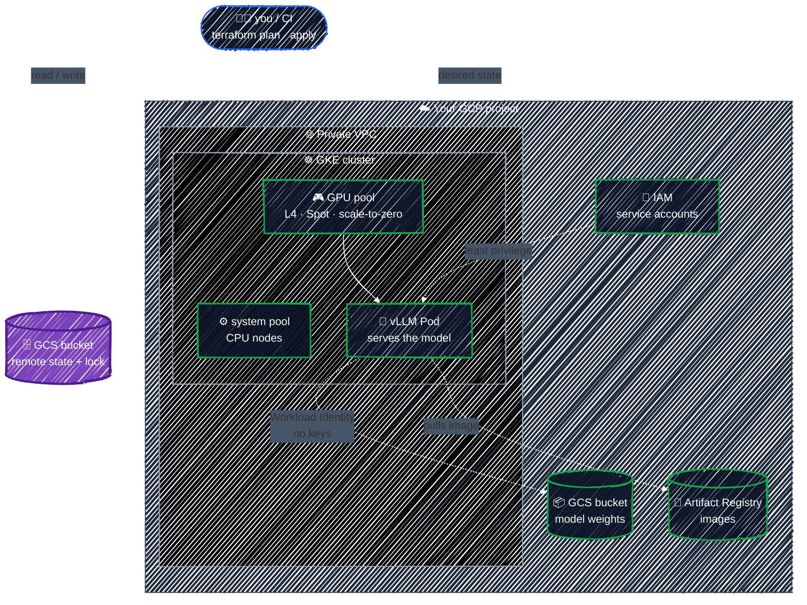

# Terraform in Practice

<p align="center">
  
</p>

> _Learn Terraform on Google Cloud by building real infrastructure, one resource at a time, ending with a GPU-backed LLM platform on GKE._


[](LICENSE)

> **Problem**: Clicking through the Cloud Console or pasting `gcloud` commands works once. Then nobody remembers which flags built prod, staging has quietly drifted away from it, and rebuilding after a mistake takes a week of archaeology.
>
> **Solution**: Terraform lets you *declare* your infrastructure in code, shows you a diff (`plan`) before it changes anything, and records what it manages in *state*, so every environment is reviewable, repeatable, and disposable.

Many Terraform tutorials stop at "create one VM". This one keeps going to the infrastructure that DevOps and AI-infra engineers actually run: **IAM done right, private networking, remote state, modules, CI/CD without keys, and GKE with GPU node pools serving a model**.

Every concept comes with a runnable example under `examples/`. They all build toward one concrete outcome: **an LLM inference platform on GKE**: a custom VPC, a GKE cluster, a Spot GPU node pool that scales to zero, a GCS bucket for model weights, Workload Identity, and vLLM serving a small open model. Then you tear it all down and confirm the bill stops.

> **No prior Terraform experience assumed.** If you're new to Terraform, read top to bottom. If you already know the basics, jump to the [Table of Contents](#table-of-contents). Kubernetes basics help in Part 5; see the companion [k8s-tutorial](https://github.com/r97221004/k8s-tutorial).

**What you'll have built by the capstone:**



> Every box above is a Terraform resource you write, `plan`, and understand. There's no ClickOps step hiding underneath.

## What You'll Learn

By the end you'll be able to:

- **Explain the Terraform model**: configuration, providers, the plan/apply loop, and why state exists.
- **Write idiomatic HCL**: variables, outputs, `for_each`, `lifecycle`, and functions, without copy-paste.
- **Run state like a team**: a GCS backend with locking, plus drift detection and refactoring with `moved`, `import`, and `removed`.
- **Build GCP foundations correctly**: enabled APIs, least-privilege IAM (and the `_iam_policy` vs. `_iam_member` trap), a private VPC with Cloud NAT, and secrets.
- **Package and promote**: write your own modules, consume registry modules, and separate dev from prod.
- **Stand up AI infrastructure**: GKE, GPU node pools with Spot and scale-to-zero, Workload Identity, and model storage.
- **Ship it safely**: `terraform test`, linting, security scanning, and GitHub Actions that authenticate to GCP with no JSON keys.
- **Tie it all together** in the [capstone](docs/capstone/llm-platform.md): an LLM inference platform you can build, use, and destroy on demand.

Every section is hands-on: you write some HCL, run `terraform plan`, read the diff, and `apply` it.

## Prerequisites

- A Linux, macOS, or WSL2 shell with basic command-line familiarity.
- A **Google Cloud account with billing enabled**. Free trial credit covers Parts 1–4, but **free trial accounts can't use GPUs**: Part 5 and the capstone need a paid account (your remaining credit carries over) and GPU quota. [Setup](docs/getting-started/setup.md#4-create-a-sandbox-project) explains both.
- Terraform **1.11+** and the **gcloud CLI**. [Setup](docs/getting-started/setup.md) walks you through both.

> 💸 **About cost.** Parts 1–4 use resources that are free or cost cents (GCS buckets, VPCs, service accounts, firewall rules). Part 5 and the capstone run **GKE and GPUs, which bill by the hour**. Every chapter ends with a cleanup step, Setup has you create a **budget alert** before anything else, and the [Cost Guide](docs/appendix/cost-guide.md) lists what each part costs. Use a dedicated sandbox project so that deleting the whole project is always your last-resort cleanup.

Before starting Part 1, check that your tools work:

```bash
terraform version                          # Terraform v1.11 or newer
gcloud config get-value project            # your sandbox project ID
gcloud auth application-default print-access-token > /dev/null && echo "ADC OK"
```

If any of these fail, finish [Setup](docs/getting-started/setup.md) first.

## Table of Contents

**Getting Started**

- [**What is Terraform?**](docs/getting-started/what-is-terraform.md): Infrastructure as Code, and the one idea behind everything.
- [**Setup**](docs/getting-started/setup.md): Terraform, gcloud, a sandbox project, a budget alert, and ADC.
- [**Core Workflow**](docs/getting-started/core-workflow.md): `init` → `plan` → `apply` → `destroy` on your first GCS bucket.
- [**Anatomy of HCL**](docs/getting-started/hcl-anatomy.md): blocks, arguments, and expressions.

**Part 1 — Core Language**

- [**Providers & Version Pinning**](docs/core-language/providers.md): `google` vs. `google-beta`, and the lock file.
- [**Resources & Data Sources**](docs/core-language/resources-and-data-sources.md): manage vs. read.
- [**Variables, Locals & Outputs**](docs/core-language/variables-and-outputs.md): inputs, computed values, and results.
- [**Expressions & Functions**](docs/core-language/expressions.md): `for`, conditionals, and `terraform console`.
- [**Meta-Arguments**](docs/core-language/meta-arguments.md): `count`, `for_each`, `depends_on`, and `lifecycle`.

**Part 2 — State**

- [**State & Drift**](docs/state/state-basics.md): what state is and how to inspect it.
- [**Remote Backend on GCS**](docs/state/remote-backend.md): shared state with locking.
- [**Refactoring: moved, import, removed**](docs/state/refactoring.md): change addresses without destroying anything.

**Part 3 — GCP Foundations**

- [**Projects & APIs**](docs/gcp-foundations/projects-and-apis.md): enabling services and labeling everything.
- [**IAM & Service Accounts**](docs/gcp-foundations/iam.md): least privilege, and the authoritative-binding trap.
- [**Networking**](docs/gcp-foundations/networking.md): VPC, secondary ranges, Cloud NAT, and firewall rules.
- [**Secret Manager & Sensitive Values**](docs/gcp-foundations/secrets.md): secrets, and why state is sensitive.

**Part 4 — Modules & Environments**

- [**Writing Modules**](docs/modules/writing-modules.md): reusable units with a clean interface.
- [**Using Registry Modules**](docs/modules/registry-modules.md): `terraform-google-modules`, pinned and understood.
- [**Environments**](docs/modules/environments.md): dev and prod without copy-paste drift.

**Part 5 — Kubernetes & AI Infra on GCP**

- [**GKE Cluster**](docs/ai-infra/gke-cluster.md): Autopilot vs. Standard, private clusters, and release channels.
- [**GPU Node Pools**](docs/ai-infra/gpu-node-pools.md): taints, drivers, Spot, scale-to-zero, and quotas.
- [**Workload Identity Federation for GKE**](docs/ai-infra/workload-identity.md): Pods that reach GCP with no keys.
- [**Model Storage & Artifact Registry**](docs/ai-infra/model-storage.md): where weights and images live.
- [**Kubernetes & Helm Providers**](docs/ai-infra/kubernetes-and-helm.md): deploy onto GKE, and the two-stage apply problem.

**Part 6 — Team Workflow**

- [**Testing & Code Quality**](docs/team-workflow/testing-and-quality.md): `fmt`, `validate`, tflint, and `terraform test`.
- [**Security Scanning**](docs/team-workflow/security-scanning.md): Trivy and Checkov before apply.
- [**CI/CD with GitHub Actions**](docs/team-workflow/ci-cd.md): keyless auth, plan on PR, apply on merge.

**Capstone**

- [**LLM Inference Platform on GKE**](docs/capstone/llm-platform.md): everything above, end to end.
- [**Cleanup**](docs/capstone/cleanup.md): tear it down and confirm the bill stops.

**Appendix**

- [**Terraform Cheat Sheet**](docs/appendix/cheatsheet.md): one-page reference.
- [**Troubleshooting**](docs/appendix/troubleshooting.md): symptom → cause → fix.
- [**GCP Cost Guide**](docs/appendix/cost-guide.md): what costs money, and how to keep it near zero.
- [**Further Reading**](docs/appendix/further-reading.md): advanced topics beyond this guide.

## License

[MIT](LICENSE)
