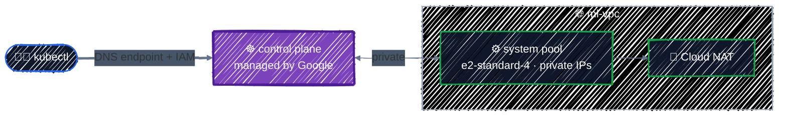

# GKE Cluster

> Autopilot vs. Standard, private clusters, and release channels.

---

Part 6 builds the AI platform layer by layer, and this chapter lays the base: a **GKE cluster** in the private network from Part 4, with private nodes, Workload Identity, and a small CPU node pool for system workloads. The next chapter adds GPUs to it; the ones after give Pods access to model weights and deploy a model server.

> 💸 **This chapter starts costing money.** A GKE cluster with one `e2-standard-4` node runs roughly **$0.10–0.25 an hour** depending on free-tier credits (see [Cost](#cost) below). Keep the cluster for the rest of Part 6, and run the [cleanup](#clean-up) when you stop for the day.

## Before you start

```bash
cd examples/ai-infra/gke-cluster
terraform init
```

```
- network in ../../modules/writing-modules/modules/vpc
```

The configuration reuses the network module from [Writing Modules](../modules/writing-modules.md) with the same names and ranges as [Networking](../gcp-services/networking.md). If you still have that chapter's network applied, destroy it first.

## What you're building



```
Plan: 13 to add, 0 to change, 0 to destroy.
```

Seven resources for the network module, three API enablements, a node service account and its role, the cluster, and its system node pool.

## Autopilot or Standard?

GKE comes in two modes:

| | Autopilot | Standard |
|---|---|---|
| Nodes | Google creates and sizes them for your Pods | you define node pools: machine types, GPUs, scaling |
| Billing | per Pod resource request | per node VM, whether busy or not |
| GPUs | yes: request them in the Pod spec | yes: in node pools you define |
| Control | less: no SSH, restricted privileged Pods, Google's choices | full |
| Terraform | `enable_autopilot = true`, no node pools | `google_container_cluster` plus `google_container_node_pool`s |

**Autopilot** is a strong default for application teams: no nodes to manage, and you only pay for what Pods request. **This guide uses Standard** because it's the one where infrastructure decisions are yours to make, and to understand: which GPU, which zones, Spot or on-demand, how far to scale down. Those are exactly the decisions an AI-infra engineer is responsible for. Everything about the network, IAM, and Workload Identity applies to both.

## The cluster

The cluster, its system node pool, and the node service account live in a **shared module**, [`examples/ai-infra/modules/gke-cluster`](../../examples/ai-infra/modules/gke-cluster/), so that the [capstone](../capstone/llm-platform.md) builds exactly the same cluster from exactly the same code. This chapter's root, in [`cluster.tf`](../../examples/ai-infra/gke-cluster/cluster.tf), just wires it to the network:

```hcl
module "gke" {
  source = "../modules/gke-cluster"

  project_id   = var.project_id
  zone         = var.zone
  cluster_name = var.cluster_name

  network_id          = module.network.network_id
  subnet_id           = module.network.subnet_id
  pods_range_name     = module.network.pods_range_name
  services_range_name = module.network.services_range_name

  authorized_cidrs = var.authorized_cidrs

  # So that `terraform destroy` works in this tutorial. Leave it true for real clusters.
  deletion_protection = false

  # Everything in the module waits for the APIs.
  depends_on = [google_project_service.enabled]
}
```

`depends_on` on a **module** applies to everything inside it, here so that nothing is created before the Compute, Container, and IAM APIs are enabled. The rest of this section walks through the module's [`main.tf`](../../examples/ai-infra/modules/gke-cluster/main.tf), piece by piece.

### Zonal, with separately managed node pools

```hcl
resource "google_container_cluster" "ml" {
  project  = var.project_id
  name     = var.cluster_name
  location = var.zone # a zone: a zonal cluster. A region would make it regional.

  network    = var.network_id
  subnetwork = var.subnet_id

  # Manage node pools as separate resources, so they can change independently.
  remove_default_node_pool = true
  initial_node_count       = 1
  ...
}
```

- **`location`** decides zonal or regional. A **zonal** cluster has one control plane in one zone; a **regional** one has three, survives a zone outage, and is what production should use. Zonal is cheaper for learning, because GKE's free tier credit applies to one zonal (or Autopilot) cluster per billing account. Node pools of a zonal cluster can still spread across other zones in the region, which matters for finding GPUs.
- **`remove_default_node_pool = true`** with **`initial_node_count = 1`** is the standard idiom. GKE insists on creating a default pool with the cluster; this deletes it right away, so every node pool is its own `google_container_node_pool` resource. Changing a pool defined inside the cluster resource can force replacing the **whole cluster**; a separate resource only ever replaces the pool.
- **`network`** and **`subnetwork`** come from the `vpc` module's outputs, passed in by the root. Referring to them also makes the cluster wait for the network.

### Release channel

```hcl
  release_channel {
    channel = "REGULAR"
  }
```

GKE upgrades the control plane and nodes automatically; the **release channel** decides how quickly you get new Kubernetes versions. `RAPID` gets them first, `STABLE` last, and `REGULAR` is the balanced default. Don't pin a version and turn upgrades off: unsupported versions are upgraded anyway, on Google's schedule rather than yours. Instead, choose a channel and add a `maintenance_policy` window for when upgrades may happen.

### VPC-native, private nodes

```hcl
  ip_allocation_policy {
    cluster_secondary_range_name  = var.pods_range_name
    services_secondary_range_name = var.services_range_name
  }

  private_cluster_config {
    enable_private_nodes = true
  }
```

- **`ip_allocation_policy`** makes the cluster VPC-native, taking Pod and Service IPs from the subnet's `pods` and `services` ranges, planned in [Networking](../gcp-services/networking.md#preparing-for-gke-secondary-ranges).
- **`enable_private_nodes`** gives nodes no public IP addresses. They reach the internet through the network's Cloud NAT, and Google APIs through Private Google Access.

### Reaching the control plane: the DNS endpoint

```hcl
  control_plane_endpoints_config {
    dns_endpoint_config {
      allow_external_traffic = true
    }
  }

  master_authorized_networks_config {
    gcp_public_cidrs_access_enabled = false

    dynamic "cidr_blocks" {
      for_each = var.authorized_cidrs
      content {
        cidr_block = cidr_blocks.value
      }
    }
  }
```

The control plane is reachable two ways:

- **The DNS endpoint** (`gke-….goog`) checks **IAM** on every request: only principals with the right permission on the cluster get through, from anywhere. It's how you'll run `kubectl`, with no IP allowlist to maintain, and it works from a laptop, Cloud Shell, or CI alike.
- **The IP endpoint** is restricted with **authorized networks**. Here, no networks are authorized by default (`var.authorized_cidrs` is empty), so only the nodes and Google's own services use it. Add CIDR blocks only if a tool truly needs the IP endpoint.

### Workload Identity, add-ons, cost allocation

```hcl
  workload_identity_config {
    workload_pool = "${var.project_id}.svc.id.goog"
  }

  addons_config {
    # Mount GCS buckets into Pods: used for model weights later.
    gcs_fuse_csi_driver_config {
      enabled = true
    }
  }

  # Break down the bill by namespace and label.
  cost_management_config {
    enabled = true
  }
```

- **`workload_identity_config`** lets Pods authenticate to Google APIs as Kubernetes service accounts, with no keys. [Workload Identity](workload-identity.md) puts it to use.
- **The Cloud Storage FUSE CSI driver** mounts a GCS bucket into a Pod as a directory. [Model Storage](model-storage.md) uses it to serve model weights to vLLM.
- **GKE cost allocation** adds namespace and Kubernetes label breakdowns to the billing export, so "what does the vLLM namespace cost?" has an answer. Labels are covered in [Projects & APIs](../gcp-foundations/projects-and-apis.md#labeling-everything).

### `deletion_protection`

```hcl
  # The google provider protects clusters by default. The chapter examples
  # pass false so that `terraform destroy` works; keep true for real clusters.
  deletion_protection = var.deletion_protection
```

The google provider protects clusters by default: with `deletion_protection` unset or `true`, `terraform destroy` fails instead of deleting the cluster. The module's variable defaults to `true`, the safe choice; this chapter's root passes `false` so that the tutorial's cleanup works. **Leave it at the default for real clusters**, and set it to `false` in a separate, reviewed change only when you really mean to delete one.

## The system node pool

```hcl
resource "google_container_node_pool" "system" {
  project  = var.project_id
  name     = "system"
  cluster  = google_container_cluster.ml.id
  location = var.zone

  autoscaling {
    min_node_count = 1
    max_node_count = 3
  }

  node_config {
    machine_type    = var.system_machine_type # e2-standard-4 by default
    disk_size_gb    = 50
    service_account = google_service_account.nodes.email
    oauth_scopes    = ["https://www.googleapis.com/auth/cloud-platform"]

    workload_metadata_config {
      mode = "GKE_METADATA" # required for Workload Identity
    }

    shielded_instance_config {
      enable_secure_boot = true
    }
    ...
  }
}
```

- **A small, always-on CPU pool** runs cluster services: DNS, metrics, and the GCS FUSE driver's sidecars. GPU nodes, added next chapter, will only run GPU workloads and scale to zero when idle.
- **`service_account`** is a dedicated SA, from the module's [`nodes-sa.tf`](../../examples/ai-infra/modules/gke-cluster/nodes-sa.tf), never the Compute Engine default ([IAM](../gcp-foundations/iam.md#service-accounts-one-per-workload)). It gets one role, **`roles/container.defaultNodeServiceAccount`**, which covers what every node needs, such as writing logs and metrics. Reading images from your own Artifact Registry repository is granted on the repository itself in [Model Storage](model-storage.md).
- **`oauth_scopes = cloud-platform`** looks broad, but scopes are a legacy second filter. With a least-privilege SA, IAM is what actually limits access, and the broad scope avoids confusing "access denied" errors.
- **`workload_metadata_config { mode = "GKE_METADATA" }`** makes Pods on these nodes use Workload Identity instead of the node's SA.
- **`autoscaling`** lets the pool grow to 3 nodes if system Pods need room, and shrink back to 1.

## Apply it

```bash
terraform apply    # takes about 10 minutes, mostly creating the cluster
terraform output
```

```
cluster_location = "us-central1-a"
cluster_name = "ml-gke"
get_credentials = "gcloud container clusters get-credentials ml-gke --location us-central1-a --project tf-tutorial-3fa9c1 --dns-endpoint"
node_service_account = "gke-nodes@tf-tutorial-3fa9c1.iam.gserviceaccount.com"
```

Then connect `kubectl`. Install it and GKE's auth plugin first, if you haven't:

```bash
gcloud components install kubectl gke-gcloud-auth-plugin   # or: sudo apt-get install kubectl google-cloud-cli-gke-gcloud-auth-plugin
$(terraform output -raw get_credentials)
kubectl get nodes
```

```
NAME                                 STATUS   ROLES    AGE   VERSION
gke-ml-gke-system-xxxxxxxx-xxxx      Ready    <none>   3m    v1.3x.x-gke.xxxx
```

The node has no external IP (`kubectl get nodes -o wide` shows `<none>`), and `kubectl` reached the control plane through the DNS endpoint. Your access comes from IAM: as project Owner you have it; teammates need a role such as `roles/container.developer`.

## Cost

| Item | Rough cost (us-central1) |
|---|---|
| GKE cluster management fee | $0.10 per hour per cluster; the free tier credit covers one zonal or Autopilot cluster per billing account |
| `e2-standard-4` system node | about $0.13 per hour on-demand |
| Cloud NAT, network, firewall | close to nothing at this scale |

Check current prices on the [GKE pricing](https://cloud.google.com/kubernetes-engine/pricing) and [VM pricing](https://cloud.google.com/compute/vm-instance-pricing) pages; the [Cost Guide](../appendix/cost-guide.md) has the whole guide's numbers in one place.

## Checkpoint

1. Private GKE nodes have no public IPs. Which components let them reach Google APIs and other outbound destinations?
2. Why manage the system node pool separately from the cluster's default pool?
3. What should `deletion_protection` normally be in production, and why is the lab different?

<details>
<summary>Answer</summary>

1. Private Google Access reaches Google APIs without public node IPs; Cloud NAT provides other outbound internet access. Firewall and routing still apply.
2. A separate resource gives lifecycle, autoscaling, machine type, service account, and upgrades an explicit boundary instead of tying node changes to cluster creation.
3. Normally `true` in production to block accidental cluster deletion. The lab sets it false so cleanup is reliable and ongoing charges can be stopped.

</details>

## Best practices

- **Regional clusters for production**, zonal for learning and development.
- **Remove the default node pool** and manage every pool as its own resource.
- **Pick a release channel** and a maintenance window; don't freeze versions.
- **Private nodes, always.** Egress through Cloud NAT, Google APIs through Private Google Access.
- **Reach the control plane through the DNS endpoint with IAM**, rather than maintaining IP allowlists.
- **A dedicated node service account** with `roles/container.defaultNodeServiceAccount`, and `GKE_METADATA` on every pool.
- **Keep `deletion_protection` on** for anything that matters.
- **Enable cost allocation**, so GPU spend can be traced to namespaces and teams.

## Clean up

If you're continuing to the next chapter, keep the cluster. When you stop for the day:

```bash
terraform destroy    # about 10 minutes
```

Destroying the cluster removes its node pools too. Later chapters can be re-applied on top of a fresh cluster at any time.

---

[← Environments](../modules/environments.md) · [↑ Contents](../../README.md) · [GPU Node Pools →](gpu-node-pools.md)
