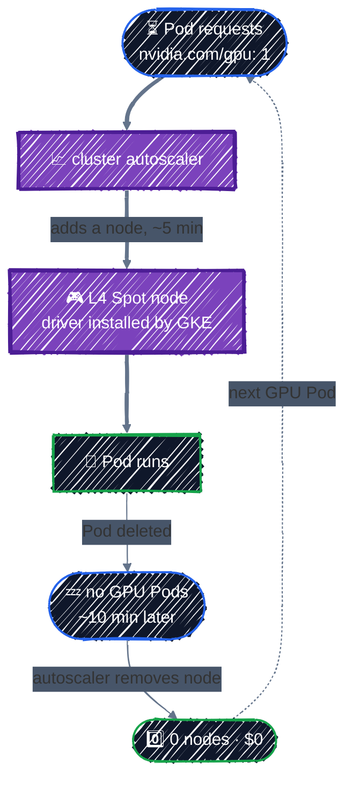

# GPU Node Pools

> L4/T4 pools with taints, driver install, Spot, scale-to-zero, and quotas.

---

GPUs are the most expensive thing in an AI platform, so the infrastructure around them is mostly about **not paying for them when you're not using them**. This chapter adds an NVIDIA L4 node pool to the cluster from [GKE Cluster](gke-cluster.md), on **Spot** VMs, that **scales to zero** when no GPU workload is running, and shows the quota you need before any of it can work.

## Before you start

You need the cluster from the previous chapter, applied and running. Then:

```bash
cd examples/ai-infra/gpu-node-pools
terraform init
```

### GPU quota, first

**A new project can't create any GPUs.** Quota for GPUs starts at zero, and free trial accounts can't get any (see [Connecting to GCP](../state/google-provider.md#3-create-a-sandbox-project)). Check yours:

```bash
gcloud compute regions describe "$TF_VAR_region" \
  --flatten=quotas --format="table(quotas.metric,quotas.limit,quotas.usage)" | grep -E "L4|GPUS"
gcloud compute project-info describe --flatten=quotas \
  --format="table(quotas.metric,quotas.limit)" | grep GPUS_ALL_REGIONS
```

You need, for this chapter:

| Quota | Scope | Needed |
|---|---|---|
| `PREEMPTIBLE_NVIDIA_L4_GPUS` | per region | 1 (Spot GPUs use the preemptible quota) |
| `GPUS_ALL_REGIONS` | per project, all regions | 1 |

If either is 0, request an increase in the Console under **IAM & Admin → Quotas & System Limits**. Small requests on a paid account are usually approved within minutes to a couple of days. Terraform can't do this step for you, so do it now.

## What you're adding



The pool exists all the time, but its nodes only exist while a Pod needs a GPU. Between experiments, the GPU part of your bill is zero.

## Finding the cluster: a data source

This configuration doesn't create the cluster; the GKE Cluster chapter's configuration owns it. Following [Environments](../modules/environments.md#splitting-by-component-too), it **looks the cluster up** instead. From [`main.tf`](../../examples/ai-infra/gpu-node-pools/main.tf):

```hcl
# The cluster is owned by the GKE Cluster chapter's configuration. This
# configuration only adds a node pool to it, so it looks the cluster up.
data "google_container_cluster" "ml" {
  name     = var.cluster_name
  location = var.zone
}

locals {
  # Created in the GKE Cluster chapter; referred to by its well-known name.
  node_service_account = "gke-nodes@${var.project_id}.iam.gserviceaccount.com"
}
```

Two ways of connecting to another configuration's resources, side by side: a **data source** for the cluster, which fails early if it doesn't exist, and a **known name** for the node service account. If the cluster isn't there, `plan` stops before anything is created:

```
Error: projects/tf-tutorial-3fa9c1/locations/us-central1-a/clusters/ml-gke-typo not found

  with data.google_container_cluster.ml,
  on main.tf line 3, in data "google_container_cluster" "ml":
   3: data "google_container_cluster" "ml" {
```

Keeping the GPU pool in its own configuration also has a practical benefit: you can destroy and recreate it (to try another GPU type, say) without touching the cluster's state.

## The GPU node pool

The pool itself is a shared module, [`examples/ai-infra/modules/gpu-node-pool`](../../examples/ai-infra/modules/gpu-node-pool/), which the [capstone](../capstone/llm-platform.md) uses too. The root passes it the cluster it found:

```hcl
module "gpu_pool" {
  source = "../modules/gpu-node-pool"

  project_id           = var.project_id
  cluster_id           = data.google_container_cluster.ml.id
  zone                 = var.zone
  node_service_account = local.node_service_account

  gpu_zones     = var.gpu_zones
  max_gpu_nodes = var.max_gpu_nodes
}
```

Inside the module, [`main.tf`](../../examples/ai-infra/modules/gpu-node-pool/main.tf):

```hcl
resource "google_container_node_pool" "l4_spot" {
  project  = var.project_id
  name     = var.name
  cluster  = var.cluster_id
  location = var.zone

  # Nodes may be created in any of these zones (all in the cluster's region).
  node_locations = var.gpu_zones

  # Start with no nodes; the cluster autoscaler adds them when a Pod asks for a GPU.
  initial_node_count = 0

  autoscaling {
    total_min_node_count = 0 # scale to zero when no GPU Pods are running
    total_max_node_count = var.max_gpu_nodes
    location_policy      = "ANY" # take capacity in whichever zone has it (best for Spot)
  }

  node_config {
    machine_type = var.machine_type # g2-standard-4: 4 vCPU, 16 GB RAM, 1 x NVIDIA L4 (24 GB)
    spot         = var.spot         # 60-90% cheaper; can be reclaimed at any time

    guest_accelerator {
      type  = var.gpu_type
      count = 1

      # GKE installs the NVIDIA driver itself.
      gpu_driver_installation_config {
        gpu_driver_version = "LATEST"
      }
    }

    disk_type    = "pd-balanced"
    disk_size_gb = 100 # model-serving images are large
    ...
  }
}
```

The module's defaults (`l4-spot`, `g2-standard-4`, `nvidia-l4`, `spot = true`) are this guide's choices; another GPU is a different set of inputs, not a different module. The plan:

```
  # module.gpu_pool.google_container_node_pool.l4_spot will be created
  + resource "google_container_node_pool" "l4_spot" {
      + cluster                     = "projects/tf-tutorial-3fa9c1/locations/us-central1-a/clusters/ml-gke"
      + initial_node_count          = 0
      + node_locations              = [
          + "us-central1-a",
          + "us-central1-b",
          + "us-central1-c",
        ]
      + autoscaling {
          + location_policy      = "ANY"
          + total_max_node_count = 1
          + total_min_node_count = 0
        }
      + node_config {
          + machine_type       = "g2-standard-4"
          + spot               = true
          + guest_accelerator {
              + count = 1
              + type  = "nvidia-l4"
              + gpu_driver_installation_config {
                  + gpu_driver_version = "LATEST"
                }
            }
          ...
```

### Choosing the GPU

GPU type and machine type go together: each GPU is available on specific machine families.

| GPU | Memory | Machine family | Good for |
|---|---|---|---|
| NVIDIA T4 | 16 GB | `n1-standard-*` + `guest_accelerator` | small models, older and cheapest |
| **NVIDIA L4** | 24 GB | `g2-standard-*` (GPU built in) | **inference of models up to ~8B parameters**; this guide's choice |
| NVIDIA A100 | 40/80 GB | `a2-*` | large models, training |
| NVIDIA H100 | 80 GB | `a3-*` | the largest models, training |

L4 on `g2-standard-4` is the sweet spot for serving a small open model: modern (supports FP8 and BF16), widely available in `us-central1`, and far cheaper than A100s. Check which zones offer a GPU with `gcloud compute accelerator-types list --filter="name=nvidia-l4"`.

### Drivers: let GKE install them

`gpu_driver_installation_config { gpu_driver_version = "LATEST" }` makes GKE install the NVIDIA driver when each node boots. You don't run a driver DaemonSet or build a custom image. `DEFAULT` picks the version GKE has tested for the node's GKE version; `LATEST` picks the newest available, which newer CUDA images often need.

### Spot

`spot = true` puts the nodes on **Spot VMs**: the same hardware at a large discount (often 60–90%), in exchange for Google being able to reclaim the VM at any time, with about 30 seconds' notice.

| Use Spot for | Avoid Spot for |
|---|---|
| inference with retries, dev and test, experiments | long training runs without checkpoints |
| batch jobs that can restart | the only replica of a production endpoint |

For model serving, Spot works well when there are several replicas, or when a few minutes of downtime during a reclaim is acceptable, as in this guide. For production, a common pattern is two pools: a small on-demand pool for the baseline, and a Spot pool for extra capacity.

### Scale to zero, across zones

- **`initial_node_count = 0`** and **`total_min_node_count = 0`** mean the pool usually has no nodes at all.
- **`total_max_node_count`** caps the whole pool (all zones together). Keep it within your GPU quota: the autoscaler can't create nodes beyond quota anyway, but the cap keeps a runaway deployment from trying.
- **`node_locations`** with three zones, plus **`location_policy = "ANY"`**, lets the autoscaler put a node wherever L4 Spot capacity exists right now. GPUs, especially Spot GPUs, regularly run out in a single zone; three zones is the cheapest reliability improvement there is.

### Taints: keeping CPU Pods off GPU nodes

GKE automatically adds a **taint** to every GPU node, `nvidia.com/gpu=present:NoSchedule`, so ordinary Pods are never scheduled there. Pods that request a GPU (`nvidia.com/gpu` in their resource limits) get a matching **toleration** added automatically. That's why the configuration doesn't declare a taint: it would only duplicate GKE's, and it's the request for `nvidia.com/gpu` that matters.

GKE also labels GPU nodes, which Pods can select on:

| Label | Example value |
|---|---|
| `cloud.google.com/gke-accelerator` | `nvidia-l4` |
| `cloud.google.com/gke-spot` | `true` |
| `cloud.google.com/gke-nodepool` | `l4-spot` |

## Apply it

```bash
terraform plan    # Plan: 1 to add, 0 to change, 0 to destroy.
terraform apply
kubectl get nodes
```

The pool is created with **no nodes**: `kubectl get nodes` still shows only the system node. Now ask for a GPU with [`gpu-test.yaml`](../../examples/ai-infra/gpu-node-pools/gpu-test.yaml):

```yaml
apiVersion: v1
kind: Pod
metadata:
  name: gpu-test
spec:
  restartPolicy: Never
  nodeSelector:
    cloud.google.com/gke-accelerator: nvidia-l4
    cloud.google.com/gke-spot: "true"
  containers:
    - name: nvidia-smi
      image: nvidia/cuda:12.4.1-base-ubuntu22.04
      command: ["nvidia-smi"]
      resources:
        limits:
          nvidia.com/gpu: 1
```

```bash
kubectl apply -f gpu-test.yaml
kubectl get pod gpu-test -w          # Pending for a few minutes, then Completed
kubectl get events --field-selector involvedObject.name=gpu-test | grep -i scale
kubectl logs gpu-test                # the nvidia-smi table, showing one NVIDIA L4
```

While the Pod is `Pending`, the cluster autoscaler sees that no node can run it, finds that the `l4-spot` pool could, and adds a node (`TriggeredScaleUp` in the events). The new node boots, GKE installs the driver, and the Pod runs.

Then delete the Pod and watch the node disappear:

```bash
kubectl delete pod gpu-test
kubectl get nodes -w                 # the GPU node is removed after ~10 idle minutes
```

If the Pod stays `Pending` with `FailedScaleUp` events, the usual causes are quota (`GPUS_ALL_REGIONS` or `PREEMPTIBLE_NVIDIA_L4_GPUS` is 0) or no Spot L4 capacity in any listed zone right now. [Troubleshooting](../appendix/troubleshooting.md) covers both.

## Cost

| Item | Rough cost (us-central1) |
|---|---|
| `g2-standard-4` with 1 × L4, on-demand | about $0.70 per hour |
| Same, Spot | typically a third of that or less; Spot prices vary |
| The pool with 0 nodes | $0 |

Check the [GPU pricing](https://cloud.google.com/compute/gpus-pricing) and [Spot VM pricing](https://cloud.google.com/spot-vms/pricing) pages for current numbers. The point of the configuration above is that you pay these rates only for the minutes a GPU Pod actually runs.

## Checkpoint

1. The GPU pool has zero nodes. What event causes a node to appear, and what must the Pod request?
2. When is Spot appropriate, and what behavior must the workload tolerate?
3. Why combine a GPU request, node selector, and taint/toleration instead of relying on only one scheduling control?

<details>
<summary>Answer</summary>

1. An unschedulable Pod requesting `nvidia.com/gpu` triggers the cluster autoscaler to add a matching GPU node, subject to quota and capacity.
2. Use Spot for restartable inference, tests, and checkpointed jobs. The workload must tolerate interruption and retry elsewhere because capacity can be reclaimed at any time.
3. The request allocates the device, the selector chooses the intended accelerator, and the taint keeps unrelated Pods off expensive nodes. Together they prevent both under-allocation and accidental GPU spending.

</details>

## Best practices

- **Request GPU quota before you need it**, for the exact GPU and both on-demand and preemptible variants if you'll use both.
- **Keep GPU pools in their own configuration**, looking up the cluster with a data source.
- **Scale GPU pools to zero** (`initial_node_count = 0`, `total_min_node_count = 0`) unless something must always run.
- **Spread pools across zones** with `location_policy = "ANY"`, especially for Spot.
- **Use Spot for anything that can restart**, and on-demand only for the baseline that can't.
- **Let GKE install drivers** with `gpu_driver_installation_config`.
- **Select GPU nodes by label and request `nvidia.com/gpu`**; GKE handles the taint and toleration.
- **Cap `total_max_node_count`** so a mistake can't scale beyond what you're willing to pay for.

## Clean up

Delete any GPU Pods first, so the pool can scale to zero. Then, if you're stopping for the day:

```bash
terraform destroy
```

An empty pool costs nothing, so you can also keep it for the next chapters.

---

[← GKE Cluster](gke-cluster.md) · [↑ Contents](../../README.md) · [Workload Identity Federation for GKE →](workload-identity.md)
