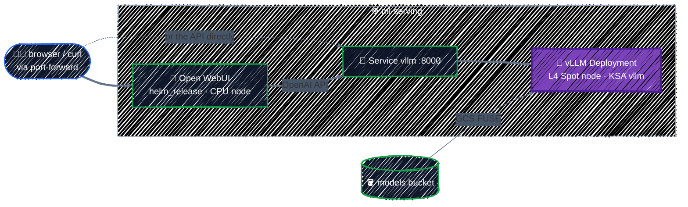

# Kubernetes & Helm Providers

> Deploy onto GKE from Terraform, and the two-stage apply problem.

---

Everything so far created Google Cloud resources. The model server itself is a **Kubernetes** workload: a Deployment, a Service, a service account. Terraform can manage those too, with the **kubernetes** and **helm** providers, so the whole platform comes up with `terraform apply`. This chapter deploys **vLLM** serving the model from [Model Storage](model-storage.md), and **Open WebUI**, a chat interface for it, from a public Helm chart.

## Before you start

You need everything from the previous chapters applied: the cluster, the GPU pool, and the model bucket with the weights uploaded.

```bash
cd examples/ai-infra/kubernetes-and-helm
terraform init
```

```
- Installed hashicorp/helm v3.3.0 (signed by HashiCorp)
- Installed hashicorp/google v8.7.0 (signed by HashiCorp)
- Installed hashicorp/kubernetes v3.3.0 (signed by HashiCorp)
```

## What you're deploying



```
  # module.vllm.helm_release.open_webui[0] will be created
  # module.vllm.kubernetes_deployment_v1.vllm will be created
  # module.vllm.kubernetes_namespace_v1.serving will be created
  # module.vllm.kubernetes_service_account_v1.vllm will be created
  # module.vllm.kubernetes_service_v1.vllm will be created
Plan: 5 to add, 0 to change, 0 to destroy.
```

## Configuring the providers

The kubernetes and helm providers need two things: **where** the cluster's API is, and **credentials** for it. From [`providers.tf`](../../examples/ai-infra/kubernetes-and-helm/providers.tf):

```hcl
# The cluster exists already (GKE Cluster chapter). Read how to reach it.
data "google_container_cluster" "ml" {
  name     = var.cluster_name
  location = var.zone
}

# A short-lived access token for your own Google identity (ADC). Ephemeral:
# it's fetched on every run and never written to state or a plan file.
ephemeral "google_client_config" "current" {}

locals {
  # The DNS endpoint uses a publicly trusted certificate, so no CA bundle is needed.
  cluster_host = "https://${data.google_container_cluster.ml.control_plane_endpoints_config[0].dns_endpoint_config[0].endpoint}"
}

provider "kubernetes" {
  host  = local.cluster_host
  token = ephemeral.google_client_config.current.access_token
}

provider "helm" {
  kubernetes = {
    host  = local.cluster_host
    token = ephemeral.google_client_config.current.access_token
  }
}
```

- **The host** is the cluster's DNS endpoint, read with a data source, the same lookup the [GPU Node Pools](gpu-node-pools.md#finding-the-cluster-a-data-source) chapter used. Connecting through the IP endpoint instead would also need `cluster_ca_certificate`, and an authorized network.
- **The token** comes from the **ephemeral** `google_client_config` resource: an OAuth access token for whoever runs Terraform (your ADC locally, the CI identity in a pipeline). As in [Secret Manager](../gcp-foundations/secrets.md#reading-secrets-in-terraform), ephemeral means it's fetched fresh on each run and never stored. GKE accepts it, and IAM plus Kubernetes RBAC decide what it may do.
- **No kubeconfig file.** Pointing the providers at `~/.kube/config` makes the result depend on whichever cluster your `kubectl` happens to point at. Configure them explicitly, from data.

Older code often uses a `data "google_client_config"` (not ephemeral) for the token. It works, but writes a valid access token into state every run. Prefer the ephemeral resource.

## The two-stage apply problem

Why does this chapter use a separate configuration, reading the cluster with a data source, instead of adding Kubernetes resources to the GKE Cluster chapter's configuration? Try putting both in one:

```hcl
resource "google_container_cluster" "ml" { ... }

provider "kubernetes" {
  host  = "https://${google_container_cluster.ml.endpoint}" # unknown until the cluster exists
  token = ephemeral.google_client_config.current.access_token
}

resource "kubernetes_manifest" "config" { ... }
```

```
Error: Failed to construct REST client

  with kubernetes_manifest.config,
  on main.tf line 20, in resource "kubernetes_manifest" "config":
  20: resource "kubernetes_manifest" "config" {

cannot create REST client: no client config
```

**Providers are configured before resources are planned.** When the cluster doesn't exist yet, its endpoint is `(known after apply)`, so the kubernetes provider has nowhere to connect during `plan`. Some Kubernetes resources can still be planned blind; `kubernetes_manifest` and Helm releases that need the API to plan can't. Even when the first apply works, later changes that **replace** the cluster leave the provider pointing at a cluster that's about to disappear.

The fixes, best first:

| Fix | How | Verdict |
|---|---|---|
| **Separate configurations** | cluster in one root module, workloads in another that reads the cluster with a data source | **the standard answer**; what this guide does |
| `-target` | `terraform apply -target=google_container_cluster.ml`, then a full apply | works once, by hand; easy to forget in CI |
| Everything in one configuration | hope the endpoint is known | breaks on first create or on cluster replacement |

Separate configurations also match the component split from [Environments](../modules/environments.md#splitting-by-component-too): the cluster changes monthly, workloads daily, and they're applied separately anyway.

## The `vllm` module

The workloads are a shared module, [`examples/ai-infra/modules/vllm`](../../examples/ai-infra/modules/vllm/), also used by the [capstone](../capstone/llm-platform.md). This chapter's root, [`main.tf`](../../examples/ai-infra/kubernetes-and-helm/main.tf), only says where the image and the weights are:

```hcl
module "vllm" {
  source = "../modules/vllm"

  image_repository = "${var.region}-docker.pkg.dev/${var.project_id}/dockerhub"
  models_bucket    = "${var.project_id}-models"
  model            = var.model
  vllm_version     = var.vllm_version
}
```

Like every reusable module ([Writing Modules](../modules/writing-modules.md#the-modules-files)), it has no `provider` blocks: it uses the `kubernetes` and `helm` providers configured in the root's `providers.tf` above. Its variables default to the names used throughout Part 5: namespace `ml-serving`, KSA `vllm`, and the Open WebUI chart enabled.

## vLLM with the kubernetes provider

Kubernetes objects map one-to-one onto resources: a manifest's fields become nested blocks. From the module's [`main.tf`](../../examples/ai-infra/modules/vllm/main.tf), the namespace and the KSA that [Workload Identity](workload-identity.md) granted access to:

```hcl
resource "kubernetes_namespace_v1" "serving" {
  metadata {
    name = local.namespace
  }
}

# The KSA that Workload Identity grants objectViewer on the models bucket.
resource "kubernetes_service_account_v1" "vllm" {
  metadata {
    name      = var.ksa_name # "vllm"
    namespace = kubernetes_namespace_v1.serving.metadata[0].name
  }
}
```

The Deployment, trimmed to the parts that matter:

```hcl
resource "kubernetes_deployment_v1" "vllm" {
  ...
  # A GPU node takes several minutes to appear; don't fail the apply meanwhile.
  wait_for_rollout = false

  spec {
    replicas = 1
    ...
    template {
      metadata {
        labels = local.labels
        annotations = {
          "gke-gcsfuse/volumes" = "true" # inject the GCS FUSE sidecar
        }
      }

      spec {
        service_account_name = kubernetes_service_account_v1.vllm.metadata[0].name

        node_selector = {
          "cloud.google.com/gke-accelerator" = "nvidia-l4"
        }

        container {
          name  = "vllm"
          image = local.image
          args = [
            "--model", "/models/${var.model}",
            "--served-model-name", var.model,
            "--max-model-len", "8192",
          ]

          resources {
            requests = { cpu = "2", memory = "8Gi" }
            limits   = { "nvidia.com/gpu" = "1" }
          }

          readiness_probe {
            http_get {
              path = "/health"
              port = 8000
            }
            period_seconds = 10
          }
          ...
        }

        volume {
          name = "models"
          csi {
            driver    = "gcsfuse.csi.storage.gke.io"
            read_only = true
            volume_attributes = {
              bucketName = var.models_bucket
            }
          }
        }

        # Shared memory for PyTorch; the container default (64 MB) is too small.
        volume {
          name = "dshm"
          empty_dir {
            medium     = "Memory"
            size_limit = "2Gi"
          }
        }
      }
    }
  }
}
```

Every line connects to an earlier chapter:

| Setting | Why | From |
|---|---|---|
| `limits = { "nvidia.com/gpu" = "1" }` | requests a GPU; GKE adds the toleration for the GPU taint | [GPU Node Pools](gpu-node-pools.md#taints-keeping-cpu-pods-off-gpu-nodes) |
| `node_selector` on `gke-accelerator` | lands on the L4 pool, and triggers its scale-up from zero | [GPU Node Pools](gpu-node-pools.md) |
| `service_account_name = "vllm"` | the KSA granted `objectViewer` on the bucket | [Workload Identity](workload-identity.md) |
| `gke-gcsfuse/volumes` and the `csi` volume | mounts the models bucket at `/models` | [Model Storage](model-storage.md#how-the-pod-will-read-the-weights) |
| `image` from `…/dockerhub/vllm/vllm-openai:v0.31.0` | pulled through the regional cache, pinned | [Model Storage](model-storage.md#artifact-registry-two-repositories) |
| `wait_for_rollout = false` | the GPU node takes minutes to appear; don't hold the apply | this chapter |

Use the `_v1` resource types (`kubernetes_deployment_v1`, not `kubernetes_deployment`): they're tied to a stable Kubernetes API version, and the unversioned names are deprecated.

## Open WebUI with the helm provider

For software someone else packages, a **Helm chart** is usually the right unit. The `helm_release` resource installs one, from the module's [`webui.tf`](../../examples/ai-infra/modules/vllm/webui.tf):

```hcl
# A chat UI in front of vLLM, from a public Helm chart.
resource "helm_release" "open_webui" {
  count = var.enable_ui ? 1 : 0

  name       = "open-webui"
  namespace  = kubernetes_namespace_v1.serving.metadata[0].name
  repository = "https://helm.openwebui.com"
  chart      = "open-webui"
  version    = "16.6.0" # pin charts exactly, like modules

  values = [yamlencode({
    ollama    = { enabled = false } # we bring our own model server
    pipelines = { enabled = false }
    websocket = { enabled = false }

    # vLLM speaks the OpenAI API; point the UI at its Service.
    openaiBaseApiUrl = "http://${kubernetes_service_v1.vllm.metadata[0].name}.${local.namespace}.svc.cluster.local:8000/v1"
  })]
}
```

The plan shows the values Helm will receive:

```
  + resource "helm_release" "open_webui" {
      + chart                      = "open-webui"
      ...
      + values                     = [
          + <<-EOT
                "ollama":
                  "enabled": false
                "openaiBaseApiUrl": "http://vllm.ml-serving.svc.cluster.local:8000/v1"
                "pipelines":
                  "enabled": false
                "websocket":
                  "enabled": false
            EOT,
        ]
```

- **`values`** takes YAML documents; building them with `yamlencode` keeps them typed and lets you use references, such as the vLLM Service name.
- **Pin `version`.** A chart is code, just like a registry module ([Using Registry Modules](../modules/registry-modules.md#pin-the-version-and-know-what-pinning-covers)). This chart's defaults would install Ollama, Pipelines, and Redis; reading its `values.yaml` before using it is how you find that out.
- **Terraform sees the release, not what's inside it.** The plan shows the values change, not which Deployments the chart will alter. `helm get manifest open-webui -n ml-serving` shows what was actually rendered.

### kubernetes provider, Helm, or neither?

| Tool | Best for |
|---|---|
| **kubernetes provider** | a few objects you own end to end, tightly wired to cloud resources (namespaces, KSAs, small Deployments) |
| **helm provider** | third-party software packaged as charts (UIs, operators, monitoring) |
| **GitOps (Argo CD, Flux)** | application workloads that change daily; Terraform installs the GitOps tool, the tool syncs apps from Git |

A common split in larger teams: Terraform owns the cluster and the platform add-ons; a GitOps tool owns the applications. For one model server, Terraform alone is perfectly reasonable.

## Apply it, and talk to the model

```bash
terraform apply
kubectl -n ml-serving get pods -w
```

The vLLM Pod is `Pending` while the GPU pool scales up from zero (a few minutes), then `ContainerCreating` while the 10 GB image is pulled, then `Running` but not `Ready` while vLLM loads the weights from GCS. When it's `1/1 Ready`:

```bash
$(terraform output -raw port_forward_api) &
curl -s localhost:8000/v1/models | jq '.data[].id'
curl -s localhost:8000/v1/chat/completions -H "Content-Type: application/json" -d '{
  "model": "Qwen2.5-1.5B-Instruct",
  "messages": [{"role": "user", "content": "In one sentence, what is Terraform state?"}]
}' | jq -r '.choices[0].message.content'
```

The first call lists `"Qwen2.5-1.5B-Instruct"`; the second returns the model's answer. vLLM serves the OpenAI API, so any OpenAI-compatible client works by changing its base URL.

For the chat UI:

```bash
$(terraform output -raw port_forward_ui) &
# open http://localhost:8080 and create the first (admin) account
```

Port-forwarding keeps everything private. Exposing either service publicly needs a load balancer with authentication in front, which is beyond this guide.

## Best practices

- **Keep Kubernetes resources in a separate configuration from the cluster**, and find the cluster with a data source.
- **Configure providers from data, not kubeconfig**, with an **ephemeral** `google_client_config` token.
- **Use the `_v1` resource types** of the kubernetes provider.
- **Pin Helm chart versions** and read the chart's `values.yaml` before installing it.
- **Build Helm values with `yamlencode`**, so references and types work.
- **Set `wait_for_rollout = false`** (or long timeouts) for workloads that wait on GPU scale-up.
- **Consider GitOps for frequently changing applications**, with Terraform owning the platform underneath.

## Clean up

Destroy in the reverse order of creation: workloads first, then the infrastructure under them.

```bash
terraform destroy                                   # this chapter
cd ../model-storage && terraform destroy
cd ../gpu-node-pools && terraform destroy
cd ../gke-cluster && terraform destroy
```

Destroying the workloads first lets the GPU node scale back to zero and Kubernetes clean up what it created. That completes Part 5. The [capstone](../capstone/llm-platform.md) builds this whole platform again from one place.

---

[← Model Storage & Artifact Registry](model-storage.md) · [↑ Contents](../../README.md) · [Testing & Code Quality →](../team-workflow/testing-and-quality.md)
