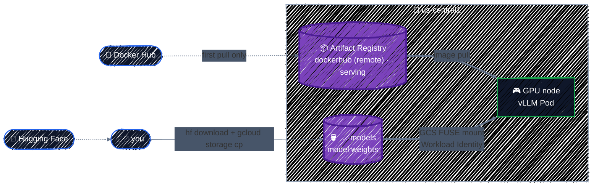

# Model Storage & Artifact Registry

> GCS for model weights, Artifact Registry for images.

---

A model server needs two things that aren't in the cluster: the **model weights** (gigabytes of files) and the **container image** that serves them. This chapter creates a home for each, in the same region as the GPUs, and grants exactly the access needed: the vLLM Pod reads the weights through [Workload Identity](workload-identity.md), and the nodes pull the images.

## Before you start

```bash
cd examples/ai-infra/model-storage
terraform init
```

The model used from here on is **[Qwen2.5-1.5B-Instruct](https://huggingface.co/Qwen/Qwen2.5-1.5B-Instruct)**: Apache-2.0 licensed, not gated (no Hugging Face token needed), about **3.1 GB** of weights, and comfortably small for one L4's 24 GB. Gated models like Llama work the same way, with the token from [Secret Manager](../gcp-foundations/secrets.md).

## Where things live



Everything the GPU node reads is **in its own region**: no cross-region egress charges, low latency, and no dependency on Hugging Face or Docker Hub being reachable when a node starts.

## The configuration

The bucket and repositories are a shared module, [`examples/ai-infra/modules/model-storage`](../../examples/ai-infra/modules/model-storage/), also used by the [capstone](../capstone/llm-platform.md). This chapter's root, [`main.tf`](../../examples/ai-infra/model-storage/main.tf), enables the APIs, builds the Workload Identity principal of the vLLM Pod, and calls the module:

```hcl
data "google_project" "this" {}

locals {
  vllm_principal = "principal://iam.googleapis.com/projects/${data.google_project.this.number}/locations/global/workloadIdentityPools/${var.project_id}.svc.id.goog/subject/ns/${var.namespace}/sa/${var.ksa_name}"
}

# The models bucket and both image repositories, from the shared module.
module "storage" {
  source = "../modules/model-storage"

  project_id                  = var.project_id
  region                      = var.region
  reader_principal            = local.vllm_principal
  node_service_account_member = "serviceAccount:gke-nodes@${var.project_id}.iam.gserviceaccount.com" # GKE Cluster chapter

  depends_on = [google_project_service.enabled]
}
```

The rest of this chapter walks through the module's [`main.tf`](../../examples/ai-infra/modules/model-storage/main.tf).

## The model bucket

```hcl
resource "google_storage_bucket" "models" {
  project  = var.project_id
  name     = "${var.project_id}-models"
  location = var.region # same region as the GPUs

  uniform_bucket_level_access = true
  public_access_prevention    = "enforced"
  force_destroy               = true # weights can be downloaded again; fine for a lab

  # A real directory tree: faster listing and renames through GCS FUSE.
  hierarchical_namespace {
    enabled = true
  }

  # Weights are reproducible, so don't pay to keep deleted copies for 7 days.
  soft_delete_policy {
    retention_duration_seconds = 0
  }

  labels = {
    component = "model-weights"
  }
}
```

[Cloud Storage](../gcp-services/cloud-storage.md) covers locations, storage classes, and these settings in general. The choices that matter for model weights:

- **Regional, in the GPUs' region.** A multi-region bucket (`US`) costs more and reads from GPUs in `us-central1` can cross regions. Weights are read every time a node starts a model server, so locality pays off quickly.
- **Hierarchical namespace** stores folders as real folders instead of name prefixes. Tools that walk directory trees, such as the GCS FUSE mount vLLM reads through, list and open files faster. It must be chosen at creation time and needs uniform bucket-level access.
- **Soft delete off.** By default, GCS keeps deleted objects for 7 days, and bills for them. For multi-gigabyte weights that you can always download again, that's paying to keep garbage. For data you can't recreate (fine-tuned checkpoints, evaluation results), keep soft delete on, or turn on versioning instead.
- **`force_destroy = true`** is for the lab only. A bucket of fine-tuned weights in production should drop `force_destroy` and add `prevent_destroy` ([Meta-Arguments](../core-language/meta-arguments.md#prevent_destroy-a-guard-against-deletion)).

Read access goes to the vLLM Pod's Kubernetes service account, exactly as in [Workload Identity](workload-identity.md):

```hcl
resource "google_storage_bucket_iam_member" "vllm_reads_models" {
  bucket = google_storage_bucket.models.name
  role   = "roles/storage.objectViewer"
  member = var.reader_principal # the vllm KSA's principal, from the root
}
```

## Artifact Registry: two repositories

```hcl
# A remote repository: pulls from Docker Hub on first use and caches the
# image in your region. Nodes reach it through Private Google Access, so
# pulls don't go through Cloud NAT and don't hit Docker Hub's rate limits.
resource "google_artifact_registry_repository" "dockerhub" {
  project       = var.project_id
  location      = var.region
  repository_id = "dockerhub"
  description   = "Pull-through cache of Docker Hub."
  format        = "DOCKER"
  mode          = "REMOTE_REPOSITORY"

  remote_repository_config {
    docker_repository {
      public_repository = "DOCKER_HUB"
    }
  }
}
```

| Repository | Mode | Holds |
|---|---|---|
| `serving` | standard | images you build and push yourself, with a cleanup policy for untagged images |
| `dockerhub` | **remote** | a cache of Docker Hub images, filled on first pull |

The vLLM image is about **10 GB**. Pulling it from Docker Hub on every new GPU node is slow, goes through Cloud NAT (and its data charges), and anonymous pulls are rate-limited. Through the remote repository, only the first pull goes to Docker Hub; every node after that pulls from Artifact Registry in the same region. You refer to it by the repository's path:

```
  + vllm_image         = "us-central1-docker.pkg.dev/tf-tutorial-3fa9c1/dockerhub/vllm/vllm-openai:v0.31.0"
```

That's `docker.io/vllm/vllm-openai:v0.31.0` with the registry prefix replaced. **Pin a version tag** (or better, a digest), never `latest`: a model server that changes version every time a node restarts is impossible to debug.

Nodes pull images as the node service account, so it gets `roles/artifactregistry.reader` on both repositories, granted on each repository rather than the project, as promised in [GKE Cluster](gke-cluster.md#the-system-node-pool):

```hcl
resource "google_artifact_registry_repository_iam_member" "nodes_pull" {
  for_each = {
    serving   = google_artifact_registry_repository.serving.name
    dockerhub = google_artifact_registry_repository.dockerhub.name
  }

  project    = var.project_id
  location   = var.region
  repository = each.value
  role       = "roles/artifactregistry.reader"
  member     = var.node_service_account_member
}
```

## Apply it

```bash
terraform plan    # Plan: 8 to add, 0 to change, 0 to destroy.
terraform apply
```

### Upload the weights

Download the model with the Hugging Face CLI and copy it to the bucket:

```bash
pip install -U "huggingface_hub"
hf download Qwen/Qwen2.5-1.5B-Instruct --local-dir ./Qwen2.5-1.5B-Instruct

gcloud storage cp -r ./Qwen2.5-1.5B-Instruct "gs://$(terraform output -raw models_bucket)/"
gcloud storage ls "gs://$(terraform output -raw models_bucket)/Qwen2.5-1.5B-Instruct/"
```

```
gs://tf-tutorial-3fa9c1-models/Qwen2.5-1.5B-Instruct/config.json
gs://tf-tutorial-3fa9c1-models/Qwen2.5-1.5B-Instruct/generation_config.json
gs://tf-tutorial-3fa9c1-models/Qwen2.5-1.5B-Instruct/merges.txt
gs://tf-tutorial-3fa9c1-models/Qwen2.5-1.5B-Instruct/model.safetensors
gs://tf-tutorial-3fa9c1-models/Qwen2.5-1.5B-Instruct/tokenizer.json
...
```

Why not let Terraform upload the weights with `google_storage_bucket_object`? Terraform would hash a 3 GB file on every plan, store its metadata in state, and the "infrastructure" configuration would depend on a download. Infrastructure (the bucket, its access) belongs in Terraform; data (the weights) gets loaded by a tool or a pipeline built for moving data.

### Warm the image cache

Optional, but it makes the first model server start faster:

```bash
gcloud auth configure-docker us-central1-docker.pkg.dev
docker pull "$(terraform output -raw vllm_image)"
```

## How the Pod will read the weights

The cluster has the **Cloud Storage FUSE CSI driver** enabled ([GKE Cluster](gke-cluster.md#workload-identity-add-ons-cost-allocation)). It mounts the bucket into the Pod as a read-only directory, using the Pod's Workload Identity:

```yaml
metadata:
  annotations:
    gke-gcsfuse/volumes: "true"       # injects the FUSE sidecar
spec:
  serviceAccountName: vllm            # the KSA with objectViewer on the bucket
  containers:
    - name: vllm
      args: ["--model", "/models/Qwen2.5-1.5B-Instruct"]
      volumeMounts:
        - name: models
          mountPath: /models
          readOnly: true
  volumes:
    - name: models
      csi:
        driver: gcsfuse.csi.storage.gke.io
        readOnly: true
        volumeAttributes:
          bucketName: tf-tutorial-3fa9c1-models
```

vLLM sees an ordinary directory and loads the weights from it. The next chapter writes this Pod spec in Terraform.

## Checkpoint

1. Should multi-gigabyte model weights normally be embedded in Terraform resources or uploaded with a data-transfer tool?
2. Why keep the bucket, Artifact Registry, and GPU nodes in the same region?
3. When is disabling soft delete reasonable, and when would it be dangerous?

<details>
<summary>Answer</summary>

1. Use tools such as `gcloud storage cp`; Terraform should manage the bucket, policy, and repositories rather than moving large mutable data through state.
2. Co-location reduces latency, cross-region transfer charges, and dependence on external registries during node startup.
3. It is reasonable for reproducible weights that can be downloaded again and would otherwise incur recovery-storage cost. Keep protection for unique fine-tunes, checkpoints, or irreplaceable data.

</details>

## Best practices

- **Keep weights in a regional bucket in the GPUs' region**, with uniform access and public access prevention.
- **Enable hierarchical namespace** for buckets read through GCS FUSE.
- **Decide soft delete per bucket**: off for reproducible downloads, on (or versioning) for data you can't recreate.
- **Grant `objectViewer` on the bucket to the serving KSA only.** Writers (training jobs, loaders) get their own identity.
- **Pull public images through an Artifact Registry remote repository**, and pin tags or digests.
- **Grant `artifactregistry.reader` per repository** to the node service account.
- **Load data with data tools**, not `google_storage_bucket_object`.

## Clean up

Keep everything for the next chapter. When you're done:

```bash
terraform destroy    # force_destroy deletes the weights too
```

---

[← Workload Identity Federation for GKE](workload-identity.md) · [↑ Contents](../../README.md) · [Kubernetes & Helm Providers →](kubernetes-and-helm.md)
