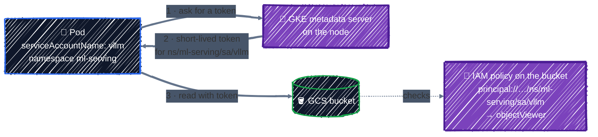

# Workload Identity Federation for GKE

> Let Pods reach GCP APIs with no keys.

---

The vLLM server will run in a Pod and needs to read model weights from GCS, and maybe a token from Secret Manager. The old way to give it access was a service account key in a Kubernetes Secret: a long-lived password, copied into the cluster, readable by anyone who can read Secrets. **Workload Identity Federation for GKE** replaces it: a Pod authenticates as its **Kubernetes service account**, and you grant IAM roles to that Kubernetes service account directly.

## Before you start

You need the cluster from [GKE Cluster](gke-cluster.md), which already has the two settings Workload Identity needs:

| Setting | Where | Effect |
|---|---|---|
| `workload_identity_config { workload_pool = "PROJECT.svc.id.goog" }` | the cluster | Kubernetes service accounts in this project become IAM principals |
| `workload_metadata_config { mode = "GKE_METADATA" }` | every node pool | Pods get credentials from GKE's metadata server, not the node's service account |

```bash
cd examples/ai-infra/workload-identity
terraform init
```

## How it works



1. Google's client libraries and `gcloud` inside the Pod ask for credentials as usual, from the metadata server.
2. With `GKE_METADATA`, GKE's metadata server answers instead of the VM's, and returns a **short-lived token** for the Pod's Kubernetes service account.
3. Google APIs check IAM for **that principal**. No key exists anywhere: nothing to leak, rotate, or revoke.

## Kubernetes service accounts as IAM principals

Every Kubernetes service account (KSA) in the project's clusters has an IAM principal identifier. From [`main.tf`](../../examples/ai-infra/workload-identity/main.tf):

```hcl
data "google_project" "this" {}

locals {
  workload_pool = "${var.project_id}.svc.id.goog"
  pool_path     = "projects/${data.google_project.this.number}/locations/global/workloadIdentityPools/${local.workload_pool}"

  # One Kubernetes service account, as an IAM principal.
  ksa_principal = "principal://iam.googleapis.com/${local.pool_path}/subject/ns/${var.namespace}/sa/${var.ksa_name}"

  # Every service account in the namespace, as an IAM principal set.
  namespace_principals = "principalSet://iam.googleapis.com/${local.pool_path}/namespace/${var.namespace}"
}
```

```
  + ksa_principal        = "principal://iam.googleapis.com/projects/123456789012/locations/global/workloadIdentityPools/tf-tutorial-3fa9c1.svc.id.goog/subject/ns/ml-serving/sa/vllm"
  + namespace_principals = "principalSet://iam.googleapis.com/projects/123456789012/locations/global/workloadIdentityPools/tf-tutorial-3fa9c1.svc.id.goog/namespace/ml-serving"
```

- The identifier uses the **project number**, which is why the configuration reads it with the `google_project` data source ([Resources & Data Sources](../core-language/resources-and-data-sources.md#data-sources)).
- **`principal://…/subject/ns/NAMESPACE/sa/NAME`** is one KSA. That's what you'll grant to in almost all cases.
- **`principalSet://…/namespace/NAMESPACE`** is every KSA in a namespace. Useful when a whole namespace belongs to one team, but broader.

The KSA doesn't have to exist when you grant the role. Terraform only writes an IAM binding, and the binding starts to work as soon as a Pod runs as that KSA.

## Granting access

The grant is an ordinary `_iam_member` from [IAM & Service Accounts](../gcp-foundations/iam.md), with the KSA's principal as the member, on the narrowest resource:

```hcl
# The grant: the Kubernetes service account, directly, on this bucket.
# No Google service account in between.
resource "google_storage_bucket_iam_member" "ksa_reads" {
  bucket = google_storage_bucket.wi_test.name
  role   = "roles/storage.objectViewer"
  member = local.ksa_principal
}
```

```
  # google_storage_bucket_iam_member.ksa_reads will be created
  + resource "google_storage_bucket_iam_member" "ksa_reads" {
      + bucket = "tf-tutorial-3fa9c1-wi-test"
      + member = "principal://iam.googleapis.com/projects/123456789012/locations/global/workloadIdentityPools/tf-tutorial-3fa9c1.svc.id.goog/subject/ns/ml-serving/sa/vllm"
      + role   = "roles/storage.objectViewer"
    }
```

The Pod running as `ml-serving/vllm` can now read objects in this one bucket, and nothing else.

### The older pattern: impersonating a Google service account

Before KSAs could be granted roles directly, every Workload Identity setup went through a Google service account (GSA): the KSA was allowed to impersonate a GSA, and roles were granted to the GSA.

```hcl
resource "google_service_account" "vllm" {
  account_id = "vllm-server"
}

resource "google_service_account_iam_member" "ksa_impersonates_gsa" {
  service_account_id = google_service_account.vllm.name
  role               = "roles/iam.workloadIdentityUser"
  member             = "serviceAccount:${var.project_id}.svc.id.goog[${var.namespace}/${var.ksa_name}]"
}
```

The KSA also needs an annotation, `iam.gke.io/gcp-service-account: vllm-server@PROJECT.iam.gserviceaccount.com`. You'll see this pattern in a lot of existing code. Prefer granting to the KSA directly: there's one identity instead of two, no annotation to keep in sync, and audit logs show the actual workload. Use a GSA only for the few Google APIs that don't yet accept federated principals, or when the same identity must be shared with non-GKE workloads.

### One thing to know: identity sameness

The workload pool is per **project**, not per cluster. A KSA named `ml-serving/vllm` in **any** cluster of the project is the same principal and gets the same access. That's convenient (a second cluster just works) and a reason to keep untrusted clusters in separate projects, and to control who can create namespaces and service accounts.

## Apply it, and test from a Pod

```bash
terraform apply    # Plan: 3 to add, 0 to change, 0 to destroy.
```

[`wi-test.yaml`](../../examples/ai-infra/workload-identity/wi-test.yaml) creates the namespace, the KSA, and a Pod running as it, which reads the test object with `gcloud`:

```bash
sed "s/REPLACE_WITH_PROJECT_ID/$TF_VAR_project_id/" wi-test.yaml | kubectl apply -f -
kubectl -n ml-serving wait --for=jsonpath='{.status.phase}'=Succeeded pod/wi-test --timeout=180s
kubectl -n ml-serving logs wi-test
```

The log ends with the file's contents, `Read by a Pod with no keys.` There's no key file in the Pod and no Kubernetes Secret: the credentials came from the metadata server. To see the grant doing its job, change `serviceAccountName` to `default` and run the Pod again: the read fails with `403`, because `ml-serving/default` was never granted anything.

The Pod has no `nodeSelector` and requests no GPU, so it runs on the system pool. Workload Identity works the same on the GPU pool, which also has `GKE_METADATA`.

## Checkpoint

1. In the direct Workload Identity pattern, what Kubernetes identity appears in the bucket IAM policy?
2. A Pod needs to read one models bucket. Where should the grant live, and which role is sufficient?
3. Why is the older KSA-to-GSA impersonation pattern unnecessary for many new GKE workloads?

<details>
<summary>Answer</summary>

1. The KSA principal URI containing the workload identity pool plus namespace and service-account subject.
2. Grant `roles/storage.objectViewer` on that bucket to the specific KSA principal, not broadly on the project.
3. GKE can federate the KSA directly to Google IAM. A separate GSA adds another identity, binding, and impersonation hop unless a service or migration constraint requires it.

</details>

## Best practices

- **Grant roles to Kubernetes service accounts directly** (`principal://…/subject/ns/NS/sa/NAME`). Use the GSA-impersonation pattern only where direct access isn't supported.
- **One KSA per workload**, and never grant anything to a namespace's `default` KSA.
- **Grant on the resource**: the bucket, secret, or repository, not the project.
- **Prefer a single principal over `principalSet`**, unless a whole namespace genuinely shares access.
- **Remember identity sameness**: every cluster in the project shares the workload pool. Keep clusters with different trust levels in different projects.
- **Never put service account keys in Kubernetes Secrets.**

## Clean up

```bash
kubectl delete namespace ml-serving
terraform destroy
```

The next chapters create the `ml-serving` namespace and `vllm` KSA again, for the real model server.

---

[← GPU Node Pools](gpu-node-pools.md) · [↑ Contents](../../README.md) · [Model Storage & Artifact Registry →](model-storage.md)
