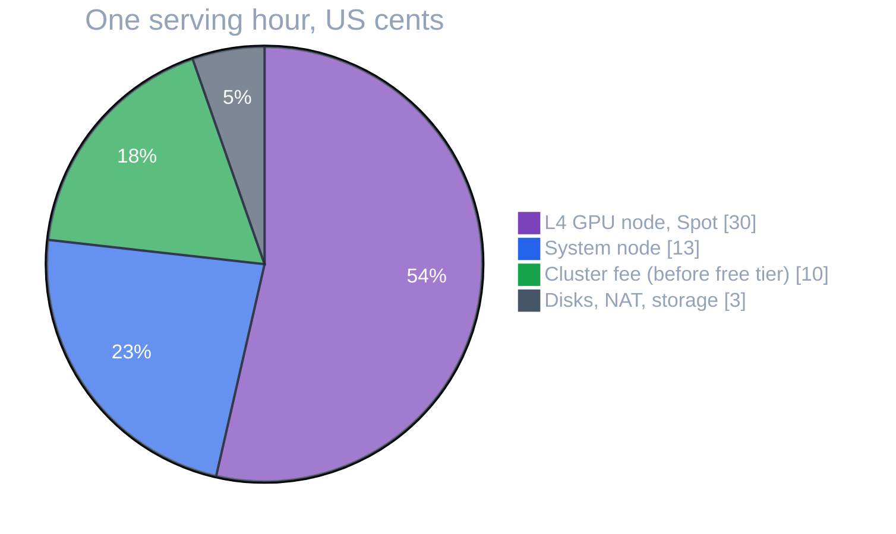

# GCP Cost Guide

> What costs money in this guide, and how to keep it near zero.

---

Most of this guide costs nothing or cents. Part 6 and the capstone run a GKE cluster and GPUs, which bill **by the hour, whether or not you're using them**. This page lists what each part costs, where the money goes, and the habits that keep a learning project from becoming a surprise bill.

> 📌 **Prices are approximate**, for `us-central1`, in USD, as of when this guide was written. GPU and Spot prices change often. Always check the official pages: [GKE](https://cloud.google.com/kubernetes-engine/pricing), [VMs](https://cloud.google.com/compute/vm-instance-pricing), [GPUs](https://cloud.google.com/compute/gpus-pricing), [Spot VMs](https://cloud.google.com/spot-vms/pricing), [Cloud NAT](https://cloud.google.com/nat/pricing), [Cloud Storage](https://cloud.google.com/storage/pricing), [Artifact Registry](https://cloud.google.com/artifact-registry/pricing).

## Cost by part

| Part | Resources | Cost while it exists |
|---|---|---|
| Getting Started, Part 1 | local files and generated values on your own machine | $0: nothing runs in the cloud |
| Part 2 | buckets with a few small objects, state files | effectively $0 (fractions of a cent per month) |
| Part 3: APIs, IAM, secrets | API enablement, service accounts, IAM, secrets | $0; a handful of secret versions is within the free tier |
| Part 4/5: networks | VPC, subnet, firewall, Cloud Router + NAT | ~$0 with no VMs; NAT is billed per VM using it |
| Part 6: GKE cluster | cluster fee + `e2-standard-4` system node + disks | **~$0.15–0.25 per hour** |
| Part 6: GPU pool | `g2-standard-4` with an L4, Spot | **$0 at zero nodes; roughly $0.25–0.35 per hour per node** while a GPU Pod runs |
| Part 6: model storage | ~3 GB in GCS, ~10 GB image in Artifact Registry | ~$1 per month |
| Part 7 | GitHub Actions, WIF pool, service accounts | $0 on the GCP side |
| Capstone | all of Part 6 | **~$0.25/hour idle, ~$0.50–1.00/hour while serving** |

## Where the capstone's money goes

While the model is being served, one hour of the capstone breaks down roughly like this:

| Item | Per hour | Notes |
|---|---|---|
| L4 GPU node (`g2-standard-4`, Spot) | ~$0.25–0.35 | about $0.70 on-demand; only while a GPU Pod runs |
| System node (`e2-standard-4`) | ~$0.13 | always on while the cluster exists |
| GKE cluster management fee | $0.10 | $0 if covered by the free tier credit |
| Persistent disks (50 GB + 100 GB balanced) | ~$0.02 | |
| Cloud NAT | ~$0.003 + $0.045/GB | 2 VMs using it; mostly model and pip downloads |
| GCS + Artifact Registry storage | < $0.01 | ~$1 per month total |

The GPU is the biggest line, but it's also the only one that **goes to zero by itself** (the pool scales to zero when nothing requests a GPU). The always-on part, about $0.25 an hour, is what you pay for leaving the cluster up overnight: about $6 a day.

### The GKE free tier

GKE gives **$74.40 of credit per billing account per month**, equal to the management fee of **one zonal Standard or Autopilot cluster** running all month. It doesn't apply to regional clusters, and it covers only the fee, not the nodes. That's why the guide's cluster is zonal.

## The bills people get surprised by

| Surprise | Why it happens | Prevention |
|---|---|---|
| A GPU node running for days | a GPU Pod left running (or stuck in a crash loop that keeps it scheduled) | delete or scale GPU workloads to 0 when done; check `kubectl get nodes` |
| A cluster left up "until tomorrow" | the system node and fee bill around the clock | `terraform destroy` at the end of a session; re-apply takes ~15 minutes |
| Orphaned persistent disks | the cluster was deleted before the PVCs that created disks | destroy workloads before the cluster ([Cleanup](../capstone/cleanup.md)) |
| Load balancers and static IPs | a `LoadBalancer` Service or reserved address outlived its user | `leftovers.sh` lists forwarding rules and addresses |
| Cross-region egress | weights bucket or image registry in a different region from the GPUs | keep data in the GPUs' region ([Model Storage](../ai-infra/model-storage.md)) |
| Soft-deleted or versioned objects | deleted multi-GB weights kept for 7 days, or every version kept | turn soft delete off for reproducible data; limit versions with lifecycle rules |
| On-demand GPUs by accident | `spot = true` missing, or a fallback pool scaled up | read the plan for `spot`; cap `total_max_node_count` |

## Habits that keep it near zero

- **Create the budget alert first** ([Connecting to GCP](../state/google-provider.md#4-prep-create-a-budget-alert-now)), and remember it only warns.
- **Destroy at the end of every session** that involved Part 6 or the capstone. Everything is in code, so rebuilding is just `terraform apply`.
- **Scale GPU pools to zero** and use **Spot** for everything that can restart ([GPU Node Pools](../ai-infra/gpu-node-pools.md)).
- **Cap GPU pools** with `total_max_node_count`, and keep GPU quota no higher than you need.
- **Run [`leftovers.sh`](../../examples/capstone/cleanup/leftovers.sh)** after a cleanup, and look at **Billing → Reports** the next day.
- **Label everything** ([Projects & APIs](../gcp-foundations/projects-and-apis.md#labeling-everything)) and turn on GKE cost allocation, so you can see which team, model, or namespace spent what.
- **Use a dedicated project**, so deleting it is always a complete stop.

---

[← Troubleshooting](troubleshooting.md) · [↑ Contents](../../README.md) · [Further Reading →](further-reading.md)
