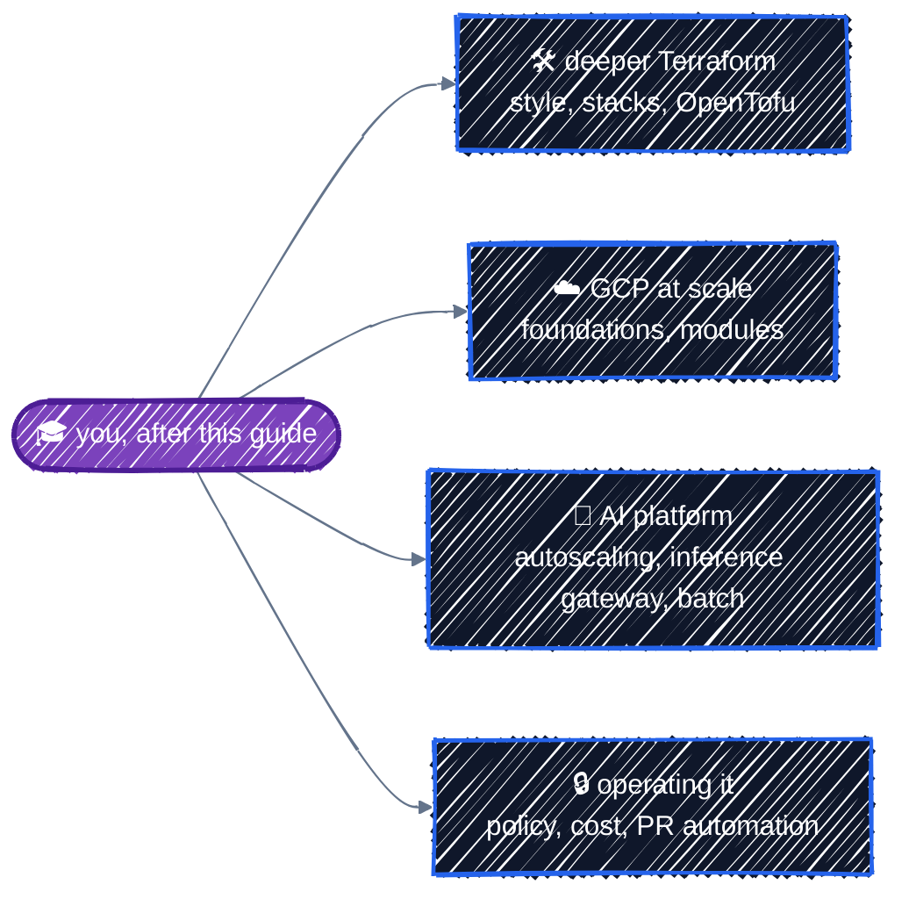

# Further Reading

> Advanced topics beyond this guide.

---

You can now build, ship, and tear down a GPU-backed model-serving platform with Terraform. Here's where to go next, depending on which direction you want to grow.

## Terraform itself

- **[Terraform language documentation](https://developer.hashicorp.com/terraform/language)**: the reference for everything in Part 1, and features this guide didn't need.
- **[Terraform style guide](https://developer.hashicorp.com/terraform/language/style)**: HashiCorp's conventions for naming, file layout, and formatting.
- **[Tests](https://developer.hashicorp.com/terraform/language/tests)**: more on `terraform test`, including `override_resource`, `mock_data`, and integration tests.
- **[Terraform Stacks](https://developer.hashicorp.com/terraform/language/stacks)**: HCP Terraform's way to deploy one configuration across many environments and regions, an alternative to the directory layout in [Environments](../modules/environments.md).
- **[OpenTofu](https://opentofu.org/)**: the open-source fork of Terraform. Almost everything in this guide works unchanged; check its release notes for differences such as state encryption.

## GCP at scale

- **[Best practices for using Terraform on Google Cloud](https://cloud.google.com/docs/terraform/best-practices-for-terraform)** and the [style and structure guide](https://cloud.google.com/docs/terraform/best-practices/general-style-structure): Google's own recommendations, many of which this guide follows.
- **[terraform-google-modules](https://github.com/terraform-google-modules)**: the modules from [Using Registry Modules](../modules/registry-modules.md), including the project factory and the full GKE module.
- **[Cloud Foundation Fabric](https://github.com/GoogleCloudPlatform/cloud-foundation-fabric)**: Google's opinionated modules and blueprints for organization-wide foundations: folders, Shared VPC, logging, and org policies.
- **[Config Connector](https://cloud.google.com/config-connector/docs/overview)**: manage GCP resources as Kubernetes objects, an alternative to Terraform for teams that run everything through Kubernetes and GitOps.

## The AI platform

- **[AI/ML on GKE](https://cloud.google.com/kubernetes-engine/docs/integrations/ai-infra)**: Google's overview of GPUs, TPUs, storage, and scheduling for ML workloads.
- **[Serve an open model with vLLM on GKE](https://cloud.google.com/kubernetes-engine/docs/tutorials/serve-gemma-gpu-vllm)**: the official tutorial for the same pattern as the capstone, with a different model.
- **[Autoscaling inference workloads](https://cloud.google.com/kubernetes-engine/docs/best-practices/machine-learning/inference/autoscaling)**: scale model servers on queue size and GPU metrics, the natural next step after scale-to-zero node pools.
- **[GKE Inference Gateway](https://cloud.google.com/kubernetes-engine/docs/concepts/about-gke-inference-gateway)**: model-aware load balancing and routing in front of several model servers.
- **[vLLM documentation](https://docs.vllm.ai/)**: engine arguments, quantization, multi-GPU serving, and metrics.
- **[Kueue](https://kueue.sigs.k8s.io/)** and **[Ray on Kubernetes](https://docs.ray.io/en/latest/cluster/kubernetes/index.html)**: queueing and distributed computing for training and batch jobs, which need GPUs in different patterns from serving.
- **[Workload Identity Federation for GKE](https://cloud.google.com/kubernetes-engine/docs/concepts/workload-identity)**: the full reference, including limitations and cross-project access.

## Operating it as a team

- **[google-github-actions/auth](https://github.com/google-github-actions/auth)**: every option for keyless CI authentication, beyond what [CI/CD](../team-workflow/ci-cd.md) used.
- **[Atlantis](https://www.runatlantis.io/)**: plan and apply driven by pull request comments, an alternative to the GitHub Actions workflow.
- **[Infracost](https://www.infracost.io/)**: cost estimates for each pull request's plan, so a reviewer sees "+$500/month" before approving a GPU change.
- **[Open Policy Agent for Terraform](https://www.openpolicyagent.org/docs/latest/terraform/)** and **[Conftest](https://www.conftest.dev/)**: write your own rules against plan JSON ("no GPUs in dev", "every bucket in us-central1"), beyond what [security scanners](../team-workflow/security-scanning.md) ship with.

## The companion guide

- **[k8s-tutorial](https://github.com/r97221004/k8s-tutorial)**: Kubernetes from the ground up, for the cluster side of everything in Part 5.

---

[← GCP Cost Guide](cost-guide.md) · [↑ Contents](../../README.md)
