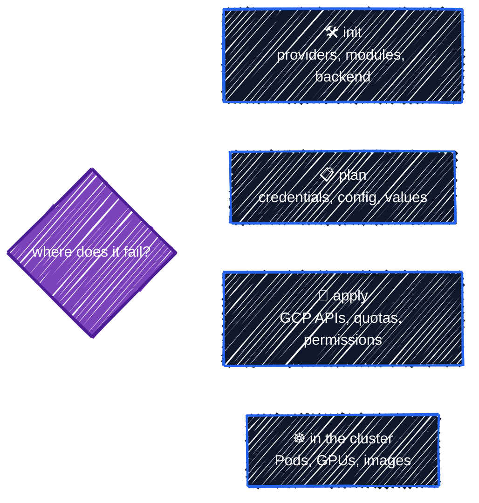

# Troubleshooting

> Symptom → cause → fix.

---

The errors you're most likely to meet while working through this guide, grouped by when they happen. Error text in code blocks is real output captured while writing the guide; where only the typical wording is shown, the entry says so.



Before anything else: **read the whole error.** Terraform and the google provider usually say exactly what's wrong, and often how to fix it.

## During `init`

### Locked provider version doesn't match the constraint

```
Error: Failed to query available provider packages

Could not retrieve the list of available versions for provider
hashicorp/google: locked provider registry.terraform.io/hashicorp/google
8.7.0 does not match configured version constraint ~> 8.5.0; must use
terraform init -upgrade to allow selection of new versions
```

**Cause:** you changed a `version` constraint so that the version in `.terraform.lock.hcl` no longer satisfies it.
**Fix:** `terraform init -upgrade`, then check the plan for changes ([Providers](../core-language/providers.md#when-the-constraint-and-the-lock-file-disagree)).

### No provider version satisfies everyone

```
Could not retrieve the list of available versions for provider
hashicorp/google-beta: no available releases match the given constraints >=
4.64.0, >= 6.19.0, ~> 8.0, < 8.0.0
```

**Cause:** a module caps the provider below the version your root module requires.
**Fix:** run `terraform providers` to see which module; upgrade that module to a release that supports your provider version ([Using Registry Modules](../modules/registry-modules.md#provider-versions-everyone-has-to-agree)).

### Module not installed / backend initialization required

```
Error: Module not installed
...
This module is not yet installed. Run "terraform init" to install all modules
required by this configuration.
```

```
Error: Backend initialization required, please run "terraform init"

Reason: Initial configuration of the requested backend "gcs"
```

**Cause:** a `module` block or `backend` was added or changed since the last `init`.
**Fix:** `terraform init` (with `-backend-config=backend.hcl` for partial backend configurations). If the backend location changed, choose `-migrate-state` or `-reconfigure` deliberately ([Remote Backend](../state/remote-backend.md#3-use-the-backend-from-another-configuration)).

### Variables not allowed (in a backend block)

```
Error: Variables not allowed

  on main.tf line 4, in terraform:
   4:     bucket = var.b

Variables may not be used here.
```

**Cause:** backend settings are read before variables exist.
**Fix:** leave the setting out of the `backend` block and pass it with `-backend-config` ([Remote Backend](../state/remote-backend.md#why-a-partial-configuration)).

## During `plan`

### No credentials

```
Error: Attempted to load application default credentials since neither `credentials` nor `access_token` was set in the provider block.  No credentials loaded. To use your gcloud credentials, run 'gcloud auth application-default login'.  Original error: google: could not find default credentials. See https://cloud.google.com/docs/authentication/external/set-up-adc for more information
```

**Cause:** Application Default Credentials aren't set up. `gcloud auth login` alone isn't enough.
**Fix:** `gcloud auth application-default login` ([Setup](../getting-started/setup.md#3-log-in-twice)). If Terraform acts as the **wrong** account, run it again, and check with `gcloud auth application-default print-access-token`.

### Project not set, or the wrong project

```
Error: Failed to retrieve project, pid: , err: project: required field is not set
```

**Cause:** no `project` in the provider or resource, and no environment variable.
**Fix:** set `project = var.project_id` in the provider, and `export TF_VAR_project_id=...`. If resources land in an **unexpected** project, look for a stray `GOOGLE_PROJECT` in your shell ([Projects & APIs](../gcp-foundations/projects-and-apis.md#which-project-does-a-resource-land-in)).

### Error acquiring the state lock

```
Error: Error acquiring the state lock

Error message: writing
"gs://tf-tutorial-3fa9c1-tfstate/tutorial/remote-backend/app/default.tflock"
failed: googleapi: Error 412: At least one of the pre-conditions you
specified did not hold., conditionNotMet
Lock Info:
  ID:        1760844118949304
  ...
  Who:       you@your-laptop
```

**Cause:** another `plan`/`apply` holds the lock, or a crashed one left it behind.
**Fix:** wait (`-lock-timeout=5m`), or ask the person in `Who`. Only if you're **sure** nothing is running: `terraform force-unlock <ID>` ([Remote Backend](../state/remote-backend.md#stale-locks-and-force-unlock)).

### Invalid value for variable

```
Error: Invalid value for variable
...
environment must be one of: dev, staging, prod.
```

**Cause:** a `validation` rule rejected an input. The message is written by the configuration's author.
**Fix:** do what the message says ([Variables, Locals & Outputs](../core-language/variables-and-outputs.md#validation-rules)).

### Invalid `for_each` argument

```
Error: Invalid for_each argument
...
The "for_each" set includes values derived from resource attributes that
cannot be determined until apply, ...
```

**Cause:** `for_each` keys depend on something known only after apply.
**Fix:** build keys from inputs; put apply-time values only in the map's values ([Meta-Arguments](../core-language/meta-arguments.md#keys-must-be-known-at-plan-time)).

### Duplicate object key

```
Two different items produced the key "1" in this 'for' expression. If
duplicates are expected, use the ellipsis (...) after the value expression to
enable grouping by key.
```

**Fix:** choose a unique key, or group with `...` ([Expressions & Functions](../core-language/expressions.md#for-expressions)).

### Ephemeral value not allowed

```
Error: Invalid use of ephemeral value
...
Ephemeral values are not valid for "secret_data", because it is not a
write-only attribute and must be persisted to state.
```

**Cause:** an `ephemeral` value flows somewhere that would be saved.
**Fix:** use a write-only argument (`*_wo`), a provider argument, or keep it out of Terraform ([Secret Manager](../gcp-foundations/secrets.md#terraform-enforces-the-rules)).

### Cannot construct REST client (kubernetes provider)

```
Error: Failed to construct REST client
...
cannot create REST client: no client config
```

**Cause:** the kubernetes/helm provider is configured from a cluster that doesn't exist yet (in the same configuration).
**Fix:** put Kubernetes resources in a separate configuration that reads the cluster with a data source ([Kubernetes & Helm](../ai-infra/kubernetes-and-helm.md#the-two-stage-apply-problem)).

### The plan wants to destroy something you only renamed

```
  # google_storage_bucket.bucket will be destroyed
  # (because google_storage_bucket.bucket is not in configuration)
  # google_storage_bucket.datasets will be created
```

**Fix:** add a `moved` block from the old address to the new one, and confirm the plan shows `has moved to` with nothing destroyed ([Refactoring](../state/refactoring.md#moved-rename-without-destroying)).

## During `apply`

### API not enabled

```
Error: Error creating Repository: googleapi: Error 403: Artifact Registry API has not been used in project 123456789012 before or it is disabled. ...
```

**Cause:** the resource was created before its API was enabled, or right after (enabling is eventually consistent).
**Fix:** add a dependency on the `google_project_service`, and re-run `apply` if it was just enabled ([Projects & APIs](../gcp-foundations/projects-and-apis.md#wait-for-the-api-before-using-it)).

### Permission denied (403) right after a grant

**Cause:** IAM changes take a minute or two to propagate, or the role is on the wrong resource, or granted to the wrong principal.
**Fix:** wait and retry first. Then check the binding on the exact resource (`gcloud ... get-iam-policy`), and the exact principal string, especially for Workload Identity, where the namespace and KSA name must match ([Workload Identity](../ai-infra/workload-identity.md#kubernetes-service-accounts-as-iam-principals)).

### Already exists (409)

*Typical wording:* `Error 409: ... already exists` or `The requested bucket name is not available`.

**Cause:** an object with that name exists outside this state: created by hand, by another configuration, or by a previous run whose state was lost. Bucket names are global, across all of GCP.
**Fix:** if it's yours, `import` it ([Refactoring](../state/refactoring.md#import-adopt-an-existing-object)); if not, choose another name (this guide prefixes bucket names with the project ID for this reason).

### Destroy refused

```
Error: Instance cannot be destroyed
...
Resource google_storage_bucket.by_for_each["vision"] has
lifecycle.prevent_destroy set, but the plan calls for this resource to be
destroyed.
```

**Cause:** `prevent_destroy`, the cluster's `deletion_protection`, a project's `deletion_policy = "PREVENT"`, or a bucket without `force_destroy` that still holds objects.
**Fix:** make sure you really mean it, then change the protection in a separate, reviewed change ([Meta-Arguments](../core-language/meta-arguments.md#prevent_destroy-a-guard-against-deletion), [Cleanup](../capstone/cleanup.md)).

## In the cluster

### GPU Pod stays Pending

```bash
kubectl describe pod <pod>          # Events at the bottom
kubectl get events --sort-by=.lastTimestamp | grep -i scale
```

| Event | Cause | Fix |
|---|---|---|
| `TriggeredScaleUp`, then waiting | normal: a GPU node is being created | wait a few minutes |
| `FailedScaleUp` mentioning **quota** | `GPUS_ALL_REGIONS` or `PREEMPTIBLE_NVIDIA_L4_GPUS` is 0 or used up | request quota ([GPU Node Pools](../ai-infra/gpu-node-pools.md#gpu-quota-first)) |
| `FailedScaleUp` with a resource availability (stockout) error | no Spot L4 capacity in the listed zones right now | add zones to `gpu_zones`, retry later, or use an on-demand pool |
| `NotTriggerScaleUp`: pod didn't fit | the Pod's selector or requests match no node pool | check `nodeSelector`, and that requests (CPU, memory) fit a `g2-standard-4` |

### Image pull fails

**Cause:** the node service account can't read the Artifact Registry repository, or the image path or tag is wrong.
**Fix:** check `roles/artifactregistry.reader` on the repository for `gke-nodes@…` ([Model Storage](../ai-infra/model-storage.md#artifact-registry-two-repositories)), and the path: `REGION-docker.pkg.dev/PROJECT/dockerhub/vllm/vllm-openai:TAG`.

### vLLM can't read the model

**Cause:** the GCS FUSE sidecar can't access the bucket: the Pod's KSA has no `objectViewer` on it, the Pod lacks the `gke-gcsfuse/volumes: "true"` annotation, or the model path is wrong.
**Fix:** check the KSA name and namespace against the IAM principal, the annotation, and `gcloud storage ls gs://BUCKET/MODEL/`. `kubectl logs <pod> -c gke-gcsfuse-sidecar` shows the driver's errors.

### vLLM runs out of GPU memory

*Typical wording:* `CUDA out of memory`, or a startup error that the KV cache doesn't fit.
**Fix:** lower `--max-model-len`, or `--gpu-memory-utilization`, or use a smaller model or a larger GPU.

## Still stuck?

- `TF_LOG=DEBUG terraform plan 2> debug.log` logs every API request the provider makes. The response body usually names the exact problem. (Don't share the log without reading it: it can contain tokens.)
- `terraform console` evaluates any expression against the configuration, which is often the fastest way to see what a variable or local actually is.
- The [google provider issues](https://github.com/hashicorp/terraform-provider-google/issues) are searchable by error message.

---

[← Terraform Cheat Sheet](cheatsheet.md) · [↑ Contents](../../README.md) · [GCP Cost Guide →](cost-guide.md)
