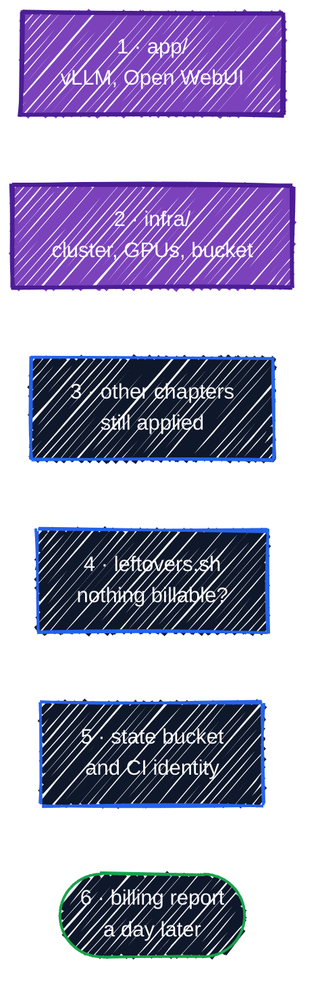

# Cleanup

> Tear it all down and confirm the bill stops.

---

`terraform destroy` is the most satisfying command in Terraform: everything you built, gone, in the right order, in a few minutes. This page tears down the capstone and anything left from earlier chapters, then checks, with tools other than Terraform, that nothing billable is left behind.

## The order matters



**Workloads before the cluster.** Some Kubernetes objects create Google Cloud resources outside Terraform's view: Open WebUI's PersistentVolumeClaim creates a **persistent disk**, and a `LoadBalancer` Service would create a **forwarding rule**. When the Kubernetes object is deleted while the cluster is running, GKE deletes what it created. If you delete the cluster first, nothing is left to clean them up, and the disk keeps billing quietly. Destroying `app/` before `infra/` avoids that.

## 1. Destroy the workloads

```bash
cd examples/capstone/llm-platform/app
terraform destroy
```

```
Plan: 0 to add, 0 to change, 5 to destroy.
```

Read the plan before typing `yes`, as always: a `destroy` plan should list exactly what you expect to lose, and nothing from another configuration.

## 2. Destroy the infrastructure

```bash
cd ../infra
terraform destroy
```

```
Plan: 0 to add, 0 to change, 22 to destroy.
```

About 10 minutes, most of it deleting the cluster. Two settings make this work in one go, and both are worth reconsidering for real systems:

- **`deletion_protection = false`** on the cluster ([GKE Cluster](../ai-infra/gke-cluster.md#deletion_protection)). With the default (`true`), the destroy stops at the cluster.
- **`force_destroy = true`** on the models bucket. Without it, GCS refuses to delete a bucket that still holds the 3 GB of weights.

The APIs stay enabled (`disable_on_destroy = false`); enabled APIs cost nothing.

## 3. Destroy anything else still applied

If you skipped `destroy` at the end of any chapter, those resources are still there, each in its own state. The ones that cost money while idle:

| Directory | Costs while idle |
|---|---|
| `examples/ai-infra/gke-cluster` (and the rest of Part 5) | yes: cluster fee and system node |
| `examples/gcp-foundations/networking`, `modules/*` networks | Cloud NAT, a little |
| `examples/modules/environments/envs/*/network` | Cloud NAT, a little |
| everything else (buckets, service accounts, IAM, secrets) | cents or nothing, but delete it anyway |

For each directory you applied:

```bash
terraform -chdir=examples/ai-infra/kubernetes-and-helm destroy
terraform -chdir=examples/ai-infra/gke-cluster destroy
# ...and so on, workloads before the infrastructure under them
```

`terraform state list` in a directory shows whether it still manages anything; an empty result means there's nothing to destroy there.

## 4. Check what's left, without Terraform

Terraform only knows about resources in its state. To find **everything**, ask GCP directly. [`leftovers.sh`](../../examples/capstone/cleanup/leftovers.sh) lists each kind of resource that can cost money:

```bash
./examples/capstone/cleanup/leftovers.sh
```

```
Billable leftovers in project tf-tutorial-3fa9c1:
GKE clusters                 none
VM instances                 none
Persistent disks             none
Static IP addresses          none
Load balancer rules          none
Cloud Routers (NAT)          none
Storage buckets              tf-tutorial-3fa9c1-tfstate
Artifact Registry repos      none
Secrets                      none
Review the resources above; delete what you no longer need.
```

That's the result you want at this point: only the **state bucket** remains. Anything else, especially a disk, cluster, or VM, means something escaped: find which chapter created it and destroy that configuration, or delete it with `gcloud` if it was never in Terraform.

## 5. Remove the state bucket and the CI identity

The state bucket goes last, because every other configuration's state is in it. It's protected by `prevent_destroy` ([Remote Backend](../state/remote-backend.md#1-create-the-state-bucket)), so delete it with `gcloud` once you're sure nothing else needs it:

```bash
gcloud storage rm --recursive --all-versions "gs://$TF_VAR_project_id-tfstate"
```

`--all-versions` removes the old state versions too; without it, the bucket can't be deleted while noncurrent versions remain.

If you set up [CI/CD](../team-workflow/ci-cd.md), destroy its Workload Identity pool and service accounts too (before deleting the state bucket, if its state is there), and remove the repository variables in GitHub.

## 6. Confirm the bill stops

Billing data lags by several hours, so check the next day:

- **Billing → Reports** in the Console, filtered to your project and grouped by **SKU**. GPU, GKE, and Compute Engine lines should drop to zero after today.
- Your **budget alert** from [Setup](../getting-started/setup.md#5-create-a-budget-alert-now) keeps watching. Keep it until the next month's bill confirms nothing is running.

## The last resort: delete the project

If anything resists cleanup, or you're done with the guide entirely, delete the sandbox project. It stops **all** billing for the project at once:

```bash
gcloud projects delete "$TF_VAR_project_id"
```

The project enters a 30-day pending deletion period, during which it can be restored with `gcloud projects undelete`, and then everything in it is permanently deleted. This is why [Setup](../getting-started/setup.md#4-create-a-sandbox-project) had you create a dedicated project: deleting it is always a complete, safe cleanup.

## Best practices

- **Destroy in reverse order of creation**: workloads, then clusters, then networks, then state.
- **Read every destroy plan.** It should list exactly what you mean to delete.
- **Check with GCP, not just Terraform**, for resources created outside Terraform's view: disks from PVCs, load balancers from Services.
- **Delete the state bucket last**, with all versions.
- **Use a dedicated project for experiments**, so deleting it is always an option.
- **Keep budget alerts** until the bill confirms the cleanup.

That's the end of the guide. The [cheat sheet](../appendix/cheatsheet.md) is a one-page summary of the commands and patterns you used along the way.

---

[← LLM Inference Platform on GKE](llm-platform.md) · [↑ Contents](../../README.md) · [Terraform Cheat Sheet →](../appendix/cheatsheet.md)
