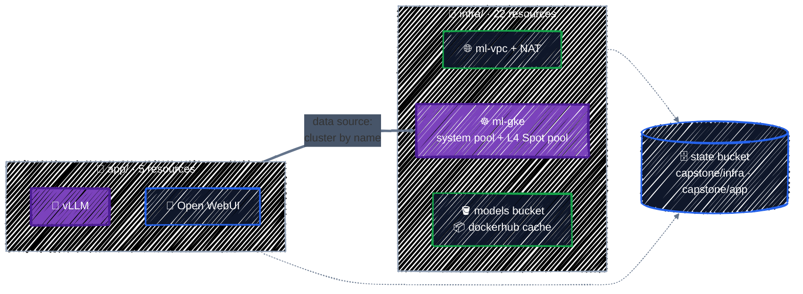

# LLM Inference Platform on GKE

> VPC → GKE → GPU Spot pool → model bucket → Workload Identity → vLLM.

---

This is where everything comes together. You'll build the LLM inference platform from the [README](../../README.md) end to end, from two Terraform configurations with remote state: a private network, a GKE cluster with a CPU pool and an L4 Spot GPU pool that scales to zero, a regional bucket of model weights read through Workload Identity, a pull-through image cache, and vLLM serving **Qwen2.5-1.5B-Instruct** behind an OpenAI-compatible API and a chat UI. Then you'll tear it all down in [Cleanup](cleanup.md).

Every piece was explained in an earlier chapter; this page links back instead of repeating. If something is unclear, follow the link.

> 💸 **Cost while it runs: roughly $0.25 an hour with the GPU pool at zero, and $0.50–1.00 an hour while the model is being served**, depending on Spot prices and free-tier credits. A full run-through takes about an hour. See the [Cost Guide](../appendix/cost-guide.md), and don't leave it running overnight.

## Before you start

You need:

- **The state bucket** from [Remote Backend](../state/remote-backend.md) (`$TF_VAR_project_id-tfstate`).
- **GPU quota**: at least 1 for `PREEMPTIBLE_NVIDIA_L4_GPUS` in your region and for `GPUS_ALL_REGIONS` ([GPU Node Pools](../ai-infra/gpu-node-pools.md#gpu-quota-first)).
- **`kubectl`** and the GKE auth plugin ([GKE Cluster](../ai-infra/gke-cluster.md#apply-it)).
- **Nothing left over from Part 5**: the capstone uses the same names (`ml-vpc`, `ml-gke`, `gke-nodes`, `…-models`). If you still have Part 5 applied, destroy it first, in reverse order.

## Two configurations, two states



| Directory | Contains | State prefix |
|---|---|---|
| [`infra/`](../../examples/capstone/llm-platform/infra/) | APIs, and the `vpc`, `gke-cluster`, `gpu-node-pool`, and `model-storage` modules | `capstone/infra` |
| [`app/`](../../examples/capstone/llm-platform/app/) | the `vllm` module: namespace, KSA, vLLM Deployment and Service, Open WebUI | `capstone/app` |

The split is the answer to the [two-stage apply problem](../ai-infra/kubernetes-and-helm.md#the-two-stage-apply-problem): the cluster has to exist before the Kubernetes providers in `app/` can be configured. It's also the component split from [Environments](../modules/environments.md#splitting-by-component-too): infrastructure changes rarely, workloads often.

## What's in `infra/` and `app/`

The capstone writes almost no resources of its own. [`infra/main.tf`](../../examples/capstone/llm-platform/infra/main.tf) and [`app/main.tf`](../../examples/capstone/llm-platform/app/main.tf) call the **same modules** the Part 4 and Part 5 chapters use, so a fix in a module reaches the chapter example and the capstone at once:

| Module | Builds | Explained in |
|---|---|---|
| [`modules/writing-modules/modules/vpc`](../../examples/modules/writing-modules/modules/vpc/) | network, subnet with `pods`/`services` ranges, Cloud NAT, firewall | [Networking](../gcp-foundations/networking.md), [Writing Modules](../modules/writing-modules.md) |
| [`ai-infra/modules/gke-cluster`](../../examples/ai-infra/modules/gke-cluster/) | node SA; zonal cluster with private nodes, DNS endpoint, Workload Identity, GCS FUSE; system pool | [GKE Cluster](../ai-infra/gke-cluster.md) |
| [`ai-infra/modules/gpu-node-pool`](../../examples/ai-infra/modules/gpu-node-pool/) | L4 Spot pool scaling 0–1 across three zones | [GPU Node Pools](../ai-infra/gpu-node-pools.md) |
| [`ai-infra/modules/model-storage`](../../examples/ai-infra/modules/model-storage/) | models bucket readable only by the `ml-serving/vllm` KSA; `serving` and `dockerhub` repositories readable by the nodes | [Model Storage](../ai-infra/model-storage.md), [Workload Identity](../ai-infra/workload-identity.md) |
| [`ai-infra/modules/vllm`](../../examples/ai-infra/modules/vllm/) (in `app/`) | namespace, KSA, vLLM Deployment and Service, optional Open WebUI | [Kubernetes & Helm](../ai-infra/kubernetes-and-helm.md) |

Two things differ from the Part 5 chapters, both because the infrastructure now lives in one configuration:

- The GPU pool module gets the cluster from the `gke` module's output, `module.gke.cluster_id`, instead of a data source lookup. Within one configuration, a reference is better: it also orders the pool after the cluster.
- The project number for the Workload Identity principal is read with `data "google_project"`, **without** `depends_on`, so it's read at plan time and the plan shows the real principal:

  ```
  data.google_project.this: Reading...
  data.google_project.this: Read complete after 0s [id=projects/tf-tutorial-3fa9c1]
  ...
        + member = "principal://iam.googleapis.com/projects/123456789012/locations/global/workloadIdentityPools/tf-tutorial-3fa9c1.svc.id.goog/subject/ns/ml-serving/sa/vllm"
  ```

  With `depends_on` on the data source, the read would be deferred to apply, as [Resources & Data Sources](../core-language/resources-and-data-sources.md#-reads-deferred-until-apply) warned.

## Step 1: Build the infrastructure

```bash
cd examples/capstone/llm-platform/infra
cp backend.hcl.example backend.hcl      # set bucket = "<your project>-tfstate"
terraform init -backend-config=backend.hcl
terraform plan
```

```
- network in ../../../modules/writing-modules/modules/vpc
...
Plan: 22 to add, 0 to change, 0 to destroy.

Changes to Outputs:
  + cluster_location = "us-central1-a"
  + cluster_name     = "ml-gke"
  + get_credentials  = "gcloud container clusters get-credentials ml-gke --location us-central1-a --project tf-tutorial-3fa9c1 --dns-endpoint"
  + models_bucket    = "tf-tutorial-3fa9c1-models"
```

Read the plan, then:

```bash
terraform apply          # about 15 minutes; the cluster is most of it
$(terraform output -raw get_credentials)
kubectl get nodes        # one system node; the GPU pool has zero nodes
```

## Step 2: Upload the model

```bash
pip install -U huggingface_hub
hf download Qwen/Qwen2.5-1.5B-Instruct --local-dir ./Qwen2.5-1.5B-Instruct
gcloud storage cp -r ./Qwen2.5-1.5B-Instruct "gs://$(terraform output -raw models_bucket)/"
```

About 3.1 GB. Data goes in with data tools, not Terraform ([Model Storage](../ai-infra/model-storage.md#upload-the-weights)).

## Step 3: Deploy the model server

```bash
cd ../app
cp backend.hcl.example backend.hcl      # same bucket, prefix = "capstone/app"
terraform init -backend-config=backend.hcl
terraform plan
```

```
  # module.vllm.helm_release.open_webui[0] will be created
  # module.vllm.kubernetes_deployment_v1.vllm will be created
  # module.vllm.kubernetes_namespace_v1.serving will be created
  # module.vllm.kubernetes_service_account_v1.vllm will be created
  # module.vllm.kubernetes_service_v1.vllm will be created
Plan: 5 to add, 0 to change, 0 to destroy.
```

`app/` is the configuration from [Kubernetes & Helm](../ai-infra/kubernetes-and-helm.md), with one variable exposed: `enable_ui` (default `true`) is passed to the module, which installs Open WebUI with `count`.

```bash
terraform apply
kubectl -n ml-serving get pods -w
```

Then watch the whole chain happen:

1. The vLLM Pod is **Pending**: it requests `nvidia.com/gpu`, and no node has one.
2. The cluster autoscaler adds an **L4 Spot node** in whichever zone has capacity (a few minutes).
3. The node pulls the **vLLM image** through the regional Docker Hub cache (several minutes the first time).
4. The GCS FUSE sidecar mounts the **models bucket**, authenticating as the `vllm` KSA through **Workload Identity**.
5. vLLM loads the weights onto the GPU, and the readiness probe on `/health` turns the Pod **Ready**.

Expect about 10–15 minutes from `apply` to Ready the first time. `kubectl -n ml-serving describe pod -l app=vllm` and `kubectl get events -n ml-serving` show which step you're in.

## Step 4: Use it

```bash
$(terraform output -raw port_forward_api) &
curl -s localhost:8000/v1/models | jq '.data[].id'
curl -s localhost:8000/v1/chat/completions -H "Content-Type: application/json" -d '{
  "model": "Qwen2.5-1.5B-Instruct",
  "messages": [{"role": "user", "content": "Explain Terraform state to a new engineer in two sentences."}]
}' | jq -r '.choices[0].message.content'
```

And the chat UI:

```bash
$(terraform output -raw port_forward_ui) &
# open http://localhost:8080
```

The API is OpenAI-compatible, so existing OpenAI client code works by pointing its base URL at `http://localhost:8000/v1`.

## Step 5: Watch it scale to zero

Scale the model server down and watch the GPU go away:

```bash
kubectl -n ml-serving scale deployment vllm --replicas=0
kubectl get nodes -w        # the L4 node disappears after ~10 idle minutes
```

The cluster, network, bucket, and image cache stay; only the GPU, by far the most expensive part, is released. `--replicas=1` brings it back, faster this time because the image is cached. (Terraform will report the replica count as drift on the next plan; for a long-term setup, put `replicas` in a variable or ignore it with `lifecycle { ignore_changes }`.)

## What you've built

Look back at what's running, and where each part came from:

| Layer | Resource | Chapter |
|---|---|---|
| State | GCS backend, locked, versioned | [Remote Backend](../state/remote-backend.md) |
| Network | custom VPC, secondary ranges, Cloud NAT, IAP-only SSH | [Networking](../gcp-foundations/networking.md) |
| Identity | node SA with one role; KSA principal with one grant; no keys anywhere | [IAM](../gcp-foundations/iam.md), [Workload Identity](../ai-infra/workload-identity.md) |
| Compute | private zonal cluster, DNS endpoint, L4 Spot pool scaling to zero | [GKE Cluster](../ai-infra/gke-cluster.md), [GPU Node Pools](../ai-infra/gpu-node-pools.md) |
| Data | regional weights bucket, image cache | [Model Storage](../ai-infra/model-storage.md) |
| Workloads | vLLM and Open WebUI | [Kubernetes & Helm](../ai-infra/kubernetes-and-helm.md) |
| Delivery | plan on PR, apply on approval, drift detection | [CI/CD](../team-workflow/ci-cd.md) |

To run it from CI, put `infra/` and `app/` in a repository, give each its own workflow directory (`TF_DIR`) and state prefix, and apply `infra` before `app`.

## Where to go from here

- **A bigger model**: raise `--max-model-len` carefully, switch to `g2-standard-8` or more L4s with `--tensor-parallel-size`, or an A100/H100 pool for 70B-class models. Gated models (Llama) need the Hugging Face token from [Secret Manager](../gcp-foundations/secrets.md).
- **Production hardening**: a regional cluster, an on-demand baseline pool plus Spot for burst, `deletion_protection = true`, more than one replica, and a load balancer with authentication in front of the API.
- **Autoscaling on load**: scale vLLM replicas on queue length or GPU utilization with the Horizontal Pod Autoscaler and custom metrics, and let the cluster autoscaler follow.
- More in [Further Reading](../appendix/further-reading.md).

## Clean up

**Don't skip this.** GPUs and clusters bill by the hour. [Cleanup](cleanup.md) tears everything down in the right order and checks that the bill stops.

---

[← CI/CD with GitHub Actions](../team-workflow/ci-cd.md) · [↑ Contents](../../README.md) · [Cleanup →](cleanup.md)
