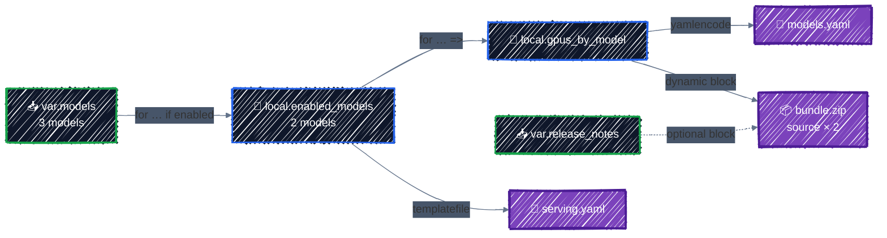

# Expressions & Functions

> for expressions, conditionals, built-in functions, and terraform console.

---

So far every value has been a literal, a reference, or a string template. Real configurations need more: "read-only files only in prod", "one file per enabled model", "the names of every enabled model", "a YAML config file rendered from a list". Terraform has no loops or `if` statements. Instead it has **expressions** that compute values, and about a hundred **built-in functions**. This chapter covers the ones you'll actually use.

## Before you start

```bash
cd examples/core-language/expressions
terraform init
```

The example generates the config for an LLM serving platform: two YAML files and a zip bundle with one file per model. All of it is computed from a list of models and a few inputs, using every technique in this chapter:



Keep **`terraform console`** open in a second terminal while you read. Every expression on this page can be pasted into it, and evaluated against the example's variables and locals:

```bash
terraform console
```

## Conditionals: `condition ? a : b`

```hcl
locals {
  # Conditional: production configs get more replicas and read-only files.
  is_prod = var.environment == "prod"
}

resource "local_file" "serving_config" {
  ...
  file_permission = local.is_prod ? "0444" : "0644"
}
```

```
> var.environment == "prod" ? 3 : 1
1
```

- Both results must have the same type, or types Terraform can convert to one (`3` and `1` are both numbers).
- Name the condition in a local, like `local.is_prod`, when it's used more than once. The intent reads better than repeated comparisons.
- Operators work as you'd expect: `==`, `!=`, `<`, `>=`, `&&`, `||`, `!`, plus arithmetic `+ - * / %`.

**`null` means "leave it out".** Setting an argument to `null` is the same as not writing it, so the provider default applies. That makes conditionals useful for optional arguments:

```hcl
  # Set a permission only when one is given; otherwise the provider's default applies.
  file_permission = var.file_mode != "" ? var.file_mode : null
```

## `for` expressions

A `for` expression builds a new list or map from an existing collection. It's Terraform's equivalent of a list comprehension. The example's models are a list of objects:

```hcl
variable "models" {
  type = list(object({
    name    = string
    repo    = string
    gpus    = optional(number, 1)
    enabled = optional(bool, true)
  }))
  default = [
    { name = "llama-3-1-8b", repo = "meta-llama/Llama-3.1-8B-Instruct" },
    { name = "qwen2-5-7b", repo = "Qwen/Qwen2.5-7B-Instruct" },
    { name = "mixtral-8x7b", repo = "mistralai/Mixtral-8x7B-Instruct-v0.1", gpus = 4, enabled = false },
  ]
}
```

**Square brackets produce a list:**

```
> [for m in var.models : upper(m.name)]
[
  "LLAMA-3-1-8B",
  "QWEN2-5-7B",
  "MIXTRAL-8X7B",
]
```

**Add `if` to filter:**

```
> [for m in var.models : m.name if !m.enabled]
[
  "mixtral-8x7b",
]
```

**Curly braces and `=>` produce a map:**

```
> { for m in var.models : m.name => m.gpus }
{
  "llama-3-1-8b" = 1
  "mixtral-8x7b" = 4
  "qwen2-5-7b" = 1
}
```

The example combines them in `locals`:

```hcl
  # for expression with a filter: keep only the enabled models.
  enabled_models = [for m in var.models : m if m.enabled]

  # for expression producing a map: model name => GPUs it needs.
  gpus_by_model = { for m in local.enabled_models : m.name => m.gpus }
```

A few more forms you'll meet:

| Form | Example | Notes |
|---|---|---|
| Index and value of a list | `[for i, m in var.models : "${i}:${m.name}"]` | `i` is 0, 1, 2… |
| Key and value of a map | `[for k, v in local.gpus_by_model : "${k} needs ${v} GPU"]` | maps iterate in sorted key order |
| Grouping | `{ for m in var.models : m.gpus => m.name... }` | the `...` collects values with the same key into a list |

Map keys must be unique. If two items produce the same key, Terraform stops with a `Duplicate object key` error, unless you use `...` to group them.

## Splat: `[*]`

For the common case of "this attribute from every element", a **splat** is shorter than a `for`:

```
> var.models[*].repo
tolist([
  "meta-llama/Llama-3.1-8B-Instruct",
  "Qwen/Qwen2.5-7B-Instruct",
  "mistralai/Mixtral-8x7B-Instruct-v0.1",
])
```

`local.enabled_models[*].name` is exactly `[for m in local.enabled_models : m.name]`. Splats work on lists; for maps, use a `for` expression or `values()`. You'll use splats with `count` resources in [Meta-Arguments](meta-arguments.md).

## Dynamic blocks

`for` expressions build **values**. But some settings are **nested blocks**, and you can't assign a list to a block. The example's zip bundle, an `archive_file` resource from the `archive` provider, takes one `source` block per file inside the zip. A **`dynamic` block** generates one nested block per element of a collection:

```hcl
resource "archive_file" "bundle" {
  type        = "zip"
  output_path = "${path.module}/out/${var.environment}/bundle.zip"

  # dynamic block: one source block per enabled model.
  dynamic "source" {
    for_each = local.gpus_by_model
    content {
      filename = "models/${source.key}.yaml"
      content  = yamlencode({ name = source.key, gpus = source.value })
    }
  }
  ...
}
```

- `dynamic "<block type>"` names the block to generate.
- `for_each` is the collection to loop over: a list, set, or map.
- Inside `content`, the **iterator** is named after the block: `source.key` and `source.value`. For a list, `key` is the index.

The plan shows two ordinary blocks, as if you'd written them out by hand:

```
      + source {
          + content  = <<-EOT
                "gpus": 1
                "name": "llama-3-1-8b"
            EOT
          + filename = "models/llama-3-1-8b.yaml"
        }
      + source {
          + content  = <<-EOT
                "gpus": 1
                "name": "qwen2-5-7b"
            EOT
          + filename = "models/qwen2-5-7b.yaml"
        }
```

On GCP you'll use the same construct for a bucket's `lifecycle_rule` blocks or a firewall's `allow` blocks.

### An optional block: zero or one

A block can't be set to `null`. To include a block only sometimes, loop over a list with **zero or one** element:

```hcl
  # Optional nested block: zero or one NOTES.txt, depending on the input.
  dynamic "source" {
    for_each = var.release_notes != "" ? [var.release_notes] : []
    content {
      filename = "NOTES.txt"
      content  = source.value
    }
  }
```

By default `release_notes` is empty, so the bundle has no notes file. Pass some notes and the block appears:

```bash
terraform plan -var 'release_notes=First release with Qwen.'
```

```
      + source {
          + content  = "First release with Qwen."
          + filename = "NOTES.txt"
        }
```

> 💡 **Don't overuse `dynamic`.** It makes code harder to read. Use it when the number of blocks really comes from input, or for an optional block. If the bundle always held exactly two files, you'd write two `source` blocks.

## Functions

Functions are called as `name(arg, ...)`. **You can't define your own.** You compose the built-ins, and put the result in a local. The full list is in the [function reference](https://developer.hashicorp.com/terraform/language/functions). These are the ones that come up constantly.

### Strings

The example turns a free-text owner name into a valid GCP label value, in one expression read from the inside out:

```hcl
  # String functions turn free text into a valid label value
  # ("ML Platform Team" -> "ml-platform-team").
  owner_label = substr(replace(lower(trimspace(var.owner)), "/[^a-z0-9_-]+/", "-"), 0, 63)
```

`trimspace` removes surrounding whitespace, `lower` lowercases it, `replace` turns every run of invalid characters into `-` (a pattern wrapped in `/.../` is a regular expression), and `substr` caps it at 63 characters.

| Function | Example | Result |
|---|---|---|
| `format` | `format("%s-%03d", "node", 7)` | `"node-007"` |
| `join` | `join(",", ["a", "b"])` | `"a,b"` |
| `split` | `split("/", "meta-llama/Llama-3.1-8B-Instruct")` | `["meta-llama", "Llama-3.1-8B-Instruct"]` |
| `replace` | `replace("a.b.c", ".", "-")` | `"a-b-c"` |
| `lower`, `upper` | `upper("us-central1")` | `"US-CENTRAL1"` |
| `trimsuffix`, `trimprefix` | `trimsuffix("model.bin", ".bin")` | `"model"` |
| `substr` | `substr("terraform", 0, 4)` | `"terr"` |

### Collections

| Function | Example | Result |
|---|---|---|
| `length` | `length(var.models)` | `3` |
| `merge` | `merge({ a = 1, b = 2 }, { b = 3 })` | `{ a = 1, b = 3 }`: later maps win |
| `concat` | `concat(["a"], ["b", "c"])` | `["a", "b", "c"]` |
| `flatten` | `flatten([["a", "b"], ["c"]])` | `["a", "b", "c"]` |
| `distinct` | `distinct(["a", "b", "a"])` | `["a", "b"]` |
| `contains` | `contains(["dev", "prod"], "qa")` | `false` |
| `keys`, `values` | `keys({ b = 2, a = 1 })` | `["a", "b"]`: sorted |
| `lookup` | `lookup({ dev = 1, prod = 3 }, "staging", 1)` | `1`: the default |
| `element` | `element(["a", "b"], 1)` | `"b"` |
| `sum` | `sum(values(local.gpus_by_model))` | `2` |

`merge` is the one you'll use most, usually for labels: `merge(local.common_labels, { component = "serving" })`.

### Handling missing values: `try`, `can`, `coalesce`

| Function | Example | Result |
|---|---|---|
| `try` | `try(var.models[5].name, "none")` | `"none"`: the first argument failed, so the fallback is used |
| `can` | `can(regex("^[a-z]+$", "Hello"))` | `false`: true if the expression succeeds |
| `coalesce` | `coalesce("", "fallback")` | `"fallback"`: the first non-null, non-empty value |

`can` is what you saw in [validation rules](variables-and-outputs.md#validation-rules). `try` is for reading optional parts of complex input without a chain of conditionals.

### Networks: `cidrsubnet`

IP planning is arithmetic, and getting it wrong means overlapping subnets. `cidrsubnet(prefix, newbits, netnum)` carves a block out of a larger range:

```hcl
  # Network function: carve one /20 per environment out of a /16.
  subnet_cidrs = {
    for i, env in ["dev", "staging", "prod"] : env => cidrsubnet("10.10.0.0/16", 4, i)
  }
```

```
  + subnet_cidrs  = {
      + dev     = "10.10.0.0/20"
      + prod    = "10.10.32.0/20"
      + staging = "10.10.16.0/20"
    }
```

`newbits = 4` turns the `/16` into `/20`s (16 + 4), and `netnum` picks the 1st, 2nd, 3rd of them. `cidrhost("10.10.0.0/20", 1)` gives a single address, `"10.10.0.1"`. [VPC Networking](../gcp-foundations/networking.md) uses these to plan the subnet and the GKE Pod and Service ranges.

### Encoding: `jsonencode`, `yamlencode`, `base64encode`

Many arguments, from a file's `content` to GCP IAM policies and Kubernetes manifests, want a JSON or YAML **string**. Build the structure in HCL and encode it, instead of writing JSON by hand inside a heredoc:

```
> jsonencode({ replicas = 2, gpu = "nvidia-l4" })
"{\"gpu\":\"nvidia-l4\",\"replicas\":2}"
```

The example writes a small model index with `yamlencode`:

```hcl
  content = yamlencode({
    environment = var.environment
    labels      = local.labels
    total_gpus  = local.total_gpus
    models      = local.gpus_by_model
  })
```

```yaml
"environment": "dev"
"labels":
  "environment": "dev"
  "managed-by": "terraform"
  "owner": "ml-platform-team"
"models":
  "llama-3-1-8b": 1
  "qwen2-5-7b": 1
"total_gpus": 2
```

Encoding functions always produce valid output: quoting, escaping, and indentation are handled for you. `base64encode` and `sha256` round out the set: `base64encode("hello")` is `"aGVsbG8="`.

### Templates: `templatefile`

When the output is a file a human will read, like a config file or startup script, a **template** is clearer than an encoder. [`templates/serving.yaml.tftpl`](../../examples/core-language/expressions/templates/serving.yaml.tftpl):

```
# Generated by Terraform. Do not edit by hand.
environment: ${environment}
replicas: ${is_prod ? 3 : 1}
models:
%{ for m in models ~}
  - name: ${m.name}
    source: hf://${m.repo}
    gpus: ${m.gpus}
%{ endfor ~}
```

- `${ ... }` inserts a value, as in any string.
- `%{ for ... }` / `%{ endfor }` and `%{ if ... }` / `%{ endif }` are template directives.
- `~` strips the whitespace and newline next to it, so the directives don't leave blank lines.
- The template can only see the variables you pass it, not `var.` or `local.`.

Render it with the variables it needs:

```hcl
  content = templatefile("${path.module}/templates/serving.yaml.tftpl", {
    environment = var.environment
    models      = local.enabled_models
    is_prod     = local.is_prod
  })
```

```yaml
# Generated by Terraform. Do not edit by hand.
environment: dev
replicas: 1
models:
  - name: llama-3-1-8b
    source: hf://meta-llama/Llama-3.1-8B-Instruct
    gpus: 1
  - name: qwen2-5-7b
    source: hf://Qwen/Qwen2.5-7B-Instruct
    gpus: 1
```

`path.module` is the directory of the current module. Always build file paths from it, so the code still works when it's called as a module from somewhere else. Use the `.tftpl` extension for templates; editors recognize it.

**`templatefile` or `yamlencode`?** Use an encoder when a program reads the output and only validity matters. Use a template when people read it too, or when you need comments and a particular layout.

### Type conversion

| Function | Example | Result |
|---|---|---|
| `tostring`, `tonumber`, `tobool` | `tonumber("8")` | `8` |
| `tolist`, `toset`, `tomap` | `toset(["a", "b", "a"])` | a set: `["a", "b"]` |

`toset` matters most: `for_each` on a resource needs a set or map, not a list, as you'll see in [Meta-Arguments](meta-arguments.md). A conversion that can't work fails with a clear error:

```
> tonumber("abc")

Error: Invalid function argument

Invalid value for "v" parameter: cannot convert "abc" to number; given
string must be a decimal representation of a number.
```

### Provider-defined functions

Providers can ship functions too, called with a `provider::<name>::` prefix. The `local` provider has one that checks for a directory:

```
> provider::local::direxists(path.module)
true
> provider::local::direxists("${path.module}/out")
false
```

(`out` doesn't exist until the first `apply`.) From Part 2 on, the google provider adds helpers for picking apart GCP resource IDs, such as `provider::google::region_from_zone("us-central1-a")`, which returns `"us-central1"`.

They only work for providers declared in `required_providers`. The list is on the provider's Registry page, under **Functions**.

## Apply it

```bash
terraform plan     # Plan: 3 to add, 0 to change, 0 to destroy.
terraform apply
cat out/dev/serving.yaml out/dev/models.yaml
unzip -l out/dev/bundle.zip
```

Then change the inputs and watch everything follow. Enable Mixtral, drop Qwen, and add release notes:

```bash
terraform plan \
  -var 'models=[{name="llama-3-1-8b",repo="meta-llama/Llama-3.1-8B-Instruct"},{name="mixtral-8x7b",repo="mistralai/Mixtral-8x7B-Instruct-v0.1",gpus=4}]' \
  -var 'release_notes=Adds Mixtral.'
```

```
  # archive_file.bundle must be replaced
  # local_file.model_index must be replaced
  # local_file.serving_config must be replaced
...
Plan: 3 to add, 0 to change, 3 to destroy.

Changes to Outputs:
  ...
  ~ total_gpus    = 2 -> 5
```

Both config files get new content, the bundle gains a Mixtral file and a `NOTES.txt`, and `total_gpus` goes from 2 to 5. One list changed, and everything computed from it followed. (Here every change is a replacement, because files can't be edited in place. On GCP, most of the same changes would be in-place updates.)

## Checkpoint

1. You have a map of models but only want entries whose `enabled` field is true. Which HCL construct expresses both transformation and filtering?
2. When should you use `templatefile` instead of building a long YAML or startup-script string with interpolation?
3. Choose the safer function: test whether an expression is valid without failing; provide a fallback when evaluation fails; select the first non-null/non-empty value.

<details>
<summary>Answer</summary>

1. A `for` expression with an `if` clause, for example `{ for k, v in var.models : k => v if v.enabled }`.
2. Use `templatefile` when the document is large enough to deserve its own syntax highlighting and review. Pass a small, explicit variables map and let `yamlencode` or `jsonencode` handle structured data where possible.
3. `can`; `try`; `coalesce` (or `coalescelist` for lists).

</details>

## Best practices

- **Name intermediate results in `locals`.** `local.enabled_models` and `local.is_prod` make the resources that use them read like sentences.
- **Prefer `for` expressions and splats over repeated code**, but keep each expression short enough to read. Split long ones across several locals.
- **Use `dynamic` only when the block count comes from input**, or for a zero-or-one optional block.
- **Build JSON and YAML with `jsonencode`/`yamlencode`**, not string templates. Use `templatefile` for human-readable files.
- **Build paths from `path.module`.**
- **Test expressions in `terraform console`** before putting them in a resource.
- **Use `cidrsubnet` for IP plans** rather than writing CIDRs by hand.

## Clean up

```bash
terraform destroy
rm -rf out
```

`destroy` removes the two YAML files, but the `archive` provider leaves the zip on disk, so delete the `out/` directory yourself. It's a reminder that "destroyed" means whatever the provider does on delete; read the plan and the docs, not just the summary line.

---

[← Variables, Locals & Outputs](variables-and-outputs.md) · [↑ Contents](../../README.md) · [Meta-Arguments →](meta-arguments.md)
