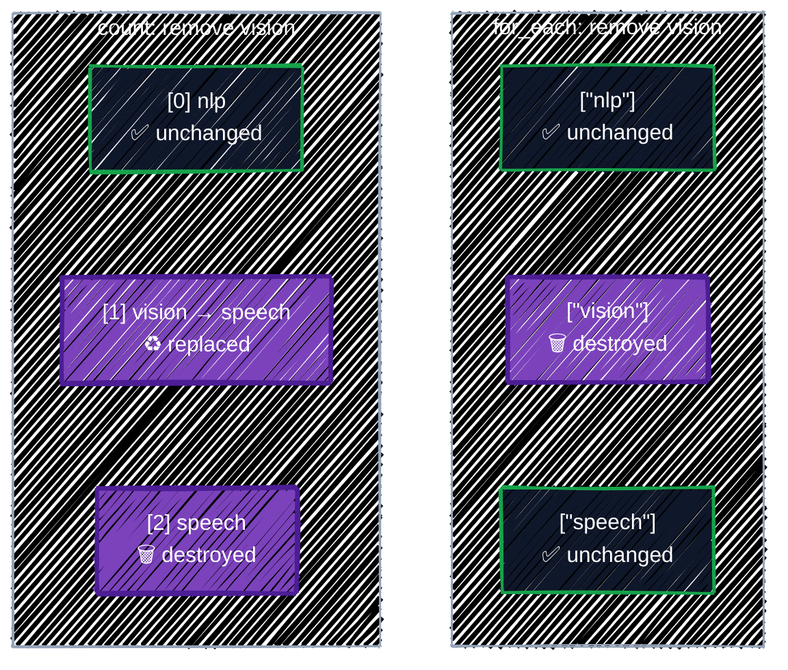

# Meta-Arguments

> count, for_each, depends_on, and lifecycle.

---

Arguments like `name` and `location` are defined by the provider and passed to GCP. **Meta-arguments** are different: they're defined by Terraform itself, work on every resource type, and change **how Terraform handles the resource**: how many copies to make, what order to make them in, and what to do when they change. You've already used one, `provider`, in [Providers](providers.md). This chapter covers the other four.

| Meta-argument | What it controls |
|---|---|
| `count` | make N copies, or switch a resource on and off |
| `for_each` | make one copy per element of a map or set |
| `depends_on` | add an ordering that references can't express |
| `lifecycle` | how changes are applied: guards, ignored attributes, replacement behavior, pre/postconditions |
| `provider` | which provider configuration to use ([Providers](providers.md#two-configurations-of-one-provider-alias)) |

## Before you start

```bash
cd examples/core-language/meta-arguments
terraform init
```

The example creates the storage layout for an ML team: one bucket per dataset stage (`raw`, `curated`, `eval`), an optional scratch bucket, a model card per model, and a `_READY` marker that's written last.

```bash
terraform plan
```

```
  # google_storage_bucket.dataset["curated"] will be created
  # google_storage_bucket.dataset["eval"] will be created
  # google_storage_bucket.dataset["raw"] will be created
  # google_storage_bucket.scratch[0] will be created
  # google_storage_bucket_object.model_card["llama-3-1-8b"] will be created
  # google_storage_bucket_object.model_card["qwen2-5-7b"] will be created
  # google_storage_bucket_object.ready will be created

Plan: 7 to add, 0 to change, 0 to destroy.
```

Seven resources from five blocks. The `[...]` after an address is the **instance key**: which copy of a multi-instance resource this is.

## `count`

`count` makes a whole number of copies. Inside the block, `count.index` is the copy's number, starting at 0. Its most common use by far is as an **on/off switch**:

```hcl
# count as an on/off switch: zero or one bucket.
resource "google_storage_bucket" "scratch" {
  count = var.enable_scratch ? 1 : 0

  name     = "${var.project_id}-ma-scratch"
  location = var.region
  ...
}
```

With `count`, the resource becomes a **list** of instances, and its address gets an index: `google_storage_bucket.scratch[0]`. That changes how you refer to it:

| You want | Write |
|---|---|
| The one instance, when you know it exists | `google_storage_bucket.scratch[0].name` |
| A list of every instance's attribute | `google_storage_bucket.scratch[*].name` |
| The instance's attribute, or `null` if `count` is 0 | `one(google_storage_bucket.scratch[*].name)` |

`[0]` fails when `count` is 0. `one()` takes a list of zero or one element and returns the element or `null`, which is exactly what an output for an optional resource needs:

```hcl
output "scratch_bucket" {
  description = "The scratch bucket's name, or null when enable_scratch is false."
  value       = one(google_storage_bucket.scratch[*].name)
}
```

```bash
terraform plan -var enable_scratch=false    # Plan: 6 to add, ...
```

### The trouble with `count` over a list

`count` can also make one copy per list element, with `count.index` to pick the element:

```hcl
variable "teams" {
  type    = list(string)
  default = ["nlp", "vision", "speech"]
}

resource "google_storage_bucket" "by_count" {
  count    = length(var.teams)
  name     = "${var.project_id}-${var.teams[count.index]}"
  location = "us-central1"
}
```

It works, until you remove an element from the middle. Instances are identified by **position**, so everything after the removed one shifts down:



Removing `"vision"` from the list gives this plan:

```
  # google_storage_bucket.by_count[1] must be replaced
-/+ resource "google_storage_bucket" "by_count" {
      ~ name                        = "tf-tutorial-3fa9c1-vision" -> "tf-tutorial-3fa9c1-speech" # forces replacement
      ...
  # google_storage_bucket.by_count[2] will be destroyed
  # (because index [2] is out of range for count)
  - resource "google_storage_bucket" "by_count" {
```

You asked to delete one bucket. Terraform deletes **two**, including the `speech` bucket and everything in it, then recreates `speech` empty at index 1. The same change with `for_each` touches only `vision`:

```
  # google_storage_bucket.by_for_each["vision"] will be destroyed
  # (because key ["vision"] is not in for_each map)
  - resource "google_storage_bucket" "by_for_each" {
```

**Rule: use `count` only for "zero or one", or for truly identical copies** where position doesn't matter. For one-per-thing, use `for_each`.

## `for_each`

`for_each` makes one instance per element of a **map** or a **set of strings**, and identifies each one by its **key**. Inside the block:

- `each.key` is the map key (or the set element).
- `each.value` is the map value (for a set, the same as `each.key`).

### Over a map

The usual form: a map whose keys name the instances and whose values hold each one's settings.

```hcl
variable "datasets" {
  description = "One bucket per dataset stage. The map key becomes part of the bucket name."
  type = map(object({
    storage_class  = optional(string, "STANDARD")
    retention_days = optional(number)
  }))
  default = {
    raw     = { storage_class = "NEARLINE", retention_days = 90 }
    curated = {}
    eval    = { retention_days = 30 }
  }
}
```

```hcl
# for_each over a map: one bucket per entry, addressed by key,
# e.g. google_storage_bucket.dataset["raw"].
resource "google_storage_bucket" "dataset" {
  for_each = var.datasets

  name          = "${var.project_id}-ma-${each.key}"
  location      = var.region
  storage_class = each.value.storage_class
  ...
  labels = {
    stage = each.key
  }
```

Adding a stage is one line in the map. Removing one destroys only that bucket.

### Over a set

For a plain list of names, convert it to a **set**. `for_each` doesn't accept lists, because a list can contain duplicates and its order would matter. The example declares the variable as `set(string)` directly:

```hcl
variable "models" {
  description = "Models to publish a model card for."
  type        = set(string)
  default     = ["llama-3-1-8b", "qwen2-5-7b"]
}

# for_each over a set of strings: each.key and each.value are the same string.
resource "google_storage_bucket_object" "model_card" {
  for_each = var.models

  bucket  = google_storage_bucket.dataset["curated"].name
  name    = "model-cards/${each.key}.md"
  content = "# ${each.key}\n\nEvaluation results go here.\n"
}
```

If the input is a list, write `for_each = toset(var.models)`.

### Referring to `for_each` instances

A `for_each` resource is a **map** of instances. Pick one by key, as `bucket = google_storage_bucket.dataset["curated"].name` does above, or turn the whole map into something useful with a `for` expression:

```hcl
output "dataset_buckets" {
  description = "Dataset stage => bucket name."
  value       = { for stage, b in google_storage_bucket.dataset : stage => b.name }
}
```

```
  + dataset_buckets = {
      + curated = "tf-tutorial-3fa9c1-ma-curated"
      + eval    = "tf-tutorial-3fa9c1-ma-eval"
      + raw     = "tf-tutorial-3fa9c1-ma-raw"
    }
```

### Keys must be known at plan time

Terraform has to know every key during `plan`, so it can show you the full list of instances. Keys built from values GCP decides fail:

```hcl
resource "google_storage_bucket_object" "readme" {
  for_each = toset([google_storage_bucket.logs.self_link])   # ⚠️ known only after apply
  ...
}
```

```
Error: Invalid for_each argument

  on extra.tf line 6, in resource "google_storage_bucket_object" "readme":
   6:   for_each = toset([google_storage_bucket.logs.self_link])
    ├────────────────
    │ google_storage_bucket.logs.self_link is a string, known only after apply

The "for_each" set includes values derived from resource attributes that
cannot be determined until apply, and so Terraform cannot determine the full
set of keys that will identify the instances of this resource.

When working with unknown values in for_each, it's better to use a map value
where the keys are defined statically in your configuration and where only
the values contain apply-time results.
```

The fix is what the message says: build keys from your **input** (variable names, fixed strings), and put apply-time values only in the map's **values**. `{ logs = google_storage_bucket.logs.self_link }` works; the key `logs` is known.

### `count` or `for_each`?

| Situation | Use |
|---|---|
| Create it or not, based on a flag | `count = var.enabled ? 1 : 0` |
| One per named thing: environments, teams, datasets, node pools | `for_each` over a map or set |
| N interchangeable copies, where only the number matters | `count` |
| Anything you might later remove from the middle | `for_each` |

`count` and `for_each` can't both be set on one resource. They also work on `module` blocks, which is how you'll stamp out one module per environment or region in [Part 4](../modules/writing-modules.md).

## `depends_on`

Terraform orders operations by **references**: if A refers to B, B goes first. That covers nearly everything. `depends_on` is for the rare case where A needs B but **nothing in A refers to B**.

The example writes a `_READY` marker that downstream jobs wait for. It must be written after every model card, but it doesn't use any of their values:

```hcl
# A marker that downstream jobs wait for. Nothing in it refers to the model
# cards, so depends_on is the only way to say "write this one last".
resource "google_storage_bucket_object" "ready" {
  bucket  = google_storage_bucket.dataset["curated"].name
  name    = "model-cards/_READY"
  content = "ok"

  depends_on = [google_storage_bucket_object.model_card]
}
```

`depends_on` takes a list of whole resources (or modules), not attributes. Pointing it at a `for_each` resource means "all of its instances". You can see the edge it adds with `terraform graph`:

```
  "google_storage_bucket_object.ready" -> "google_storage_bucket_object.model_card";
```

On GCP you'll mostly need `depends_on` for **side effects that happen inside GCP**:

- **API enablement.** A resource fails if its API isn't enabled yet, but nothing about a GKE cluster refers to the `google_project_service` that enables `container.googleapis.com`. [Projects & APIs](../gcp-foundations/projects-and-apis.md) shows the pattern.
- **IAM grants.** A workload that starts using a permission the moment it's created needs the grant to exist first.

> ⚠️ **Use it sparingly.** `depends_on` makes Terraform more cautious: anything that depends on a resource with pending changes gets more `(known after apply)` values, and data sources get deferred to apply (the `<=` from [Resources & Data Sources](resources-and-data-sources.md#-reads-deferred-until-apply)). Prefer a real reference whenever one exists, and leave a comment explaining every `depends_on`.

## `lifecycle`

The `lifecycle` block changes how Terraform applies changes to a resource. It has six settings.

### `prevent_destroy`: a guard against deletion

```hcl
resource "google_storage_bucket" "model_weights" {
  ...
  lifecycle {
    prevent_destroy = true
  }
}
```

Any plan that would destroy the resource, including a replacement, fails:

```
Error: Instance cannot be destroyed

  on main.tf line 15:
  15: resource "google_storage_bucket" "by_for_each" {

Resource google_storage_bucket.by_for_each["vision"] has
lifecycle.prevent_destroy set, but the plan calls for this resource to be
destroyed. To avoid this error and continue with the plan, either disable
lifecycle.prevent_destroy or reduce the scope of the plan using the -target
option.
```

Use it on things that hold data or are painful to recreate: the state bucket, model-weight buckets, databases. Two limits: it must be a literal `true` or `false` (no variables), and it doesn't help if someone deletes the whole `resource` block, since the setting goes with it. For buckets, also leave `force_destroy` off, so GCS refuses to delete a non-empty bucket either way.

### `ignore_changes`: let something else own an attribute

Sometimes another system legitimately changes an attribute after creation. Without `ignore_changes`, every plan would try to change it back:

```hcl
resource "google_container_node_pool" "gpu" {
  ...
  autoscaling {
    min_node_count = 0
    max_node_count = 4
  }

  lifecycle {
    # The cluster autoscaler changes the node count; don't fight it.
    ignore_changes = [node_count]
  }
}
```

List attribute names, not strings. `ignore_changes = all` ignores every attribute, which is almost never what you want. Each entry is a small "Terraform doesn't manage this any more" exception, so comment why.

### `create_before_destroy`: replace without a gap

By default, a replacement (`-/+`) destroys the old object first, then creates the new one. With `create_before_destroy = true`, the order flips (`+/-`), so there's no moment without the resource:

```hcl
resource "google_compute_instance_template" "inference" {
  name_prefix = "inference-"   # a unique name each time, so old and new can coexist
  ...
  lifecycle {
    create_before_destroy = true
  }
}
```

It only works if both copies can exist at once. A bucket with a fixed `name` can't, because names are unique. That's why resources that are often replaced, like instance templates, offer `name_prefix`.

### `replace_triggered_by`: replace when something else changes

Forces a replacement when a referenced resource or attribute changes, even though no argument of this resource changed:

```hcl
  lifecycle {
    # Recreate the VM whenever its startup script changes.
    replace_triggered_by = [google_storage_bucket_object.startup_script]
  }
```

### `precondition` and `postcondition`: assumptions, checked

A **precondition** is a check that runs during `plan`, before the resource is created or changed. Unlike [variable validation](variables-and-outputs.md#validation-rules), it can look at several values together, including locals and other resources. The example uses one to catch a costly mistake: GCS charges an early-deletion fee if objects are deleted before a storage class's minimum duration (30 days for Nearline, 90 for Coldline, 365 for Archive):

```hcl
  lifecycle {
    # Checked during plan, before anything is created or changed.
    precondition {
      condition     = coalesce(each.value.retention_days, 36500) >= local.min_days[each.value.storage_class]
      error_message = "Dataset \"${each.key}\": retention_days is shorter than the minimum storage duration of ${each.value.storage_class}, so every deletion would pay an early-deletion fee."
    }
  }
```

```bash
terraform plan -var 'datasets={raw={storage_class="NEARLINE",retention_days=7},curated={}}'
```

```
Error: Resource precondition failed

  on main.tf line 43, in resource "google_storage_bucket" "dataset":
  43:       condition     = coalesce(each.value.retention_days, 36500) >= local.min_days[each.value.storage_class]
    ├────────────────
    │ each.value.retention_days is 7
    │ each.value.storage_class is "NEARLINE"
    │ local.min_days is object with 4 attributes

Dataset "raw": retention_days is shorter than the minimum storage duration of
NEARLINE, so every deletion would pay an early-deletion fee.
```

A **postcondition** runs after the resource is created or read, and can check `self`, the resource's own attributes. Use it to assert something about what GCP actually returned, for example that a data source found an image of the expected architecture.

## Apply it

```bash
terraform apply
terraform output
terraform state list
```

```
google_storage_bucket.dataset["curated"]
google_storage_bucket.dataset["eval"]
google_storage_bucket.dataset["raw"]
google_storage_bucket.scratch[0]
google_storage_bucket_object.model_card["llama-3-1-8b"]
google_storage_bucket_object.model_card["qwen2-5-7b"]
google_storage_bucket_object.ready
```

Watch the apply output: the two model cards are written in parallel, and `_READY` only after both finish. Then try the changes from this chapter against real resources:

```bash
terraform plan -var enable_scratch=false                         # scratch[0] will be destroyed
terraform plan -var 'models=["qwen2-5-7b"]'                      # only one model card destroyed
terraform plan -var 'models=["llama-3-1-8b","qwen2-5-7b","mixtral-8x7b"]'   # one added
```

## Best practices

- **`for_each` for one-per-thing, `count` for on/off.** Avoid `count` over a list of things you might remove.
- **Choose stable, meaningful keys.** The key is part of the address in state. Changing it later (`"raw"` to `"bronze"`) means destroy-and-recreate, unless you use a `moved` block ([Refactoring](../state/refactoring.md)).
- **Build `for_each` keys from input**, never from values known only after apply.
- **Wrap optional resources' outputs in `one(...[*])`**, so they're `null` instead of an error when the resource is off.
- **Prefer references to `depends_on`**, and comment every `depends_on` you do need.
- **`prevent_destroy` on anything holding data you can't recreate**, plus no `force_destroy` on those buckets.
- **Comment every `ignore_changes`** with which system owns the attribute.
- **Use preconditions for rules that span several values** and would otherwise fail late or cost money.

## Clean up

```bash
terraform destroy
```

That's the end of Part 1. You can now read and write any Terraform configuration. Part 2 is about the file that makes it all work: [State & Drift](../state/state-basics.md).

---

[← Expressions & Functions](expressions.md) · [↑ Contents](../../README.md) · [State & Drift →](../state/state-basics.md)
