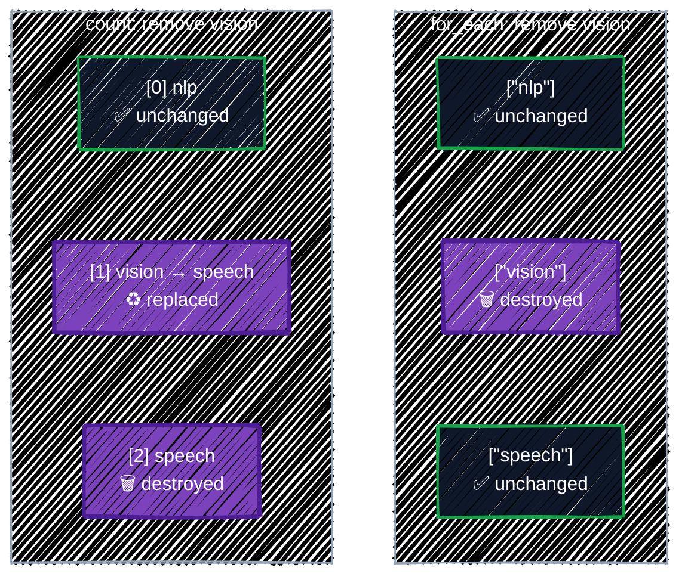

# Meta-Arguments

> count, for_each, depends_on, and lifecycle, plus forced replacement and provisioners.

---

Arguments like `filename` and `content` are defined by the provider and passed to whatever it manages. **Meta-arguments** are different: they're defined by Terraform itself, work on every resource type, and change **how Terraform handles the resource**: how many copies to make, what order to make them in, and what to do when they change. A fifth, `provider`, picks which provider configuration a resource uses; this guide doesn't need it. This chapter covers the other four.

| Meta-argument | What it controls |
|---|---|
| `count` | make N copies, or switch a resource on and off |
| `for_each` | make one copy per element of a map or set |
| `depends_on` | add an ordering that references can't express |
| `lifecycle` | how changes are applied: guards, ignored attributes, replacement behavior, pre/postconditions |

## Before you start

```bash
cd examples/core-language/meta-arguments
terraform init
```

The example writes the file layout for an ML team: one manifest per dataset stage (`raw`, `curated`, `eval`) that a storage job will turn into buckets, an optional scratch area, a model card per model, and a `_READY` marker that's written last.

```bash
terraform plan
```

```
  # local_file.dataset["curated"] will be created
  # local_file.dataset["eval"] will be created
  # local_file.dataset["raw"] will be created
  # local_file.model_card["llama-3-1-8b"] will be created
  # local_file.model_card["qwen2-5-7b"] will be created
  # local_file.ready will be created
  # local_file.scratch[0] will be created

Plan: 7 to add, 0 to change, 0 to destroy.
```

Seven resources from four blocks. The `[...]` after an address is the **instance key**: which copy of a multi-instance resource this is.

## `count`

`count` makes a whole number of copies. Inside the block, `count.index` is the copy's number, starting at 0. Its most common use by far is as an **on/off switch**:

```hcl
# count as an on/off switch: zero or one file.
resource "local_file" "scratch" {
  count = var.enable_scratch ? 1 : 0

  filename = "${path.module}/out/scratch/README.txt"
  content  = "Scratch space. Anything here may be deleted.\n"
  ...
}
```

With `count`, the resource becomes a **list** of instances, and its address gets an index: `local_file.scratch[0]`. That changes how you refer to it:

| You want | Write |
|---|---|
| The one instance, when you know it exists | `local_file.scratch[0].filename` |
| A list of every instance's attribute | `local_file.scratch[*].filename` |
| The instance's attribute, or `null` if `count` is 0 | `one(local_file.scratch[*].filename)` |

`[0]` fails when `count` is 0. `one()` takes a list of zero or one element and returns the element or `null`, which is exactly what an output for an optional resource needs:

```hcl
output "scratch_readme" {
  description = "The scratch README's path, or null when enable_scratch is false."
  value       = one(local_file.scratch[*].filename)
}
```

```bash
terraform plan -var enable_scratch=false    # Plan: 6 to add, ...
```

### The trouble with `count` over a list

`count` can also make one copy per list element, with `count.index` to pick the element:

```hcl
variable "teams" {
  type    = list(string)
  default = ["nlp", "vision", "speech"]
}

resource "local_file" "by_count" {
  count    = length(var.teams)
  filename = "${path.module}/out/count/${var.teams[count.index]}.txt"
  content  = "${var.teams[count.index]}\n"
}
```

It works, until you remove an element from the middle. Instances are identified by **position**, so everything after the removed one shifts down:



Removing `"vision"` from the list gives this plan:

```
  # local_file.by_count[1] must be replaced
-/+ resource "local_file" "by_count" {
      ~ filename             = "./out/count/vision.txt" -> "./out/count/speech.txt" # forces replacement
      ...
  # local_file.by_count[2] will be destroyed
  # (because index [2] is out of range for count)
  - resource "local_file" "by_count" {
```

You asked to delete one file. Terraform deletes **two**, including `speech.txt`, then recreates `speech.txt` at index 1. With files that's harmless; with buckets, it means deleting the `speech` bucket and everything in it, then recreating it empty. The same change with `for_each` touches only `vision`:

```
  # local_file.by_for_each["vision"] will be destroyed
  # (because key ["vision"] is not in for_each map)
  - resource "local_file" "by_for_each" {
```

**Rule: use `count` only for "zero or one", or for truly identical copies** where position doesn't matter. For one-per-thing, use `for_each`.

## `for_each`

`for_each` makes one instance per element of a **map** or a **set of strings**, and identifies each one by its **key**. Inside the block:

- `each.key` is the map key (or the set element).
- `each.value` is the map value (for a set, the same as `each.key`).

### Over a map

The usual form: a map whose keys name the instances and whose values hold each one's settings.

```hcl
variable "datasets" {
  description = "One manifest per dataset stage. The map key becomes part of the file name."
  type = map(object({
    storage_class  = optional(string, "STANDARD")
    retention_days = optional(number)
  }))
  default = {
    raw     = { storage_class = "NEARLINE", retention_days = 90 }
    curated = {}
    eval    = { retention_days = 30 }
  }
}
```

```hcl
# for_each over a map: one manifest per entry, addressed by key,
# e.g. local_file.dataset["raw"]. A storage job reads these to set up buckets.
resource "local_file" "dataset" {
  for_each = var.datasets

  filename = "${path.module}/out/datasets/${each.key}.json"
  ...
  content = jsonencode({
    stage          = each.key
    storage_class  = each.value.storage_class
    retention_days = each.value.retention_days
  })
```

Adding a stage is one line in the map. Removing one destroys only that manifest. On GCP, the same `for_each` would create the buckets themselves, one per stage.

### Over a set

For a plain list of names, convert it to a **set**. `for_each` doesn't accept lists, because a list can contain duplicates and its order would matter. The example declares the variable as `set(string)` directly:

```hcl
variable "models" {
  description = "Models to publish a model card for."
  type        = set(string)
  default     = ["llama-3-1-8b", "qwen2-5-7b"]
}

# for_each over a set of strings: each.key and each.value are the same string.
resource "local_file" "model_card" {
  for_each = var.models

  filename = "${path.module}/out/model-cards/${each.key}.md"
  content  = "# ${each.key}\n\nEvaluation results go here.\n"
  ...
}
```

If the input is a list, write `for_each = toset(var.models)`.

### Referring to `for_each` instances

A `for_each` resource is a **map** of instances. Pick one by key, as in `local_file.dataset["curated"].filename`, or turn the whole map into something useful with a `for` expression:

```hcl
output "dataset_manifests" {
  description = "Dataset stage => manifest path."
  value       = { for stage, f in local_file.dataset : stage => f.filename }
}
```

```
  + dataset_manifests = {
      + curated = "./out/datasets/curated.json"
      + eval    = "./out/datasets/eval.json"
      + raw     = "./out/datasets/raw.json"
    }
```

### Keys must be known at plan time

Terraform has to know every key during `plan`, so it can show you the full list of instances. Keys built from values decided at apply time fail, such as a random name:

```hcl
resource "random_pet" "logs" {}

resource "local_file" "readme" {
  for_each = toset([random_pet.logs.id]) # ⚠️ known only after apply
  ...
}
```

```
Error: Invalid for_each argument

  on main.tf line 4, in resource "local_file" "readme":
   4:   for_each = toset([random_pet.logs.id]) # ⚠️ known only after apply
    ├────────────────
    │ random_pet.logs.id is a string, known only after apply

The "for_each" set includes values derived from resource attributes that
cannot be determined until apply, and so Terraform cannot determine the full
set of keys that will identify the instances of this resource.

When working with unknown values in for_each, it's better to use a map value
where the keys are defined statically in your configuration and where only
the values contain apply-time results.
```

The fix is what the message says: build keys from your **input** (variable names, fixed strings), and put apply-time values only in the map's **values**. `{ logs = random_pet.logs.id }` works; the key `logs` is known. On GCP, the usual offenders are IDs and self-links of resources created in the same run.

### `count` or `for_each`?

| Situation | Use |
|---|---|
| Create it or not, based on a flag | `count = var.enabled ? 1 : 0` |
| One per named thing: environments, teams, datasets, node pools | `for_each` over a map or set |
| N interchangeable copies, where only the number matters | `count` |
| Anything you might later remove from the middle | `for_each` |

`count` and `for_each` can't both be set on one resource. They also work on `module` blocks, which is how you'll stamp out one module per environment or region in [Part 4](../modules/writing-modules.md).

## `depends_on`

Terraform orders operations by **references**: if A refers to B, B goes first. That covers nearly everything. `depends_on` is for the rare case where A needs B but **nothing in A refers to B**.

The example writes a `_READY` marker that downstream jobs wait for. It must be written after every model card, but it doesn't use any of their values:

```hcl
# A marker that downstream jobs wait for. Nothing in it refers to the model
# cards, so depends_on is the only way to say "write this one last".
resource "local_file" "ready" {
  filename = "${path.module}/out/model-cards/_READY"
  content  = "ok\n"
  ...

  depends_on = [local_file.model_card]
}
```

`depends_on` takes a list of whole resources (or modules), not attributes. Pointing it at a `for_each` resource means "all of its instances". You can see the edge it adds with `terraform graph`:

```
  "local_file.ready" -> "local_file.model_card";
```

On GCP you'll mostly need `depends_on` for **side effects that happen inside GCP**:

- **API enablement.** A resource fails if its API isn't enabled yet, but nothing about a GKE cluster refers to the `google_project_service` that enables `container.googleapis.com`. [Projects & APIs](../gcp-foundations/projects-and-apis.md) shows the pattern.
- **IAM grants.** A workload that starts using a permission the moment it's created needs the grant to exist first.

> ⚠️ **Use it sparingly.** `depends_on` makes Terraform more cautious: anything that depends on a resource with pending changes gets more `(known after apply)` values, and data sources get deferred to apply (the `<=` from [Resources & Data Sources](resources-and-data-sources.md#-reads-deferred-until-apply)). Prefer a real reference whenever one exists, and leave a comment explaining every `depends_on`.

## `lifecycle`

The `lifecycle` block changes how Terraform applies changes to a resource. It has six settings.

### `prevent_destroy`: a guard against deletion

```hcl
resource "local_file" "by_for_each" {
  ...
  lifecycle {
    prevent_destroy = true
  }
}
```

Any plan that would destroy the resource, including a replacement, fails. Removing `"vision"` from the teams list above now stops the plan:

```
Error: Instance cannot be destroyed

  on main.tf line 12:
  12: resource "local_file" "by_for_each" {

Resource local_file.by_for_each["vision"] has lifecycle.prevent_destroy set,
but the plan calls for this resource to be destroyed. To avoid this error and
continue with the plan, either disable lifecycle.prevent_destroy or reduce
the scope of the plan using the -target option.
```

Use it on things that hold data or are painful to recreate: the state bucket, model-weight buckets, databases. Two limits: it must be a literal `true` or `false` (no variables), and it doesn't help if someone deletes the whole `resource` block, since the setting goes with it. For buckets, also leave `force_destroy` off, so GCS refuses to delete a non-empty bucket either way.

### `ignore_changes`: let something else own an attribute

Sometimes another system legitimately changes an attribute after creation. Without `ignore_changes`, every plan would try to change it back. The classic case is on GCP, where the cluster autoscaler resizes a GKE node pool:

```hcl
resource "google_container_node_pool" "gpu" {
  ...
  autoscaling {
    min_node_count = 0
    max_node_count = 4
  }

  lifecycle {
    # The cluster autoscaler changes the node count; don't fight it.
    ignore_changes = [node_count]
  }
}
```

List attribute names, not strings. `ignore_changes = all` ignores every attribute, which is almost never what you want. Each entry is a small "Terraform doesn't manage this any more" exception, so comment why.

### `create_before_destroy`: replace without a gap

By default, a replacement (`-/+`) destroys the old object first, then creates the new one. With `create_before_destroy = true`, the order flips (`+/-`), so there's no moment without the resource:

```hcl
resource "google_compute_instance_template" "inference" {
  name_prefix = "inference-"   # a unique name each time, so old and new can coexist
  ...
  lifecycle {
    create_before_destroy = true
  }
}
```

It only works if both copies can exist at once. A bucket with a fixed `name` can't, because names are unique. That's why resources that are often replaced, like instance templates, offer `name_prefix`.

### `replace_triggered_by`: replace when something else changes

Forces a replacement when a referenced resource or attribute changes, even though no argument of this resource changed:

```hcl
  lifecycle {
    # Recreate the VM whenever its startup script changes.
    replace_triggered_by = [google_storage_bucket_object.startup_script]
  }
```

### `precondition` and `postcondition`: assumptions, checked

A **precondition** is a check that runs during `plan`, before the resource is created or changed. Unlike [variable validation](variables-and-outputs.md#validation-rules), it can look at several values together, including locals and other resources. The example uses one to stop a manifest that would cost money once the storage job turns it into a bucket: GCS charges an early-deletion fee if objects are deleted before a storage class's minimum duration (30 days for Nearline, 90 for Coldline, 365 for Archive):

```hcl
  lifecycle {
    # Checked during plan, before anything is created or changed.
    precondition {
      condition     = coalesce(each.value.retention_days, 36500) >= local.min_days[each.value.storage_class]
      error_message = "Dataset \"${each.key}\": retention_days is shorter than the minimum storage duration of ${each.value.storage_class}, so every deletion would pay an early-deletion fee."
    }
  }
```

```bash
terraform plan -var 'datasets={raw={storage_class="NEARLINE",retention_days=7},curated={}}'
```

```
Error: Resource precondition failed

  on main.tf line 29, in resource "local_file" "dataset":
  29:       condition     = coalesce(each.value.retention_days, 36500) >= local.min_days[each.value.storage_class]
    ├────────────────
    │ each.value.retention_days is 7
    │ each.value.storage_class is "NEARLINE"
    │ local.min_days is object with 4 attributes

Dataset "raw": retention_days is shorter than the minimum storage duration of
NEARLINE, so every deletion would pay an early-deletion fee.
```

A **postcondition** runs after the resource is created or read, and can check `self`, the resource's own attributes. Use it to assert something about what was actually created or read, for example that a data source found an image of the expected architecture on GCP.

## Forcing a replacement: `-replace`

Sometimes an object is broken in a way Terraform can't see: a VM whose disk got corrupted, a node that's unhealthy, a file someone mangled in a way the provider doesn't check. The configuration hasn't changed, so the plan says `No changes`. To rebuild just that one object, ask for it. Try it once the example is applied ([Apply it](#apply-it) below):

```bash
terraform plan -replace='local_file.model_card["qwen2-5-7b"]'
```

```
Terraform used the selected providers to generate the following execution
plan. Resource actions are indicated with the following symbols:
-/+ destroy and then create replacement

Terraform will perform the following actions:

  # local_file.model_card["qwen2-5-7b"] will be replaced, as requested
-/+ resource "local_file" "model_card" {
      ~ id                   = "28bc0d275fa6a939c7e66268e82b406fa6f9fd3e" -> (known after apply)
        # (4 unchanged attributes hidden)
    }

Plan: 1 to add, 0 to change, 1 to destroy.
```

- Quote the address in single quotes; `[` and `"` mean something to your shell.
- `-replace` works on `plan` and `apply`, and you can repeat it for several addresses. It's a one-off: nothing is saved in the configuration. For "replace this whenever that changes", use `replace_triggered_by` instead.
- Older guides use `terraform taint <address>`, which marks the resource in state so the next plan replaces it (`is tainted, so must be replaced`), and `terraform untaint` to undo that. The commands still exist, but HashiCorp recommends `-replace`: it shows you the plan before anything changes, while `taint` edits state immediately.

Terraform also taints a resource **by itself** when its creation fails partway, as the next section shows.

## Provisioners: a last resort

A **provisioner** runs a command as part of creating or destroying a resource. `local-exec` runs on the machine running Terraform; `remote-exec` runs on the new server over SSH. Here's `local-exec` on a `terraform_data` resource, a built-in resource that stores a value and creates nothing else. The snippets in this section aren't part of the example; to try them, put them in a `main.tf` in an empty scratch directory and run `terraform init`:

```hcl
resource "random_pet" "server" {}

resource "terraform_data" "announce" {
  input = random_pet.server.id

  # Runs once, on the machine running Terraform, right after creation.
  provisioner "local-exec" {
    command = "echo 'Server ${self.input} is ready' >> deploy.log"
  }

  # Runs when the resource is destroyed.
  provisioner "local-exec" {
    when    = destroy
    command = "echo 'Server ${self.input} is gone' >> deploy.log"
  }
}
```

```
terraform_data.announce: Creating...
terraform_data.announce: Provisioning with 'local-exec'...
terraform_data.announce (local-exec): Executing: ["/bin/sh" "-c" "echo 'Server mutual-treefrog is ready' >> deploy.log"]
terraform_data.announce: Creation complete after 0s [id=e0e25595-938f-e579-2a71-42b3af81b14d]
```

Inside a provisioner, `self` is the resource it belongs to. Three behaviors catch people out:

- **Creation-time provisioners run once.** Change the `command` and plan again: `No changes`. Terraform doesn't track what a provisioner did, so it has no reason to run it again. To re-run it, replace the resource with `-replace`.
- **A failed provisioner taints the resource.** If the command exits non-zero, the apply fails, but the resource has already been created, so it stays in state marked as tainted. Add this to the scratch `main.tf` and apply:

  ```hcl
  resource "terraform_data" "smoke_test" {
    provisioner "local-exec" {
      command = "test -f model.bin"   # fails: the file doesn't exist
    }
  }
  ```

  ```
  Error: local-exec provisioner error

    with terraform_data.smoke_test,
    on main.tf line 19, in resource "terraform_data" "smoke_test":
    19:   provisioner "local-exec" {

  Error running command 'test -f model.bin': exit status 1. Output:
  ```

  ```
    # terraform_data.smoke_test is tainted, so must be replaced
  Plan: 1 to add, 0 to change, 1 to destroy.
  ```

  Add `on_failure = continue` to the provisioner only if a failure really doesn't matter.
- **Destroy-time provisioners** (`when = destroy`) run before the resource is deleted, and can refer only to `self` (plus `count.index` or `each.key`). After `terraform destroy`, `deploy.log` holds both lines:

  ```
  Server mutual-treefrog is ready
  Server mutual-treefrog is gone
  ```

Why "last resort"? Everything else in Terraform is planned, diffed, and recorded in state. A provisioner is none of those: the plan can't tell you what the script will do, Terraform can't detect drift in what it did, and a failure leaves things half-done. HashiCorp's own documentation says to use them only when nothing else works. On GCP there almost always is something else:

| Instead of a provisioner that… | Use |
|---|---|
| installs software on a new VM | a startup script in the instance's metadata, or a VM image built with Packer ([server templating](../getting-started/what-is-terraform.md#three-kinds-of-iac-tool)) |
| runs an app on a cluster | a container image and a Kubernetes deployment ([Part 5](../ai-infra/kubernetes-and-helm.md)) |
| configures a long-lived server | a configuration management tool such as Ansible |
| calls an API Terraform has no resource for | look for a provider or resource first; the Registry is large |

## Apply it

```bash
terraform apply
terraform output
terraform state list
```

```
local_file.dataset["curated"]
local_file.dataset["eval"]
local_file.dataset["raw"]
local_file.model_card["llama-3-1-8b"]
local_file.model_card["qwen2-5-7b"]
local_file.ready
local_file.scratch[0]
```

Watch the apply output: the two model cards are written in parallel, and `_READY` only after both finish:

```
local_file.model_card["qwen2-5-7b"]: Creating...
local_file.model_card["llama-3-1-8b"]: Creating...
local_file.model_card["qwen2-5-7b"]: Creation complete after 0s [id=28bc0d275fa6a939c7e66268e82b406fa6f9fd3e]
local_file.model_card["llama-3-1-8b"]: Creation complete after 0s [id=83b0cf4b20b354162c6f8812f7dec930b75f628c]
local_file.ready: Creating...
```

Then try the changes from this chapter against the real files:

```bash
terraform plan -var enable_scratch=false                         # scratch[0] will be destroyed
terraform plan -var 'models=["qwen2-5-7b"]'                      # only one model card destroyed
terraform plan -var 'models=["llama-3-1-8b","qwen2-5-7b","mixtral-8x7b"]'   # one added
```

## Checkpoint

1. A list of named environments may be reordered later. Should repeated resources use `count` or `for_each`, and why?
2. A resource already references another resource's ID. Should you also add `depends_on`?
3. A plan shows an unexpected destroy, but `prevent_destroy` blocks it. Is the incident solved? What should you investigate?
4. One VM is unhealthy, but its configuration hasn't changed and the plan shows no changes. How do you rebuild only that VM, and why prefer this over `terraform taint`?
5. A `local-exec` provisioner fails during `apply`. What state is the resource left in, and what will the next plan do?

<details>
<summary>Answer</summary>

1. Prefer `for_each` with stable keys. Reordering a `count` list changes numeric addresses and can update or replace the wrong instances.
2. Usually no. The reference already creates the dependency; redundant explicit dependencies make plans more conservative and values more likely to remain unknown.
3. No. The guard prevented damage, but the plan still reveals a configuration, address, or immutable-attribute problem. Find the proposed cause instead of removing the guard reflexively.
4. `terraform apply -replace='<address>'`. It shows the replacement in a plan before anything happens; `taint` edits state immediately, without a plan to review.
5. The resource exists but is marked tainted in state. The next plan replaces it (`is tainted, so must be replaced`), which runs the provisioner again.

</details>

## Best practices

- **`for_each` for one-per-thing, `count` for on/off.** Avoid `count` over a list of things you might remove.
- **Choose stable, meaningful keys.** The key is part of the address in state. Changing it later (`"raw"` to `"bronze"`) means destroy-and-recreate, unless you use a `moved` block ([Refactoring](../state/refactoring.md)).
- **Build `for_each` keys from input**, never from values known only after apply.
- **Wrap optional resources' outputs in `one(...[*])`**, so they're `null` instead of an error when the resource is off.
- **Prefer references to `depends_on`**, and comment every `depends_on` you do need.
- **`prevent_destroy` on anything holding data you can't recreate**, plus no `force_destroy` on those buckets.
- **Comment every `ignore_changes`** with which system owns the attribute.
- **Use preconditions for rules that span several values** and would otherwise fail late or cost money.
- **Rebuild a single broken object with `-replace`**, not by editing code or using `taint`.
- **Treat provisioners as a last resort.** Prefer startup scripts, images, or a real provider resource; if you must use one, keep it small and idempotent.

## Clean up

```bash
terraform destroy
```

That's the end of Part 1. You can now read and write any Terraform configuration, and everything so far ran on your own disk. Part 2 connects Terraform to GCP, starting with [Connecting to GCP](../state/google-provider.md), and then turns to the file that makes it all work: state.

---

[← Expressions & Functions](expressions.md) · [↑ Contents](../../README.md) · [Connecting to GCP →](../state/google-provider.md)
