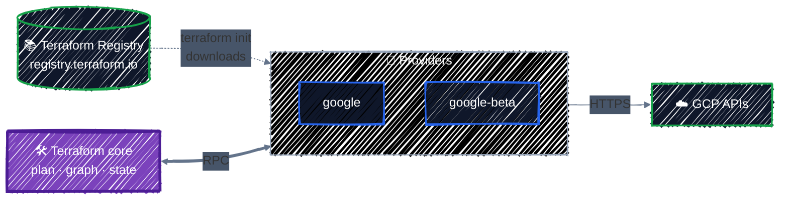

# Providers & Version Pinning

> google vs. google-beta, version constraints, and the dependency lock file.

---

Terraform itself knows nothing about GCP, Kubernetes, or any other platform. Everything it can manage comes from a **provider**: a plugin that translates HCL into API calls for one platform. This chapter covers how to choose providers, pin their versions, configure them, and run more than one configuration of the same provider at once.

## Before you start

```bash
cd examples/core-language/providers
terraform init
```

This example creates three small buckets: one in your default region, one in a second "disaster recovery" region, and one through the `google-beta` provider.

## What a provider is



- **Terraform core** reads your configuration, builds the dependency graph, computes plans, and manages state. It's the same binary whatever cloud you use.
- **A provider** is a separate executable that core starts and talks to over RPC. It knows the schema of every resource it offers (which arguments exist, which force replacement) and how to call the platform's API. `terraform init` downloads it from the [Terraform Registry](https://registry.terraform.io) into `.terraform/`.
- **Providers are versioned and released independently of Terraform.** The google provider ships a new version roughly every week. That's why pinning matters.

Each provider has its own documentation on the Registry, with a page per resource. [hashicorp/google](https://registry.terraform.io/providers/hashicorp/google/latest/docs) is the page you'll have open most while working through this guide.

## Declaring providers: `required_providers`

[`versions.tf`](../../examples/core-language/providers/versions.tf) declares which providers this configuration needs:

```hcl
terraform {
  required_version = ">= 1.10"

  required_providers {
    google = {
      source  = "hashicorp/google"
      version = "~> 8.0"
    }
    google-beta = {
      source  = "hashicorp/google-beta"
      version = "~> 8.0"
    }
  }
}
```

Each entry has three parts:

- **The local name** (`google`, `google-beta`): what you call the provider inside this configuration. It's also the prefix of its resource types: `google_storage_bucket` belongs to the provider named `google`.
- **`source`**: where to download it. `hashicorp/google` is short for `registry.terraform.io/hashicorp/google`, meaning the `google` provider published by `hashicorp` on the public Registry.
- **`version`**: which versions are acceptable. That's the next section.

Always declare every provider here, even ones that Terraform could guess from resource names. It's the one place a reader can see every dependency and its version range.

Ask Terraform which providers a configuration needs, and why:

```bash
terraform providers
```

```
Providers required by configuration:
.
├── provider[registry.terraform.io/hashicorp/google-beta] ~> 8.0
└── provider[registry.terraform.io/hashicorp/google] ~> 8.0
```

## Version constraints

| Constraint | Allows | Use it when |
|---|---|---|
| `= 8.7.0` (or just `8.7.0`) | exactly 8.7.0 | almost never; the lock file already pins exactly |
| `>= 8.0` | 8.0 and anything newer, **including 9.x, 10.x** | in reusable modules, to state a minimum |
| `~> 8.0` | `>= 8.0` and `< 9.0`: any 8.x | in root modules: get fixes and features, never a new major |
| `~> 8.7.0` | `>= 8.7.0` and `< 8.8.0`: patch releases only | when you need to hold a specific minor version |
| `>= 8.3, < 8.10` | a custom range | to avoid one known-bad release |

`~>` is the "pessimistic constraint operator": it allows only the **rightmost** version component to increase. `~> 8.0` lets the `0` go up, so any 8.x; `~> 8.7.0` lets only the patch go up.

Why not allow everything? **A major version is allowed to break you.** Each google provider major version removes deprecated arguments and changes defaults, and each comes with an [upgrade guide](https://registry.terraform.io/providers/hashicorp/google/latest/docs/guides/version_8_upgrade) listing the changes. Upgrading to a new major version should be a deliberate pull request, never a surprise from `terraform init`.

> 📌 **Root modules vs. reusable modules.** In a root module (a directory you run `terraform apply` in), use `~> 8.0` and commit the lock file. In a reusable module ([Writing Modules](../modules/writing-modules.md)), declare only a minimum such as `>= 8.0`. The root module that calls it chooses the exact version, and an over-tight constraint in a module makes it impossible to combine with others.

## The dependency lock file

A constraint like `~> 8.0` allows many versions. The **lock file**, `.terraform.lock.hcl`, records the **exact one** that was chosen:

```hcl
provider "registry.terraform.io/hashicorp/google" {
  version     = "8.7.0"
  constraints = "~> 8.0"
  hashes = [
    "h1:r0evOKSNhYYj04qb6VCTVtm7/uWr67jMZ2TsgLubk6o=",
    "zh:087771b1c22126084ec1ac26272f7e0bce1030bedd9d692b6eef38e6baf5db2e",
    ...
  ]
}
```

- **`version`**: the exact version selected. Every later `terraform init` installs this version, even after newer 8.x releases come out.
- **`constraints`**: the constraint that was in effect when it was selected.
- **`hashes`**: checksums of the provider package for each operating system and CPU architecture. `init` refuses to install a download that doesn't match, which protects you from a tampered or corrupted package.

The Registry returns checksums for every platform, so a lock file created on Linux also works on a teammate's Mac and on a Windows CI runner. You'll only need `terraform providers lock -platform=...` to add platforms by hand if you install providers from a private mirror.

**Commit the lock file.** Without it, your laptop and CI could resolve `~> 8.0` to different versions on the same day, and the plan you reviewed isn't the plan that runs.

### Upgrading a provider on purpose

With a lock file in place, `terraform init` keeps installing the locked version. To move to a newer version within your constraint, run:

```bash
terraform init -upgrade
```

```
Initializing provider plugins...
- Finding hashicorp/google versions matching "~> 8.0"...
- Finding hashicorp/google-beta versions matching "~> 8.0"...
- Installing hashicorp/google v8.7.0...
- Installed hashicorp/google v8.7.0 (signed by HashiCorp)
- Installing hashicorp/google-beta v8.7.0...
- Installed hashicorp/google-beta v8.7.0 (signed by HashiCorp)
```

`-upgrade` ignores the locked versions, picks the newest version allowed by each constraint, and rewrites the lock file. Here 8.7.0 was already the newest 8.x, so nothing changed.

A safe upgrade looks like this:

1. Read the provider's [CHANGELOG](https://github.com/hashicorp/terraform-provider-google/blob/main/CHANGELOG.md) for the versions you're skipping.
2. Run `terraform init -upgrade`.
3. Run `terraform plan`. For a minor upgrade you want **`No changes.`** Any diff means the new version reads or defaults something differently, so understand it before applying.
4. Commit the updated `.terraform.lock.hcl` on its own, in a pull request that does nothing else.

### When the constraint and the lock file disagree

If you tighten a constraint so that the locked version no longer satisfies it, for example by changing `~> 8.0` to `~> 8.5.0` while 8.7.0 is locked, `init` stops and tells you what to do:

```
Error: Failed to query available provider packages

Could not retrieve the list of available versions for provider
hashicorp/google: locked provider registry.terraform.io/hashicorp/google
8.7.0 does not match configured version constraint ~> 8.5.0; must use
terraform init -upgrade to allow selection of new versions
```

`terraform init -upgrade` then selects 8.5.x and rewrites the lock file. Terraform never silently swaps the provider out from under you.

## Configuring a provider

The `provider` block sets defaults for every resource that uses that provider. From [`providers.tf`](../../examples/core-language/providers/providers.tf):

```hcl
locals {
  # Every resource either provider creates gets these labels, on top of its own.
  default_labels = {
    managed-by = "terraform"
    tutorial   = "providers"
  }
}

# The default google provider: used by any google_* resource that doesn't say otherwise.
provider "google" {
  project        = var.project_id
  region         = var.region
  default_labels = local.default_labels
}
```

- **`project`, `region`**: the defaults for resources that don't set their own. A resource can always override them, as the `dr` bucket below does with `location`.
- **`default_labels`**: labels applied to **every** resource this provider creates that supports labels, merged with the resource's own `labels`. It's the easiest way to make sure everything is labeled with its owner, environment, or cost center.
- **Credentials**: you don't set any. The provider finds your Application Default Credentials from [Setup](../getting-started/setup.md) automatically. Never put credentials in a provider block. [IAM & Service Accounts](../gcp-foundations/iam.md) shows the one credential-related setting you will use, `impersonate_service_account`.

None of the buckets in `main.tf` sets `labels`, yet the plan shows them labeled:

```
  # google_storage_bucket.primary will be created
  + resource "google_storage_bucket" "primary" {
      + effective_labels            = {
          + "goog-terraform-provisioned" = "true"
          + "managed-by"                 = "terraform"
          + "tutorial"                   = "providers"
        }
      ...
```

## Two configurations of one provider: `alias`

Sometimes one configuration needs the same provider set up two ways: two regions, two projects, or two sets of credentials. Add a second `provider` block with an **`alias`**:

```hcl
# A second configuration of the SAME provider, for another region.
# Resources opt in with `provider = google.dr`.
provider "google" {
  alias          = "dr"
  project        = var.project_id
  region         = var.dr_region
  default_labels = local.default_labels
}
```

The block without an alias is the **default** configuration. A resource uses the aliased one only when it asks, with the `provider` meta-argument:

```hcl
resource "google_storage_bucket" "dr" {
  provider = google.dr     # <local name>.<alias>, not a string

  name     = "${var.project_id}-providers-dr"
  location = var.dr_region
  ...
}
```

```
Changes to Outputs:
  + buckets = {
      + beta    = "US-CENTRAL1"
      + dr      = "US-EAST1"
      + primary = "US-CENTRAL1"
    }
```

Common uses of `alias` in GCP:

- **A second project**: a shared "network host" project alongside a workload project, or a central logging project.
- **A second region**: disaster-recovery copies, or regional resources such as Artifact Registry repositories in several places.
- **Different credentials**: one configuration impersonating a deploy service account, another impersonating a read-only one.

> 💡 For a bucket, `location` alone decides where it lives, so the alias is only demonstrating the mechanism here. It matters for resources that have no location argument of their own and take the region from the provider, and for working across projects.

## `google` vs. `google-beta`

GCP releases many features in **preview** before they're generally available. The google provider ships as **two providers** built from the same code:

| | `google` | `google-beta` |
|---|---|---|
| Features | generally available (GA) only | GA **plus** preview (beta) features |
| Stability | GA features follow normal deprecation rules | preview features can change or disappear |
| Versions | released together, with the same version numbers | |
| Use it | by default, for everything | only for resources or arguments that need a preview feature |

A resource that needs a preview feature opts in exactly like an alias:

```hcl
resource "google_storage_bucket" "beta" {
  provider = google-beta
  ...
}
```

Rules that keep this manageable:

- **Default to `google`.** Switch individual resources to `google-beta` only when the docs mark an argument or resource as beta. The Registry pages say so explicitly.
- **Configure both identically** (same project, region, `default_labels`), or the resources they manage will behave inconsistently.
- **Pin both to the same version range.** They're released in lockstep, and mixing `google` 8.7 with `google-beta` 8.3 just causes confusion.
- **Switching back is free.** When a feature reaches GA, change `provider = google-beta` back to the default. The resource stays the same; only the provider that manages it changes. Run `plan` to confirm there's nothing else to do.

## Apply it

```bash
terraform plan    # Plan: 3 to add, 0 to change, 0 to destroy.
terraform apply
gcloud storage buckets list --filter="labels.tutorial=providers" --format="table(name,location)"
```

All three buckets show up with the `tutorial=providers` label, even though none of them sets it.

## Best practices

- **Declare every provider in `required_providers`** with an explicit `source` and `version`.
- **Use `~> <major>.0` in root modules, `>= <minimum>` in reusable modules.**
- **Commit `.terraform.lock.hcl`** and upgrade providers with `init -upgrade` in a dedicated pull request, after reading the changelog.
- **Treat a provider major version as a migration.** Read the upgrade guide first, and expect to change code.
- **Set `default_labels`** on every google provider configuration, so nothing goes unlabeled.
- **Keep credentials out of `provider` blocks.** Use ADC locally and Workload Identity Federation in CI.
- **Prefer `google`; use `google-beta` per resource**, only where a preview feature requires it.

## Clean up

```bash
terraform destroy
```

---

[← Anatomy of HCL](../getting-started/hcl-anatomy.md) · [↑ Contents](../../README.md) · [Resources & Data Sources →](resources-and-data-sources.md)
