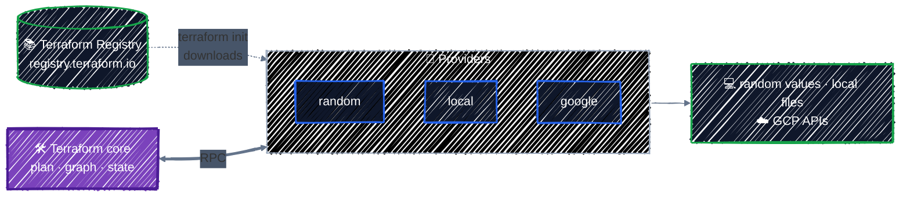

# Providers & Version Pinning

> What a provider is, version constraints, and the dependency lock file.

---

Terraform itself knows nothing about GCP, Kubernetes, files on your disk, or any other platform. Everything it can manage comes from a **provider**: a plugin that translates HCL into calls to one platform. This chapter covers how to declare providers, pin their versions, and upgrade them on purpose.

## Before you start

```bash
cd examples/core-language/providers
terraform init
```

This example uses the two providers you already know from [Getting Started](../getting-started/core-workflow.md): `random` generates a name, and `local` writes it to a file. The resources are deliberately boring; the interesting part is `versions.tf` and the lock file.

## What a provider is



- **Terraform core** reads your configuration, builds the dependency graph, computes plans, and manages state. It's the same binary whatever you manage.
- **A provider** is a separate executable that core starts and talks to over RPC. It knows the schema of every resource it offers (which arguments exist, which force replacement) and how to make the change: write a file, generate a value, or call a cloud API. `terraform init` downloads it from the [Terraform Registry](https://registry.terraform.io) into `.terraform/`.
- **Providers are versioned and released independently of Terraform.** Busy providers ship often; the google provider releases roughly every week. That's why pinning matters.

Each provider has its own documentation on the Registry, with a page per resource. [hashicorp/random](https://registry.terraform.io/providers/hashicorp/random/latest/docs) documents `random_pet`; from Part 2 on, [hashicorp/google](https://registry.terraform.io/providers/hashicorp/google/latest/docs) is the page you'll have open most.

### Who publishes a provider

The Registry hosts thousands of providers, and they aren't equally trustworthy. Each one's page shows a badge for its tier:

| Tier | Published by | Examples |
|---|---|---|
| **Official** | HashiCorp | `hashicorp/random`, `hashicorp/local`, `hashicorp/google` |
| **Partner** | the company that makes the platform, verified by HashiCorp | providers for monitoring, database, and DNS services, published by those vendors |
| **Community** | anyone | small or niche integrations, maintained by individuals |

The namespace in `source` (`hashicorp/` in `hashicorp/random`) tells you who publishes it. A community provider can be perfectly good, but before you depend on one, check what you'd check for any dependency: who maintains it, how recently it was released, and whether its issues get answers. The lock file's checksums protect you from a tampered download; they can't tell you whether the publisher is someone you should trust.

## Declaring providers: `required_providers`

[`versions.tf`](../../examples/core-language/providers/versions.tf) declares which providers this configuration needs:

```hcl
terraform {
  required_version = ">= 1.10"

  required_providers {
    random = {
      source  = "hashicorp/random"
      version = "~> 3.9"
    }
    local = {
      source  = "hashicorp/local"
      version = "~> 2.9"
    }
  }
}
```

Each entry has three parts:

- **The local name** (`random`, `local`): what you call the provider inside this configuration. It's also the prefix of its resource types: `random_pet` belongs to the provider named `random`, `local_file` to `local`.
- **`source`**: where to download it. `hashicorp/random` is short for `registry.terraform.io/hashicorp/random`, meaning the `random` provider published by `hashicorp` on the public Registry.
- **`version`**: which versions are acceptable. That's the next section.

Always declare every provider here, even ones that Terraform could guess from resource names. It's the one place a reader can see every dependency and its version range.

Ask Terraform which providers a configuration needs, and why:

```bash
terraform providers
```

```
Providers required by configuration:
.
├── provider[registry.terraform.io/hashicorp/random] ~> 3.9
└── provider[registry.terraform.io/hashicorp/local] ~> 2.9
```

## Version constraints

| Constraint | Allows | Use it when |
|---|---|---|
| `= 3.9.1` (or just `3.9.1`) | exactly 3.9.1 | almost never; the lock file already pins exactly |
| `>= 3.0` | 3.0 and anything newer, **including 4.x, 5.x** | in reusable modules, to state a minimum |
| `~> 3.9` | `>= 3.9` and `< 4.0`: 3.9 or any later 3.x | in root modules: get fixes and features, never a new major |
| `~> 3.6.0` | `>= 3.6.0` and `< 3.7.0`: patch releases only | when you need to hold a specific minor version |
| `>= 3.5, < 3.8` | a custom range | to stay within versions you've tested |
| `>= 3.5, != 3.9.1` | 3.5 or newer, except 3.9.1 | to skip one known-bad release |

Combine conditions with commas; a version must satisfy all of them. With `>= 3.5, != 3.9.1`, `init` skips the excluded release and picks the newest of the rest:

```
- Finding hashicorp/random versions matching ">= 3.5.0, != 3.9.1"...
- Installing hashicorp/random v3.9.0...
```

`~>` is the "pessimistic constraint operator": it allows only the **rightmost** version component to increase. `~> 3.9` lets the `9` go up, so any 3.x from 3.9; `~> 3.6.0` lets only the patch go up.

Why not allow everything? **A major version is allowed to break you.** Major versions remove deprecated arguments and change defaults, and well-maintained providers publish an upgrade guide for each one. The google provider's [version 8 upgrade guide](https://registry.terraform.io/providers/hashicorp/google/latest/docs/guides/version_8_upgrade) is a typical example. Upgrading to a new major version should be a deliberate pull request, never a surprise from `terraform init`.

> 📌 **Root modules vs. reusable modules.** In a root module (a directory you run `terraform apply` in), use `~> <major>.<minor>` and commit the lock file. In a reusable module ([Writing Modules](../modules/writing-modules.md)), declare only a minimum such as `>= 3.0`. The root module that calls it chooses the exact version, and an over-tight constraint in a module makes it impossible to combine with others.

## The dependency lock file

A constraint like `~> 3.9` allows many versions. The **lock file**, `.terraform.lock.hcl`, records the **exact one** that was chosen:

```hcl
provider "registry.terraform.io/hashicorp/random" {
  version     = "3.9.1"
  constraints = "~> 3.9"
  hashes = [
    "h1:g40qr7yDmIpaur4SsK5BcOda3HSo1RJ6zHVMqN4EJ+0=",
    "zh:05f4734c1f0be840b711b3eff259ebc5fca436784c728955b1678078466f48d7",
    ...
  ]
}
```

- **`version`**: the exact version selected. Every later `terraform init` installs this version, even after newer 3.x releases come out.
- **`constraints`**: the constraint that was in effect when it was selected.
- **`hashes`**: checksums of the provider package for each operating system and CPU architecture. `init` refuses to install a download that doesn't match, which protects you from a tampered or corrupted package.

The Registry returns checksums for every platform, so a lock file created on Linux also works on a teammate's Mac and on a Windows CI runner. You'll only need `terraform providers lock -platform=...` to add platforms by hand if you install providers from a private mirror.

**Commit the lock file.** Without it, your laptop and CI could resolve `~> 3.9` to different versions on the same day, and the plan you reviewed isn't the plan that runs.

### Upgrading a provider on purpose

With a lock file in place, `terraform init` keeps installing the locked version. To move to a newer version within your constraint, run:

```bash
terraform init -upgrade
```

```
Initializing provider plugins...
- Finding hashicorp/local versions matching "~> 2.9"...
- Finding hashicorp/random versions matching "~> 3.9"...
- Using previously-installed hashicorp/random v3.9.1
- Using previously-installed hashicorp/local v2.9.1
```

`-upgrade` ignores the locked versions, picks the newest version allowed by each constraint, and rewrites the lock file. Here 3.9.1 and 2.9.1 were already the newest allowed, so nothing changed.

A safe upgrade looks like this:

1. Read the provider's changelog for the versions you're skipping. Every provider links it from its Registry page.
2. Run `terraform init -upgrade`.
3. Run `terraform plan`. For a minor upgrade you want **`No changes.`** Any diff means the new version reads or defaults something differently, so understand it before applying.
4. Commit the updated `.terraform.lock.hcl` on its own, in a pull request that does nothing else.

### When the constraint and the lock file disagree

Hold `random` to the 3.6 series: in `versions.tf`, change `~> 3.9` to `~> 3.6.0`. The locked 3.9.1 no longer satisfies the constraint, so `init` stops and tells you what to do:

```bash
terraform init
```

```
Error: Failed to query available provider packages

Could not retrieve the list of available versions for provider
hashicorp/random: locked provider registry.terraform.io/hashicorp/random
3.9.1 does not match configured version constraint ~> 3.6.0; must use
terraform init -upgrade to allow selection of new versions
```

Do what it says:

```bash
terraform init -upgrade
```

```
- Finding hashicorp/random versions matching "~> 3.6.0"...
- Installing hashicorp/random v3.6.3...
- Installed hashicorp/random v3.6.3 (signed by HashiCorp)
```

```bash
git diff .terraform.lock.hcl
```

```diff
 provider "registry.terraform.io/hashicorp/random" {
-  version     = "3.9.1"
-  constraints = "~> 3.9"
+  version     = "3.6.3"
+  constraints = "~> 3.6.0"
   hashes = [
```

That diff is what a reviewer sees in a provider-change pull request. Terraform never silently swaps the provider out from under you: changing versions always takes an explicit `-upgrade` and shows up in the lock file.

Put it back: change the constraint to `~> 3.9` again and run `terraform init -upgrade`. The lock file returns to 3.9.1, and `git diff` shows nothing.

## Configuring a provider

Some providers need settings before they can do anything: which project and region to use, which account to act as. You give them in a `provider` block:

```hcl
provider "google" {
  project = var.project_id
  region  = var.region
}
```

`random` and `local` need no settings at all, so this example has no `provider` block. Terraform uses an empty default configuration for them.

A configurable provider can also set **provider-wide defaults**, such as the google provider's `default_labels`, which apply to every resource the provider creates.

You'll configure the google provider in [Connecting to GCP](../state/google-provider.md), the first chapter that creates real cloud resources.

## Apply it

```bash
terraform apply
cat out/server.txt
```

```
cunning-hermit
```

Nothing about the resources changed in this chapter. What you practiced is the part that keeps them reproducible: the same configuration, with the same lock file, installs the same provider builds on every machine.

## Checkpoint

1. Your constraint is `~> 3.9`, and the lock file selects `3.9.1`. A month later 3.10.0 is released. Which version does a normal `terraform init` install, and how do you intentionally move to the new one?
2. A teammate wrote `version = ">= 3.0"` in a root module and didn't commit the lock file. What can go wrong when random 4.0 is released?
3. You change a constraint, and `init` fails with *"locked provider ... does not match configured version constraint"*. Why does Terraform refuse, and what's the fix?

<details>
<summary>Answer</summary>

1. Terraform keeps installing `3.9.1` from the lock file. Run `terraform init -upgrade` deliberately, review the lock-file diff, and check that `terraform plan` shows no unexpected changes.
2. The next `init` on a fresh machine or CI runner picks 4.0, a major version that may remove arguments or change behavior. Different machines can then run different provider versions against the same state. Use `~> 3.9` in root modules and commit the lock file.
3. The lock file records one exact version, and Terraform won't change it without being asked. Run `terraform init -upgrade` to select a version that matches the new constraint, then commit the updated lock file.

</details>

## Best practices

- **Declare every provider in `required_providers`** with an explicit `source` and `version`.
- **Use `~> <major>.<minor>` in root modules, `>= <minimum>` in reusable modules.**
- **Commit `.terraform.lock.hcl`** and upgrade providers with `init -upgrade` in a dedicated pull request, after reading the changelog.
- **Treat a provider major version as a migration.** Read the upgrade guide first, and expect to change code.
- **Keep credentials out of `provider` blocks.** Providers that need credentials find them from the environment; for GCP, that's Application Default Credentials locally and Workload Identity Federation in CI.

## Clean up

```bash
terraform destroy
```

---

[← Anatomy of HCL](../getting-started/hcl-anatomy.md) · [↑ Contents](../../README.md) · [Resources & Data Sources →](resources-and-data-sources.md)
