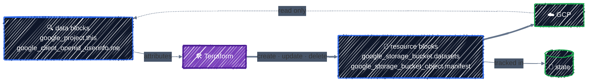
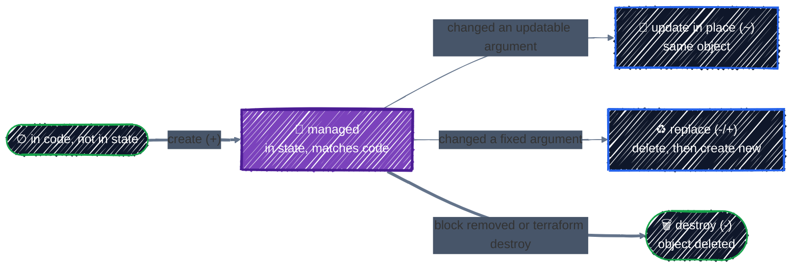

# Resources & Data Sources

> Things Terraform manages vs. things it only reads.

---

Every block that talks to GCP is one of two kinds. A **resource** is something Terraform **owns**: it creates it, updates it to match your code, and deletes it on `destroy`. A **data source** is something Terraform only **reads**: a project, the identity you're logged in as, a network another team runs. It's never created, changed, or deleted. Knowing which one you need, and how to read a resource's documentation, is most of day-to-day Terraform work.

## Before you start

```bash
cd examples/core-language/resources-and-data-sources
terraform init
```

The example reads three things that already exist (your project, your identity, and Cloud Storage's service agent), then creates a bucket and writes a small manifest file into it built from what it read.

## Manage vs. read



| | `resource` | `data` |
|---|---|---|
| Terraform… | creates, updates, deletes it | only reads it |
| Address | `google_storage_bucket.datasets` | `data.google_project.this` |
| On `destroy` | deleted | untouched |
| Appears in a plan as | `+`, `~`, `-/+`, `-` | nothing, or `<=` if it can't be read until apply |
| Use it for | everything this configuration owns | things that exist already, or that someone else owns |

The rule of thumb: **each real object is managed by exactly one Terraform configuration.** Everywhere else, it's a data source (or a value passed in as a variable).

## Resources

### Anatomy of a resource

From [`main.tf`](../../examples/core-language/resources-and-data-sources/main.tf):

```hcl
resource "google_storage_bucket" "datasets" {
  # Required arguments.
  name     = "${var.project_id}-datasets"
  location = var.region

  # Optional arguments. Leave one out and the provider or GCP picks a default.
  storage_class               = "STANDARD"
  uniform_bucket_level_access = true
  public_access_prevention    = "enforced"
  force_destroy               = true

  versioning {
    enabled = true
  }

  # Keep only the 3 newest old versions of each object.
  lifecycle_rule {
    condition {
      num_newer_versions = 3
      with_state         = "ARCHIVED"
    }
    action {
      type = "Delete"
    }
  }
}
```

- **The resource type** (`google_storage_bucket`) picks the kind of object and, through its prefix, the provider: `google_` means the `google` provider.
- **The local name** (`datasets`) is how you refer to it in this configuration. Together they form the **address**, `google_storage_bucket.datasets`, which is also its key in state. Renaming it is a refactor, covered in [Refactoring](../state/refactoring.md).
- **The body** is arguments and nested blocks, exactly as in [Anatomy of HCL](../getting-started/hcl-anatomy.md).

### Arguments in, attributes out

Every resource type has a **schema** that says, for each field, whether you set it, GCP sets it, or either can:

| Kind | Who sets it | Examples on `google_storage_bucket` |
|---|---|---|
| **Required** argument | you, always | `name`, `location` |
| **Optional** argument | you, if you want; otherwise it's unset | `labels`, `force_destroy`, `storage_class` |
| **Optional + computed** | you, or GCP fills in a default | `project`, `public_access_prevention`, `rpo` |
| **Computed** attribute (read-only) | GCP, after creation | `url`, `self_link`, `time_created`, `project_number` |

You can **refer to any of them** from elsewhere: `google_storage_bucket.datasets.url` works even though you never set `url`. That's what makes resources composable.

Computed values don't exist until GCP has created the object, which is why the plan shows them as `(known after apply)`:

```
  # google_storage_bucket.datasets will be created
  + resource "google_storage_bucket" "datasets" {
      + force_destroy               = true
      + id                          = (known after apply)
      + location                    = "US-CENTRAL1"
      + name                        = "tf-tutorial-3fa9c1-datasets"
      + project                     = (known after apply)
      + project_number              = (known after apply)
      + public_access_prevention    = "enforced"
      + rpo                         = (known after apply)
      + self_link                   = (known after apply)
      + storage_class               = "STANDARD"
      ...
      + url                         = (known after apply)
```

Anything you set, or that Terraform can work out from your variables, is shown as a value. Anything GCP decides is `(known after apply)`. This matters downstream too: a value computed from `google_storage_bucket.datasets.url` is also unknown until apply.

### Reading the provider docs

Every resource has a page on the Registry, for example [google_storage_bucket](https://registry.terraform.io/providers/hashicorp/google/latest/docs/resources/storage_bucket). You'll read dozens of these, and they all have the same layout:

| Section | What it tells you |
|---|---|
| **Example Usage** | a working configuration to start from. Copy this first |
| **Argument Reference** | every argument and nested block, each marked `(Required)` or `(Optional)`, with defaults and allowed values |
| **Attributes Reference** | the read-only, computed values you can refer to |
| **Timeouts** | how long create/update/delete may take before Terraform gives up, and how to raise it with a `timeouts { }` block (GKE clusters need this) |
| **Import** | the ID format for bringing an existing object under management |

Arguments that **force replacement** (the `-/+` from [Core Workflow](../getting-started/core-workflow.md)) aren't always called out in the docs. The plan always marks them with `# forces replacement`, so read the plan before you trust your assumptions.

To see the schema of every resource and data source in your installed providers, ask Terraform itself:

```bash
terraform providers schema -json | jq '.provider_schemas[].resource_schemas.google_storage_bucket.block.attributes.url'
```

```json
{
  "type": "string",
  "description_kind": "plain",
  "computed": true
}
```

### What happens to a resource over its life



- **Create**: the address is in your code but not in state.
- **Update in place** (`~`): you changed an argument that the API can change on a live object, such as `labels` or a `lifecycle_rule`.
- **Replace** (`-/+`): you changed an argument the API can't change, such as a bucket's `name` or `location`. Terraform deletes the object and creates a new one at the same address.
- **Destroy**: the address is in state but no longer in your code, or you ran `terraform destroy`.

There's no "ignore it from now on" action. Removing a block from your code means **delete the object**. To stop managing something without deleting it, use a `removed` block ([Refactoring](../state/refactoring.md)).

## Data sources

A `data` block looks like a resource but starts with `data`, and its arguments are **search criteria**, not desired settings. From [`data.tf`](../../examples/core-language/resources-and-data-sources/data.tf):

```hcl
# The project this configuration runs in (the provider's default project).
# Gives us its number, which many GCP APIs and service agents use.
data "google_project" "this" {}

# Who is running Terraform right now (the account behind your ADC).
data "google_client_openid_userinfo" "me" {}

# The Google-managed service agent that Cloud Storage uses in this project.
# You grant it roles when buckets need to use your KMS keys or publish
# notifications. GCP creates it; you only look it up.
data "google_storage_project_service_account" "gcs" {}
```

All three have empty bodies: they use the provider's default `project`. Their attributes are referred to with a `data.` prefix, and feed into resources like any other value:

```hcl
resource "google_storage_bucket_object" "manifest" {
  bucket       = google_storage_bucket.datasets.name
  name         = "MANIFEST.json"
  content_type = "application/json"

  content = jsonencode({
    project_id     = data.google_project.this.project_id
    project_number = data.google_project.this.number
    created_by     = data.google_client_openid_userinfo.me.email
  })
}
```

### When data sources are read

Normally, **during `plan`**, before Terraform works out any changes. You'll see it at the top of the output:

```
data.google_project.this: Reading...
data.google_storage_project_service_account.gcs: Reading...
data.google_client_openid_userinfo.me: Reading...
data.google_storage_project_service_account.gcs: Read complete after 0s [id=service-123456789012@gs-project-accounts.iam.gserviceaccount.com]
data.google_project.this: Read complete after 0s [id=projects/tf-tutorial-3fa9c1]
...
```

Because they're read up front, their values are real in the plan, not `(known after apply)`:

```
Changes to Outputs:
  + bucket_self_link  = (known after apply)
  + bucket_url        = (known after apply)
  + gcs_service_agent = "service-123456789012@gs-project-accounts.iam.gserviceaccount.com"
  + project_number    = "123456789012"
  + running_as        = "you@example.com"
```

(`running_as` shows the email of the account behind your ADC.)

Data sources are re-read on **every** plan. They aren't cached between runs. If someone changes the thing being read, your next plan sees the new value.

### `<=`: reads deferred until apply

If a data source's arguments depend on a resource that's about to change, Terraform can't read it during plan, because the thing it would read doesn't exist yet. It **defers the read to apply** and marks it with a new symbol, `<=`:

```hcl
# ⚠️ Anti-pattern: reading back a bucket this configuration creates.
data "google_storage_bucket" "readback" {
  name = google_storage_bucket.datasets.name
}
```

```
Terraform used the selected providers to generate the following execution
plan. Resource actions are indicated with the following symbols:
  + create
 <= read (data resources)

Terraform will perform the following actions:

  # data.google_storage_bucket.readback will be read during apply
  # (depends on a resource or a module with changes pending)
 <= data "google_storage_bucket" "readback" {
      + name                        = "tf-tutorial-3fa9c1-datasets"
      ...
    }
```

Everything computed from it is now `(known after apply)` too, so the plan tells you less. Worse, this keeps happening on every plan where the bucket has a pending change. **Never use a data source to read something the same configuration manages.** Refer to the resource directly: `google_storage_bucket.datasets.location` already has everything the data source would return.

### Looking up something someone else owns

The most common real use: another team, or another Terraform configuration, owns a shared object, and you need its attributes.

```hcl
variable "shared_models_bucket" {
  type = string
}

data "google_storage_bucket" "shared_models" {
  name = var.shared_models_bucket
}

# then use data.google_storage_bucket.shared_models.url, .location, ...
```

If the object doesn't exist, **the plan fails**. A data source never creates what it can't find:

```
Error: googleapi: Error 404: The specified bucket does not exist., notFound

  with data.google_storage_bucket.shared_models,
  on data.tf line 16, in data "google_storage_bucket" "shared_models":
  16: data "google_storage_bucket" "shared_models" {
```

That's a feature: you find out at plan time, not halfway through an apply.

### Data sources you'll use constantly on GCP

| Data source | Gives you | Used for |
|---|---|---|
| `google_project` | project `number`, name, labels | service agent emails, APIs that want the number |
| `google_client_config` | the provider's `project`, `region`, and an `access_token` | configuring the Kubernetes and Helm providers ([Kubernetes & Helm](../ai-infra/kubernetes-and-helm.md)) |
| `google_client_openid_userinfo` | the `email` of who's running Terraform | granting yourself access in a sandbox |
| `google_storage_project_service_account` | Cloud Storage's service agent | CMEK and Pub/Sub notification grants |
| `google_compute_network`, `google_compute_subnetwork` | an existing VPC and subnet | deploying into a network another team runs |
| `google_compute_zones` | zones available in a region | spreading node pools across zones |
| `google_container_engine_versions` | GKE versions available in a location | pinning a GKE version ([GKE Cluster](../ai-infra/gke-cluster.md)) |
| `google_secret_manager_secret_version` | a secret's value | reading secrets you don't manage ([Secrets](../gcp-foundations/secrets.md)) |

### Data source, variable, or import?

When your configuration needs something it didn't create, you have three options:

| Use | When | Example |
|---|---|---|
| **A variable** | the value is simple and the caller knows it | a project ID, a region, a network name |
| **A data source** | you need attributes you'd otherwise have to look up and copy (numbers, IDs, links), or you want plan to fail if it's missing | the project number, a subnet's `self_link` |
| **Import** | Terraform should **take over** managing the existing object | a bucket created by hand that you now want in code ([Refactoring](../state/refactoring.md)) |

A data source and an import are not interchangeable: a data source only reads, while an import means this configuration will change and eventually destroy the object.

## Apply it

```bash
terraform plan    # Plan: 2 to add, 0 to change, 0 to destroy.
terraform apply
terraform output
gcloud storage cat "gs://$TF_VAR_project_id-datasets/MANIFEST.json"
```

```
{"created_by":"you@example.com","project_id":"tf-tutorial-3fa9c1","project_number":"123456789012"}
```

The manifest was built entirely from data sources. Now look at what Terraform recorded for the bucket, including every computed attribute:

```bash
terraform state show google_storage_bucket.datasets
```

Data sources are stored in state too (`terraform state list` shows `data.google_project.this`), but only as a cache of the last read. Removing a `data` block never deletes anything.

## Checkpoint

1. Choose among a resource, data source, input variable, or import: create a bucket; look up the active project's number; receive a project ID from the caller; adopt an existing bucket.
2. Why can adding `depends_on` to a data source make its value unknown during planning?
3. A configuration creates a bucket and then reads the same bucket back with a data source. What should it usually do instead?

<details>
<summary>Answer</summary>

1. Resource; data source; input variable; import plus a matching resource block.
2. Terraform must wait for the dependency to change before performing the read, so it can defer the data source until apply and show dependent values as unknown in the plan.
3. Refer directly to the managed resource's attributes. Reading back an object the same configuration owns adds an unnecessary API read and can defer values.

</details>

## Best practices

- **One owner per object.** Each real object is a `resource` in exactly one configuration; everywhere else it's a `data` source or a variable.
- **Never read back with a data source what the same configuration creates.** Refer to the resource's attributes instead.
- **Start from the docs' Example Usage**, then check the Argument Reference for what each setting does and its default.
- **Read the plan for `# forces replacement`** before applying any change to a resource holding data.
- **Look things up rather than hard-coding them.** A project number or service agent email pasted into code breaks the day the code runs in another project.
- **Use a variable when it's enough.** Every data source is an API call on every plan and needs read permission on the object.

## Clean up

```bash
terraform destroy
```

Only the bucket and the manifest are destroyed. The project, your account, and the service agent were only read, so they're untouched.

---

[← Providers & Version Pinning](providers.md) · [↑ Contents](../../README.md) · [Variables, Locals & Outputs →](variables-and-outputs.md)
