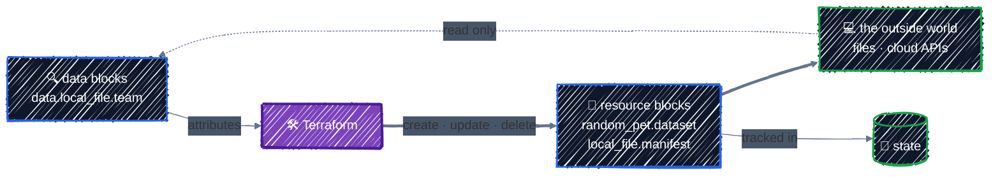
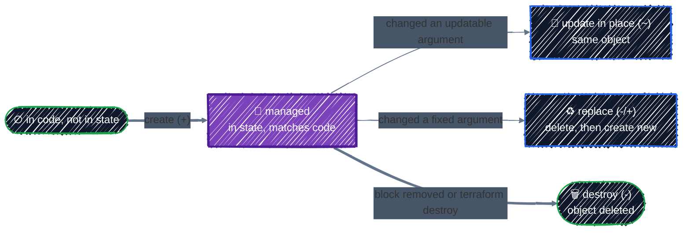

# Resources & Data Sources

> Things Terraform manages vs. things it only reads.

---

Every block that touches the outside world is one of two kinds. A **resource** is something Terraform **owns**: it creates it, updates it to match your code, and deletes it on `destroy`. A **data source** is something Terraform only **reads**: a file another team maintains, a project, a network someone else runs. It's never created, changed, or deleted. Knowing which one you need, and how to read a resource's documentation, is most of day-to-day Terraform work.

## Before you start

```bash
cd examples/core-language/resources-and-data-sources
terraform init
```

The example reads a JSON file that it doesn't own, [`input/team.json`](../../examples/core-language/resources-and-data-sources/input/team.json), then generates a dataset name and writes a manifest built from what it read:

```json
{
  "team": "ml-platform",
  "owner": "alice@example.com",
  "cost_center": "cc-1234"
}
```

Picture another team's tooling maintaining that file. On GCP, the same pattern reads a project, a network, or a bucket someone else manages.

## Manage vs. read



| | `resource` | `data` |
|---|---|---|
| Terraform… | creates, updates, deletes it | only reads it |
| Address | `local_file.manifest` | `data.local_file.team` |
| On `destroy` | deleted | untouched |
| Appears in a plan as | `+`, `~`, `-/+`, `-` | nothing, or `<=` if it can't be read until apply |
| Use it for | everything this configuration owns | things that exist already, or that someone else owns |

The rule of thumb: **each real object is managed by exactly one Terraform configuration.** Everywhere else, it's a data source (or a value passed in as a variable).

## Resources

### Anatomy of a resource

From [`main.tf`](../../examples/core-language/resources-and-data-sources/main.tf):

```hcl
resource "local_file" "manifest" {
  # Required argument.
  filename = "${path.module}/out/manifest.json"

  # Exactly one content source is required: content, content_base64, or source.
  content = jsonencode({
    dataset     = random_pet.dataset.id
    owner       = local.team.owner
    cost_center = local.team.cost_center
  })

  # Optional arguments. Leave one out and the provider picks a default.
  file_permission      = "0644"
  directory_permission = "0755"
}
```

- **The resource type** (`local_file`) picks the kind of object and, through its prefix, the provider: `local_` means the `local` provider, as `google_` means `google`.
- **The local name** (`manifest`) is how you refer to it in this configuration. Together they form the **address**, `local_file.manifest`, which is also its key in state. Renaming it is a refactor, covered in [Refactoring](../state/refactoring.md).
- **The body** is arguments and nested blocks, exactly as in [Anatomy of HCL](../getting-started/hcl-anatomy.md). `jsonencode` turns a map into JSON text; [Expressions & Functions](expressions.md) covers it.

### Arguments in, attributes out

Every resource type has a **schema** that says, for each field, whether you set it, the provider sets it, or either can:

| Kind | Who sets it | Examples on `local_file` and `random_pet` |
|---|---|---|
| **Required** argument | you, always | `filename` |
| **Optional** argument | you, if you want; otherwise it's unset | `content`, `random_pet`'s `prefix` |
| **Optional + computed** | you, or the provider fills in a default | `file_permission` (default `"0777"`), `random_pet`'s `length` (default `2`) |
| **Computed** attribute (read-only) | the provider, after creation | `id`, `content_sha256`, `content_md5` |

You can **refer to any of them** from elsewhere: `local_file.manifest.content_sha256` works even though you never set it. That's what makes resources composable.

Computed values don't exist until the object has been created, which is why the plan shows them as `(known after apply)`:

```
  # local_file.manifest will be created
  + resource "local_file" "manifest" {
      + content              = (known after apply)
      + content_base64sha256 = (known after apply)
      ...
      + content_sha256       = (known after apply)
      + directory_permission = "0755"
      + file_permission      = "0644"
      + filename             = "./out/manifest.json"
      + id                   = (known after apply)
    }

  # random_pet.dataset will be created
  + resource "random_pet" "dataset" {
      + id        = (known after apply)
      + length    = 2
      + prefix    = "ml-platform"
      + separator = "-"
    }
```

Anything you set, or that Terraform can work out before creating anything, is shown as a value. `length` and `separator` show their defaults. Anything decided at creation is `(known after apply)`, and so is everything computed from it downstream: `content` is unknown because it includes the pet name. On a cloud, IDs, URLs, and IP addresses behave the same way.

### Reading the provider docs

Every resource has a page on the Registry, for example [local_file](https://registry.terraform.io/providers/hashicorp/local/latest/docs/resources/file) or, from Part 2 on, [google_storage_bucket](https://registry.terraform.io/providers/hashicorp/google/latest/docs/resources/storage_bucket). You'll read dozens of these, and they all have the same layout:

| Section | What it tells you |
|---|---|
| **Example Usage** | a working configuration to start from. Copy this first |
| **Argument Reference** | every argument and nested block, each marked `(Required)` or `(Optional)`, with defaults and allowed values |
| **Attributes Reference** | the read-only, computed values you can refer to |
| **Timeouts** | how long create/update/delete may take before Terraform gives up, and how to raise it with a `timeouts { }` block (GKE clusters need this) |
| **Import** | the ID format for bringing an existing object under management |

Arguments that **force replacement** (the `-/+` from [Core Workflow](../getting-started/core-workflow.md)) aren't always called out in the docs. The plan always marks them with `# forces replacement`, so read the plan before you trust your assumptions.

To see the schema of every resource and data source in your installed providers, ask Terraform itself:

```bash
terraform providers schema -json | jq '.provider_schemas[].resource_schemas.local_file.block.attributes.content_sha256'
```

```json
{
  "type": "string",
  "description": "SHA256 checksum of file content.",
  "description_kind": "plain",
  "computed": true
}
```

### What happens to a resource over its life



- **Create**: the address is in your code but not in state.
- **Update in place** (`~`): you changed an argument that can be changed on a live object, such as a bucket's labels on GCP. `local_file` and `random_pet` have no such arguments, which is why you haven't seen `~` on a resource yet.
- **Replace** (`-/+`): you changed an argument that can't be changed, such as a pet's `prefix` or a bucket's `name`. Terraform deletes the object and creates a new one at the same address. `local_file` has no updatable arguments at all: any change replaces the file.
- **Destroy**: the address is in state but no longer in your code, or you ran `terraform destroy`.

There's no "ignore it from now on" action. Removing a block from your code means **delete the object**. To stop managing something without deleting it, use a `removed` block ([Refactoring](../state/refactoring.md)).

## Data sources

A `data` block looks like a resource but starts with `data`, and its arguments are **search criteria**, not desired settings. From [`data.tf`](../../examples/core-language/resources-and-data-sources/data.tf):

```hcl
# A file this configuration doesn't own: picture another team's tooling
# writing it. Terraform reads it again on every plan.
data "local_file" "team" {
  filename = "${path.module}/input/team.json"
}
```

`filename` says which file to read; nothing about it is created. Its attributes are referred to with a `data.` prefix, and feed into resources like any other value:

```hcl
locals {
  # jsondecode turns the file's text into a value you can index.
  team = jsondecode(data.local_file.team.content)
}

resource "random_pet" "dataset" {
  prefix = local.team.team
}
```

### When data sources are read

Normally, **during `plan`**, before Terraform works out any changes. You'll see it at the top of the output:

```
data.local_file.team: Reading...
data.local_file.team: Read complete after 0s [id=740d1e0b3023df19f5addc921c9da6b4f4a02630]
```

Because they're read up front, their values are real in the plan, not `(known after apply)`. That's why the pet's `prefix` above already shows `"ml-platform"`, and why the outputs differ:

```
Changes to Outputs:
  + dataset_name    = (known after apply)
  + manifest_sha256 = (known after apply)
  + owner           = "alice@example.com"
```

Data sources are re-read on **every** plan. They aren't cached between runs. If someone changes the thing being read, your next plan sees the new value. After you apply, try it: change `owner` in `input/team.json` to `bob@example.com` and run `terraform plan`:

```
  # local_file.manifest must be replaced
-/+ resource "local_file" "manifest" {
      ~ content              = jsonencode(
          ~ {
              ~ owner       = "alice@example.com" -> "bob@example.com"
                # (2 unchanged attributes hidden)
            } # forces replacement
        )
      ...
    }

Plan: 1 to add, 0 to change, 1 to destroy.
```

The data source picked up the change, and the manifest follows it. Put the file back before you continue.

### `<=`: reads deferred until apply

If a data source's arguments depend on a resource that's about to change, Terraform can't read it during plan, because the thing it would read doesn't exist yet in its new form. It **defers the read to apply** and marks it with a new symbol, `<=`:

```hcl
# ⚠️ Anti-pattern: reading back a file this configuration creates.
data "local_file" "readback" {
  filename = local_file.manifest.filename
}
```

With a pending change to the manifest, the plan shows:

```
Terraform used the selected providers to generate the following execution
plan. Resource actions are indicated with the following symbols:
-/+ destroy and then create replacement
 <= read (data resources)

Terraform will perform the following actions:

  # data.local_file.readback will be read during apply
  # (depends on a resource or a module with changes pending)
 <= data "local_file" "readback" {
      + content              = (known after apply)
      ...
      + filename             = "./out/manifest.json"
      + id                   = (known after apply)
    }
```

Everything computed from it is now `(known after apply)` too, so the plan tells you less. Worse, this keeps happening on every plan where the resource has a pending change. **Never use a data source to read something the same configuration manages.** Refer to the resource directly: `local_file.manifest.content` already has everything the data source would return.

### When the thing isn't there

If the object doesn't exist, **the plan fails**. A data source never creates what it can't find. Misspell the file name as `input/teams.json`:

```
Error: Read local file data source error

  with data.local_file.team,
  on data.tf line 6, in data "local_file" "team":
   6: data "local_file" "team" {

The file at given path cannot be read.

+Original Error: open ./input/teams.json: no such file or directory
```

That's a feature: you find out at plan time, not halfway through an apply. On GCP, a data source for a bucket or network that doesn't exist fails the same way, with a `404` from the API.

### Data sources you'll use on GCP

From Part 2 on, most data sources you write read GCP. These come up constantly:

| Data source | Gives you | Used for |
|---|---|---|
| `google_project` | project `number`, name, labels | service agent emails, APIs that want the number |
| `google_client_config` | the provider's `project`, `region`, and an `access_token` | configuring the Kubernetes and Helm providers ([Kubernetes & Helm](../ai-infra/kubernetes-and-helm.md)) |
| `google_client_openid_userinfo` | the `email` of who's running Terraform | granting yourself access in a sandbox |
| `google_storage_project_service_account` | Cloud Storage's service agent | CMEK and Pub/Sub notification grants |
| `google_compute_network`, `google_compute_subnetwork` | an existing VPC and subnet | deploying into a network another team runs |
| `google_compute_zones` | zones available in a region | spreading node pools across zones |
| `google_container_engine_versions` | GKE versions available in a location | pinning a GKE version ([GKE Cluster](../ai-infra/gke-cluster.md)) |
| `google_secret_manager_secret_version` | a secret's value | reading secrets you don't manage ([Secrets](../gcp-foundations/secrets.md)) |

### Data source, variable, or import?

When your configuration needs something it didn't create, you have three options:

| Use | When | Example |
|---|---|---|
| **A variable** | the value is simple and the caller knows it | a team name, a project ID, a region |
| **A data source** | you need attributes you'd otherwise have to look up and copy, or you want plan to fail if it's missing | another team's settings file, a project number, a subnet's `self_link` |
| **Import** | Terraform should **take over** managing the existing object | a bucket created by hand that you now want in code ([Refactoring](../state/refactoring.md)) |

A data source and an import are not interchangeable: a data source only reads, while an import means this configuration will change and eventually destroy the object.

## Apply it

```bash
terraform plan    # Plan: 2 to add, 0 to change, 0 to destroy.
terraform apply
cat out/manifest.json
```

```
{"cost_center":"cc-1234","dataset":"ml-platform-sweet-firefly","owner":"alice@example.com"}
```

The manifest was built from the data source and the generated name. Now look at what Terraform recorded:

```bash
terraform state list
```

```
data.local_file.team
local_file.manifest
random_pet.dataset
```

Data sources are stored in state too, but only as a cache of the last read. Removing a `data` block never deletes anything. `terraform state show local_file.manifest` prints every attribute of the managed file, including the computed checksums.

## Checkpoint

1. Choose among a resource, data source, input variable, or import: create a manifest file; read a settings file another team maintains; receive a team name from the caller; start managing a bucket someone created by hand.
2. Why can adding `depends_on` to a data source make its value unknown during planning?
3. A configuration creates a file and then reads the same file back with a data source. What should it do instead?

<details>
<summary>Answer</summary>

1. Resource; data source; input variable; import plus a matching resource block.
2. Terraform must wait for the dependency to change before performing the read, so it can defer the data source until apply and show dependent values as unknown in the plan.
3. Refer directly to the managed resource's attributes, such as `local_file.manifest.content`. Reading back an object the same configuration owns adds an unnecessary read and defers values to apply.

</details>

## Best practices

- **One owner per object.** Each real object is a `resource` in exactly one configuration; everywhere else it's a `data` source or a variable.
- **Never read back with a data source what the same configuration creates.** Refer to the resource's attributes instead.
- **Start from the docs' Example Usage**, then check the Argument Reference for what each setting does and its default.
- **Read the plan for `# forces replacement`** before applying any change to a resource holding data.
- **Look things up rather than hard-coding them.** A value copied out of another team's settings, or a project number pasted into code, goes stale the day the source changes.
- **Use a variable when it's enough.** Every data source is a read on every plan, and on a cloud it's an API call that needs read permission on the object.

## Clean up

```bash
terraform destroy
```

Only the pet name and the manifest are destroyed. `input/team.json` was only read, so it's untouched.

---

[← Providers & Version Pinning](providers.md) · [↑ Contents](../../README.md) · [Variables, Locals & Outputs →](variables-and-outputs.md)
