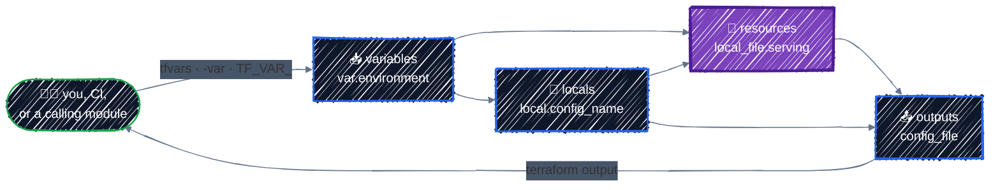

# Variables, Locals & Outputs

> Inputs, computed values, and results: tfvars, validation, and sensitive values.

---

Hard-coded configurations work once. To use the same code for `dev` and `prod`, for your project and a teammate's, you need three things: **input variables** to take values in, **locals** to name values you compute, and **outputs** to hand results back out. Together they're the interface of every Terraform configuration, and later of every module you write.

## Before you start

```bash
cd examples/core-language/variables-and-outputs
cp terraform.tfvars.example terraform.tfvars
terraform init
```

The example writes a config file for a model-serving deployment. Its name, labels, and settings all come from variables, so the same code can serve any environment or team. On GCP, the same inputs would name and label a bucket or a GKE node pool instead of a file.

## How the three fit together



| | Declared with | Referred to as | Set by |
|---|---|---|---|
| Input variable | `variable "environment" { }` | `var.environment` | the caller |
| Local value | `locals { config_name = ... }` | `local.config_name` | the configuration itself |
| Output | `output "config_file" { }` | `terraform output config_file`, or `module.<name>.config_file` | the configuration itself |

## Input variables

### Declaring a variable

From [`variables.tf`](../../examples/core-language/variables-and-outputs/variables.tf):

```hcl
variable "environment" {
  description = "Deployment environment. Becomes part of names and labels."
  type        = string

  validation {
    condition     = contains(["dev", "staging", "prod"], var.environment)
    error_message = "environment must be one of: dev, staging, prod."
  }
}
```

| Argument | What it does |
|---|---|
| `description` | Shown when Terraform prompts for a value, and by documentation tools. Always write one. |
| `type` | The accepted type. Values are converted to it, and anything that doesn't fit is rejected before planning starts. |
| `default` | Makes the variable **optional**. Without a default, the variable is **required**. |
| `validation` | A custom rule with your own error message. You can have several. |
| `sensitive` | Hides the value in plan and apply output. See [Sensitive values](#sensitive-values). |
| `nullable` | `false` means the caller can't pass `null`. Mostly useful in modules. |
| `ephemeral` | The value is never written to state or plan files. Covered in [Secret Manager & Sensitive Values](../gcp-foundations/secrets.md). |

**Required or optional?** Give a default only when there's a value that's right for most callers, like `region = "us-central1"`. Leave it off when a wrong guess would be dangerous. Here `environment` and `team` have no default, so nobody accidentally deploys a "dev" config to production.

If a required variable has no value, Terraform asks for it:

```
var.environment
  Deployment environment. Becomes part of names and labels.

  Enter a value:
```

In CI, where nobody is there to type, use `-input=false` and the same situation becomes an error:

```
Error: No value for required variable

  on variables.tf line 1:
   1: variable "environment" {

The root module input variable "environment" is not set, and has no default
value. Use a -var or -var-file command line argument to provide a value for
this variable.
```

### Types for structured input

Simple values use `string`, `number`, `bool`, `list(string)`, or `map(string)`:

```hcl
variable "extra_labels" {
  description = "Additional labels to record in the config."
  type        = map(string)
  default     = {}
}
```

When several settings belong together, use an **`object`** with **`optional()`** fields. Callers set only what they care about, and every field they leave out gets its default:

```hcl
variable "serving" {
  description = "Settings for the model-serving config. Every field is optional."
  type = object({
    name_suffix = optional(string, "serving")
    gpu_type    = optional(string, "nvidia-l4")
    replicas    = optional(number, 1)
    max_tokens  = optional(number, 4096)
  })
  default = {}
  ...
}
```

The example's `terraform.tfvars` sets only two of the four fields:

```hcl
serving = {
  replicas   = 2
  max_tokens = 8192
  # name_suffix and gpu_type are left out: their optional() defaults apply.
}
```

`terraform console` shows the value Terraform actually uses:

```
> var.serving
{
  "gpu_type" = "nvidia-l4"
  "max_tokens" = 8192
  "name_suffix" = "serving"
  "replicas" = 2
}
```

Type checks catch mistakes before anything is planned:

```bash
terraform plan -var 'serving={replicas="two"}'
```

```
Error: Invalid value for input variable

  on variables.tf line 22:
  22: variable "serving" {

Unsuitable value for var.serving set using -var="serving=...": a number is
required.
```

> ⚠️ **Misspelled fields are silently dropped.** Passing `serving = { gpu = "nvidia-h100-80gb" }` (instead of `gpu_type`) is **not** an error. Converting to the object type discards attributes it doesn't know, so you get `nvidia-l4` and no warning. Check the plan, or `terraform console`, when an object setting seems to be ignored.

### Validation rules

`type` checks shape; `validation` checks meaning. The `condition` must be `true` for the value to be accepted:

```hcl
variable "team" {
  description = "Owning team, used in names and as a label value."
  type        = string

  validation {
    # The same rule GCP applies to label values: lowercase letters, digits, - and _, at most 63 characters.
    condition     = can(regex("^[a-z0-9_-]{1,63}$", var.team))
    error_message = "team must be 1-63 characters: lowercase letters, digits, - or _."
  }
}
```

```bash
terraform plan -var 'team=ML Platform'
```

```
Error: Invalid value for variable

  on variables.tf line 11:
  11: variable "team" {
    ├────────────────
    │ var.team is "ML Platform"

team must be 1-63 characters: lowercase letters, digits, - or _.

This was checked by the validation rule at variables.tf:15,3-13.
```

Without the rule, a local file would happily accept `ML Platform`, and the mistake would surface later: on GCP, halfway through `apply`, as an API error about label values. Validation moves the failure to the earliest point, with a message that says how to fix it. Good candidates are anything a platform is strict about: names, label values, region lists, allowed machine or GPU types. `serving.gpu_type` in the example has a rule like that too.

`can(...)` turns an error into `false`, which is how `regex` (which fails when nothing matches) becomes a condition. More functions are in [Expressions & Functions](expressions.md).

### Setting values, and which one wins

Terraform reads variable values from several places. When the same variable is set in more than one, **the later source in this list wins**:

```mermaid
---
config:
  look: handDrawn
  theme: default
  themeVariables:
    fontFamily: '"Comic Sans MS", "Comic Sans", "Segoe Print", "Bradley Hand", cursive'
    lineColor: '#64748B'
    edgeLabelBackground: '#475569'
  themeCSS: |
    .edgeLabel, .edgeLabel p, .edgeLabel span { color: #FFFFFF !important; }
---
flowchart LR
    d["1️⃣ default<br/>in variables.tf"]
    e["2️⃣ TF_VAR_name<br/>environment variable"]
    t["3️⃣ terraform.tfvars"]
    a["4️⃣ *.auto.tfvars<br/>alphabetical order"]
    c["5️⃣ -var-file and -var<br/>in command-line order"]

    d -->|"overridden by"| e
    e -->|"overridden by"| t
    t -->|"overridden by"| a
    a -->|"overridden by"| c

    classDef ctrl fill:#0F172A,stroke:#2563EB,stroke-width:2px,color:#FFFFFF
    classDef eng fill:#7B42BC,stroke:#4C1D95,stroke-width:3px,color:#FFFFFF
    classDef tgt fill:#0F172A,stroke:#16A34A,stroke-width:2px,color:#FFFFFF
    class d tgt
    class e,t,a ctrl
    class c eng
```



You can watch it happen, with `terraform.tfvars` setting `environment = "dev"`:

```bash
echo 'var.environment' | TF_VAR_environment=staging terraform console
# "dev"       terraform.tfvars beats TF_VAR_

echo 'environment = "staging"' > staging.tfvars
echo 'var.environment' | terraform console -var-file=staging.tfvars
# "staging"   -var-file beats terraform.tfvars

echo 'var.environment' | terraform console -var-file=staging.tfvars -var environment=prod
# "prod"      the last command-line argument wins
```

How each source is typically used:

| Source | Typical use |
|---|---|
| `default` | a sensible value for most callers |
| `TF_VAR_project_id` | per-person or per-shell values, like your GCP sandbox project from Part 2 on |
| `terraform.tfvars` | this directory's values. Loaded automatically. **Git-ignored** in this repo |
| `*.auto.tfvars` | also loaded automatically. Handy when a tool generates a values file |
| `-var-file=prod.tfvars` | choosing an environment's values explicitly. [Environments](../modules/environments.md) builds on this |
| `-var 'name=value'` | one-off overrides while experimenting |

Why is `terraform.tfvars` git-ignored? It tends to hold project IDs, and sometimes secrets, specific to one person or environment. The repo commits a **`terraform.tfvars.example`** instead, documenting what to set:

```hcl
# Copy to terraform.tfvars (git-ignored) and edit:
#   cp terraform.tfvars.example terraform.tfvars

environment = "dev"
team        = "ml-platform"
...
```

Teams often do commit non-secret per-environment files like `envs/prod.tfvars`, since they're reviewed configuration, not personal settings. That's a choice you make on purpose, covered in [Environments](../modules/environments.md).

## Locals

A **local value** names an expression so you can use it in many places, and change it in one. From [`main.tf`](../../examples/core-language/variables-and-outputs/main.tf):

```hcl
locals {
  # Name things once, use the names everywhere.
  name_prefix = "${var.team}-${var.environment}"
  config_name = "${local.name_prefix}-${var.serving.name_suffix}"

  # Labels for everything this configuration creates.
  # Keys in extra_labels can't override these, because these come last.
  labels = merge(var.extra_labels, {
    environment = var.environment
    team        = var.team
    managed-by  = "terraform"
  })
}
```

- The block is `locals` (plural); a reference is `local.<name>` (singular).
- Locals can refer to variables, resources, data sources, and other locals, in any order. Terraform works out the dependencies.
- **Callers can't set a local.** That's the difference from a variable: a variable is part of your interface, a local is an implementation detail.

`local.config_name` names the file, and `local.labels` goes into its content:

```hcl
resource "local_file" "serving" {
  filename = "${path.module}/out/${local.config_name}.json"
  ...
  content = jsonencode({
    name       = local.config_name
    gpu_type   = var.serving.gpu_type
    replicas   = var.serving.replicas
    max_tokens = var.serving.max_tokens
    labels     = local.labels
  })
}
```

Every value here is known before anything is created, so the plan shows the whole file:

```
  + resource "local_file" "serving" {
      + content              = jsonencode(
            {
              + gpu_type   = "nvidia-l4"
              + labels     = {
                  + cost-center = "research"
                  + environment = "dev"
                  + managed-by  = "terraform"
                  + team        = "ml-platform"
                }
              + max_tokens = 8192
              + name       = "ml-platform-dev-serving"
              + replicas   = 2
            }
        )
      ...
      + filename             = "./out/ml-platform-dev-serving.json"
```

On GCP you'd pass `local.labels` to the provider's `default_labels` instead, and every resource would get it ([Connecting to GCP](../state/google-provider.md#configuring-the-google-provider)).

**When to use a local:**

- The same expression appears in two or more places: names, labels, prefixes.
- An expression is long enough that a name makes the resource easier to read.
- You want one place to change a convention, such as the naming scheme.

**When not to:** wrapping a single `var.region` in `local.region` only adds a hop for the reader. If a value is used once and is short, write it inline.

## Outputs

An **output** exposes a value after `apply`. From [`outputs.tf`](../../examples/core-language/variables-and-outputs/outputs.tf):

```hcl
output "config_file" {
  description = "Path of the generated config file, for scripts that deploy it."
  value       = local_file.serving.filename
}

output "serving_settings" {
  description = "The serving variable after optional() defaults were filled in."
  value       = var.serving
}
```

Outputs have three audiences:

- **You**, after `apply`: the values you'd otherwise go to the Console for.
- **Scripts and CI**, through `terraform output`: a deploy job reads the config path, or on GCP a bucket URL, instead of hard-coding it.
- **Other Terraform code**: a module's outputs are its return values (`module.storage.bucket_url`), as you'll see in [Writing Modules](../modules/writing-modules.md).

They're printed at the end of every `apply`, and shown as changes in the plan:

```
Changes to Outputs:
  + config_file      = "./out/ml-platform-dev-serving.json"
  + config_name      = "ml-platform-dev-serving"
  + labels           = {
      + cost-center = "research"
      + environment = "dev"
      + managed-by  = "terraform"
      + team        = "ml-platform"
    }
  + serving_settings = {
      + gpu_type    = "nvidia-l4"
      + max_tokens  = 8192
      + name_suffix = "serving"
      + replicas    = 2
    }
```

### Reading outputs: `terraform output`

```bash
terraform output                     # all outputs, human-readable
terraform output config_name         # one output, as an HCL value: "ml-platform-dev-serving"
terraform output -raw config_file     # one string, no quotes: for shell scripts
terraform output -json labels         # one output as JSON: for jq and other tools
```

```
$ terraform output -json labels
{"cost-center":"research","environment":"dev","managed-by":"terraform","team":"ml-platform"}
```

Use `-raw` for single strings in shell commands, as you did with `cat "$(terraform output -raw readme_path)"` in [Anatomy of HCL](../getting-started/hcl-anatomy.md). Use `-json` for anything structured. Outputs are read from **state**, so they only exist after an `apply`, and reading them never touches the real resources.

**What makes a good output:** values someone downstream needs (names, paths, URLs, IDs, service account emails), each with a `description`. Don't output whole resources "just in case". Every output is a promise to its readers, and removing one later can break them.

## Sensitive values

Some values shouldn't appear on screen or in CI logs: API tokens, passwords, private keys. Terraform tracks **sensitivity** on values, and hides sensitive ones in plan and apply output as `(sensitive value)`.

Values become sensitive in two ways:

- **The provider marks an attribute sensitive.** The `local` provider has a variant of `local_file` for exactly this, `local_sensitive_file`, whose `content` the plan shows as `(sensitive value)`. On GCP, `google_storage_bucket_object`'s `content` is hidden the same way: the provider can't know whether a file's contents are secret, so it assumes they might be.
- **You mark a variable or output** with `sensitive = true`.

Sensitivity **follows the value**. Anything computed from a sensitive value is sensitive too, and Terraform won't let it leak out through an unmarked output:

```hcl
variable "hf_token" {
  type      = string
  sensitive = true
}

output "token_preview" {
  value = "token is ${var.hf_token}"
}
```

```
Error: Output refers to sensitive values

  on main.tf line 5:
   5: output "token_preview" {

To reduce the risk of accidentally exporting sensitive data that was intended
to be only internal, Terraform requires that any root module output
containing sensitive data be explicitly marked as sensitive, to confirm your
intent.

If you do intend to export this data, annotate the output value as sensitive
by adding the following argument:
    sensitive = true
```

With `sensitive = true` on the output, it's shown as `<sensitive>` in the summary, but asking for it by name reveals it:

```
$ terraform output
hf_token = <sensitive>

$ terraform output -raw hf_token
hf_abc123
```

> 🔐 **`sensitive` hides values from the screen, not from state.** The plain value is still written to `terraform.tfstate`:
>
> ```
> $ grep hf_abc123 terraform.tfstate
>       "value": "hf_abc123",
> ```
>
> Anyone who can read your state can read every secret in it. That's why state lives in a locked-down bucket ([Remote Backend](../state/remote-backend.md)), and why the right answer for real secrets is to keep them **out of Terraform values entirely**: store them in Secret Manager and have workloads read them at runtime, or use `ephemeral` variables and write-only arguments, which are never saved. [Secret Manager & Sensitive Values](../gcp-foundations/secrets.md) covers both.

## Apply it

```bash
terraform plan     # Plan: 1 to add, 0 to change, 0 to destroy.
terraform apply
terraform output
cat "$(terraform output -raw config_file)"
```

```
{"gpu_type":"nvidia-l4","labels":{"cost-center":"research","environment":"dev","managed-by":"terraform","team":"ml-platform"},"max_tokens":8192,"name":"ml-platform-dev-serving","replicas":2}
```

Then try another environment without touching the files, and read the plan. Changing `environment` changes the config's name, so the plan is a replacement:

```bash
terraform plan -var environment=staging
```

```
  # local_file.serving must be replaced
-/+ resource "local_file" "serving" {
      ...
      ~ filename             = "./out/ml-platform-dev-serving.json" -> "./out/ml-platform-staging-serving.json" # forces replacement
      ...

Plan: 1 to add, 0 to change, 1 to destroy.
```

On GCP, the same change would rename, and therefore replace, a bucket full of data. And it's not how you'd run two environments for real: both would share one state, so switching would destroy the other. [Environments](../modules/environments.md) shows the right way.

## Checkpoint

1. `TF_VAR_environment=dev`, `terraform.tfvars` says `staging`, and the command uses `-var environment=prod`. Which value wins?
2. Does `sensitive = true` keep a value out of state? What protection does it actually provide?
3. Decide whether each belongs in a variable, local, or output: caller-selected GPU type; a computed naming prefix reused internally; the generated config path consumed by a deploy script.

<details>
<summary>Answer</summary>

1. `prod`; explicit command-line values have higher precedence than automatic variable files and `TF_VAR_` environment variables.
2. No. It redacts normal CLI display, but the value can still be stored in state and saved plans. Protect those files and use ephemeral/write-only mechanisms when persistence must be prevented.
3. Variable; local; output.

</details>

## Best practices

- **Give every variable a `description` and a `type`.** They're your configuration's documentation, and `type` catches mistakes before planning.
- **No default for values that are dangerous to guess**: environment, project, anything that names production.
- **Validate what the platform is strict about**, so bad input fails at `plan` with your message instead of mid-`apply` with an API error.
- **Group related settings into an `object` with `optional()` defaults** rather than many loose variables. Remember that unknown fields are dropped silently.
- **Commit `terraform.tfvars.example`, not `terraform.tfvars`.**
- **Use locals for names and labels**, so the convention lives in one place.
- **Output what downstream needs, with descriptions.** Use `-raw` and `-json` in scripts.
- **Treat `sensitive` as screen protection only.** Secrets in Terraform values end up in state; keep real secrets out, as shown in [Secrets](../gcp-foundations/secrets.md).

## Clean up

```bash
terraform destroy
```

---

[← Resources & Data Sources](resources-and-data-sources.md) · [↑ Contents](../../README.md) · [Expressions & Functions →](expressions.md)
