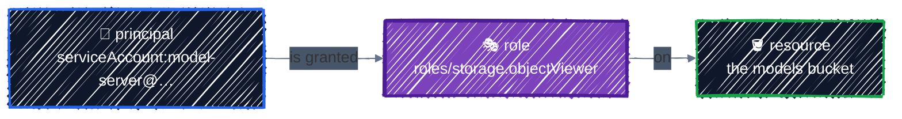
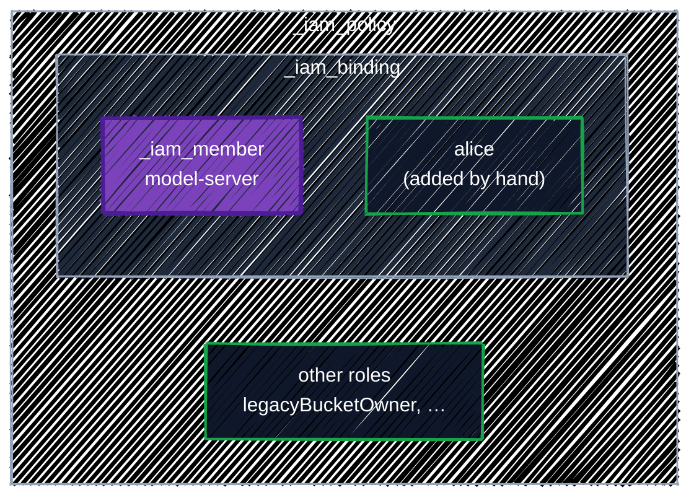

# IAM & Service Accounts

> Least privilege, and the _iam_policy / _iam_binding / _iam_member trap.

---

Every request to GCP is checked against IAM: **who** is asking, **what** they want to do, and **on which resource**. Getting IAM right is most of what "secure infrastructure" means in practice, and Terraform makes it reviewable. It also makes one particular mistake very easy, which this chapter shows you on purpose.

## Before you start

```bash
cd examples/gcp-foundations/iam
terraform init
```

The example sets up access for two ML workloads: a **trainer** that writes model weights to a bucket, and a **server** that only reads them. Each gets its own service account and exactly the access it needs.

## IAM in one picture



A **binding** connects a **principal** to a **role** on a **resource**. Each resource has one **IAM policy**: the list of all its bindings. Policies are inherited downward: a role granted on the project applies to every bucket in it, and a role on the organization applies to every project.

**Principals** are written with a type prefix:

| Principal | Written as | Use for |
|---|---|---|
| Google account | `user:alice@example.com` | individual people (prefer groups) |
| Google group | `group:ml-platform@example.com` | **people, almost always**. Access follows group membership |
| Service account | `serviceAccount:model-server@PROJECT.iam.gserviceaccount.com` | workloads: VMs, GKE pods, CI jobs |
| Workload Identity principal | `principal://iam.googleapis.com/...` | external identities such as GitHub Actions ([CI/CD](../team-workflow/ci-cd.md)) |

**Roles** are collections of permissions:

| Kind | Example | Verdict |
|---|---|---|
| Basic | `roles/owner`, `roles/editor`, `roles/viewer` | **avoid**. Thousands of permissions across every service |
| Predefined | `roles/storage.objectViewer`, `roles/container.developer` | the default choice: narrow, maintained by Google |
| Custom | `projects/my-proj/roles/modelReader` | when no predefined role is narrow enough |

## Service accounts: one per workload

A **service account** (SA) is an identity for software. Create one per workload, so each can be given exactly what it needs and you can tell from audit logs which workload did what:

```hcl
resource "google_service_account" "server" {
  project      = google_project_service.enabled["iam.googleapis.com"].project
  account_id   = "model-server"
  display_name = "Model serving"
  description  = "Reads model weights from the models bucket. Nothing else."
}
```

```
  + resource "google_service_account" "server" {
      + account_id      = "model-server"
      ...
      + email           = "model-server@tf-tutorial-3fa9c1.iam.gserviceaccount.com"
      ...
      + member          = "serviceAccount:model-server@tf-tutorial-3fa9c1.iam.gserviceaccount.com"
      ...
    }
```

- `account_id` must be 6–30 characters: lowercase letters, digits, and hyphens. Changing it replaces the SA.
- **`member`** is the ready-made principal string. Use `google_service_account.server.member` in grants instead of building `"serviceAccount:${...email}"` yourself.
- The `project` reference makes the SA wait for the IAM API, as in [Projects & APIs](projects-and-apis.md#wait-for-the-api-before-using-it).

> ⚠️ **Don't use the Compute Engine default service account.** Enabling the Compute API creates `PROJECT_NUMBER-compute@developer.gserviceaccount.com`, and VMs and GKE nodes use it unless told otherwise. In many projects it has the **Editor** role on the whole project, so anything running as it can change nearly anything. Always give VMs, node pools, and workloads their own SA. Organizations can stop the automatic Editor grant with the `iam.automaticIamGrantsForDefaultServiceAccounts` organization policy.

## Grant at the narrowest scope

Most resources have their own IAM policy, with a matching Terraform resource for each: `google_storage_bucket_iam_member`, `google_secret_manager_secret_iam_member`, `google_artifact_registry_repository_iam_member`, and so on. Grant there, not on the project:

```hcl
resource "google_storage_bucket_iam_member" "trainer_writes_models" {
  bucket = google_storage_bucket.models.name
  role   = "roles/storage.objectUser" # read, create, overwrite, delete objects
  member = google_service_account.trainer.member
}

resource "google_storage_bucket_iam_member" "server_reads_models" {
  bucket = google_storage_bucket.models.name
  role   = "roles/storage.objectViewer" # read only
  member = google_service_account.server.member
}
```

`roles/storage.objectViewer` on **this bucket** lets the server read model weights and nothing else. The same role on the **project** would let it read every bucket in the project, including Terraform state.

Use project-level grants only for permissions that have no narrower scope. Writing logs and metrics is the typical case. The example builds every (workload, role) pair with `setproduct` and a `for` expression from [Expressions & Functions](../core-language/expressions.md):

```hcl
locals {
  workload_members = {
    trainer = google_service_account.trainer.member
    server  = google_service_account.server.member
  }
  project_roles = ["roles/logging.logWriter", "roles/monitoring.metricWriter"]

  # Every (workload, role) pair, keyed like "server/roles/logging.logWriter".
  project_grants = {
    for pair in setproduct(keys(local.workload_members), local.project_roles) :
    "${pair[0]}/${pair[1]}" => { member = local.workload_members[pair[0]], role = pair[1] }
  }
}

resource "google_project_iam_member" "workloads" {
  for_each = local.project_grants

  project = var.project_id
  role    = each.value.role
  member  = each.value.member
}
```

```
  # google_project_iam_member.workloads["server/roles/logging.logWriter"] will be created
  # google_project_iam_member.workloads["server/roles/monitoring.metricWriter"] will be created
  # google_project_iam_member.workloads["trainer/roles/logging.logWriter"] will be created
  # google_project_iam_member.workloads["trainer/roles/monitoring.metricWriter"] will be created
```

## The trap: `_iam_member` vs `_iam_binding` vs `_iam_policy`

Every resource that has IAM comes with **three** Terraform resource types, and they behave very differently:

| Resource type | Manages | Effect on access Terraform doesn't know about |
|---|---|---|
| `google_..._iam_member` | **one** principal in **one** role | left alone (**additive**) |
| `google_..._iam_binding` | **all** principals in **one** role | **removed** (authoritative for that role) |
| `google_..._iam_policy` | the **entire** policy | **removed**, every role (authoritative for everything) |



Each box is what that resource type **owns**. Anything inside the box that isn't in your code gets removed. The names look similar, so it's easy to pick the wrong one. Here's what each does to a bucket where someone has also granted access by hand.

### `_iam_member`: additive

The server's grant is applied with `google_storage_bucket_iam_member`. Then someone grants `user:alice@example.com` the same role in the Console. The bucket's `objectViewer` binding now has two members:

```
{"role":"roles/storage.objectViewer","members":["serviceAccount:model-server@tf-tutorial-3fa9c1.iam.gserviceaccount.com","user:alice@example.com"]}
```

```bash
terraform plan
```

```
No changes. Your infrastructure matches the configuration.
```

`_iam_member` only cares about its own principal and role. Alice keeps her access.

### `_iam_binding`: owns the whole role

Now manage the same role with `google_storage_bucket_iam_binding` instead:

```hcl
resource "google_storage_bucket_iam_binding" "viewers" {
  bucket  = google_storage_bucket.models.name
  role    = "roles/storage.objectViewer"
  members = ["serviceAccount:model-server@tf-tutorial-3fa9c1.iam.gserviceaccount.com"]
}
```

```
  # google_storage_bucket_iam_binding.viewers will be created
  + resource "google_storage_bucket_iam_binding" "viewers" {
      + bucket  = "tf-tutorial-3fa9c1-iam-models"
      + etag    = (known after apply)
      + id      = (known after apply)
      + members = [
          + "serviceAccount:model-server@tf-tutorial-3fa9c1.iam.gserviceaccount.com",
        ]
      + role    = "roles/storage.objectViewer"
    }

Plan: 1 to add, 0 to change, 0 to destroy.
```

The plan says nothing about Alice. After `apply`, the role contains exactly the list in the code:

```
{"role":"roles/storage.objectViewer","members":["serviceAccount:model-server@tf-tutorial-3fa9c1.iam.gserviceaccount.com"]}
```

**Alice's access is gone**, and nothing in the plan warned you. From then on, anyone added to that role by hand shows up as drift to be removed:

```
  # google_storage_bucket_iam_binding.viewers will be updated in-place
  ~ resource "google_storage_bucket_iam_binding" "viewers" {
        id      = "b/tf-tutorial-3fa9c1-iam-models/roles/storage.objectViewer"
      ~ members = [
          - "user:bob@example.com",
            # (1 unchanged element hidden)
        ]
        # (3 unchanged attributes hidden)
    }
```

### `_iam_policy`: owns everything

`google_storage_bucket_iam_policy` replaces the whole policy with exactly what you give it:

```hcl
data "google_iam_policy" "models" {
  binding {
    role    = "roles/storage.objectViewer"
    members = ["serviceAccount:model-server@tf-tutorial-3fa9c1.iam.gserviceaccount.com"]
  }
}

resource "google_storage_bucket_iam_policy" "models" {
  bucket      = google_storage_bucket.models.name
  policy_data = data.google_iam_policy.models.policy_data
}
```

Every new bucket has default bindings that give the project's owners, editors, and viewers access. Before the apply:

```
roles/storage.legacyBucketOwner
roles/storage.legacyBucketReader
roles/storage.legacyObjectOwner
roles/storage.legacyObjectReader
roles/storage.objectViewer
```

After it:

```
{"role":"roles/storage.objectViewer","members":["serviceAccount:model-server@tf-tutorial-3fa9c1.iam.gserviceaccount.com"]}
```

Every default binding is gone, including the project owners' access to the bucket. Again, the plan only showed `1 to add`. On a bucket that's painful. **On a project, `google_project_iam_policy` can remove your own access and Google's service agents, and lock everyone out of the project.**

### The rules

- **Use `_iam_member`** by default, everywhere. Several configurations, and people, can safely grant access to the same resource.
- **Use `_iam_binding` only when this configuration must be the single source of truth for a role**, for example to guarantee that nobody else holds `roles/owner` on a sensitive bucket. Then expect any hand-made grant of that role to be removed.
- **Avoid `_iam_policy`**, and never use `google_project_iam_policy` or `google_organization_iam_policy` unless you fully understand every binding that already exists.
- **Never mix types for the same role on the same resource.** A `_binding` and a `_member` for the same role fight each other on every apply.

## Conditional access

An **IAM condition** limits when or where a grant applies. The most common use is **temporary access**, for example an external reviewer who should be able to read model weights until the end of the year:

```hcl
# Time-limited access: the grant stops working at the given time.
resource "google_storage_bucket_iam_member" "temporary_readers" {
  for_each = var.temporary_readers

  bucket = google_storage_bucket.models.name
  role   = "roles/storage.objectViewer"
  member = each.key

  condition {
    title       = "expires-${substr(each.value, 0, 10)}"
    description = "Temporary read access."
    expression  = "request.time < timestamp(\"${each.value}\")"
  }
}
```

```bash
terraform plan -var 'temporary_readers={"user:alice@example.com"="2026-12-31T00:00:00Z"}'
```

```
  + resource "google_storage_bucket_iam_member" "temporary_readers" {
      + bucket = "tf-tutorial-3fa9c1-iam-models"
      ...
      + member = "user:alice@example.com"
      + role   = "roles/storage.objectViewer"

      + condition {
          + description = "Temporary read access."
          + expression  = "request.time < timestamp(\"2026-12-31T00:00:00Z\")"
          + title       = "expires-2026-12-31"
        }
    }
```

After that time the grant simply stops working, even if nobody remembers to remove it. Conditions are written in [CEL](https://cloud.google.com/iam/docs/conditions-overview). Two practical limits: a bucket needs **uniform bucket-level access** for conditions to work, and **basic roles** can't have conditions.

## Acting as a service account

Two roles control what people (and other SAs) can do **with** a service account. Grant them on the SA itself, with `google_service_account_iam_member`, never on the project:

| Role on the SA | Lets the principal |
|---|---|
| `roles/iam.serviceAccountUser` | **attach** the SA to a resource: run a VM, node pool, or Cloud Run service as it |
| `roles/iam.serviceAccountTokenCreator` | **impersonate** it: get short-lived credentials and call APIs as the SA |

Granting `serviceAccountUser` on the project means "may run things as **any** SA in the project", including powerful ones.

### Running Terraform as a service account

Impersonation is how you let Terraform act with a deployer SA's permissions without anyone holding its key. In the provider:

```hcl
provider "google" {
  project                     = var.project_id
  region                      = var.region
  impersonate_service_account = "terraform-deployer@${var.project_id}.iam.gserviceaccount.com"
}
```

Your own credentials (ADC) are then only used to get a short-lived token for `terraform-deployer`, which requires `roles/iam.serviceAccountTokenCreator` on that SA. Every API call is made, and audit-logged, as the deployer. The same works for a single run with `export GOOGLE_IMPERSONATE_SERVICE_ACCOUNT=terraform-deployer@...`, and for the backend with `impersonate_service_account` in `backend.hcl`.

This pattern lets you give people **read-only** access to a project, plus permission to impersonate the deployer: changes go through Terraform, not the Console. [CI/CD](../team-workflow/ci-cd.md) uses the same idea for GitHub Actions, with Workload Identity Federation instead of a person.

> 🔑 **No service account keys.** A key is a long-lived password for the SA. Impersonation (for people), Workload Identity Federation (for CI), and attached SAs (for VMs and GKE) cover every use. Organizations can block key creation entirely with the `iam.disableServiceAccountKeyCreation` policy.

## IAM changes take a moment

IAM is eventually consistent. A grant Terraform just created usually works within a minute or two, but can occasionally take longer. If a workload created in the same apply fails with `403 Permission denied` right away, wait and retry rather than adding more roles.

## Apply it

```bash
terraform plan    # Plan: 11 to add, 0 to change, 0 to destroy.
terraform apply
terraform output
```

```
models_bucket = "gs://tf-tutorial-3fa9c1-iam-models"
server_email = "model-server@tf-tutorial-3fa9c1.iam.gserviceaccount.com"
trainer_email = "model-trainer@tf-tutorial-3fa9c1.iam.gserviceaccount.com"
```

Check what each identity can do on the bucket:

```bash
gcloud storage buckets get-iam-policy "$(terraform output -raw models_bucket)" --format=json
gcloud projects get-iam-policy "$TF_VAR_project_id" \
  --flatten="bindings[].members" \
  --filter="bindings.members:model-server" \
  --format="table(bindings.role)"
```

The server SA has `objectViewer` on one bucket, and `logWriter` and `metricWriter` on the project. That's all. Over time, the [IAM recommender](https://cloud.google.com/policy-intelligence/docs/role-recommendations-overview) in the Console shows grants that were never used, so you can tighten them further.

## Best practices

- **One service account per workload.** Never run anything as the Compute Engine default SA.
- **Grant to groups, not individual users.**
- **Predefined roles at the narrowest scope**: the bucket, secret, or repository, not the project. Never basic roles.
- **`_iam_member` by default.** `_iam_binding` only when you mean to own a role; avoid `_iam_policy`.
- **Never mix `_member` and `_binding` for the same role and resource.**
- **Grant `serviceAccountUser` and `serviceAccountTokenCreator` on specific SAs**, never project-wide.
- **Impersonate instead of using keys.** No SA keys, anywhere.
- **Use conditions for temporary access**, so it expires on its own.

## Clean up

```bash
terraform destroy
```

Destroying a service account doesn't remove grants made to it elsewhere, by hand or by other configurations. They stay in those policies as `deleted:serviceAccount:...` until removed. And if you recreate an SA with the same name, it gets a new identity: old grants don't apply to it.

---

[← Projects & APIs](projects-and-apis.md) · [↑ Contents](../../README.md) · [Networking →](networking.md)
