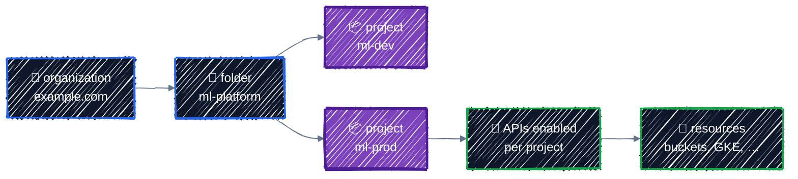

# Projects & APIs

> google_project_service, labels, and the provider's project defaults.

---

Part 3 builds the GCP foundations the AI platform in Part 5 stands on: APIs, IAM, networking, and secrets. Every one of them lives in a **project**, and nothing works until the right **APIs** are enabled in it. This chapter covers both, plus the two settings that quietly affect every resource you create: **which project** it lands in, and **how it's labeled**.

## Before you start

```bash
cd examples/gcp-foundations/projects-and-apis
terraform init
```

The example enables every API the rest of this guide uses, and creates an Artifact Registry repository for model-serving images, which can only be created once its API is on.

## Where projects fit



- A **project** is the unit of almost everything in GCP: billing, IAM, quotas (including GPU quota), and API enablement. Resources always belong to exactly one project.
- **Folders** and the **organization** group projects so policies and IAM can be set once for many projects. A personal account without a company domain has no organization, which is fine for this guide.
- **One project per environment** (`ml-dev`, `ml-prod`) is the usual pattern. It gives each environment its own IAM, quotas, and bill, and a mistake in dev physically can't touch prod.

## Should Terraform create the project?

In a company, yes, usually: a dedicated "project factory" configuration creates projects with the right folder, billing account, labels, and baseline APIs. It's ordinary Terraform:

```hcl
resource "google_project" "ml_dev" {
  name            = "ml-dev"
  project_id      = "ml-dev-3fa9c1"
  folder_id       = var.folder_id
  billing_account = var.billing_account

  # Don't create the "default" VPC with its wide-open firewall rules.
  # You'll build a proper network in the Networking chapter.
  auto_create_network = false

  labels = {
    environment = "dev"
    team        = "ml-platform"
  }
}
```

```
  # google_project.ml_dev will be created
  + resource "google_project" "ml_dev" {
      + auto_create_network = false
      + billing_account     = "0X0X0X-0X0X0X-0X0X0X"
      + deletion_policy     = "PREVENT"
      ...
```

Note **`deletion_policy = "PREVENT"`**: the google provider protects projects from `terraform destroy` by default, because deleting a project deletes everything in it. Setting it to `"DELETE"` is a deliberate decision.

This guide doesn't do this. Creating projects needs permissions on an organization or folder (`roles/resourcemanager.projectCreator`) and on a billing account, which personal accounts often don't have. You created your sandbox project by hand in [Setup](../getting-started/setup.md), and every example uses it through `var.project_id`. Real projects are often split the same way: a platform team owns the project factory, and application teams' Terraform runs **inside** the projects it creates.

## Enabling APIs: `google_project_service`

Every GCP service sits behind an API that must be enabled in the project before anything can use it. In [Setup](../getting-started/setup.md) you enabled four by hand. From now on, configurations enable what they need themselves. From [`main.tf`](../../examples/gcp-foundations/projects-and-apis/main.tf):

```hcl
locals {
  # Every API this guide uses from here on. Enabling an API is free;
  # you pay only for what you create with it.
  services = toset([
    "artifactregistry.googleapis.com", # container images
    "compute.googleapis.com",          # VPCs, VMs, GPUs
    "container.googleapis.com",        # GKE
    "iam.googleapis.com",              # service accounts
    "iamcredentials.googleapis.com",   # Workload Identity, impersonation
    "logging.googleapis.com",
    "monitoring.googleapis.com",
    "secretmanager.googleapis.com",
    "storage.googleapis.com",
  ])
}

resource "google_project_service" "enabled" {
  for_each = local.services

  service = each.key

  # Leave the API enabled when this resource is destroyed. Other
  # configurations (and people) in the project may depend on it.
  disable_on_destroy = false
}
```

```
  # google_project_service.enabled["artifactregistry.googleapis.com"] will be created
  # google_project_service.enabled["compute.googleapis.com"] will be created
  # google_project_service.enabled["container.googleapis.com"] will be created
  ...
  # google_project_service.enabled["storage.googleapis.com"] will be created
```

One resource per API, keyed by its name: exactly the `for_each` over a set from [Meta-Arguments](../core-language/meta-arguments.md#over-a-set). Adding an API later is one line.

### Don't disable APIs on destroy

APIs are **shared by the whole project**. If this configuration's `destroy` turned off `container.googleapis.com`, it would break every GKE cluster in the project, including ones another team manages.

- **`disable_on_destroy = false`** keeps the API on when the resource is destroyed. The google provider already behaves this way when the argument is unset, but write it explicitly: before provider 7.0 the default was `true`, which disabled the API for the whole project, so plenty of existing code and examples still behave that way. The explicit value makes your intent obvious to reviewers.
- Only set it to `true` in a configuration that **owns the whole project**, such as a project factory that also deletes the project.
- **`disable_dependent_services`** only matters when disabling. If it's unset, disabling an API that other enabled APIs depend on fails instead of cascading.

Enabling an API is free and harmless. When in doubt, leave it enabled.

### Wait for the API before using it

A resource that needs an API must be created **after** the API is enabled. Nothing in an Artifact Registry repository naturally refers to `google_project_service`, so without help Terraform would create both in parallel and the repository could fail:

```
Error: Error creating Repository: googleapi: Error 403: Artifact Registry API has not been used in project 123456789012 before or it is disabled. Enable it by visiting https://console.developers.google.com/apis/api/artifactregistry.googleapis.com/overview?project=123456789012 then retry. If you enabled this API recently, wait a few minutes for the action to propagate to our systems and retry.
Details:
[
  {
    "@type": "type.googleapis.com/google.rpc.ErrorInfo",
    "domain": "googleapis.com",
    "metadata": {
      "consumer": "projects/123456789012",
      "service": "artifactregistry.googleapis.com"
    },
    "reason": "SERVICE_DISABLED"
  }
]
```

There are two ways to add the dependency. The example uses a **reference**:

```hcl
resource "google_artifact_registry_repository" "images" {
  # Referring to the API's resource creates the dependency: Terraform enables
  # Artifact Registry first, then creates the repository.
  project = google_project_service.enabled["artifactregistry.googleapis.com"].project

  location      = var.region
  repository_id = "serving-images"
  ...
}
```

`google_project_service.enabled[...].project` is just your project ID, so the value is the same as leaving `project` out. But because it's a reference to that specific API's resource, Terraform orders them correctly, and only waits for the one API this resource needs:

```
  "google_artifact_registry_repository.images" -> "google_project_service.enabled";
```

The alternative is `depends_on = [google_project_service.enabled]`, which waits for **all** the APIs in the set. It's simpler to read, but any change to the list makes Terraform more cautious about everything that depends on it. Either is fine; pick one style per codebase.

> ⏳ **"Enabled" isn't always "ready".** Enabling is eventually consistent in GCP. The provider waits for the enable operation to finish, but occasionally (more often in brand-new projects) the next call still gets `SERVICE_DISABLED` for a short time. If it happens, run `apply` again. If it happens every time, the provider's [project service guide](https://registry.terraform.io/providers/hashicorp/google/latest/docs/guides/google_project_service) shows how to add a short `time_sleep` after enabling.

### APIs in a team setting

In real projects, decide **who owns API enablement**:

- **A foundation configuration enables everything** the project needs (this chapter's approach), and application configurations assume the APIs are on.
- **Or each configuration enables what it uses**, with `disable_on_destroy = false` so they can't interfere with each other.

Two configurations each managing `google_project_service` for the same API is safe with `disable_on_destroy = false`, but having one owner is easier to reason about.

## Which project does a resource land in?

The `project` for each resource is decided in this order:

| Source | Example | Use it? |
|---|---|---|
| 1. The resource's own `project` argument | `project = var.project_id` | when one configuration spans several projects |
| 2. The provider's `project` | `provider "google" { project = var.project_id }` | **yes, always** |
| 3. Environment variables: `GOOGLE_PROJECT`, then `GOOGLE_CLOUD_PROJECT`, `GCLOUD_PROJECT`, `CLOUDSDK_CORE_PROJECT` | `export GOOGLE_PROJECT=...` | no |

The fallback to environment variables is a trap. Leave `project` out of the provider, and whatever happens to be in your shell decides where resources go:

```bash
GOOGLE_PROJECT=some-other-project terraform plan
```

```
      + project          = "some-other-project"
Plan: 1 to add, 0 to change, 0 to destroy.
```

No warning. That's why every example in this guide sets `project` explicitly from `var.project_id`. With no project anywhere, the plan fails instead:

```
Error: Failed to retrieve project, pid: , err: project: required field is not set
```

The same rules apply to `region` and `zone`. The example sets all three in [`providers.tf`](../../examples/gcp-foundations/projects-and-apis/providers.tf):

```hcl
provider "google" {
  # Defaults for every resource that doesn't set its own.
  project = var.project_id
  region  = var.region
  zone    = "${var.region}-a"

  default_labels = local.labels
}
```

> 💡 **Quota project errors.** Some APIs bill requests to a "quota project". With your personal credentials that's set by `gcloud auth application-default set-quota-project` from [Setup](../getting-started/setup.md). If you still see errors mentioning a quota project or `X-Goog-User-Project`, set `user_project_override = true` and `billing_project = var.project_id` in the provider block.

## Labeling everything

Labels are key-value pairs on resources. They cost nothing and pay off in three places: **cost reports** (the billing export can be grouped by any label), **filtering** (in the Console and with `gcloud ... --filter="labels.team=ml-platform"`), and **ownership** (who do I ask about this bucket?).

Agree on a small, fixed set of keys, and apply them everywhere through the provider's `default_labels`:

```hcl
locals {
  # The labeling convention: every resource carries these, through default_labels.
  labels = {
    environment = var.environment
    team        = var.team
    cost-center = var.cost_center
    managed-by  = "terraform"
  }
}
```

The repository sets no labels of its own, yet carries all of them, plus `goog-terraform-provisioned`, which the provider adds to show the resource was created by Terraform:

```
  + resource "google_artifact_registry_repository" "images" {
      ...
      + effective_labels = {
          + "cost-center"                = "research"
          + "environment"                = "dev"
          + "goog-terraform-provisioned" = "true"
          + "managed-by"                 = "terraform"
          + "team"                       = "ml-platform"
        }
```

| Key | Example values | Answers |
|---|---|---|
| `environment` | `dev`, `staging`, `prod` | which environment |
| `team` | `ml-platform`, `research` | who owns it |
| `cost-center` | `research`, `product` | which budget pays |
| `managed-by` | `terraform` | don't edit it by hand |
| `component` (per resource) | `serving`, `training`, `datasets` | what it's for |

GCP label rules, which [validation](../core-language/variables-and-outputs.md#validation-rules) can enforce on inputs:

- Keys and values: lowercase letters, digits, `_` and `-`, at most 63 characters. Keys must start with a letter.
- At most 64 labels per resource.
- **Not everything supports labels.** IAM bindings, API enablement, and some older resources don't. `default_labels` simply skips those.

For AI infrastructure, labels are how you answer "what did the GPU nodes for the Llama service cost last month?" Label GKE node pools and buckets per model or workload ([GPU Node Pools](../ai-infra/gpu-node-pools.md)), and the [cost guide](../appendix/cost-guide.md) shows how to read it back from the billing export.

## Apply it

```bash
terraform plan    # Plan: 10 to add, 0 to change, 0 to destroy.
terraform apply
terraform output
```

```
enabled_services = [
  "artifactregistry.googleapis.com",
  "compute.googleapis.com",
  ...
]
image_repository = "us-central1-docker.pkg.dev/tf-tutorial-3fa9c1/serving-images"
project_number = "123456789012"
```

Check from outside Terraform:

```bash
gcloud services list --enabled --filter="name:(container OR artifactregistry)"
gcloud artifacts repositories list --location="$TF_VAR_region"
```

Enabling `compute.googleapis.com` the first time can take a minute or two, and it also creates the project's Compute Engine default service account. You'll see why not to use that account in [IAM & Service Accounts](iam.md).

## Best practices

- **One project per environment**, created by a project factory where your organization allows it.
- **Set `auto_create_network = false`** on projects Terraform creates, and keep the default `deletion_policy = "PREVENT"`.
- **Enable APIs with `google_project_service` and `for_each`**, and keep `disable_on_destroy = false` unless the configuration owns the whole project.
- **Make resources depend on the API they need**, by reference or `depends_on`.
- **Always set `project`, `region`, and `zone` in the provider** from variables. Never rely on environment variables.
- **Agree on a label convention** and apply it with `default_labels`. Add a `component` label per resource for finer cost breakdowns.

## Clean up

```bash
terraform destroy
```

The repository is deleted. The APIs stay enabled (`disable_on_destroy = false`), which costs nothing, and the following chapters rely on them. If you skip ahead, each later example enables its own APIs too.

---

[← Refactoring: moved, import, removed](../state/refactoring.md) · [↑ Contents](../../README.md) · [IAM & Service Accounts →](iam.md)
