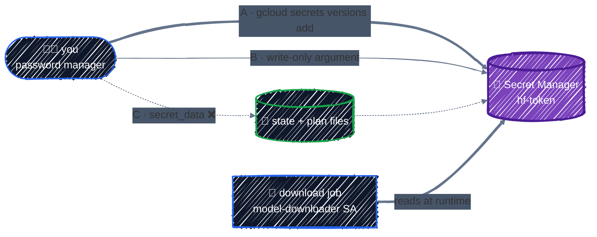

# Secret Manager & Sensitive Values

> Managing secrets, and why they still end up in state.

---

The LLM platform needs at least one real secret: a **Hugging Face access token**, to download gated model weights such as Llama. [Variables, Locals & Outputs](../core-language/variables-and-outputs.md#sensitive-values) showed that `sensitive = true` only hides values on screen, and [State & Drift](../state/state-basics.md#whats-in-the-file) showed secrets sitting in plain text in state. This chapter is about keeping secrets **out** of Terraform's files entirely, while Terraform still manages everything around them.

## Before you start

```bash
cd examples/gcp-foundations/secrets
terraform init
```

The example creates a Secret Manager secret for the Hugging Face token, a service account for the job that downloads model weights, and the IAM grant that lets only that job read the token.

> 📌 This example needs **Terraform 1.11 or newer** (for write-only arguments), and its `required_version` says so. Every other example works with 1.10.

## Where a secret value can travel



| Path | Value in state? | Value in saved plan? | Use it |
|---|---|---|---|
| **A.** Terraform creates the secret; you add the value with `gcloud` | no | no | **default** |
| **B.** Write-only argument (`secret_data_wo`) from an ephemeral variable | no | no | when the value must come through Terraform, such as in CI |
| **C.** Regular argument (`secret_data`) | **yes, plain text** | **yes, plain text** | never for real secrets |

Whichever path the value takes, the **workload reads it at runtime** from Secret Manager with its own service account. The value never passes through Terraform on the way out.

## The secret is a container

From [`main.tf`](../../examples/gcp-foundations/secrets/main.tf):

```hcl
# The secret is a container. Terraform manages its name, replication,
# labels, and who can read it, but not (by default) its value.
resource "google_secret_manager_secret" "hf_token" {
  project   = google_project_service.enabled["secretmanager.googleapis.com"].project
  secret_id = "hf-token"

  replication {
    auto {}
  }
}
```

Secret Manager separates a **secret** (a name, replication policy, labels, IAM) from its **versions** (the actual values). Every new value is a new version; old versions stay until you disable or destroy them, and workloads usually read `versions/latest`.

- **`replication { auto {} }`** lets Google store replicas wherever it chooses. Use `user_managed` with a list of locations if data residency rules require it.
- **Labels** come from the provider's `default_labels`, as everywhere else.
- Other useful settings: **`rotation`** to get notified when it's time to rotate, **`version_destroy_ttl`** to delay destroying old versions so they can be recovered, and **`deletion_protection = true`** for secrets that would be painful to recreate.

## Who can read it

```hcl
# Only the downloader can read the value. Granted on the secret, not the project.
resource "google_secret_manager_secret_iam_member" "downloader_reads_hf_token" {
  secret_id = google_secret_manager_secret.hf_token.id
  role      = "roles/secretmanager.secretAccessor"
  member    = google_service_account.downloader.member
}
```

Everything from [IAM & Service Accounts](iam.md) applies:

- **Grant `secretAccessor` on the secret**, not the project. On the project it would read every secret, including ones added later.
- **`secretAccessor` reads values; `viewer` doesn't.** `roles/secretmanager.viewer` sees names and metadata only, which is what most humans need.
- **Use `_iam_member`**, never `_iam_binding` or `_iam_policy`, for the same reasons as before.

## Path A: add the value outside Terraform

The simplest safe pattern: Terraform creates the empty secret and its IAM; a person (or a separate process) adds the value directly:

```bash
terraform apply

# Paste the token at the prompt; it never touches your shell history or a file.
printf "Hugging Face token: " && read -rs HF_TOKEN && echo
printf '%s' "$HF_TOKEN" | gcloud secrets versions add hf-token --data-file=-
unset HF_TOKEN
```

Terraform never sees the value, so it can't leak into state, a plan file, CI logs, or a pull request. Rotation is the same command again: a new version, and workloads reading `latest` pick it up on their next read.

The trade-off: the **value** isn't in code, so "is the secret set?" isn't something `terraform plan` can answer. For most teams that's fine. Secret values were never something you'd review in a pull request anyway.

## Path B: write-only arguments

Sometimes the value has to come through Terraform, for example when a CI pipeline gets a token from another system and must store it. Terraform 1.11 added **write-only arguments**: they're sent to the provider on apply, but **never stored in state or in plan files**. The google provider offers one on secret versions, `secret_data_wo`. From [`version.tf`](../../examples/gcp-foundations/secrets/version.tf):

```hcl
resource "google_secret_manager_secret_version" "hf_token" {
  count = var.hf_token_version > 0 ? 1 : 0

  secret                 = google_secret_manager_secret.hf_token.id
  secret_data_wo         = var.hf_token
  secret_data_wo_version = var.hf_token_version
}
```

The value comes from an **ephemeral variable**:

```hcl
# Only used by version.tf. Ephemeral: Terraform never writes it to state or
# to a saved plan. Pass it as TF_VAR_hf_token, never in a .tfvars file.
variable "hf_token" {
  description = "Hugging Face access token to store in Secret Manager."
  type        = string
  default     = null
  sensitive   = true
  ephemeral   = true
}
```

```bash
export TF_VAR_hf_token="hf_..."     # from your password manager or CI secret store
terraform plan -var hf_token_version=1 -out=tfplan
```

```
  # google_secret_manager_secret_version.hf_token[0] will be created
  + resource "google_secret_manager_secret_version" "hf_token" {
      ...
      + secret_data_wo         = (write-only attribute)
      + secret_data_wo_version = "1"
      ...
    }
```

### Why the version number

Because the value is never stored, Terraform has nothing to compare a new value against, so it **can't detect a change**. `secret_data_wo_version` is your signal: bump it (`-var hf_token_version=2`) whenever you want Terraform to write a new value. Leaving it at `0` means this example doesn't create a version at all, which is path A.

### Proving it's not stored

Compare with the regular `secret_data` argument. On screen, both look safe:

```
      + secret_data     = (sensitive value)
```

But a saved plan file is a zip archive, and the plan JSON contains the real value:

```bash
terraform show -json tfplan | jq '.resource_changes[] | select(.type=="google_secret_manager_secret_version") | .change.after.secret_data'
```

```
"hf_EXAMPLEdoNotUse123"
```

After `apply`, the same value would sit in `terraform.tfstate`, or in your GCS state bucket. With `secret_data_wo`, the same check shows nothing:

```json
{
  "enabled": true,
  "is_secret_data_base64": null,
  "secret_data": null,
  "secret_data_wo": null,
  "secret_data_wo_version": "1",
  "timeouts": null
}
```

The token appears nowhere in the plan file, and won't appear in state.

### Terraform enforces the rules

An ephemeral value can only flow into places that don't persist it. Try to put it in a regular argument:

```
Error: Invalid use of ephemeral value

  with google_secret_manager_secret_version.bad,
  on bad.tf line 3, in resource "google_secret_manager_secret_version" "bad":
   3:   secret_data = var.hf_token

Ephemeral values are not valid for "secret_data", because it is not a
write-only attribute and must be persisted to state.
```

Or in an output:

```
Error: Ephemeral value not allowed

  on bad.tf line 2, in output "t":
   2:   value     = var.hf_token

This output value is not declared as returning an ephemeral value, so it
cannot be set to a result derived from an ephemeral value.
```

That's the difference from `sensitive`: **sensitive** hides a value from your screen and still saves it; **ephemeral** guarantees it's never saved, and refuses to compile code that would save it.

Ephemeral values may go into: write-only arguments, provider configuration, `locals`, other ephemeral values, and ephemeral outputs of child modules.

## Reading secrets in Terraform

Sometimes Terraform itself needs a secret value, typically to **configure a provider** (a database password for a SQL provider, a token for an API). There are two ways to read one, and they differ in the same way:

```hcl
# ❌ Data source: the value is stored in state.
data "google_secret_manager_secret_version" "hf_token" {
  secret = google_secret_manager_secret.hf_token.secret_id
}

# ✅ Ephemeral resource: read fresh on every run, never stored.
ephemeral "google_secret_manager_secret_version" "hf_token" {
  secret = google_secret_manager_secret.hf_token.secret_id
}
```

An **ephemeral resource** is like a data source that's never saved: it's read during each plan and apply, and its values are ephemeral, so the same rules apply. Prefer it whenever Terraform must handle a secret. You'll use the same idea in [Kubernetes & Helm](../ai-infra/kubernetes-and-helm.md), where the ephemeral `google_client_config` provides a short-lived access token for the Kubernetes provider.

But the best answer is usually not to read the secret in Terraform at all. **Let the workload read it at runtime**, with its own service account. Terraform only wires up the identity and the IAM grant, as this example does.

## Apply it

```bash
terraform apply    # Plan: 5 to add, 0 to change, 0 to destroy.
```

Then add the value with path A, or with path B:

```bash
export TF_VAR_hf_token="hf_..."
terraform apply -var hf_token_version=1
unset TF_VAR_hf_token
```

Check from outside Terraform, without printing the value:

```bash
gcloud secrets describe hf-token --format="yaml(name,replication,labels)"
gcloud secrets versions list hf-token
gcloud secrets get-iam-policy hf-token
```

The download job, running as `model-downloader`, reads `projects/PROJECT/secrets/hf-token/versions/latest`. In Part 5, a Kubernetes service account is mapped to it through [Workload Identity](../ai-infra/workload-identity.md), so the vLLM pod reads the token without any key or Kubernetes Secret.

## Best practices

- **Terraform manages secrets, IAM, and settings; values stay out of Terraform.** Add values with `gcloud` or another process.
- **When Terraform must set a value, use a write-only argument** fed by an `ephemeral` variable, and bump its `_wo_version` to rotate.
- **Never use `secret_data`**, or any regular argument, for a real secret. `sensitive` doesn't keep it out of state or plan files.
- **Read secrets with ephemeral resources, not data sources**, and only when Terraform truly needs the value.
- **Grant `secretAccessor` per secret, per workload.** Nobody needs it on the project.
- **Pass secrets through environment variables**, never `.tfvars` files, and `unset` them afterwards.
- **Treat state and saved plans as secret anyway.** Older code, other providers, and data sources can still put secrets there.

## Clean up

```bash
terraform destroy
```

Destroying the secret destroys all of its versions. That completes Part 3: APIs, IAM, networking, and secrets. Part 4 turns these pieces into reusable code, starting with [Writing Modules](../modules/writing-modules.md).

---

[← Networking](networking.md) · [↑ Contents](../../README.md) · [Writing Modules →](../modules/writing-modules.md)
