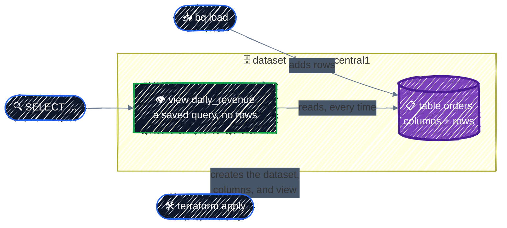
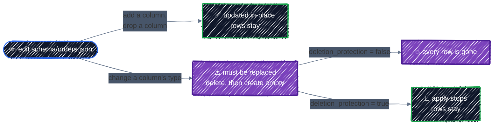
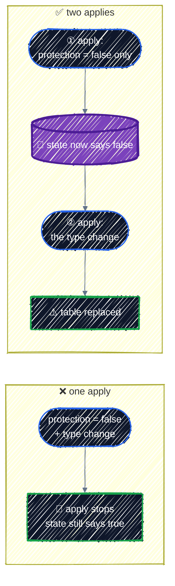
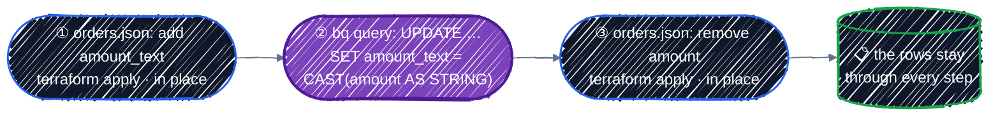

# BigQuery

> Datasets, tables, and views as code; rows loaded with `bq`; and the schema change that quietly deletes a table's data.

---

**BigQuery** is Google's data warehouse: you put data in tables and query it with SQL. There are no servers or clusters to size. You pay for two things: the data you store, and the bytes each query reads. The free tier covers 10 GB of storage and 1 TB of queries a month, far more than this chapter uses.

With Terraform, the line to keep in mind is: **Terraform owns the structure, not the data.** It creates the dataset, the table and its columns, and the views. The rows are loaded and changed by other tools. That split is also where the one real danger in this chapter comes from.

## Before you start

```bash
cd examples/gcp-services/bigquery
terraform init
```

The example creates a dataset named `shop` with an `orders` table and a `daily_revenue` view. The table's columns are in [`schema/orders.json`](../../examples/gcp-services/bigquery/schema/orders.json), and eight sample orders are in [`data/orders.csv`](../../examples/gcp-services/bigquery/data/orders.csv). You'll load them with `bq`, the BigQuery command-line tool that comes with gcloud.

## 1. What BigQuery is



| Thing | What it is | In Terraform |
|---|---|---|
| **Dataset** | a container for tables and views, in one location | `google_bigquery_dataset` |
| **Table** | columns (the schema) plus rows | `google_bigquery_table` |
| **View** | a saved SQL query that looks like a table and stores nothing | `google_bigquery_table` with a `view` block |

Tables are named `dataset.table`, or `project.dataset.table` in full.

## 2. A dataset

From [`main.tf`](../../examples/gcp-services/bigquery/main.tf):

```hcl
resource "google_bigquery_dataset" "shop" {
  dataset_id  = "shop" # letters, digits, and underscores only
  location    = var.region
  description = "BigQuery chapter's sample orders."

  # Lab only: lets terraform destroy delete the dataset even with tables in it.
  delete_contents_on_destroy = true
}
```

- **`dataset_id`** can't contain hyphens, unlike most GCP names.
- **`location`** is where the data is stored, and it can't change later: a new location means a new dataset. A query can only join tables in the same location.
- **`delete_contents_on_destroy`** defaults to `false`, so `terraform destroy` refuses to delete a dataset that still has tables. That's the safe default for real data; the example turns it off so cleanup is one command.

## 3. A table

```hcl
resource "google_bigquery_table" "orders" {
  dataset_id = google_bigquery_dataset.shop.dataset_id
  table_id   = "orders"
  schema     = file("${path.module}/schema/orders.json")

  # Lab only: while this is true (the default), Terraform refuses to delete
  # the table, including when a schema change would replace it.
  deletion_protection = false
}
```

The schema lives in its own JSON file, in the same format `bq` and the Console use:

```json
[
  { "name": "order_id",   "type": "STRING",  "mode": "REQUIRED" },
  { "name": "order_date", "type": "DATE",    "mode": "REQUIRED" },
  { "name": "customer",   "type": "STRING",  "mode": "NULLABLE" },
  { "name": "amount",     "type": "NUMERIC", "mode": "NULLABLE" }
]
```

`mode` is `REQUIRED` (every row must have a value) or `NULLABLE` (it may be empty).

`deletion_protection` defaults to `true`, and the example sets it to `false` only so the lab can clean up. [Step 5](#5-changing-the-schema) shows why you want it `true` everywhere else.

## 4. A view

A view is a table resource with a `view` block instead of a schema:

```hcl
resource "google_bigquery_table" "daily_revenue" {
  dataset_id = google_bigquery_dataset.shop.dataset_id
  table_id   = "daily_revenue"

  deletion_protection = false

  view {
    use_legacy_sql = false
    query          = <<-SQL
      SELECT order_date, COUNT(*) AS orders, SUM(amount) AS revenue
      FROM `${google_bigquery_table.orders.project}.${google_bigquery_table.orders.dataset_id}.${google_bigquery_table.orders.table_id}`
      GROUP BY order_date
    SQL
  }
}
```

- **`use_legacy_sql = false`** selects standard SQL. Always set it; the old dialect is only there for compatibility.
- **The table name comes from references**, not typed out, so Terraform creates `orders` first and the view always points at the right project and dataset.

A view stores no rows. Every query on it runs the SQL against `orders` again.

## Apply it

```bash
terraform apply
```

```
Apply complete! Resources: 4 added, 0 changed, 0 destroyed.

Outputs:

orders_table = "shop.orders"
view = "shop.daily_revenue"
```

The table is empty. Load the CSV into it with `bq`, skipping its header line:

```bash
bq load --source_format=CSV --skip_leading_rows=1 shop.orders data/orders.csv
```

Then query the view:

```bash
bq query --use_legacy_sql=false 'SELECT * FROM shop.daily_revenue ORDER BY order_date'
```

```
+------------+--------+---------+
| order_date | orders | revenue |
+------------+--------+---------+
| 2026-11-01 |      3 |   77.75 |
| 2026-11-02 |      2 |   68.75 |
| 2026-11-03 |      3 |    68.4 |
+------------+--------+---------+
```

Now run `terraform plan`:

```
No changes. Your infrastructure matches the configuration.
```

Eight new rows, and Terraform sees nothing to do. The rows aren't part of the configuration, so loading them is not drift. That's the split from the start of the chapter, working as intended.

## 5. Changing the schema

Because Terraform doesn't own the rows, it also doesn't protect them. Some schema changes can be made to the existing table; others can only be made by deleting it and creating a new, empty one. The plan tells you which:



| Change to `orders.json` | Plan |
|---|---|
| add a `NULLABLE` column | `Plan: 0 to add, 1 to change, 0 to destroy.` |
| remove a column | `Plan: 0 to add, 1 to change, 0 to destroy.` (that column's values are deleted) |
| change `amount` from `NUMERIC` to `STRING` | `Plan: 1 to add, 0 to change, 1 to destroy.` |

Look at the plan for the type change:

```
  # google_bigquery_table.orders must be replaced
-/+ resource "google_bigquery_table" "orders" {
      ...
      ~ num_rows                     = 8 -> (known after apply)
      ...
      ~ schema                       = jsonencode(
          ~ [
                # (2 unchanged elements hidden)
                {
                    mode = "NULLABLE"
                    name = "customer"
                    type = "STRING"
                },
              ~ {
                    name = "amount"
                  ~ type = "NUMERIC" -> "STRING"
                    # (1 unchanged attribute hidden)
                },
            ] # forces replacement
        )
      ...
    }

Plan: 1 to add, 0 to change, 1 to destroy.
```

`must be replaced` and `# forces replacement` mean delete and recreate. `num_rows = 8 -> (known after apply)` is the quiet part: the new table starts with zero rows. With `deletion_protection = false`, as in this lab, applying it does exactly that:

```bash
terraform apply
bq query --use_legacy_sql=false 'SELECT COUNT(*) AS row_count FROM shop.orders'
```

```
+-----------+
| row_count |
+-----------+
|         0 |
+-----------+
```

All eight orders are gone, and there was no warning beyond the plan. The view broke too: it still runs `SUM(amount)`, which no longer works on a `STRING` column, and Terraform didn't notice, because the view's SQL text didn't change.

With `deletion_protection = true`, the same apply stops before deleting anything:

```
Error: cannot destroy table projects/tf-tutorial-3fa9c1/datasets/shop/tables/orders without setting deletion_protection=false and running `terraform apply`
```

The error says how to get past it, and it takes two applies on purpose: first set `deletion_protection = false` and apply that alone, then apply the replacement. Changing both in one apply fails the same way. It's hard to delete a table by accident.



To change a column's type and keep the rows, don't let Terraform replace the table. Add a new column, copy the values into it with SQL, then remove the old one. Every step is an in-place change:



## Checkpoint

1. You load a million rows into a table Terraform manages. What does the next `terraform plan` show, and why?
2. A plan for a BigQuery table says `must be replaced`. What happens to its rows if you apply it?
3. Which schema changes are safe to apply to a table that has data, and which isn't?
4. You set `deletion_protection = false` and change a column's type in the same commit. Why does `apply` still fail?

<details>
<summary>Answer</summary>

1. No changes. The rows aren't in the configuration, only the dataset, schema, and views are, so loading data isn't drift.
2. They're deleted: replacement drops the table and creates an empty one. `num_rows ... -> (known after apply)` in the plan is the hint.
3. Adding a column and removing one are in-place, though removing one deletes that column's values. Changing a column's type replaces the whole table.
4. The protection is checked against what's in state, which still says `true`. Apply `deletion_protection = false` alone first, then the type change.

</details>

## Best practices

- **Leave `deletion_protection` on** for every table that holds data you can't reload, and `delete_contents_on_destroy` off for every dataset.
- **Read every plan for `must be replaced`** on a BigQuery table. That one line means the rows go.
- **Keep schemas in JSON files**, next to the code, in the same format `bq` uses.
- **Let Terraform own structure, not rows.** Load and change data with `bq`, SQL, or a pipeline.
- **Reference tables in view SQL** through resource attributes, never as typed-out names.
- **Change a column's type inside BigQuery** (add, copy with `UPDATE`, drop), never by letting Terraform replace the table.

## Clean up

```bash
terraform destroy
```

`delete_contents_on_destroy = true` and `deletion_protection = false` let this delete the dataset, the table and its rows, and the view in one step. The BigQuery API stays enabled, which costs nothing.

---

[← Cloud Functions](cloud-functions.md) · [↑ Contents](../../README.md) · [Writing Modules →](../modules/writing-modules.md)
