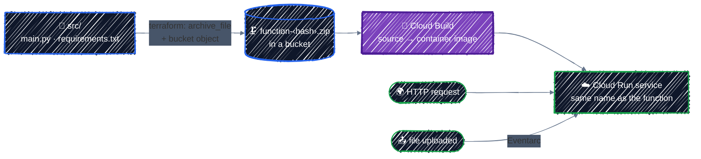
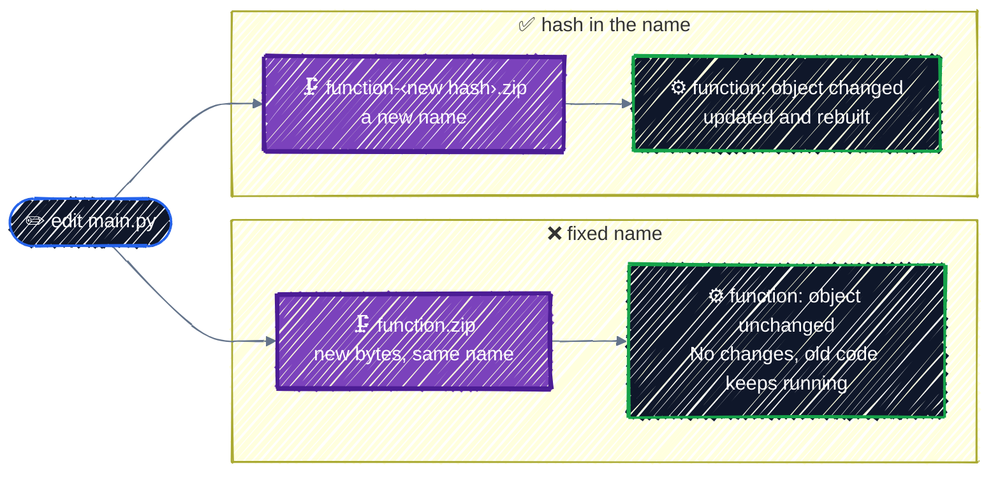

# Cloud Functions

> Deploy source code, not a container: package it with `archive_file`, call an HTTP function, redeploy on every code change, and run a function on every file upload.

---

**Cloud Functions** runs a single function written in Python, Node.js, Go, or another supported language. You hand it source code; Google builds it into a container and runs it on [Cloud Run](cloud-run.md). Like Cloud Run, it scales to zero and costs nothing while idle.

What it adds over Cloud Run is in the name of the two halves of this chapter:

- **You deploy source, not an image.** No Dockerfile, no registry to push to.
- **Events can call it**, not just HTTP requests: a file uploaded to a bucket, a Pub/Sub message, and many more.

## Before you start

```bash
cd examples/gcp-services/cloud-functions
terraform init
```

The example deploys two functions from the same folder of Python, [`src/main.py`](../../examples/gcp-services/cloud-functions/src/main.py): `hello-http` answers HTTP requests, and `on-upload` runs whenever a file lands in a bucket. `init` installs one provider you haven't used yet, `hashicorp/archive`, which zips the source.

## 1. What Cloud Functions does



Terraform's part ends at the bucket. From there, Google builds the image with Cloud Build, stores it in Artifact Registry, and deploys it as a Cloud Run service. That's why the example enables Cloud Build, Artifact Registry, and Cloud Run along with Cloud Functions.

| | [Cloud Run](cloud-run.md) | Cloud Functions |
|---|---|---|
| You deploy | a container image you built | source code |
| Called by | HTTP requests | HTTP requests, or events |
| Good for | a whole web app or API, any language or binary | one small piece of code, especially glue between services |

## 2. Package the source

A function's source must be a zip in a bucket. Terraform makes both. The zip comes from the `archive_file` data source, from [`main.tf`](../../examples/gcp-services/cloud-functions/main.tf):

```hcl
data "archive_file" "source" {
  type        = "zip"
  source_dir  = "${path.module}/src"
  output_path = "${path.module}/out/function.zip"
}
```

It zips `src/` into `out/function.zip` on every `plan`, and exposes the zip's hash as `output_md5`. The `out/` folder is git-ignored: it's rebuilt from `src/` every time.

Then upload it:

```hcl
resource "google_storage_bucket_object" "source" {
  name   = "function-${data.archive_file.source.output_md5}.zip"
  bucket = google_storage_bucket.source.name
  source = data.archive_file.source.output_path
}
```



**The hash in the object name is what makes code changes deploy.** The function points at the object by name. With a fixed name like `function.zip`, changing `main.py` would upload new bytes under the same name, the function's settings wouldn't change, and Terraform would never rebuild it. With the hash in the name, any code change is a new name, and every function using it gets updated. You'll see that in [step 4](#4-change-the-code-redeploy).

## 3. An HTTP function

```hcl
resource "google_cloudfunctions2_function" "hello" {
  name     = "hello-http"
  location = var.region

  # How to build it: runtime, the Python function to call, and the source.
  build_config {
    runtime     = "python312"
    entry_point = "hello_http"

    source {
      storage_source {
        bucket = google_storage_bucket.source.name
        object = google_storage_bucket_object.source.name
      }
    }
  }

  # How to run it.
  service_config {
    service_account_email = google_service_account.function.email
    available_memory      = "256M"
    max_instance_count    = 2 # a ceiling on cost
    timeout_seconds       = 60
  }
}
```

- **`google_cloudfunctions2_function`** is the current generation of Cloud Functions, now also called Cloud Run functions. The older `google_cloudfunctions_function` is first generation; don't start anything new on it.
- **`build_config`** is the build: `entry_point` is the name of the Python function in `main.py` to call.
- **`service_config`** is the Cloud Run service it runs as: its own service account, memory, a cap on instances, and a timeout.

The function is **private**. Nothing grants anyone the invoker role on it, so only accounts that already have it through a project role, such as you as Owner, can call it.

## Apply it

```bash
terraform apply
```

Each function takes a minute or two: that's Cloud Build building the image.

On a project where Eventarc has never been used, the first `apply` can fail on the second function:

```
Error: Error creating function: googleapi: Error 400: Validation failed for trigger projects/tf-tutorial-3fa9c1/locations/us-central1/triggers/on-upload-902026: Invalid resource state for "": Permission denied while using the Eventarc Service Agent. If you recently started to use Eventarc, it may take a few minutes before all necessary permissions are propagated to the Service Agent. Otherwise, verify that it has Eventarc Service Agent role.
```

Enabling the Eventarc API gives its service agent its permissions, but they take a few minutes to take effect. Wait two or three minutes and run `terraform apply` again. Everything already created stays; only the missing resources are added:

```
Plan: 2 to add, 0 to change, 0 to destroy.
...
Apply complete! Resources: 2 added, 0 changed, 0 destroyed.

Outputs:

upload_bucket = "tf-tutorial-3fa9c1-gcf-uploads"
url = "https://us-central1-tf-tutorial-3fa9c1.cloudfunctions.net/hello-http"
```

Call the HTTP function. Without credentials, it refuses:

```bash
curl -s -o /dev/null -w "%{http_code}\n" "$(terraform output -raw url)"
```

```
403
```

With an identity token for your account, it answers:

```bash
curl -H "Authorization: Bearer $(gcloud auth print-identity-token)" "$(terraform output -raw url)"
curl -H "Authorization: Bearer $(gcloud auth print-identity-token)" "$(terraform output -raw url)?name=Terraform"
```

```
Hello, world!
Hello, Terraform!
```

## 4. Change the code, redeploy

Edit `src/main.py` and change `Hello` to `Hi`, then plan:

```bash
terraform plan
```

```
  # google_cloudfunctions2_function.hello will be updated in-place
      ~ build_config {
                  ~ object     = "function-8016526bf4d604cc19b99a861fc45511.zip" -> "function-cf81d6cd34b31327da58d9158c3339b7.zip"
  # google_cloudfunctions2_function.on_upload will be updated in-place
      ~ build_config {
                  ~ object     = "function-8016526bf4d604cc19b99a861fc45511.zip" -> "function-cf81d6cd34b31327da58d9158c3339b7.zip"
  # google_storage_bucket_object.source must be replaced
      ~ name                = "function-8016526bf4d604cc19b99a861fc45511.zip" -> "function-cf81d6cd34b31327da58d9158c3339b7.zip" # forces replacement

Plan: 1 to add, 2 to change, 1 to destroy.
```

A new zip, and both functions point at it, because they share the source. Apply it if you like, and `curl` again for `Hi, world!`. Then change it back.

## 5. Trigger on a file upload

The second function is called by an **event** instead of a request. In `main.py` it takes a `cloud_event`, whose `data` describes the uploaded file:

```python
@functions_framework.cloud_event
def on_upload(cloud_event):
    data = cloud_event.data
    print(f"New file: gs://{data['bucket']}/{data['name']} ({data['size']} bytes)")
```

In Terraform, it's the same resource with one more block:

```hcl
resource "google_cloudfunctions2_function" "on_upload" {
  name     = "on-upload"
  ...

  event_trigger {
    trigger_region        = var.region
    event_type            = "google.cloud.storage.object.v1.finalized" # a new file
    retry_policy          = "RETRY_POLICY_DO_NOT_RETRY"
    service_account_email = google_service_account.function.email

    event_filters {
      attribute = "bucket"
      value     = google_storage_bucket.uploads.name
    }
  }
}
```

`event_type` and `event_filters` together say "a new file in this bucket". The bucket must be in the same region as `trigger_region`, which is why the uploads bucket uses `var.region` as its location.

An event takes three hops to reach the function, and each hop needs a role:


| Who | Role | Why |
|---|---|---|
| Cloud Storage's service agent | `roles/pubsub.publisher` on the project | Storage publishes the upload event to Pub/Sub |
| the function's account | `roles/eventarc.eventReceiver` on the project | Eventarc receives the event as that account |
| the function's account | `roles/run.invoker` on the function's Cloud Run service | Eventarc calls the function as that account |

Each is one `_iam_member` resource in `main.tf`. Cloud Storage's service agent is an account Google creates per project; the `google_storage_project_service_account` data source looks up its email.

Upload a file, then read the function's logs:

```bash
echo "hello from terraform" > hello.txt
gcloud storage cp hello.txt "gs://$(terraform output -raw upload_bucket)/"
gcloud functions logs read on-upload --region="$TF_VAR_region" --limit=5
```

```
LEVEL    NAME       EXECUTION_ID  TIME_UTC                 LOG
         on-upload  P2fSm7fWs2ei  2026-11-09 15:31:29.458  New file: gs://tf-tutorial-3fa9c1-gcf-uploads/hello.txt (21 bytes)
I        on-upload                2026-11-09 15:31:29.289
WARNING  on-upload                2026-11-09 15:31:14.567  The request was not authenticated. Either allow unauthenticated invocations or set the proper Authorization header. The IAM principal lacks {run.routes.invoke} permission. ...
```

The newest line is first: your `print`, with the file's bucket, name, and size. Logs take a few seconds to show up, so if yours is empty, run the command again.

The `WARNING` below it is common on the first upload after `apply`: the `run.invoker` grant was still taking effect, so the first delivery was refused, and Eventarc delivered the event again 15 seconds later. If every upload logs only that warning, the grant is missing.

## Checkpoint

1. You edit `main.py`, but `terraform plan` says *No changes*. The object's `name` is `"function.zip"`. Why doesn't the function update?
2. `curl` on the HTTP function's URL returns `403`. Is the function broken?
3. The first `apply` fails with *Permission denied while using the Eventarc Service Agent*. What do you do?
4. You upload a file, but `on-upload` never logs anything. Name two things to check.

<details>
<summary>Answer</summary>

1. The function points at the object by name, and the name didn't change, so Terraform sees nothing different in the function. Put the zip's hash in the name, `function-${data.archive_file.source.output_md5}.zip`, so every code change is a new name.
2. No. It's private, and the request had no identity token. Send one with `Authorization: Bearer $(gcloud auth print-identity-token)`, or grant `roles/run.invoker` to whoever should call it.
3. Wait a few minutes for the newly enabled Eventarc service agent's permissions to take effect, then run `terraform apply` again. Nothing has to be undone.
4. The three roles: Cloud Storage's service agent publishing to Pub/Sub, and the function's account receiving events and invoking the function. And the bucket: the trigger only fires for the bucket in `event_filters`, which must be in the trigger's region.

</details>

## Best practices

- **Put the source hash in the object name**, so every code change redeploys and an unchanged one doesn't.
- **Use `google_cloudfunctions2_function`**, never the first-generation resource for new work.
- **One service account per function**, with only the roles it needs, never the project's default.
- **Always set `max_instance_count`.** An event storm, such as thousands of uploads at once, otherwise scales to the project's limit.
- **Keep functions private** unless they're meant to be public, and grant `roles/run.invoker` only to the callers that need it.
- **Choose `retry_policy` on purpose.** Retrying a failing event can call the function again and again; only turn it on for code that's safe to run twice.

## Clean up

```bash
terraform destroy
rm -f hello.txt
```

That deletes both functions, both buckets and the files in them, the service account, and the role grants. Two things stay, both free or nearly so: the enabled APIs, and the `gcf-artifacts` repository in Artifact Registry where Cloud Build stored the images. Terraform never created that repository, so it doesn't delete it. To remove it:

```bash
gcloud artifacts repositories delete gcf-artifacts --location="$TF_VAR_region"
```

---

[← Cloud Run](cloud-run.md) · [↑ Contents](../../README.md) · [Writing Modules →](../modules/writing-modules.md)
