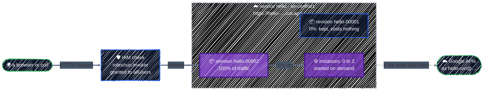
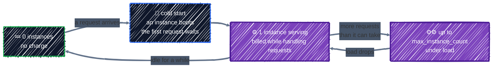
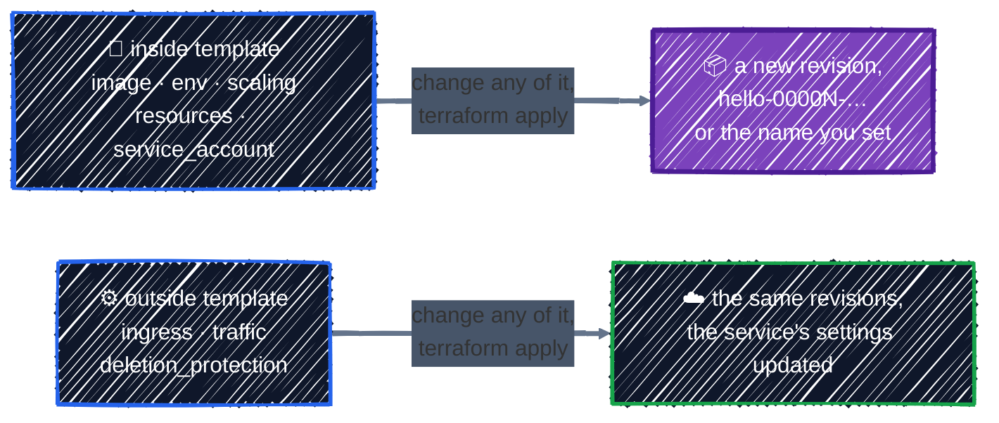
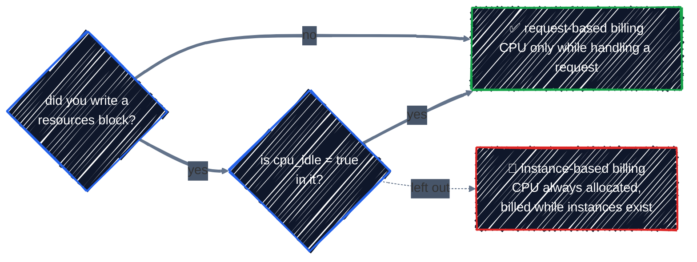
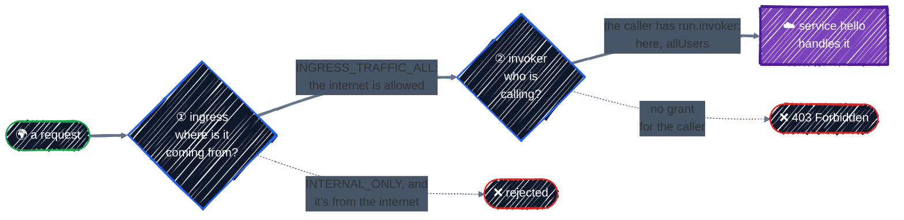
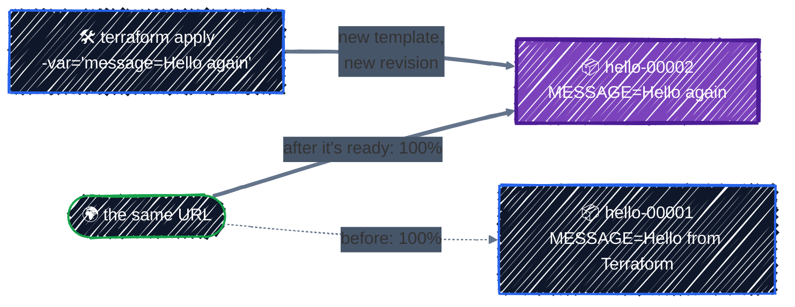
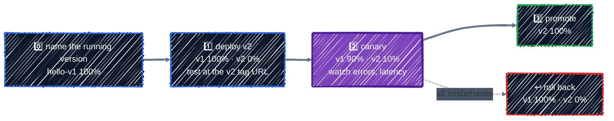

# Cloud Run

> Containers without servers: services and revisions, scale to zero, public access, and the two defaults that trip up Terraform users.

---

**Cloud Run** runs a container image and gives it an HTTPS URL. You don't create VMs, pick machine types, or patch an OS: Cloud Run starts container instances when requests arrive, adds more under load, and stops them all when traffic goes quiet. With the default billing, an idle service costs nothing.

Compare that with the [Compute Engine](compute-engine.md) chapter: there you chose a machine type, a disk, an image, a startup script, an external IP, and firewall rules, and paid for the VM whether anyone used it or not. Here you give Cloud Run a container image and a few limits. When the job is "answer HTTP requests with a container", Cloud Run is usually the simpler and cheaper choice.

## Before you start

```bash
cd examples/gcp-services/cloud-run
terraform init
```

The example deploys Google's sample container, `us-docker.pkg.dev/cloudrun/container/hello`, as a public service named `hello`, with its own service account, an environment variable, and limits on CPU, memory, and instance count. It needs no network setup: Cloud Run services get their URL and TLS certificate from Google.

## 1. What Cloud Run does



| Concept | What it means |
|---|---|
| **Service** | the long-lived thing with a name, a region, and a stable HTTPS URL |
| **Revision** | an immutable snapshot of the service's configuration: image, environment variables, limits, service account. **Any** change to them creates a new revision |
| **Traffic** | which revisions get requests, and what share. By default, 100% goes to the latest revision that's ready; `traffic` blocks split it by revision name |
| **Instance** | one running copy of a revision's container. Cloud Run starts and stops instances to match the load |
| **Invoker** | who may call the service: `roles/run.invoker` in IAM. Without it, requests get `403 Forbidden` |
| **Service account** | the identity the container uses to call Google APIs, as on a [VM](compute-engine.md#identity-a-service-account-of-its-own) |

### Scaling, and what you pay for



- **Scale to zero** is the default (`min_instance_count = 0`). An idle service has no instances and costs nothing; the price is a **cold start**, a delay of a second or so on the first request while an instance boots. Setting `min_instance_count = 1` removes cold starts, and costs for that idle instance.
- **`max_instance_count`** is the ceiling. Without it, Cloud Run picks one from your quota, which means a traffic spike, or a bug in a client that retries forever, can scale you further than you'd like to pay for.
- **Request-based billing** charges CPU and memory only while an instance is handling requests. The [free tier](https://cloud.google.com/free/docs/free-cloud-features) covers 2 million requests, 180,000 vCPU-seconds, and 360,000 GB-seconds a month, far more than this chapter uses.

## 2. In the Console

**Cloud Run → Deploy container → Service** asks for the following. They map to [`google_cloud_run_v2_service`](https://registry.terraform.io/providers/hashicorp/google/latest/docs/resources/cloud_run_v2_service), plus one IAM resource for public access. As with VMs, compare the two default columns:

| Console field | Terraform argument | Console default | Terraform default |
|---|---|---|---|
| Container image URL | `template { containers { image } }` | required | required |
| Service name, Region | `name`, `location` | required | required |
| Authentication: Allow public access | a `google_cloud_run_v2_service_iam_member` granting `roles/run.invoker` to `allUsers` | asked | **none**: only principals with the invoker role can call it |
| Billing: request-based / instance-based | `cpu_idle` in `resources` | request-based | request-based, **unless you write a `resources` block**: see [below](#limits-and-the-cpu_idle-trap) |
| Service scaling: min and max instances | `template { scaling { … } }` | 0, with a default maximum | 0 to a quota-based max |
| Ingress: All / Internal | `ingress` | All | All |
| Container port | `containers { ports { container_port } }` | 8080 | chosen by Cloud Run, passed in `$PORT` |
| Memory, CPU | `resources { limits = { … } }` | 512 MiB, 1 CPU | 512 MiB, 1 CPU |
| Variables & secrets | `env { … }` | none | none |
| Security: service account | `template { service_account }` | the Compute Engine default service account | the project's default service account |
| *(no Console equivalent)* | `deletion_protection` | | **`true`**: Terraform refuses to destroy the service |

The last row has no Console field because it isn't a GCP setting at all: it's a guard in the Terraform provider.

## 3. The minimum

Three arguments are required: `name`, `location`, and a `template` with a container image.

```hcl
resource "google_cloud_run_v2_service" "hello" {
  name     = "hello"
  location = "us-central1"

  template {
    containers {
      image = "us-docker.pkg.dev/cloudrun/container/hello"
    }
  }
}
```

That deploys a working service, with three surprises:

- **Nobody can call it.** There's no invoker grant, so `curl` gets `403 Forbidden`. You can still reach it as yourself, because your account has the invoker permission through its project role: `curl -H "Authorization: Bearer $(gcloud auth print-identity-token)" URL`.
- **You can't destroy it.** `deletion_protection` defaults to `true`, so `terraform destroy` stops with an error until you set it to `false` and `apply` that first.
- **It runs as the project's default service account**, which in many projects has the Editor role, the same problem as on a [VM](compute-engine.md#identity-a-service-account-of-its-own).

## 4. The real configuration

From [`main.tf`](../../examples/gcp-services/cloud-run/main.tf).

### The service

```hcl
resource "google_cloud_run_v2_service" "hello" {
  project  = google_project_service.enabled["run.googleapis.com"].project
  name     = "hello"
  location = var.region
  ingress  = "INGRESS_TRAFFIC_ALL" # reachable from the internet

  # Lab only: while this is true (the default), Terraform refuses to destroy
  # the service.
  deletion_protection = false
  ...
```

- **`project`** waits for the Cloud Run API, the same pattern as in [Compute Engine](compute-engine.md#machine-type-and-boot-disk). The example also enables IAM, for the service account.
- **`ingress = "INGRESS_TRAFFIC_ALL"`** accepts requests from the internet. `INGRESS_TRAFFIC_INTERNAL_ONLY` would accept them only from inside your VPCs, for a service other services call but users never do. Ingress decides **where** requests may come from; the invoker role decides **who** may make them. A public service needs both.
- **`deletion_protection = false`** lets `terraform destroy` clean up the lab. On a real service, leave the default: deleting a service takes its URL offline at once, with no undo.

### The template: one revision

```hcl
  # Everything in template is a revision: changing any of it creates a new one.
  template {
    # null: Cloud Run names each revision. A name lets traffic point at it,
    # and can't be reused for a different template.
    revision        = var.revision
    service_account = google_service_account.hello.email

    scaling {
      min_instance_count = 0 # scale to zero when idle
      max_instance_count = 2 # a ceiling on cost
    }

    containers {
      image = "us-docker.pkg.dev/cloudrun/container/hello"

      env {
        name  = "MESSAGE"
        value = var.message
      }
      ...
```



- **`template` is the revision.** Everything inside it, from the image to a single environment variable, is copied into an immutable revision. Change any of it and the next `apply` creates a new revision and, unless `traffic` blocks say otherwise, moves traffic to it. Settings outside `template`, like `ingress` and `traffic`, change the service without a new revision.
- **`revision = var.revision`** is `null` by default, so Cloud Run names each revision itself, like `hello-00001-abc`. You'll set it in [Control the rollout](#control-the-rollout), where traffic has to point at revisions by name.
- **`service_account`** is `hello-run`, created in the same file with no roles: the sample calls no Google APIs. A service that reads a bucket gets `roles/storage.objectViewer` on that bucket, exactly as in [Cloud Storage](cloud-storage.md#access-iam-only-never-public).
- **`max_instance_count = 2`** keeps a runaway client from scaling the bill. Real services set it from what they and their downstream systems can handle.
- **`env`** passes `MESSAGE` from a variable, so you can create a new revision with nothing but `-var`, which you'll do below. The sample app doesn't display it; a real app would read it like any environment variable. For a secret, use `value_source { secret_key_ref { secret, version } }` instead of `value`, and grant the service account `roles/secretmanager.secretAccessor` on that secret, as in [Secret Manager](../gcp-foundations/secrets.md).
- **No `ports` block**: Cloud Run tells the container which port to listen on through the `PORT` environment variable, and the sample listens on it.

### Limits, and the `cpu_idle` trap

```hcl
      resources {
        limits = {
          cpu    = "1"
          memory = "512Mi"
        }
        # With a resources block, this must be set to keep request-based
        # billing: CPU only while a request is being handled.
        cpu_idle = true
      }
```

`limits` sets each instance's CPU and memory; `1` CPU and `512Mi` are Cloud Run's own defaults, written out so you can see and change them.

The trap is `cpu_idle`. Without a `resources` block, it defaults to `true`: CPU is allocated only while a request is being handled, and you pay only for that time. **As soon as you write a `resources` block**, the provider's documentation says `cpu_idle` must be set to `true` explicitly to keep that behavior. Leave it out and the service switches to CPU that's always allocated, billed for as long as an instance exists. Nothing fails; it just costs more. That's why `cpu_idle = true` sits right next to `limits` here.



### Public access

```hcl
# Anyone may call the service: allUsers gets the invoker role on it.
resource "google_cloud_run_v2_service_iam_member" "public" {
  project  = google_cloud_run_v2_service.hello.project
  location = google_cloud_run_v2_service.hello.location
  name     = google_cloud_run_v2_service.hello.name
  role     = "roles/run.invoker"
  member   = "allUsers"
}
```



Both gates have to say yes. A request from the internet first needs an ingress setting that accepts it, then a caller the invoker role covers. This service opens both: ingress to all traffic, and the invoker role to `allUsers`.

`allUsers` means anyone on the internet, signed in or not. The grant is on this **one service**, not the project, like every grant in [IAM](../gcp-foundations/iam.md#grant-at-the-narrowest-scope). For a service only other services should call, grant `roles/run.invoker` to their service accounts instead; Cloud Run then checks a Google-signed identity token on every request, and you write no authentication code at all.

If `apply` fails here with a policy error, your organization probably restricts IAM grants to its own domain, which blocks `allUsers`. Sandbox projects without an organization don't have that policy.

## Apply it

```bash
terraform plan    # Plan: 5 to add, 0 to change, 0 to destroy.
terraform apply
```

Five resources: two APIs, the service account, the service, and the public grant. The first deployment takes a minute or two, mostly enabling the API and pulling the image. Then:

```bash
terraform output
curl "$(terraform output -raw url)"
```

`url` is the service's `https://hello-….run.app` address, with a certificate already in place, and `latest_revision` is the revision serving it, `hello-00001-…`. The sample's page says the service is running and names the service and revision that answered. Open the URL in a browser to see it.

## Ship a new revision

Change the environment variable, without touching any file:

```bash
terraform apply -var='message=Hello again'
```

The plan shows `~ update in-place` on `google_cloud_run_v2_service.hello`, with the `env` value changing. Cloud Run, though, creates a whole new revision from the new template, waits for it to be ready, and only then moves traffic to it:



```bash
gcloud run revisions list --service=hello --region="$TF_VAR_region"
curl "$(terraform output -raw url)"
```

The list has both revisions, with `hello-00002-…` active, and the page now names `hello-00002-…`. Now ask Terraform:

```bash
terraform output latest_revision
```

```
"projects/…/services/hello/revisions/hello-00001-…"
```

Still the old one. `terraform output` doesn't ask GCP; it prints values saved in state when the outputs were last worked out. During the plan, the provider kept `latest_ready_revision` at its old value instead of marking it `(known after apply)`, so Terraform worked out the outputs from that old value. Cloud Run only picked the new revision during `apply`, and the resource in state was updated, but the saved outputs weren't. A refresh fixes them:

```bash
terraform apply -refresh-only
terraform output latest_revision
```

The refresh-only plan lists the two outputs changing, `latest_revision` and `traffic`, and nothing in GCP. After `yes`, the output reads `hello-00002-…`. ([State & Drift](../state/state-basics.md) covers `-refresh-only`.) The next `apply` would also fix them.

The old revision stays, receiving no traffic and costing nothing, so rolling back is a traffic change rather than a rebuild. A deploy that never becomes ready, say a typo in the image name, leaves traffic on the old revision, and `apply` reports the error.

Compare that with the [VM](compute-engine.md#changing-a-running-vm): there, a change either stopped the VM or replaced it. Here every change is a new revision behind the same URL, with no downtime.

Switching 100% at once is fine for a lab. For anything users depend on, you'll want to try the new revision first and move traffic in steps, which is the next section.

## Control the rollout

So far every new revision took 100% of the traffic as soon as it was ready. To send it a little traffic first, and roll back without rebuilding anything, two variables that you've left at their defaults come into play: `revision` names the revision, and `traffic` says what share each named revision gets. The example turns `traffic` into one block per revision:

```hcl
  # One traffic block per revision in var.traffic. With none (the default),
  # all traffic goes to the latest revision the moment it's ready.
  dynamic "traffic" {
    for_each = var.traffic

    content {
      type     = "TRAFFIC_TARGET_ALLOCATION_TYPE_REVISION"
      revision = traffic.key
      percent  = traffic.value
      tag      = traffic.key # https://hello-v2---hello-….run.app (3-47 characters)
    }
  }
```

- **One block per revision that gets traffic**, generated with a [`dynamic` block](../core-language/expressions.md#dynamic-blocks). With `traffic` empty, there are no blocks, which is the default behavior you've used so far. The percents must add up to 100, and the variable's validation checks that before Cloud Run does.
- **`TRAFFIC_TARGET_ALLOCATION_TYPE_REVISION`** points at a revision by name, so revisions need names you choose: an automatic one like `hello-00002-xyz` isn't known until after `apply`. The other type, `…_LATEST`, means "whatever revision is newest", so a second template change would quietly move that share to a revision you never tested.
- **`tag`** gives each listed revision a URL of its own, `https://hello-v2---hello-….run.app`, that reaches it whatever its percent, even 0. That's how you test a new revision before any user sees it.
- **A revision name can't be reused.** Once you set `revision`, every template change needs a new name, or `apply` fails.

The rollout goes in steps, each one an edit to `terraform.tfvars` and an `apply`:



### Step 0: name the running version

Copy the example variable file:

```bash
cp terraform.tfvars.example terraform.tfvars
```

It names the revision `hello-v1` and gives it all the traffic:

```hcl
revision = "hello-v1"
traffic = {
  "hello-v1" = 100
}
```

```bash
terraform apply
```

Setting a name changes the template, so Cloud Run creates a new revision, `hello-v1`, and the traffic block sends it everything. If you ran `-var='message=Hello again'` above, the message also goes back to the default here: `-var` values aren't remembered between runs, which is one reason this section keeps them in a file.

### Step 1: deploy v2 with no traffic

In `terraform.tfvars`, name a new revision, change what's in it, and give it 0%:

```hcl
revision = "hello-v2"
message  = "Hello again"
traffic  = { "hello-v1" = 100, "hello-v2" = 0 }
```

```bash
terraform apply
```

The plan shows `~ update in-place` on `google_cloud_run_v2_service.hello`: the template's `revision` and `env` change, and a second traffic block appears. Cloud Run builds `hello-v2`, waits until it's ready, and sends it nothing. If it never becomes ready, say from a typo in the image name, `apply` fails and `hello-v1` keeps serving.

Ask Cloud Run what it's doing now:

```bash
gcloud run services describe hello --region="$TF_VAR_region"
```

```
✔ Service hello in region us-central1
…
URL:     https://hello-….run.app
Ingress: all
Traffic:
  100% hello-v1
        hello-v1: https://hello-v1---hello-….run.app
  0%   hello-v2
        hello-v2: https://hello-v2---hello-….run.app
…
```

`Traffic` lists each revision's share and its tag URL. Don't rely on the `traffic` and `tag_urls` outputs for this: like [`latest_revision`](#ship-a-new-revision), they're worked out at plan time, so they lag one `apply` behind. Now call both versions:

```bash
curl "$(terraform output -raw url)"       # still v1
curl https://hello-v2---hello-….run.app   # paste the hello-v2 URL from above: v2, before any user sees it
```

### Step 2: send it 10%

Change only the `traffic` line, and leave `revision` and `message` as they are:

```hcl
revision = "hello-v2"
message  = "Hello again"
traffic  = { "hello-v1" = 90, "hello-v2" = 10 }
```

```bash
terraform apply
```

This time the plan changes only the two `percent` values, and no new revision is created: `revision` and `message` didn't change. About one request in ten now goes to `hello-v2`. In a real rollout, this is where you watch its error rate and latency in **Cloud Run → hello → Metrics** before going on.

> ⚠️ `terraform.tfvars` is the whole desired state, not a list of changes. Remove or comment out `revision` or `message`, and it goes back to its default in `variables.tf`, so the template changes. Cloud Run then creates another revision, named automatically (`hello-00003-…`) since `revision` is now `null`, and gives it 0% because it isn't in `traffic`.

### Step 3: promote, or roll back

If v2 behaves, give it everything, again changing only the `traffic` line:

```hcl
traffic = { "hello-v2" = 100 }
```

`hello-v1` isn't deleted: it stays, gets nothing, and costs nothing. If v2 misbehaves at any step, roll back the same way, with no rebuild:

```hcl
traffic = { "hello-v1" = 100, "hello-v2" = 0 }
```

The rollback takes effect as soon as `apply` finishes, because `hello-v1` is still there, ready. `gcloud run revisions list --service=hello --region="$TF_VAR_region"` shows every revision you've created, named and unnamed.

### Who should own traffic

Driving traffic from `terraform.tfvars` works well when releases are occasional and you want each step in a plan and in Git. Teams that deploy many times a day usually split the job: Terraform owns the service's settings, such as the service account, limits, and IAM, while CI deploys each image with `gcloud run deploy --no-traffic --tag=…` and moves traffic with `gcloud run services update-traffic`. The Terraform configuration then needs `lifecycle { ignore_changes = [...] }` on the image and traffic, or the next `apply` would undo what CI did. For automated canaries with approvals between steps, **Cloud Deploy** has a Cloud Run canary strategy built in.

## Watch scale to zero

Leave the service alone for 15 minutes or so, and time the next request. The first one is slower, a cold start; the ones after it are fast again:

```bash
curl -s -o /dev/null -w '%{time_total}s\n' "$(terraform output -raw url)"
```

## Checkpoint

1. You add a `resources` block to set `memory = "1Gi"` and nothing else in it. What else changed, and how would you notice?
2. `curl` on the service URL returns `403 Forbidden`, but `curl` with `gcloud auth print-identity-token` works. What's missing?
3. `terraform destroy` fails on a `google_cloud_run_v2_service`, saying it can't be destroyed. What's going on, and what's the fix?
4. You change only `max_instance_count`. Is that a new revision? What if you've set `revision`, as in the rollout?
5. `hello-v2` is at 10% and its error rate jumps. What's the fastest way back, and why is it fast?

<details>
<summary>Answer</summary>

1. `cpu_idle` stopped defaulting to `true`, so the service moved to CPU that's always allocated, billed for as long as instances exist. Nothing errors; the bill grows. Set `cpu_idle = true` in the same block.
2. An invoker grant for unauthenticated callers. Your own token works because your account has the invoker permission through its project role. Grant `roles/run.invoker` to `allUsers` on the service for a public service, or to the calling service's account for a private one.
3. `deletion_protection` is `true`, the provider's default. Set it to `false`, run `terraform apply` so state records it, then destroy. Leave it `true` on services that matter.
4. Yes. `scaling` is inside `template`, and every change inside `template` creates a new revision. Settings outside it, like `ingress` or `traffic`, don't. With `revision` set, you must also give it a new name: the old name already belongs to a different template, so `apply` fails otherwise.
5. Set `traffic` back to `hello-v1 = 100` and `hello-v2 = 0`, and apply. Nothing is rebuilt: `hello-v1` still exists and is ready, so only the traffic setting changes.

</details>

## Best practices

- **One service account per service**, with only the roles it needs, never the project's default.
- **Always set `max_instance_count`**, from what the service and anything it calls can handle.
- **Write `cpu_idle = true` whenever you write a `resources` block**, unless you've chosen instance-based billing on purpose.
- **Grant `roles/run.invoker` on the service**, to `allUsers` only for truly public services, and to service accounts for service-to-service calls.
- **Keep `deletion_protection` on** outside labs.
- **Name revisions and route traffic by name** for anything users depend on: deploy at 0% with a tag, test, then shift in steps. Leave a team's frequent deploys to CI, with `ignore_changes` on what CI owns.
- **Deploy images by tag in development and by digest in production**, so a revision always serves exactly the image you tested.
- **Pass secrets with `value_source`**, never as plain `env` values, which end up in state and in the Console.

## Clean up

```bash
terraform destroy
rm -f terraform.tfvars
```

`deletion_protection = false` lets this delete the service, every revision, the service account, and the public grant. The APIs stay enabled, which costs nothing. An idle Cloud Run service costs nothing either, but destroying it removes the public URL.

---

[← Compute Engine](compute-engine.md) · [↑ Contents](../../README.md) · [Cloud Functions →](cloud-functions.md)
