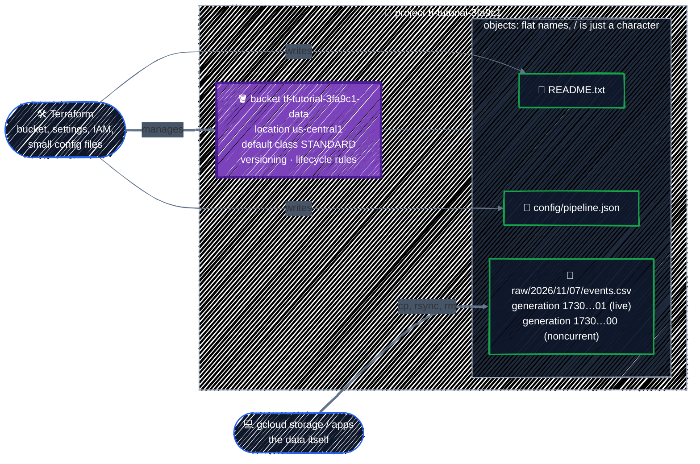

# Cloud Storage

> Buckets and objects, locations and storage classes, lifecycle rules, and everyday `gcloud storage` commands.

---

**Cloud Storage (GCS)** is GCP's object storage: files of any size and type, such as images, videos, CSV exports, backups, and model weights, stored in **buckets** and read over HTTPS. You've already used it twice, for your [first resource](../state/google-provider.md#6-your-first-resource-a-gcs-bucket) and for [Terraform state](../state/remote-backend.md). This chapter covers the service itself: the choices every bucket makes, how to make data cheaper as it ages, and where Terraform's job ends and `gcloud storage` takes over.

Every chapter in this part follows the same four steps for a new service:

1. **What it does**: the concepts and the choices you'll have to make.
2. **The Console**: the form you'd fill in by hand, and which Terraform argument each field becomes.
3. **The minimum**: a resource with only the required arguments, and what the defaults give you.
4. **The real configuration**: one argument at a time, each with its reason.

## Before you start

```bash
cd examples/gcp-services/cloud-storage
terraform init
```

The example builds a bucket for raw data that moves to cheaper storage as it ages, versions every overwrite, and holds two small files written by Terraform. You'll add the data yourself with `gcloud storage`. It needs `TF_VAR_project_id` and `TF_VAR_region` from [Connecting to GCP](../state/google-provider.md#6-your-first-resource-a-gcs-bucket), and no extra APIs: new projects start with Cloud Storage enabled.

## 1. What Cloud Storage does



| Concept | What it means |
|---|---|
| **Bucket** | a container with a **globally unique name** (across all of GCP, not just your project), a location, and settings that apply to everything in it |
| **Object** | a file plus metadata. Objects are **immutable**: "editing" one uploads a new object with the same name |
| **Object name** | a flat string. `raw/2026/11/07/events.csv` is one name; the "folders" you see in the Console are just shared prefixes |
| **Generation** | a number identifying each upload of an object name. With versioning on, older generations are kept as **noncurrent** versions |
| **Storage class** | per object: how it's billed. Cheaper storage costs more to read |
| **Location** | per bucket: where the data lives. Fixed at creation |

### Location: where the data lives

| Location type | Example | Use it for |
|---|---|---|
| **Region** | `us-central1` | almost everything: cheapest, and fastest for compute in the same region |
| **Dual-region** | `NAM4` (Iowa + South Carolina) | data that must survive a regional outage, read from two known regions |
| **Multi-region** | `US`, `EU`, `ASIA` | content served to users across a continent |

Put a bucket in the **same region as whatever reads it**. A VM or GKE node in `us-central1` reading from a `US` multi-region bucket pays more for storage and may read across regions. This guide uses `us-central1` everywhere.

A bucket's location **can't be changed**. Neither can its name. Changing either in Terraform means a new bucket, which you'll see in a plan as a replacement.

### Storage classes: cheap to keep vs. cheap to read

Approximate prices for `us-central1`; check [Cloud Storage pricing](https://cloud.google.com/storage/pricing) for current ones.

| Class | Storage per GB-month | Retrieval per GB | Minimum duration | Good for |
|---|---|---|---|---|
| **Standard** | ~$0.020 | free | none | data you read often, or just wrote |
| **Nearline** | ~$0.010 | ~$0.01 | 30 days | read about once a month: last month's logs |
| **Coldline** | ~$0.004 | ~$0.02 | 90 days | read about once a quarter: disaster-recovery copies |
| **Archive** | ~$0.0012 | ~$0.05 | 365 days | kept for compliance, almost never read |

Two things trip people up:

- **Minimum duration** means deleting or overwriting an object early is billed as if it had stayed the full period. A file uploaded straight to Coldline and deleted a week later still pays for 90 days of Coldline.
- **The class is per object.** A bucket's `storage_class` is only the default for new uploads. Changing it doesn't touch objects already there; lifecycle rules do that.

## 2. In the Console

Create a bucket in **Cloud Storage → Buckets → Create** and you're asked the same questions in the same order. Each one is an argument of [`google_storage_bucket`](https://registry.terraform.io/providers/hashicorp/google/latest/docs/resources/storage_bucket):

| Console field | Terraform argument | Default if you leave it out |
|---|---|---|
| Name your bucket | `name` | required |
| Labels | `labels` | none (plus the provider's `default_labels`) |
| Location type, Location | `location` | required |
| Default storage class | `storage_class` | `STANDARD` |
| Autoclass | `autoclass { }` | off |
| Prevent public access | `public_access_prevention` | inherited from the project or organization |
| Access control: Uniform / Fine-grained | `uniform_bucket_level_access` | fine-grained (per-object ACLs) |
| Soft delete policy | `soft_delete_policy { }` | 7 days |
| Object versioning | `versioning { }` | off |
| Lifecycle rules (a tab, after creation) | `lifecycle_rule { }` | none |

Looking at the Console form first is a quick way to learn what a service wants before reading its Terraform docs. Don't create anything there, though: a bucket made by hand is one Terraform doesn't know about, and [`import`](../state/refactoring.md) is how you'd fix that.

## 3. The minimum

Only two arguments are required:

```hcl
resource "google_storage_bucket" "data" {
  name     = "${var.project_id}-data"
  location = var.region
}
```

That works, and it's what [Connecting to GCP](../state/google-provider.md#6-your-first-resource-a-gcs-bucket) created. But the defaults from the table above are rarely what you want:

- **Fine-grained access** means every object can carry its own ACL, so who can read an object depends on how it was uploaded, not just on the bucket's IAM.
- **Public access prevention** only applies if your project or organization enforces it. On a sandbox project, nothing stops someone from making an object public.
- **No versioning**: an overwrite or `gcloud storage rm` is permanent after the soft-delete window.
- **No lifecycle rules**: data stays in Standard, and stays forever, until someone deletes it.

## 4. The real configuration

From [`main.tf`](../../examples/gcp-services/cloud-storage/main.tf), one group of arguments at a time.

### Access: IAM only, never public

```hcl
resource "google_storage_bucket" "data" {
  name          = "${var.project_id}-data"
  location      = var.region # can't be changed later: a new location is a new bucket
  storage_class = "STANDARD" # the default class for new objects

  uniform_bucket_level_access = true
  public_access_prevention    = "enforced"

  # Lab only: lets `terraform destroy` delete the bucket with objects in it.
  force_destroy = true
  ...
```

- **`uniform_bucket_level_access = true`** turns off per-object ACLs. Access comes only from IAM, on the bucket or above it, so one `gcloud storage buckets get-iam-policy` answers "who can read this?".
- **`public_access_prevention = "enforced"`** blocks `allUsers` and `allAuthenticatedUsers` on the bucket and its objects, even for someone with permission to grant them. [Security Scanning](../team-workflow/security-scanning.md) shows scanners flagging buckets that lack both settings.
- **`force_destroy = true`** is for the lab. Without it, GCS refuses to delete a bucket that still holds objects, which is exactly what you want for data you can't recreate. Production buckets drop it and add [`prevent_destroy`](../core-language/meta-arguments.md#prevent_destroy-a-guard-against-deletion), as the [state bucket](../state/remote-backend.md#1-create-the-state-bucket) does.

Grants go on the bucket, not the project, with additive `_iam_member` resources ([IAM](../gcp-foundations/iam.md#grant-at-the-narrowest-scope)):

```hcl
resource "google_storage_bucket_iam_member" "readers" {
  for_each = var.readers

  bucket = google_storage_bucket.data.name
  role   = "roles/storage.objectViewer"
  member = each.key
}
```

`readers` defaults to empty. The roles you'll use most on a bucket:

| Role | Can |
|---|---|
| `roles/storage.objectViewer` | list and read objects |
| `roles/storage.objectCreator` | upload new objects, but not read, overwrite, or delete them: a good fit for a job that only drops files off |
| `roles/storage.objectUser` | read, write, overwrite, and delete objects |
| `roles/storage.admin` | everything, including the bucket's settings and IAM |

### Versioning: an undo button for overwrites

```hcl
  # Overwriting or deleting an object keeps the old version as noncurrent.
  versioning {
    enabled = true
  }
```

With versioning, an overwrite or delete doesn't destroy data: the old generation becomes **noncurrent** and can be listed and copied back, which you'll do below. Noncurrent versions are billed like live ones, so versioning always comes with rules that clean them up.

**Soft delete** is a different safety net, on by default: anything deleted, including noncurrent versions and whole buckets, stays restorable for 7 days and is billed meanwhile. This example keeps the default. For large data you can always recreate, [Model Storage](../ai-infra/model-storage.md#the-model-bucket) turns it off.

### Lifecycle rules: cheaper as it ages, then gone

Each `lifecycle_rule` is a **condition** and an **action**. GCS applies them asynchronously, and a change to the rules can take up to 24 hours to take effect, so nothing happens at the exact moment an object qualifies.

```hcl
  # Standard for the first 30 days, then Nearline, then Coldline, then gone.
  lifecycle_rule {
    condition {
      age                   = 30
      matches_storage_class = ["STANDARD"]
    }
    action {
      type          = "SetStorageClass"
      storage_class = "NEARLINE"
    }
  }

  lifecycle_rule {
    condition {
      age                   = 90
      matches_storage_class = ["NEARLINE"]
    }
    action {
      type          = "SetStorageClass"
      storage_class = "COLDLINE"
    }
  }

  lifecycle_rule {
    condition {
      age = 365
    }
    action {
      type = "Delete"
    }
  }
```

A file uploaded today spends its first month in Standard, months 2–3 in Nearline, the rest of the year in Coldline, and is deleted after a year:

```
day 0 ──────── 30 ──────── 90 ─────────────────── 365
   STANDARD  │  NEARLINE  │       COLDLINE         │ deleted
```

- **`age` counts days since the object was created**, not since it last changed class.
- **`matches_storage_class`** limits each rule to objects in the class it moves them from, so each rule is one step of the chain. Lifecycle rules only ever move objects to colder classes.
- **Class changes by lifecycle rules are free**: no retrieval or early-deletion fees, and the days an object already spent in the bucket count toward the new class's minimum. An object that reaches Coldline at day 90 has already met Coldline's 90-day minimum.
- **Only the `Delete` can cost extra**, if it comes before the current class's minimum. Day 365 is past every minimum except Archive's, which is why this chain stops at Coldline.

The other two rules handle the noncurrent versions that versioning keeps:

```hcl
  # Old versions: keep 3 per object, and none longer than 30 days.
  lifecycle_rule {
    condition {
      num_newer_versions = 3
      with_state         = "ARCHIVED"
    }
    action {
      type = "Delete"
    }
  }

  lifecycle_rule {
    condition {
      days_since_noncurrent_time = 30
    }
    action {
      type = "Delete"
    }
  }
```

- **`num_newer_versions = 3`** deletes a version once three newer ones exist. `with_state = "ARCHIVED"` (GCS's name for noncurrent) makes sure the rule never touches live objects.
- **`days_since_noncurrent_time = 30`** deletes a version 30 days after it was replaced, however few versions there are.

When several rules match one object, `Delete` wins over `SetStorageClass`, and between two `SetStorageClass` actions the cheaper class wins.

> 💡 **Autoclass is the alternative.** If you don't know how often data will be read, `autoclass { enabled = true }` lets GCS move each object between classes based on its actual access, with no retrieval or early-deletion charges, for a small per-object management fee. It can't be combined with `SetStorageClass` rules: pick Autoclass or a schedule, per bucket. A schedule like the one above is better when you know the pattern, as with logs and exports.

### Labels

```hcl
  labels = {
    component = "raw-data"
  }
```

These merge with the provider's `default_labels` (`managed-by`, `tutorial`) from [`providers.tf`](../../examples/gcp-services/cloud-storage/providers.tf), and show up in billing reports, as [Projects & APIs](../gcp-foundations/projects-and-apis.md#labeling-everything) explains.

## Objects: what belongs in Terraform

`google_storage_bucket_object` uploads an object, from a local file (`source`) or a string (`content`):

```hcl
# Small, rarely changing files belong in Terraform. Data doesn't.
resource "google_storage_bucket_object" "readme" {
  bucket       = google_storage_bucket.data.name
  name         = "README.txt"
  source       = "${path.module}/files/README.txt"
  content_type = "text/plain"
}

resource "google_storage_bucket_object" "pipeline_config" {
  bucket = google_storage_bucket.data.name
  name   = "config/pipeline.json"
  content = jsonencode({
    input_prefix = "raw/"
    format       = "csv"
  })
  content_type = "application/json"
}
```

Terraform records each object's MD5 hash in state. If you edit `files/README.txt` or the `jsonencode` map, the next plan replaces the object with the new content. If someone overwrites the object outside Terraform, the next plan notices too, and puts Terraform's version back.

That's the right behavior for **configuration**: a few files, a few KB each, that should always match the code. It's the wrong one for **data**:

- **State holds the inline `content` of every object**, so a large or sensitive file ends up in state and in every saved plan.
- **Every plan reads every file** in `source` to hash it, so thousands of files make every plan slow.
- **Data changes on its own schedule**: pipelines write it, people upload it. Terraform would keep trying to put back what it remembers.

So Terraform manages the bucket, its settings, its IAM, and a handful of config files. The data goes in with `gcloud storage` or the application itself. [Model Storage](../ai-infra/model-storage.md#upload-the-weights) uploads multi-gigabyte model weights exactly this way.

## Apply it

```bash
terraform plan    # Plan: 3 to add, 0 to change, 0 to destroy.
terraform apply
```

Three resources: the bucket and two objects. The `readers` grant adds one more per principal if you set it, for example:

```bash
terraform apply -var='readers=["user:teammate@example.com"]'
```

The outputs give you everything the next section needs:

```
Outputs:

bucket_name = "tf-tutorial-3fa9c1-data"
bucket_url = "gs://tf-tutorial-3fa9c1-data"
objects = [
  "gs://tf-tutorial-3fa9c1-data/README.txt",
  "gs://tf-tutorial-3fa9c1-data/config/pipeline.json",
]
```

Check what GCS actually stored:

```bash
BUCKET="gs://$(terraform output -raw bucket_name)"
gcloud storage buckets describe "$BUCKET" \
  --format="yaml(location,default_storage_class,versioning_enabled,public_access_prevention,uniform_bucket_level_access,lifecycle_config)"
```

## Everyday `gcloud storage` commands

`gcloud storage` replaces the older `gsutil`. You'll still see `gsutil` in older docs and scripts; the commands map almost one to one (`gsutil cp` → `gcloud storage cp`), and `gcloud storage` is faster for large transfers.

Make some data to work with:

```bash
mkdir -p raw/2026/11/07
printf 'ts,event\n2026-11-07T09:00:00Z,login\n' > raw/2026/11/07/events.csv
```

### Upload, list, read

```bash
# Upload one file. The object name is the destination path in the bucket.
gcloud storage cp raw/2026/11/07/events.csv "$BUCKET/raw/2026/11/07/events.csv"

# List the top level; folders are prefixes that end in /
gcloud storage ls "$BUCKET"

# List everything under a prefix, recursively, with sizes and dates
gcloud storage ls -l "$BUCKET/raw/**"

# Print an object, or show its metadata (storage class, size, generation, hashes)
gcloud storage cat "$BUCKET/config/pipeline.json"
gcloud storage objects describe "$BUCKET/raw/2026/11/07/events.csv"
```

`objects describe` shows `storage_class: STANDARD` for the new file. Thirty days from now, the lifecycle rule will have changed it to `NEARLINE`.

### Overwrite, and restore an old version

```bash
printf 'ts,event\n2026-11-07T09:00:00Z,logout\n' > raw/2026/11/07/events.csv
gcloud storage cp raw/2026/11/07/events.csv "$BUCKET/raw/2026/11/07/events.csv"

# --all-versions (-a) lists noncurrent generations too, each as name#generation
gcloud storage ls -a "$BUCKET/raw/2026/11/07/events.csv"
```

Two lines come back, the older generation first. To roll back, copy the old generation over the live object:

```bash
gcloud storage cp "$BUCKET/raw/2026/11/07/events.csv#<older generation>" \
  "$BUCKET/raw/2026/11/07/events.csv"
gcloud storage cat "$BUCKET/raw/2026/11/07/events.csv"    # login again

# cp works in both directions: download the restored file over your local copy
gcloud storage cp "$BUCKET/raw/2026/11/07/events.csv" raw/2026/11/07/events.csv
```

The restore is itself a new upload, so now there are three generations. The `num_newer_versions = 3` rule starts deleting the oldest ones after the fourth.

### Sync a directory

```bash
mkdir -p raw/2026/11/08
printf 'ts,event\n2026-11-08T10:00:00Z,login\n' > raw/2026/11/08/events.csv
gcloud storage rsync raw/2026/11/08 "$BUCKET/raw/2026/11/08" --recursive
```

`rsync` uploads only what's new or changed, so it's the command for "make the bucket match this directory". Add `--delete-unmatched-destination-objects` to also delete objects that no longer exist locally, and run it with `--dry-run` first: with the wrong source path, it deletes everything under the prefix.

### Move, delete, measure

```bash
gcloud storage mv "$BUCKET/raw/2026/11/08/events.csv" "$BUCKET/raw/2026/11/08/events-backfill.csv"
gcloud storage rm "$BUCKET/raw/2026/11/08/events-backfill.csv"
gcloud storage du "$BUCKET" --summarize --readable-sizes
```

- **`mv` is a copy plus a delete**, since object names are flat and objects immutable. On a large prefix it copies every object, and the deleted originals become noncurrent versions.
- **`rm` on a versioned bucket keeps the data** as a noncurrent version, until the lifecycle rules or `rm` with an explicit `#generation` remove it.
- **`du` counts only live objects** unless you add `--all-versions` (`-a`). Noncurrent versions and soft-deleted objects are billed too.

### Watch Terraform catch a change

Overwrite one of the objects Terraform owns, then plan:

```bash
echo '{"input_prefix":"tmp/"}' | gcloud storage cp - "$BUCKET/config/pipeline.json"
terraform plan
```

The plan shows `google_storage_bucket_object.pipeline_config` must be replaced: the stored hash no longer matches the code. `terraform apply` puts the configured content back. The CSV files under `raw/` don't appear in any plan, because Terraform never managed them. That's the line between the two tools.

## Checkpoint

1. You change `location` from `us-central1` to `US` on a bucket full of data. What does the plan show, and what happens to the data on `apply`?
2. You set `storage_class = "NEARLINE"` on an existing bucket. Which objects change class?
3. A teammate shortens the chain: objects go to Archive at day 30 and are deleted at day 180. Which step costs extra, and why?
4. A pipeline writes ten thousand CSVs a day into the bucket. Should each be a `google_storage_bucket_object`?

<details>
<summary>Answer</summary>

1. A replacement: `location` can't be changed in place, so Terraform plans to destroy the bucket and create a new one. With `force_destroy = true`, `apply` deletes every object with the old bucket. Without it, the destroy fails because the bucket isn't empty, which is why production buckets don't set it. To move data, create the new bucket alongside, copy with `gcloud storage cp` or Storage Transfer Service, then retire the old one.
2. None. `storage_class` is the default for new uploads only. Existing objects keep their class until a lifecycle rule or a rewrite changes it.
3. The delete. Moving to Archive by a lifecycle rule is free, but Archive's minimum is 365 days, counted from the object's creation. Deleting at day 180 bills the remaining 185 days of Archive storage. Either keep the objects for a year, or stop at a class whose minimum fits: Coldline's 90 days does.
4. No. Each would sit in state and be hashed on every plan, and Terraform would try to manage data it doesn't own. Terraform creates the bucket, the lifecycle rules, and the pipeline's IAM grant (`roles/storage.objectCreator`); the pipeline writes the files.

</details>

## Best practices

- **One region, the same as the compute that reads the data.** Use dual- or multi-region only for a reason you can name.
- **Uniform bucket-level access and enforced public access prevention on every bucket.** Grant access with `google_storage_bucket_iam_member` on the bucket, not the project.
- **Versioning plus noncurrent-version rules** for data you can't recreate. Versioning without cleanup rules keeps every overwrite forever, and bills for it.
- **Lifecycle rules for anything with a predictable access pattern**, and Autoclass when there isn't one. Moving between classes is free; make sure the final `Delete` comes after the last class's minimum duration.
- **No `force_destroy` outside a lab**, and `prevent_destroy` on buckets that matter.
- **Terraform for the bucket and a few config files; `gcloud storage` or your application for data.**
- **Prefer `gcloud storage` over `gsutil`** in new scripts, and use `rsync --dry-run` before any `--delete-unmatched-destination-objects`.

## Clean up

```bash
terraform destroy
rm -rf raw
```

`force_destroy = true` lets Terraform delete the bucket along with the CSVs you uploaded and every noncurrent version. The deleted objects sit in soft delete for 7 days, which for a few KB costs nothing.

---

[← Networking](networking.md) · [↑ Contents](../../README.md) · [Writing Modules →](../modules/writing-modules.md)
