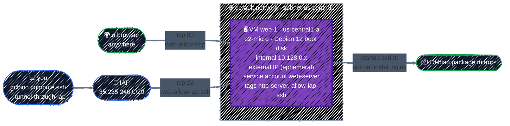

# Compute Engine

> Virtual machines: machine types, boot disks, external IPs, service accounts, startup scripts, and changing a running VM.

---

**Compute Engine** runs virtual machines (VMs) on Google's infrastructure. It's the oldest and most flexible way to run something on GCP: you pick the CPU and memory, the operating system, the disk, and the network, and the VM is yours to configure. Most other compute services are built on it; the nodes of the GKE cluster in Part 6 are Compute Engine VMs.

This chapter builds the classic first VM: a web server that installs nginx on boot and answers on its own IP address.

> 📌 **This chapter uses the project's `default` network**, to keep the focus on the VM. That network is fine for one practice VM, but [Networking](networking.md#three-kinds-of-vpc) explains why nothing real should run on it, and what to use instead: a custom VPC where VMs have no external IP at all and reach the internet through Cloud NAT.

## Before you start

```bash
cd examples/gcp-services/compute-engine
terraform init
```

The example creates one `e2-micro` VM with a service account of its own, a startup script that installs nginx, and two firewall rules: HTTP from anywhere, and SSH only through Google's IAP proxy.

The VM goes in the `default` network, which GCP creates when the Compute Engine API is first enabled. Check that yours still exists:

```bash
gcloud compute networks list
```

If `default` isn't listed, because you deleted it after reading Networking or your organization skips it, create a new one. It's an auto-mode VPC with no firewall rules, which is all this example needs:

```bash
gcloud compute networks create default --subnet-mode=auto
```

## 1. What Compute Engine does



A VM is a handful of choices, each of which you'll set in Terraform:

| Concept | What it means |
|---|---|
| **Zone** | a VM runs in one zone, such as `us-central1-a`. Its boot disk lives there too |
| **Machine type** | CPUs and memory. A family prefix plus a size: `e2-micro`, `e2-standard-4`, `g2-standard-4` |
| **Boot disk and image** | the disk the OS boots from, created from an **image** such as Debian 12 |
| **Network interface** | the subnet the VM joins and its **internal IP**, plus an optional **external IP** |
| **Service account** | the identity programs on the VM use to call Google APIs |
| **Metadata and startup script** | key-value settings the VM can read; the `startup-script` key runs as root on every boot |
| **Network tags** | labels that [firewall rules](networking.md#firewall-rules) use to pick the VMs they apply to |

### Machine types

| Machine type | vCPUs, memory | Used in this guide for | Price, us-central1 |
|---|---|---|---|
| `e2-micro` | 2 shared, 1 GB | this chapter | free: one per month on the free tier |
| `e2-small` | 2 shared, 2 GB | the resize experiment below | ~$0.017/hour |
| `e2-standard-4` | 4, 16 GB | the GKE system node in Part 6 | ~$0.13/hour |
| `g2-standard-4` | 4, 16 GB, one L4 GPU | the GPU node in Part 6 | ~$0.70/hour, much less on Spot |

Prices are approximate; see [VM instance pricing](https://cloud.google.com/compute/vm-instance-pricing). **E2** is the general-purpose, cheapest family, and the right default until you have a reason for something else: more CPU per core (C3, C4), more memory (M3), or GPUs (G2, A3).

The [free tier](https://cloud.google.com/free/docs/free-cloud-features#compute) covers one non-Spot `e2-micro` per month in `us-central1`, `us-west1`, or `us-east1`, with 30 GB of standard persistent disk. The limit is in hours, so two `e2-micro`s running all month use up the free hours in half a month.

## 2. In the Console

**Compute Engine → VM instances → Create instance** walks through the same choices. Each one becomes an argument of [`google_compute_instance`](https://registry.terraform.io/providers/hashicorp/google/latest/docs/resources/compute_instance), but watch the last column: where the Console and Terraform defaults differ, you'll be surprised by whichever one you didn't expect.

| Console field | Terraform argument | Console default | Terraform default |
|---|---|---|---|
| Name | `name` | `instance-…` | required |
| Region, Zone | `zone` | picked for you | the provider's `zone`, if set |
| Machine configuration | `machine_type` | `e2-medium` | required |
| Boot disk: image, size, type | `boot_disk { initialize_params { … } }` | Debian, 10 GB, balanced | required |
| Identity and API access | `service_account { email, scopes }` | the Compute Engine default service account | only what you set |
| Firewall: Allow HTTP traffic | `tags = ["http-server"]`, plus a firewall rule | off | separate `google_compute_firewall` |
| Networking: network, subnet | `network_interface { network, subnetwork }` | `default` | required |
| Networking: External IPv4 address | `access_config { }` | **Ephemeral** | **none**: no `access_config`, no external IP |
| Management: Automation (startup script) | `metadata_startup_script` | none | none |
| Deletion protection | `deletion_protection` | off | `false` |

Two rows stand out:

- **External IP**: the Console gives every VM one unless you say otherwise; Terraform gives none unless you add an `access_config` block. Terraform's default is the safer one.
- **Allow HTTP traffic** is a convenience the Console builds from two pieces: it adds the network tag `http-server` to the VM and, if needed, creates a firewall rule allowing port 80 to that tag. In Terraform you write both pieces yourself, which is what this example does.

## 3. The minimum

Four arguments are required, plus `zone` because this guide's provider block sets only a region:

```hcl
resource "google_compute_instance" "web" {
  name         = "web-1"
  machine_type = "e2-micro"
  zone         = "us-central1-a"

  boot_disk {
    initialize_params {
      image = "debian-cloud/debian-12"
    }
  }

  network_interface {
    network = "default"
  }
}
```

That's a running Debian VM. It just can't do much:

- **No external IP**, and the `default` network has no Cloud NAT, so the VM can't reach the internet to install anything, and nothing outside can reach it.
- **No service account of its own**, so whatever runs on it either can't call Google APIs or, if you later attach the Compute Engine default service account, gets that account's broad project access.
- **No startup script**, so it's a bare OS until someone logs in and configures it by hand, which is exactly the step Terraform is meant to remove.
- **No firewall rule for its web traffic**, so even with an external IP, port 80 stays closed. The original `default` network's rules let SSH, RDP, and ping in from anywhere; a recreated one lets nothing in at all.

## 4. The real configuration

From [`main.tf`](../../examples/gcp-services/compute-engine/main.tf), one group at a time.

### Machine type and boot disk

```hcl
resource "google_compute_instance" "web" {
  project      = google_project_service.enabled["compute.googleapis.com"].project
  name         = "web-1"
  zone         = var.zone
  machine_type = "e2-micro" # the free tier's machine type

  # Lets Terraform stop the VM to change settings such as machine_type.
  allow_stopping_for_update = true

  boot_disk {
    initialize_params {
      image = "debian-cloud/debian-12" # an image family: its newest image
      size  = 10
      type  = "pd-standard" # the free tier covers 30 GB of standard disk
    }
  }
  ...
```

- **`project`** refers to the API's `google_project_service`, so Terraform enables the Compute Engine API before creating the VM ([Projects & APIs](../gcp-foundations/projects-and-apis.md#wait-for-the-api-before-using-it)). The example enables IAM the same way, for the service account.
- **`debian-cloud/debian-12`** is an **image family**: the project `debian-cloud`, where Google publishes Debian images, and the family `debian-12`, which always points to its newest image. The VM is created from whatever image is newest at that moment.
- **`size` and `type`** are set explicitly so the disk stays inside the free tier: 10 GB, the image's minimum, of standard persistent disk.
- **`allow_stopping_for_update = true`**: some changes, like `machine_type`, need the VM stopped first. Without this, Terraform refuses to make them, and you'll [try one below](#change-it-in-place-the-machine-type).

### Network: an external IP, on purpose

```hcl
  network_interface {
    network = "default"

    # An ephemeral external IP. The default network has no Cloud NAT, so
    # without one the VM couldn't reach the internet to install nginx.
    access_config {}
  }
```

An empty **`access_config {}`** gives the VM an **ephemeral** external IP: GCP picks it, and it can change if the VM is stopped and started. The VM needs it twice here, to download nginx and to answer browsers. The internal IP comes from the `default` network's `us-central1` subnet, `10.128.0.0/20`.

An external IP isn't part of the free tier offer: in use, it costs about $0.005 an hour ([pricing](https://cloud.google.com/vpc/network-pricing)). For a stable address, reserve one with `google_compute_address` and set `nat_ip` in the `access_config`.

This is the part that would change for a real service. With the [Networking](networking.md) VPC, the VM has no `access_config` at all, downloads through Cloud NAT, and a load balancer takes the public traffic.

### Identity: a service account of its own

```hcl
# The VM's own identity. It has no roles: nothing on this VM calls Google APIs.
resource "google_service_account" "web" {
  project      = google_project_service.enabled["iam.googleapis.com"].project
  account_id   = "web-server"
  display_name = "Compute Engine chapter web server"
}
```

```hcl
  service_account {
    email  = google_service_account.web.email
    scopes = ["cloud-platform"] # IAM roles decide what the VM can do, not scopes
  }
```

Programs on the VM call Google APIs as this service account, with no key file: they get tokens from the VM's metadata server. Two settings decide what they can do:

- **IAM roles granted to the service account.** This one has none, because nginx calls no Google APIs. If the VM later needed to read a bucket, you'd grant `roles/storage.objectViewer` on that bucket to this account, exactly as in [Cloud Storage](cloud-storage.md#access-iam-only-never-public).
- **Access scopes**, an older, coarser limit applied on top of IAM. `cloud-platform` means "no extra limit", so IAM alone decides. That's Google's recommendation: one place to manage access instead of two.

Don't attach the **Compute Engine default service account** instead. In many projects it still has the Editor role on the whole project, so every program on every VM using it can change almost anything. [IAM](../gcp-foundations/iam.md#service-accounts-one-per-workload) covers the one-account-per-workload rule.

### Startup script

```hcl
  # Runs as root on every boot. Changing it replaces the VM.
  metadata_startup_script = file("${path.module}/startup.sh")
```

[`startup.sh`](../../examples/gcp-services/compute-engine/startup.sh):

```bash
#!/bin/bash
# Runs as root on every boot. Installs nginx the first time, then writes a
# page that names this VM and its zone.
set -euo pipefail

if ! command -v nginx >/dev/null; then
  apt-get update
  apt-get install -y nginx
fi

zone=$(curl -sf -H "Metadata-Flavor: Google" \
  http://metadata.google.internal/computeMetadata/v1/instance/zone)

cat >/var/www/html/index.html <<HTML
<h1>Hello from $(hostname)</h1>
<p>Zone: ${zone##*/}</p>
HTML
```

- **It runs on every boot**, not just the first, so it's written to be safe to repeat: nginx is installed only if it's missing.
- **The metadata server** at `metadata.google.internal` answers questions about the VM itself, such as its zone. The `Metadata-Flavor: Google` header is required.
- **`metadata_startup_script` forces a replacement when it changes**: Terraform destroys the VM and creates a new one that runs the new script from a clean disk. That's predictable, and the reason this example uses it. The alternative is `metadata = { startup-script = … }`, which updates in place and runs the new script only at the next boot, on a disk that still has whatever the old script did. The two can't be used together.

A startup script is fine for installing one package. When setup grows, the usual next steps are a custom image with everything preinstalled (built with a tool such as Packer), or containers.

### Firewall rules for the VM

```hcl
  # The firewall rules below pick this VM by these tags.
  tags = ["http-server", "allow-iap-ssh"]
```

```hcl
resource "google_compute_firewall" "allow_http" {
  project   = google_project_service.enabled["compute.googleapis.com"].project
  name      = "web-allow-http"
  network   = "default"
  direction = "INGRESS"

  source_ranges = ["0.0.0.0/0"]
  target_tags   = ["http-server"]

  allow {
    protocol = "tcp"
    ports    = ["80"]
  }
}

resource "google_compute_firewall" "allow_iap_ssh" {
  project   = google_project_service.enabled["compute.googleapis.com"].project
  name      = "web-allow-iap-ssh"
  network   = "default"
  direction = "INGRESS"

  # Identity-Aware Proxy's range: SSH only through
  # `gcloud compute ssh --tunnel-through-iap`, never from the internet.
  source_ranges = ["35.235.240.0/20"]
  target_tags   = ["allow-iap-ssh"]

  allow {
    protocol = "tcp"
    ports    = ["22"]
  }
}
```

- **`web-allow-http`** opens port 80 to the world, but only to VMs tagged `http-server`. A web server is the one case where `0.0.0.0/0` is the point.
- **`web-allow-iap-ssh`** is the same IAP rule as in [Networking](networking.md#firewall-rules): SSH only through Google's proxy, which checks IAM first. The `default` network may also have `default-allow-ssh`, which allows SSH from anywhere; this example doesn't rely on it, and you shouldn't either.
- **The rules are created on the `default` network** and removed by `terraform destroy`, along with the VM.

## Apply it

```bash
terraform plan    # Plan: 6 to add, 0 to change, 0 to destroy.
terraform apply
```

Six resources: two APIs, the service account, the VM, and two firewall rules. The outputs tell you where to look:

```bash
terraform output
```

`url` is the VM's external IP as an `http://` address, and `ssh_command` the full `gcloud compute ssh` command. The VM is running as soon as `apply` finishes, but the startup script needs about a minute more to install nginx:

```bash
curl "$(terraform output -raw url)"
```

```
<h1>Hello from web-1</h1>
<p>Zone: us-central1-a</p>
```

If `curl` can't connect, wait a little and try again: nginx isn't installed yet. Then look inside:

```bash
$(terraform output -raw ssh_command)
```

The first time, `gcloud` creates an SSH key for you and adds it to the project. On the VM:

```bash
sudo journalctl -u google-startup-scripts.service   # the startup script's output
systemctl status nginx
exit
```

`journalctl` is where to look whenever a startup script doesn't do what you expected. To rerun the script without rebooting, run `sudo google_metadata_script_runner startup` on the VM.

## Changing a running VM

Terraform changes a VM one of three ways, and the plan says which before anything happens. Try two of them.

### Change it in place: the machine type

In `main.tf`, change `machine_type` from `"e2-micro"` to `"e2-small"`, then:

```bash
terraform plan
```

The plan shows `~ update in-place` for `google_compute_instance.web`, with `machine_type` changing. `apply` stops the VM, changes its type, and starts it again: the same VM, the same disk, a minute of downtime. That only works because of `allow_stopping_for_update = true`; without it, `apply` fails and asks you to set it.

The ephemeral external IP can change when the VM stops, so run `terraform output url` again afterwards. Then change `machine_type` back to `"e2-micro"` and apply: `e2-small` isn't free.

### Replace it: the startup script

Edit the page text in `startup.sh`, for example change `Hello from` to `Hi from`, then plan:

```bash
terraform plan
```

This time the plan shows `-/+ destroy and then create replacement`, with `# forces replacement` next to `metadata_startup_script`. A new VM means a new boot disk, a new external IP, and a fresh run of the script. Put the text back if you apply it, or keep it: either way, nothing on the old disk survives.

The third way, `~` on an attribute that GCP can change live, like `labels`, needs neither a stop nor a replacement. Reading the plan for `~`, `~` with a stop, and `-/+` before every `apply` is the habit that keeps a VM change from becoming an outage.

## Checkpoint

1. You create a VM in the Console without touching the network settings, then write the same VM in Terraform without `access_config`. What's different about the two?
2. The VM's service account has no IAM roles, but its scope is `cloud-platform`, "full access". Can a program on the VM read a bucket?
3. You change `metadata_startup_script`. What happens to files written on the VM's disk since it was created?
4. `apply` fails with an error asking you to set `allow_stopping_for_update`. What were you changing, and what does setting it allow?

<details>
<summary>Answer</summary>

1. The Console VM has an ephemeral external IP, because that's the Console's default. The Terraform VM has none, because Terraform only creates what you write. It's reachable only from inside its network, and on the `default` network it can't reach the internet either.
2. No. Scopes only limit what IAM allows; they never grant anything. With no roles, the account can't read the bucket. Grant `roles/storage.objectViewer` on that bucket to it.
3. They're gone. Changing `metadata_startup_script` replaces the VM, which creates a new boot disk from the image. Keep data you care about off the boot disk: in Cloud Storage, a database, or a separate persistent disk.
4. A property that can only change while the VM is stopped, such as `machine_type`. Setting it lets Terraform stop the VM, apply the change, and start it again, with a short downtime instead of a replacement.

</details>

## Best practices

- **One service account per VM role**, with only the IAM roles it needs; never the Compute Engine default service account. Leave scopes at `cloud-platform` and manage access with IAM.
- **No external IPs on real services.** Put VMs in a custom VPC with Cloud NAT ([Networking](networking.md)), and public traffic through a load balancer.
- **SSH only through IAP**, with a firewall rule for `35.235.240.0/20`, never `0.0.0.0/0` on port 22.
- **Use image families** like `debian-cloud/debian-12` instead of pinning an image by name, so new VMs get security updates.
- **Treat VMs as replaceable.** Write startup scripts that are safe to rerun, keep data off the boot disk, and read every plan for `-/+` before applying.
- **Start with E2** and change the machine type when you have a reason; with `allow_stopping_for_update`, it's a short stop, not a rebuild.

## Clean up

```bash
terraform destroy
```

This deletes the VM, its boot disk, its service account, and the two firewall rules. It leaves the `default` network and the two APIs, which cost nothing. A stopped VM still bills for its disk and, if reserved, its IP; destroying it is the only way to stop all charges.

---

[← Cloud Storage](cloud-storage.md) · [↑ Contents](../../README.md) · [Writing Modules →](../modules/writing-modules.md)
