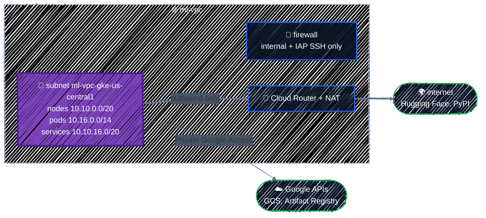

# Networking

> A custom VPC, subnets with secondary ranges, Cloud NAT, and firewall rules.

---

The GKE cluster in Part 6 needs a network: IP addresses for its nodes, Pods, and Services, a way to download model weights from the internet without being reachable from it, and firewall rules that let in only what's needed. This chapter builds that network as a standalone configuration, the same one the [capstone](../capstone/llm-platform.md) uses.

## Before you start

```bash
cd examples/gcp-services/networking
terraform init
```

## What you're building



| Piece | Why the AI platform needs it |
|---|---|
| **Custom VPC** | a private network with only the subnets you design |
| **Subnet with secondary ranges** | GKE takes node IPs from the primary range, and Pod and Service IPs from two named secondary ranges |
| **Private Google Access** | nodes without public IPs can still pull images from Artifact Registry and model weights from GCS |
| **Cloud NAT** | nodes without public IPs can download from the internet (Hugging Face, pip), and nothing can connect in |
| **Firewall rules** | everything inbound is blocked except internal traffic and SSH through Google's IAP proxy |

## The VPC: custom mode

```hcl
resource "google_compute_network" "vpc" {
  project                 = google_project_service.compute.project
  name                    = var.network_name
  auto_create_subnetworks = false
  routing_mode            = "REGIONAL"
}
```

**`auto_create_subnetworks = false`** is the important line. An **auto-mode** VPC (and the project's `default` network, which is one) gets a subnet in every region with predefined ranges, `10.128.0.0/9`. You don't choose them, they're the same in every project (so they collide the moment you connect two projects), and they waste address space you'll want for Pods. A **custom-mode** VPC has only the subnets you create.

If your project has a `default` network, it also came with firewall rules that allow SSH and RDP from **anywhere** (`0.0.0.0/0`). Don't use it. [Projects & APIs](../gcp-foundations/projects-and-apis.md#should-terraform-create-the-project) showed `auto_create_network = false` for projects Terraform creates; for your sandbox, you can delete it with `gcloud compute networks delete default` once nothing uses it.

`routing_mode = "REGIONAL"` means Cloud Routers only advertise routes in their own region. That's the default and right for a single-region platform; `GLOBAL` matters for VPNs and multi-region hybrid setups.

## Planning IP ranges

A VPC-native GKE cluster uses **three** ranges, all from your subnet:

| Range | Used for | Size here | Fits |
|---|---|---|---|
| Primary | node VM IPs | `/20` | 4,096 nodes |
| Secondary `pods` | one IP per Pod. GKE gives **each node a `/24`** by default | `/14` | 1,024 nodes × 110 Pods |
| Secondary `services` | ClusterIP Service IPs | `/20` | 4,096 Services |

The Pod range is the one people make too small: a `/24` per node means a `/20` Pod range runs out at **16 nodes**, and you can't grow it in place. Size it for the largest cluster you might ever run.

Ranges must not overlap anything else in the VPC, **or in any network you'll connect to later** (another VPC through peering, an on-premises network through VPN). Pick them once, write them down, and compute them instead of typing them. From [`main.tf`](../../examples/gcp-services/networking/main.tf):

```hcl
locals {
  # IP plan. Ranges in one VPC (and in any network you peer with) must not overlap.
  nodes_cidr    = cidrsubnet(var.nodes_and_services_cidr, 4, 0) # 10.10.0.0/20:  4,096 node IPs
  services_cidr = cidrsubnet(var.nodes_and_services_cidr, 4, 1) # 10.10.16.0/20: 4,096 Service IPs
}
```

`cidrsubnet` from [Expressions & Functions](../core-language/expressions.md#networks-cidrsubnet) splits the `/16` into `/20`s and takes the first two. Check the arithmetic in `terraform console`:

```
> cidrsubnet("10.10.0.0/16", 4, 1)
"10.10.16.0/20"
> cidrhost("10.16.0.0/14", -1)
"10.19.255.255"
> pow(2, 32 - 14) / 256
1024
```

The last line is the Pod range math: a `/14` holds `2^18` addresses, enough for 1,024 nodes' `/24`s. Input validation stops a wrong-sized range before anything is planned:

```
Error: Invalid value for variable

  on variables.tf line 18:
  18: variable "nodes_and_services_cidr" {
    ├────────────────
    │ var.nodes_and_services_cidr is "10.10.0.0/20"

nodes_and_services_cidr must be an IPv4 /16, such as 10.10.0.0/16.

This was checked by the validation rule at variables.tf:23,3-13.
```

## The subnet

```hcl
resource "google_compute_subnetwork" "gke" {
  name          = "${var.network_name}-gke-${var.region}"
  network       = google_compute_network.vpc.id
  region        = var.region
  ip_cidr_range = local.nodes_cidr

  # GKE (VPC-native) takes Pod and Service IPs from these named ranges.
  secondary_ip_range {
    range_name    = "pods"
    ip_cidr_range = var.pods_cidr
  }
  secondary_ip_range {
    range_name    = "services"
    ip_cidr_range = local.services_cidr
  }

  # Lets VMs without public IPs reach Google APIs (GCS, Artifact Registry, ...).
  private_ip_google_access = true
}
```

```
  + resource "google_compute_subnetwork" "gke" {
      + ip_cidr_range                    = "10.10.0.0/20"
      + name                             = "ml-vpc-gke-us-central1"
      + private_ip_google_access         = true
      + region                           = "us-central1"
      ...
      + secondary_ip_range {
          + ip_cidr_range = "10.16.0.0/14"
          + range_name    = "pods"
        }
      + secondary_ip_range {
          + ip_cidr_range = "10.10.16.0/20"
          + range_name    = "services"
        }
    }
```

- **Subnets are regional.** One subnet serves every zone in `us-central1`, which is what lets a node pool spread across zones (and find GPUs in whichever zone has them).
- **The secondary range names are the interface to GKE.** The cluster refers to `pods` and `services` by name, so they're also outputs.
- **`private_ip_google_access = true`** is essential for private nodes. Without it, a node with no public IP can't reach `storage.googleapis.com`, so it can't pull images or read model weights.

## Cloud NAT: out, never in

GKE nodes in this guide have **no public IP addresses**, so nothing on the internet can reach them directly. But they still need to download things: a vLLM container from Docker Hub, model weights from Hugging Face, Python packages. **Cloud NAT** lets VMs without public IPs open outbound connections, and allows only the replies back in.

```hcl
resource "google_compute_router" "nat" {
  name    = "${var.network_name}-router-${var.region}"
  network = google_compute_network.vpc.id
  region  = var.region
}

resource "google_compute_router_nat" "nat" {
  name   = "${var.network_name}-nat-${var.region}"
  router = google_compute_router.nat.name
  region = var.region

  nat_ip_allocate_option             = "AUTO_ONLY"
  source_subnetwork_ip_ranges_to_nat = "LIST_OF_SUBNETWORKS"

  subnetwork {
    name                    = google_compute_subnetwork.gke.id
    source_ip_ranges_to_nat = ["ALL_IP_RANGES"] # nodes and Pods
  }

  log_config {
    enable = true
    filter = "ERRORS_ONLY"
  }
}
```

- Cloud NAT is configured **on a Cloud Router**, one per region. The router here does nothing else.
- **`AUTO_ONLY`** lets Google allocate the external IPs. If a partner needs to allowlist your traffic, reserve static IPs with `google_compute_address` and use `MANUAL_ONLY` instead.
- **`LIST_OF_SUBNETWORKS`** with `ALL_IP_RANGES` covers both node IPs and Pod IPs. Listing subnets explicitly means a subnet added later doesn't silently get internet access.
- **`ERRORS_ONLY` logging** records dropped connections (usually port exhaustion) without logging every connection.

Cloud NAT is billed per VM using it plus per GB processed, so an idle NAT with no VMs behind it costs close to nothing. See [Cloud NAT pricing](https://cloud.google.com/nat/pricing). Note that traffic to Google APIs goes through Private Google Access, not NAT, so pulling images from Artifact Registry and weights from GCS isn't charged as NAT data.

## Firewall rules

Every VPC has two **implied** rules you never see in Terraform: **deny all ingress** and **allow all egress**, both at the lowest priority. A custom VPC has nothing else, so by default nothing can connect to anything. You add rules for exactly the traffic you need:

```hcl
resource "google_compute_firewall" "allow_internal" {
  name      = "${var.network_name}-allow-internal"
  network   = google_compute_network.vpc.id
  direction = "INGRESS"
  priority  = 1000

  source_ranges = [local.nodes_cidr, var.pods_cidr]

  allow {
    protocol = "tcp"
  }
  allow {
    protocol = "udp"
  }
  allow {
    protocol = "icmp"
  }
}

resource "google_compute_firewall" "allow_iap_ssh" {
  name      = "${var.network_name}-allow-iap-ssh"
  network   = google_compute_network.vpc.id
  direction = "INGRESS"
  priority  = 1000

  # Identity-Aware Proxy's range: SSH only through `gcloud compute ssh --tunnel-through-iap`,
  # never from the internet.
  source_ranges = ["35.235.240.0/20"]
  target_tags   = ["allow-iap-ssh"]

  allow {
    protocol = "tcp"
    ports    = ["22"]
  }
}
```

- **`allow_internal`** lets nodes and Pods talk to each other. Pod-to-Pod traffic across nodes, such as a model server calling a tokenizer service, needs it.
- **`allow_iap_ssh`** never opens port 22 to the internet. `35.235.240.0/20` is the range Google's Identity-Aware Proxy connects from, so SSH works only through `gcloud compute ssh --tunnel-through-iap`, which checks IAM first. It applies only to VMs tagged `allow-iap-ssh`.
- **GKE adds its own rules** for the cluster it creates (control plane to nodes, health checks for load balancers). Don't recreate those by hand.

Rules choose their targets by **network tag** (`target_tags`) or **service account** (`target_service_accounts`). Tags are simple, but anyone who can edit a VM can add a tag to it. Targeting a service account is stricter: only principals allowed to run as that SA can create VMs the rule applies to. Prefer service accounts for rules that open anything sensitive.

Never add a rule with `source_ranges = ["0.0.0.0/0"]` for SSH, RDP, or a model server's port. Public endpoints go through a load balancer, which has its own controls.

## Apply it

```bash
terraform plan    # Plan: 7 to add, 0 to change, 0 to destroy.
terraform apply
```

The plan's outputs show the whole IP plan before anything is created:

```
Changes to Outputs:
  + gke_secondary_range_names = {
      + pods     = "pods"
      + services = "services"
    }
  + ip_plan                   = {
      + nodes    = "10.10.0.0/20"
      + pods     = "10.16.0.0/14"
      + services = "10.10.16.0/20"
    }
  + network                   = "ml-vpc"
  + subnetwork                = "ml-vpc-gke-us-central1"
```

The outputs are exactly what [GKE Cluster](../ai-infra/gke-cluster.md) needs: network, subnet, and the two range names. Check the result:

```bash
gcloud compute networks subnets describe ml-vpc-gke-us-central1 --region="$TF_VAR_region" \
  --format="yaml(ipCidrRange,secondaryIpRanges,privateIpGoogleAccess)"
gcloud compute routers nats list --router=ml-vpc-router-us-central1 --region="$TF_VAR_region"
gcloud compute firewall-rules list --filter="network:ml-vpc"
```

## Checkpoint

1. Why does a VPC-native GKE subnet need separate secondary ranges for Pods and Services?
2. Private nodes can reach the internet through Cloud NAT. Can the internet initiate a connection back through that NAT?
3. A firewall rule allows `0.0.0.0/0` to SSH. What narrower source is used in this guide, and what else should limit the targets?

<details>
<summary>Answer</summary>

1. GKE assigns alias IPs from distinct Pod and Service ranges, keeping those addresses separate from node primary IPs and making routing scalable.
2. No. Cloud NAT provides outbound connections and their return traffic; it doesn't create an inbound listener or public IP on the nodes.
3. Google's IAP TCP forwarding range, with target tags or service accounts restricting which instances the rule reaches. Prefer managed access paths over public SSH.

</details>

## Best practices

- **Custom-mode VPCs only.** Don't use the `default` network, and create projects with `auto_create_network = false`.
- **Plan IP ranges once, for the biggest cluster you'll run**, and make sure they don't overlap with any network you might connect to. Size the Pod range generously.
- **Compute ranges with `cidrsubnet`** and validate inputs, rather than typing CIDRs in many places.
- **No public IPs on nodes.** Use Private Google Access for Google APIs and Cloud NAT for the internet.
- **List subnets explicitly in Cloud NAT**, and log errors.
- **Open the minimum in the firewall.** No `0.0.0.0/0` ingress; SSH only through IAP; prefer service-account targets over tags.
- **Keep the network in its own configuration** (its own state), separate from the clusters that use it. A network changes rarely and everything depends on it; [Environments](../modules/environments.md) shows how to split configurations this way.

## Clean up

```bash
terraform destroy
```

Without VMs this costs next to nothing, but destroy it anyway: the Part 6 chapters create the network they need themselves, with the same names.

---

[← Secret Manager & Sensitive Values](../gcp-foundations/secrets.md) · [↑ Contents](../../README.md) · [Cloud Storage →](cloud-storage.md)
