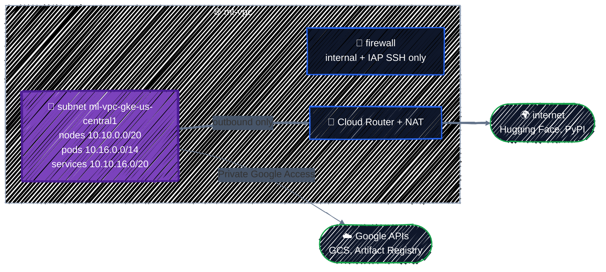

# Networking

> VPC types, a custom VPC, subnets, Cloud NAT, and firewall rules, plus the secondary ranges GKE will need.

---

Almost everything you create on GCP from here on runs inside a **VPC network**: VMs, databases with private IPs, GKE nodes. The network decides which IP addresses they get, whether they can reach the internet and Google's APIs, and what can connect to them. It's built once and changes rarely, so the choices you make here last.

This chapter builds the network the rest of the guide uses: [Writing Modules](../modules/writing-modules.md) packages it, [GKE Cluster](../ai-infra/gke-cluster.md) runs on it, and the [capstone](../capstone/llm-platform.md) builds the same one.

Part 4 provisions GCP's core services, starting with this one. Every chapter in the part follows the same four steps for a new service:

1. **What it does**: the concepts and the choices you'll have to make.
2. **The Console**: the form you'd fill in by hand, and which Terraform argument each field becomes.
3. **The minimum**: a resource with only the required arguments, and what the defaults give you.
4. **The real configuration**: one argument at a time, each with its reason.

## Before you start

```bash
cd examples/gcp-services/networking
terraform init
```

The example builds a custom VPC with one subnet in `us-central1`, Cloud NAT for outbound internet access, and firewall rules that allow only internal traffic and SSH through Google's IAP proxy. The subnet also carries two secondary ranges that GKE needs in Part 6.

## 1. What a VPC does



| Piece | What it does |
|---|---|
| **VPC network** | a private network, **global**: one VPC spans every region |
| **Subnet** | a range of IP addresses in **one region**. Every VM's network interface lives in a subnet |
| **Private Google Access** | lets VMs without public IPs reach Google APIs (Cloud Storage, Artifact Registry), per subnet |
| **Cloud Router + Cloud NAT** | lets VMs without public IPs open connections to the internet, and nothing connect back in |
| **Firewall rules** | which traffic may reach which VMs. With no rules, nothing inbound gets through |

### Three kinds of VPC

A VPC comes in one of three forms, and the difference is who picks the subnets:

| Kind | How you get it | Subnets | Firewall rules |
|---|---|---|---|
| **Default** | created automatically in new projects | one per region, from `10.128.0.0/9`, added as GCP adds regions | comes with rules that allow SSH, RDP, and ICMP from **anywhere** (`0.0.0.0/0`), and all internal traffic |
| **Auto mode** | a VPC created with automatic subnet creation | the same as default: one per region, same ranges | none |
| **Custom mode** | a VPC created with custom subnet creation | only the ones you create, with ranges you choose | none |

The `default` network is an auto-mode VPC with permissive rules added. Auto-mode subnets use the **same ranges in every project**, so two auto-mode networks collide the moment you connect them through peering or VPN, and they spend address space in regions you'll never use. **Use custom mode**, which is what this chapter builds.

If your project has a `default` network, don't use it. [Projects & APIs](../gcp-foundations/projects-and-apis.md#should-terraform-create-the-project) showed `auto_create_network = false` for projects Terraform creates; for your sandbox, you can delete it with `gcloud compute networks delete default` once nothing uses it.

## 2. In the Console

**VPC network → VPC networks → Create VPC network** asks for the network and its first subnet on one form. The fields map to two resources, [`google_compute_network`](https://registry.terraform.io/providers/hashicorp/google/latest/docs/resources/compute_network) and [`google_compute_subnetwork`](https://registry.terraform.io/providers/hashicorp/google/latest/docs/resources/compute_subnetwork):

| Console field | Terraform argument | Default if you leave it out |
|---|---|---|
| Name | `google_compute_network.name` | required |
| Subnet creation mode: Custom / Automatic | `auto_create_subnetworks` | `true`: automatic |
| Dynamic routing mode: Regional / Global | `routing_mode` | `REGIONAL` |
| New subnet: Name, Region | `google_compute_subnetwork.name`, `region` | required |
| New subnet: IPv4 range | `ip_cidr_range` | required |
| Secondary IPv4 ranges | `secondary_ip_range { }` | none |
| Private Google Access | `private_ip_google_access` | off |
| Firewall rules | separate `google_compute_firewall` resources | none |

Cloud NAT has its own form, under **Network services → Cloud NAT**, which also creates the Cloud Router it runs on: `google_compute_router` and `google_compute_router_nat` in Terraform.

## 3. The minimum

`google_compute_network` has one required argument:

```hcl
resource "google_compute_network" "vpc" {
  name = "ml-vpc"
}
```

That creates a network, but look at the Console table again: `auto_create_subnetworks` defaults to `true`. The minimal resource is an **auto-mode** VPC, with a subnet in every region on the shared `10.128.0.0/9` ranges, which is exactly what the previous section said to avoid. It has no firewall rules either, so nothing can connect to its VMs, not even you over SSH.

So the real configuration starts by turning automatic subnets off, then adds the pieces one at a time.

## 4. The real configuration

From [`main.tf`](../../examples/gcp-services/networking/main.tf). Most of it is what any VM or database needs; the [last part](#preparing-for-gke-secondary-ranges) prepares the subnet for GKE.

### The VPC: custom mode

```hcl
resource "google_compute_network" "vpc" {
  project                 = google_project_service.compute.project
  name                    = var.network_name
  auto_create_subnetworks = false
  routing_mode            = "REGIONAL"
}
```

**`auto_create_subnetworks = false`** is the important line: the VPC has only the subnets you create.

`routing_mode = "REGIONAL"` means Cloud Routers only advertise routes in their own region. That's the default and right for a single-region platform; `GLOBAL` matters for VPNs and multi-region hybrid setups.

`project` comes from the `google_project_service` that enables the Compute Engine API, so Terraform waits for the API before creating the network ([Projects & APIs](../gcp-foundations/projects-and-apis.md#wait-for-the-api-before-using-it)).

### Planning IP ranges

Ranges must not overlap anything else in the VPC, **or in any network you'll connect to later** (another VPC through peering, an on-premises network through VPN). Pick them once, write them down, and compute them instead of typing them. From [`main.tf`](../../examples/gcp-services/networking/main.tf):

```hcl
locals {
  # IP plan. Ranges in one VPC (and in any network you peer with) must not overlap.
  nodes_cidr    = cidrsubnet(var.nodes_and_services_cidr, 4, 0) # 10.10.0.0/20:  4,096 node IPs
  services_cidr = cidrsubnet(var.nodes_and_services_cidr, 4, 1) # 10.10.16.0/20: 4,096 Service IPs
}
```

`cidrsubnet` from [Expressions & Functions](../core-language/expressions.md#networks-cidrsubnet) splits the `/16` into `/20`s and takes the first two: the subnet's primary range for VMs, and a range kept for GKE's Services. Check the arithmetic in `terraform console`:

```
> cidrsubnet("10.10.0.0/16", 4, 1)
"10.10.16.0/20"
```

Input validation stops a wrong-sized range before anything is planned:

```
Error: Invalid value for variable

  on variables.tf line 18:
  18: variable "nodes_and_services_cidr" {
    ├────────────────
    │ var.nodes_and_services_cidr is "10.10.0.0/20"

nodes_and_services_cidr must be an IPv4 /16, such as 10.10.0.0/16.

This was checked by the validation rule at variables.tf:23,3-13.
```

### The subnet

```hcl
resource "google_compute_subnetwork" "gke" {
  name          = "${var.network_name}-gke-${var.region}"
  network       = google_compute_network.vpc.id
  region        = var.region
  ip_cidr_range = local.nodes_cidr

  # GKE (VPC-native) takes Pod and Service IPs from these named ranges.
  secondary_ip_range {
    range_name    = "pods"
    ip_cidr_range = var.pods_cidr
  }
  secondary_ip_range {
    range_name    = "services"
    ip_cidr_range = local.services_cidr
  }

  # Lets VMs without public IPs reach Google APIs (GCS, Artifact Registry, ...).
  private_ip_google_access = true
}
```

```
  + resource "google_compute_subnetwork" "gke" {
      + ip_cidr_range                    = "10.10.0.0/20"
      + name                             = "ml-vpc-gke-us-central1"
      + private_ip_google_access         = true
      + region                           = "us-central1"
      ...
      + secondary_ip_range {
          + ip_cidr_range = "10.16.0.0/14"
          + range_name    = "pods"
        }
      + secondary_ip_range {
          + ip_cidr_range = "10.10.16.0/20"
          + range_name    = "services"
        }
    }
```

- **Subnets are regional.** One subnet serves every zone in `us-central1`, so VMs and node pools can spread across zones (and find GPUs in whichever zone has them).
- **The primary range, `10.10.0.0/20`,** is where every VM's internal IP comes from: 4,096 addresses. GKE nodes are VMs too, which is why the local is called `nodes_cidr`.
- **`private_ip_google_access = true`** is essential for VMs without public IPs. Without it, they can't reach `storage.googleapis.com`, so they can't pull images or read data from Cloud Storage.
- **The two `secondary_ip_range` blocks** are for GKE, and explained [below](#preparing-for-gke-secondary-ranges). A VM doesn't use them unless you give it alias IPs.

### Cloud NAT: out, never in

VMs in this guide have **no public IP addresses**, so nothing on the internet can reach them directly. But they still need to download things: a container image from Docker Hub, model weights from Hugging Face, Python packages. **Cloud NAT** lets VMs without public IPs open outbound connections, and allows only the replies back in.

```hcl
resource "google_compute_router" "nat" {
  name    = "${var.network_name}-router-${var.region}"
  network = google_compute_network.vpc.id
  region  = var.region
}

resource "google_compute_router_nat" "nat" {
  name   = "${var.network_name}-nat-${var.region}"
  router = google_compute_router.nat.name
  region = var.region

  nat_ip_allocate_option             = "AUTO_ONLY"
  source_subnetwork_ip_ranges_to_nat = "LIST_OF_SUBNETWORKS"

  subnetwork {
    name                    = google_compute_subnetwork.gke.id
    source_ip_ranges_to_nat = ["ALL_IP_RANGES"] # nodes and Pods
  }

  log_config {
    enable = true
    filter = "ERRORS_ONLY"
  }
}
```

- Cloud NAT is configured **on a Cloud Router**, one per region. The router here does nothing else.
- **`AUTO_ONLY`** lets Google allocate the external IPs. If a partner needs to allowlist your traffic, reserve static IPs with `google_compute_address` and use `MANUAL_ONLY` instead.
- **`LIST_OF_SUBNETWORKS`** with `ALL_IP_RANGES` covers the primary range and both secondary ranges. Listing subnets explicitly means a subnet added later doesn't silently get internet access.
- **`ERRORS_ONLY` logging** records dropped connections (usually port exhaustion) without logging every connection.

Cloud NAT is billed per VM using it plus per GB processed, so an idle NAT with no VMs behind it costs close to nothing. See [Cloud NAT pricing](https://cloud.google.com/nat/pricing). Note that traffic to Google APIs goes through Private Google Access, not NAT, so pulling images from Artifact Registry and data from GCS isn't charged as NAT data.

### Firewall rules

Every VPC has two **implied** rules you never see in Terraform: **deny all ingress** and **allow all egress**, both at the lowest priority. A custom VPC has nothing else, so by default nothing can connect to anything. You add rules for exactly the traffic you need:

```hcl
resource "google_compute_firewall" "allow_internal" {
  name      = "${var.network_name}-allow-internal"
  network   = google_compute_network.vpc.id
  direction = "INGRESS"
  priority  = 1000

  source_ranges = [local.nodes_cidr, var.pods_cidr]

  allow {
    protocol = "tcp"
  }
  allow {
    protocol = "udp"
  }
  allow {
    protocol = "icmp"
  }
}

resource "google_compute_firewall" "allow_iap_ssh" {
  name      = "${var.network_name}-allow-iap-ssh"
  network   = google_compute_network.vpc.id
  direction = "INGRESS"
  priority  = 1000

  # Identity-Aware Proxy's range: SSH only through `gcloud compute ssh --tunnel-through-iap`,
  # never from the internet.
  source_ranges = ["35.235.240.0/20"]
  target_tags   = ["allow-iap-ssh"]

  allow {
    protocol = "tcp"
    ports    = ["22"]
  }
}
```

- **`allow_internal`** lets VMs in the subnet talk to each other, and, once GKE runs here, Pods too. Pod-to-Pod traffic across nodes, such as a model server calling a tokenizer service, needs it.
- **`allow_iap_ssh`** never opens port 22 to the internet. `35.235.240.0/20` is the range Google's Identity-Aware Proxy connects from, so SSH works only through `gcloud compute ssh --tunnel-through-iap`, which checks IAM first. It applies only to VMs tagged `allow-iap-ssh`.
- **GKE adds its own rules** for the cluster it creates (control plane to nodes, health checks for load balancers). Don't recreate those by hand.

Rules choose their targets by **network tag** (`target_tags`) or **service account** (`target_service_accounts`). Tags are simple, but anyone who can edit a VM can add a tag to it. Targeting a service account is stricter: only principals allowed to run as that SA can create VMs the rule applies to. Prefer service accounts for rules that open anything sensitive.

Never add a rule with `source_ranges = ["0.0.0.0/0"]` for SSH, RDP, or a model server's port. Public endpoints go through a load balancer, which has its own controls.

### Preparing for GKE: secondary ranges

Everything so far is what any VM needs. The subnet's two `secondary_ip_range` blocks are for the GKE cluster in Part 6. A **VPC-native** GKE cluster uses **three** ranges, all from this subnet:

| Range | Used for | Size here | Fits |
|---|---|---|---|
| Primary | node VM IPs | `/20` | 4,096 nodes |
| Secondary `pods` | one IP per Pod. GKE gives **each node a `/24`** by default | `/14` | 1,024 nodes × 110 Pods |
| Secondary `services` | ClusterIP Service IPs | `/20` | 4,096 Services |

The Pod range is the one people make too small: a `/24` per node means a `/20` Pod range runs out at **16 nodes**, and you can't grow it in place. Size it for the largest cluster you might ever run. `terraform console` checks the math:

```
> cidrhost("10.16.0.0/14", -1)
"10.19.255.255"
> pow(2, 32 - 14) / 256
1024
```

The `/14` ends at `10.19.255.255`, and holds `2^18` addresses: enough for 1,024 nodes' `/24`s.

- **The ranges are in the IP plan now**, even though nothing uses them until Part 6. Planning every range in the VPC up front is what keeps them from overlapping.
- **The range names are the interface to GKE.** The cluster refers to `pods` and `services` by name, so they're also outputs.

## Apply it

```bash
terraform plan    # Plan: 7 to add, 0 to change, 0 to destroy.
terraform apply
```

The plan's outputs show the whole IP plan before anything is created:

```
Changes to Outputs:
  + gke_secondary_range_names = {
      + pods     = "pods"
      + services = "services"
    }
  + ip_plan                   = {
      + nodes    = "10.10.0.0/20"
      + pods     = "10.16.0.0/14"
      + services = "10.10.16.0/20"
    }
  + network                   = "ml-vpc"
  + subnetwork                = "ml-vpc-gke-us-central1"
```

`network` and `subnetwork` are what any VM needs to join the network. With the two range names, they're also exactly what [GKE Cluster](../ai-infra/gke-cluster.md) needs. Check the result:

```bash
gcloud compute networks subnets describe ml-vpc-gke-us-central1 --region="$TF_VAR_region" \
  --format="yaml(ipCidrRange,secondaryIpRanges,privateIpGoogleAccess)"
gcloud compute routers nats list --router=ml-vpc-router-us-central1 --region="$TF_VAR_region"
gcloud compute firewall-rules list --filter="network:ml-vpc"
```

## Checkpoint

1. What do you get from a `google_compute_network` with only `name` set, and why isn't it what you want?
2. Why does a VPC-native GKE subnet need separate secondary ranges for Pods and Services?
3. Private VMs can reach the internet through Cloud NAT. Can the internet initiate a connection back through that NAT?
4. A firewall rule allows `0.0.0.0/0` to SSH. What narrower source is used in this guide, and what else should limit the targets?

<details>
<summary>Answer</summary>

1. An auto-mode VPC: `auto_create_subnetworks` defaults to `true`, so it gets a subnet in every region on the same `10.128.0.0/9` ranges as every other auto-mode network. You don't choose the ranges, they collide with any other auto-mode network you connect to, and they spend address space in every region. Set `auto_create_subnetworks = false` and create your own subnets.
2. GKE assigns alias IPs from distinct Pod and Service ranges, keeping those addresses separate from node primary IPs and making routing scalable.
3. No. Cloud NAT provides outbound connections and their return traffic; it doesn't create an inbound listener or public IP on the VMs.
4. Google's IAP TCP forwarding range, with target tags or service accounts restricting which instances the rule reaches. Prefer managed access paths over public SSH.

</details>

## Best practices

- **Custom-mode VPCs only.** Don't use the `default` network, and create projects with `auto_create_network = false`.
- **Plan IP ranges once, for everything the VPC will ever hold**, and make sure they don't overlap with any network you might connect to. If GKE will run there, size the Pod range generously.
- **Compute ranges with `cidrsubnet`** and validate inputs, rather than typing CIDRs in many places.
- **No public IPs on VMs.** Use Private Google Access for Google APIs and Cloud NAT for the internet.
- **List subnets explicitly in Cloud NAT**, and log errors.
- **Open the minimum in the firewall.** No `0.0.0.0/0` ingress; SSH only through IAP; prefer service-account targets over tags.
- **Keep the network in its own configuration** (its own state), separate from the VMs and clusters that use it. A network changes rarely and everything depends on it; [Environments](../modules/environments.md) shows how to split configurations this way.

## Clean up

```bash
terraform destroy
```

Without VMs this costs next to nothing, but destroy it anyway: the Part 6 chapters create the network they need themselves, with the same names.

---

[← Secret Manager & Sensitive Values](../gcp-foundations/secrets.md) · [↑ Contents](../../README.md) · [Cloud Storage →](cloud-storage.md)
