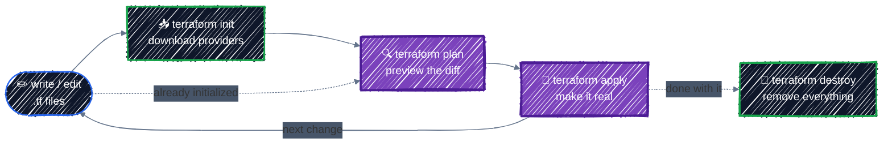

# Core Workflow

> init → plan → apply → destroy, using a GCS bucket as your first resource.

---

## Before you start

Finish [Setup](setup.md) first. In particular, check that these are set in your current shell:

```bash
echo "$TF_VAR_project_id $TF_VAR_region"   # e.g. tf-tutorial-3fa9c1 us-central1
gcloud auth application-default print-access-token > /dev/null && echo "ADC OK"
```

Everything in this chapter runs in one directory:

```bash
cd examples/getting-started/first-bucket
```

## The loop you'll use for everything

Four commands cover almost all day-to-day Terraform work. You'll repeat the middle two constantly:



You only re-run `init` when you add a provider or module, or change the backend. Every other change goes straight from editing to `plan`.

## The configuration

[`examples/getting-started/first-bucket/main.tf`](../../examples/getting-started/first-bucket/main.tf) holds everything in one file. The next chapter, [Anatomy of HCL](hcl-anatomy.md), takes the syntax apart; for now, read it top to bottom:

```hcl
terraform {
  required_version = ">= 1.10"

  required_providers {
    google = {
      source  = "hashicorp/google"
      version = "~> 8.0"
    }
  }
}

variable "project_id" {
  description = "The GCP project to create resources in. Set via TF_VAR_project_id."
  type        = string
}

variable "region" {
  description = "Default region. Set via TF_VAR_region."
  type        = string
  default     = "us-central1"
}

provider "google" {
  project = var.project_id
  region  = var.region
}

resource "google_storage_bucket" "first" {
  # Bucket names are globally unique across ALL of GCP, so prefix with the project ID.
  name     = "${var.project_id}-first-bucket"
  location = var.region

  uniform_bucket_level_access = true       # IAM only, no per-object ACLs
  public_access_prevention    = "enforced" # can never be made public by accident

  # Lets `terraform destroy` delete the bucket even if it still holds objects.
  # Fine for a lab; leave it off for buckets holding data you care about.
  force_destroy = true

  labels = {
    managed-by = "terraform"
    tutorial   = "core-workflow"
  }
}

output "bucket_url" {
  description = "The gs:// URL of the bucket."
  value       = google_storage_bucket.first.url
}
```

In plain words:

- **`terraform`**: settings for Terraform itself. It needs version 1.10+ and the `google` provider, any 8.x version.
- **`variable`**: inputs. `project_id` comes from the `TF_VAR_project_id` you exported in Setup.
- **`provider "google"`**: configures the plugin that talks to GCP. Every Google resource uses this project and region unless it says otherwise.
- **`resource "google_storage_bucket" "first"`**: the one thing you want to exist. `google_storage_bucket` is the **type**; `first` is the **local name** you use to refer to it inside this configuration. Together they form its **address**, `google_storage_bucket.first`.
- **`output`**: a value printed after `apply`, and readable later with `terraform output`.

## 1. `terraform init`: prepare the directory

```bash
terraform init
```

```
Initializing the backend...

Initializing provider plugins...
- Reusing previous version of hashicorp/google from the dependency lock file
- Installing hashicorp/google v8.7.0...
- Installed hashicorp/google v8.7.0 (signed by HashiCorp)

Terraform has been successfully initialized!
```

`init` doesn't touch GCP. It works only on your local directory:

- **Downloads providers** into `.terraform/`. The google provider is a large binary, so the first `init` takes a moment. `.terraform/` is a cache: never commit it, and it's safe to delete.
- **Reads `.terraform.lock.hcl`**, which records the exact provider version and its checksums. This repo already includes one, which is why the output says *"Reusing previous version ... from the dependency lock file"*: you get exactly the provider build this chapter was written against. In a directory without a lock file, `init` picks the newest version allowed by `~> 8.0` and writes the file for you. **Commit it.** It guarantees that you, your teammates, and CI all run the same provider build. [Providers & Version Pinning](../core-language/providers.md) covers it in depth.
- **Sets up the backend**, which is where state is stored. With no backend configured, state is a local file. You'll move it to GCS in [Remote Backend on GCS](../state/remote-backend.md).

`init` is safe to run any number of times.

## 2. `fmt` and `validate`: cheap checks first

Two quick commands catch mistakes before you talk to GCP:

```bash
terraform fmt        # rewrites files into canonical style; prints the names of files it changed
terraform validate   # checks syntax, types, and references, without calling any API
```

```
Success! The configuration is valid.
```

`validate` catches typos like a misspelled argument name or a reference to a variable that doesn't exist. It can't catch problems that only GCP knows about, such as a bucket name someone else already took. `plan` and `apply` find those.

## 3. `terraform plan`: preview the change

```bash
terraform plan
```

```
Terraform used the selected providers to generate the following execution
plan. Resource actions are indicated with the following symbols:
  + create

Terraform will perform the following actions:

  # google_storage_bucket.first will be created
  + resource "google_storage_bucket" "first" {
      + deletion_policy             = "DELETE"
      + effective_labels            = {
          + "goog-terraform-provisioned" = "true"
          + "managed-by"                 = "terraform"
          + "tutorial"                   = "core-workflow"
        }
      + force_destroy               = true
      + id                          = (known after apply)
      + labels                      = {
          + "managed-by" = "terraform"
          + "tutorial"   = "core-workflow"
        }
      + location                    = "US-CENTRAL1"
      + name                        = "tf-tutorial-3fa9c1-first-bucket"
      + project                     = (known after apply)
      + public_access_prevention    = "enforced"
      + self_link                   = (known after apply)
      + storage_class               = "STANDARD"
      + terraform_labels            = {
          + "goog-terraform-provisioned" = "true"
          + "managed-by"                 = "terraform"
          + "tutorial"                   = "core-workflow"
        }
      + uniform_bucket_level_access = true
      + url                         = (known after apply)
      ...
    }

Plan: 1 to add, 0 to change, 0 to destroy.

Changes to Outputs:
  + bucket_url = (known after apply)
```

How to read it:

- **`# google_storage_bucket.first will be created`**: the address, and what will happen to it.
- **`+`** in front of each attribute: the value it will be created with. These include values you didn't write, such as `storage_class = "STANDARD"`, which are the provider's defaults. `location` shows up as `US-CENTRAL1` because GCS stores locations in upper case; the provider treats `us-central1` as the same value.
- **`(known after apply)`**: values GCP decides at creation time, like the `id`. Terraform can't know them yet.
- **`labels` vs. `effective_labels`**: `labels` is exactly what you wrote. `effective_labels` is what ends up on the bucket: your labels plus `goog-terraform-provisioned`, which the google provider adds to everything it creates so you can tell Terraform-managed resources apart in the Console. (`terraform_labels` is an intermediate view of the same thing; you can ignore it.)
- **`Plan: 1 to add, 0 to change, 0 to destroy.`**: the summary line. Read it every time.

`plan` makes read-only API calls (it checks what exists) and changes nothing. You can run it as often as you like.

### The four symbols

Every plan uses the same notation. Learn these and you can read any plan:

| Symbol | Meaning | Risk |
|---|---|---|
| `+` | create | Low: something new appears |
| `~` | update in place | Usually low: the resource keeps its identity |
| `-` | destroy | **High**: the resource and its data are gone |
| `-/+` | destroy, then create a replacement | **High**: same address, but a brand-new resource. Data doesn't carry over |

`-/+` is the one that surprises people. Some attributes can't be changed on an existing resource; you'll trigger one on purpose in step 5.

## 4. `terraform apply`: make it real

```bash
terraform apply
```

`apply` computes a fresh plan, shows it, and asks for confirmation:

```
Plan: 1 to add, 0 to change, 0 to destroy.

Do you want to perform these actions?
  Terraform will perform the actions described above.
  Only 'yes' will be accepted to approve.

  Enter a value: yes

google_storage_bucket.first: Creating...
google_storage_bucket.first: Creation complete after 2s [id=tf-tutorial-3fa9c1-first-bucket]

Apply complete! Resources: 1 added, 0 changed, 0 destroyed.

Outputs:

bucket_url = "gs://tf-tutorial-3fa9c1-first-bucket"
```

Only the exact word `yes` approves the plan. Anything else cancels it.

Check that it's real, using a tool other than Terraform:

```bash
gcloud storage buckets describe "gs://${TF_VAR_project_id}-first-bucket" \
  --format='yaml(name,location,labels,public_access_prevention)'
```

Then look at what `apply` left behind in the directory:

```bash
ls -a
# .  ..  .terraform  .terraform.lock.hcl  main.tf  terraform.tfstate
```

`terraform.tfstate` is new. It's Terraform's record that `google_storage_bucket.first` in your code is the real bucket `tf-tutorial-3fa9c1-first-bucket`. **Never edit it by hand, and never commit it.** It can contain secrets, and it's the only link between your code and what's running. [State & Drift](../state/state-basics.md) covers it properly. The repo's `.gitignore` already excludes it.

Run `plan` again:

```bash
terraform plan
```

```
No changes. Your infrastructure matches the configuration.
```

That's the declarative model at work. The code and the real world agree, so there's nothing to do. Applying the same configuration twice is always safe.

## 5. Change something

### An in-place update (`~`)

Add object versioning to the bucket. In `main.tf`, inside the `google_storage_bucket` block, add:

```hcl
  versioning {
    enabled = true
  }
```

```bash
terraform plan
```

```
  # google_storage_bucket.first will be updated in-place
  ~ resource "google_storage_bucket" "first" {
        id                          = "tf-tutorial-3fa9c1-first-bucket"
        name                        = "tf-tutorial-3fa9c1-first-bucket"
        # (16 unchanged attributes hidden)

      + versioning {
          + enabled = true
        }

        # (1 unchanged block hidden)
    }

Plan: 0 to add, 1 to change, 0 to destroy.
```

`~` means the same bucket gets modified. Its name, its objects, and everything else stay. Apply it:

```bash
terraform apply
```

### A replacement (`-/+`)

Now change something that GCP can't change on an existing bucket. A bucket's location is fixed at creation. Change `location = var.region` to:

```hcl
  location = "us-east1"
```

```bash
terraform plan
```

```
  # google_storage_bucket.first must be replaced
-/+ resource "google_storage_bucket" "first" {
      ~ id                          = "tf-tutorial-3fa9c1-first-bucket" -> (known after apply)
      ~ location                    = "US-CENTRAL1" -> "US-EAST1" # forces replacement
        name                        = "tf-tutorial-3fa9c1-first-bucket"
        ...
    }

Plan: 1 to add, 0 to change, 1 to destroy.
```

**`# forces replacement`** marks the attribute responsible. Applying this would delete the bucket, including every object in it (`force_destroy = true` allows that), and create an empty one in `us-east1`. For a bucket holding model weights, that's an outage plus a multi-gigabyte re-upload.

**Don't apply it.** Change `location` back to `var.region` and confirm the plan is clean again:

```bash
terraform plan   # No changes.
```

This is why you read every plan before you apply. A one-word edit can mean "delete my data", and the plan is the only place that tells you.

## 6. Drift: someone changes it by hand

Terraform only knows about changes made through Terraform. Simulate a teammate "quickly fixing something" in the Console:

```bash
gcloud storage buckets update "gs://${TF_VAR_project_id}-first-bucket" \
  --update-labels=tutorial=hotfix-by-hand
```

```bash
terraform plan
```

```
Note: Objects have changed outside of Terraform

Terraform detected the following changes made outside of Terraform since the
last "terraform apply" which may have affected this plan:

  # google_storage_bucket.first has changed
  ~ resource "google_storage_bucket" "first" {
      ~ labels                      = {
          ~ "tutorial"   = "core-workflow" -> "hotfix-by-hand"
            # (1 unchanged element hidden)
        }
        ...
    }

...

  # google_storage_bucket.first will be updated in-place
  ~ resource "google_storage_bucket" "first" {
      ~ effective_labels            = {
          ~ "tutorial"                   = "hotfix-by-hand" -> "core-workflow"
            # (2 unchanged elements hidden)
        }
        id                          = "tf-tutorial-3fa9c1-first-bucket"
      ~ labels                      = {
          ~ "tutorial"   = "hotfix-by-hand" -> "core-workflow"
            # (1 unchanged element hidden)
        }
        ...
    }

Plan: 0 to add, 1 to change, 0 to destroy.
```

Terraform reports the drift first, then plans to put things back the way the code says. You have two honest choices:

- **The hand change was wrong**: `terraform apply` reverts it.
- **The hand change was right**: update `main.tf` to match, so code and reality agree again.

Ignoring drift is the one wrong choice. The next person to run `apply` reverts the change without knowing it was there. Revert it now:

```bash
terraform apply
```

## 7. Saved plans: apply exactly what you reviewed

When you run `terraform apply` with no arguments, Terraform computes a **new** plan. If something changed in the meantime, such as a teammate's apply or a hand edit, it might not match the plan you reviewed a minute ago. Saving the plan removes that gap:

```bash
terraform plan -out=tfplan    # save the plan to a file
terraform show tfplan         # re-read it any time
terraform apply tfplan        # apply exactly that plan; no prompt, because you already reviewed it
```

If the state changed after the plan was saved, `apply tfplan` refuses to run and you plan again. This is how CI pipelines work: one job saves the plan, a human reviews it, and a later job applies that exact file. You'll build this in [CI/CD](../team-workflow/ci-cd.md). `tfplan` is git-ignored, because a saved plan can contain sensitive values.

## 8. Outputs

```bash
terraform output                  # every output
terraform output -raw bucket_url  # one value, without quotes, for use in scripts
```

```bash
gcloud storage ls "$(terraform output -raw bucket_url)"   # an empty bucket lists nothing
```

Outputs are how one piece of infrastructure hands values to scripts, CI, or other Terraform configurations.

## 9. `terraform destroy`: remove everything

```bash
terraform destroy
```

```
  # google_storage_bucket.first will be destroyed
  - resource "google_storage_bucket" "first" {
      ...
    }

Plan: 0 to add, 0 to change, 1 to destroy.

Do you really want to destroy all resources?
  Terraform will destroy all your managed infrastructure, as shown above.
  There is no undo. Only 'yes' will be accepted to confirm.

  Enter a value: yes

google_storage_bucket.first: Destroying... [id=tf-tutorial-3fa9c1-first-bucket]
google_storage_bucket.first: Destruction complete after 1s

Destroy complete! Resources: 1 destroyed.
```

`destroy` removes **every resource in this configuration's state**, and nothing else. It never touches resources Terraform didn't create, even in the same project.

Preview a destroy without doing it with `terraform plan -destroy`. That's a good habit before running `destroy` against anything that matters.

## Best practices

- **Read the summary line and look for `-` and `-/+`** in every plan before typing `yes`. Look for `# forces replacement` to see why.
- **Never edit infrastructure by hand.** If you must during an incident, bring the code back in line straight after.
- **Commit `.terraform.lock.hcl`; never commit `.terraform/`, `*.tfstate`, or saved plans.**
- **Run `terraform fmt` and `terraform validate` before every commit.** They're instant, and CI will run them anyway (see [Testing & Code Quality](../team-workflow/testing-and-quality.md)).
- **Use `plan -out` + `apply <planfile>`** whenever a plan is reviewed by someone else or applied by automation.
- **Name buckets with the project ID as a prefix.** Bucket names are global across every GCP customer.

## Clean up

If you skipped step 9, destroy the bucket now:

```bash
terraform destroy
```

An empty bucket costs nothing, but tear down what you create at the end of every chapter anyway. It's the habit that keeps GPU node pools from running all weekend in Part 5.

---

[← Setup](setup.md) · [↑ Contents](../../README.md) · [Anatomy of HCL →](hcl-anatomy.md)
