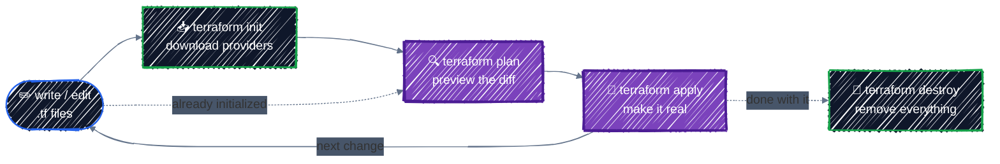

# Core Workflow

> init → plan → apply → destroy, using a local file and a random name, so no cloud account is needed yet.

---

## Before you start

This chapter doesn't touch GCP. All you need is Terraform from [Setup](setup.md#1-install-terraform):

```bash
terraform version   # v1.11 or newer
```

The resources here live on your own disk: a generated name, a file, and a value stored in state. They cost nothing, can't break anything, and behave like cloud resources in every way that matters for learning the workflow. Later chapters switch to real GCP resources.

Everything in this chapter runs in one directory:

```bash
cd examples/getting-started/core-workflow
```

## The loop you'll use for everything

Four commands cover almost all day-to-day Terraform work. You'll repeat the middle two constantly:



You only re-run `init` when you add a provider or module, or change the backend. Every other change goes straight from editing to `plan`.

## The configuration

[`examples/getting-started/core-workflow/main.tf`](../../examples/getting-started/core-workflow/main.tf) holds everything in one file. The next chapter, [Anatomy of HCL](hcl-anatomy.md), takes the syntax apart; for now, read it top to bottom:

```hcl
terraform {
  required_version = ">= 1.10"

  required_providers {
    local = {
      source  = "hashicorp/local"
      version = "~> 2.9"
    }
    random = {
      source  = "hashicorp/random"
      version = "~> 3.9"
    }
  }
}

variable "owner" {
  description = "Written into the config file."
  type        = string
  default     = "platform-team"
}

# A random two-word name, like "relaxed-gecko". Generated once, then kept in state.
resource "random_pet" "server" {
  length = 2
}

# A file on your disk, standing in for a cloud resource.
resource "local_file" "config" {
  filename             = "${path.module}/out/server.conf"
  content              = "name=${random_pet.server.id}\nowner=${var.owner}\n"
  file_permission      = "0644"
  directory_permission = "0755"
}

# Built into Terraform: it stores a value in state and creates nothing else.
resource "terraform_data" "release" {
  input = {
    version = "1.0"
  }
}

output "server_name" {
  description = "The generated server name."
  value       = random_pet.server.id
}

output "config_file" {
  description = "Path of the generated config file."
  value       = local_file.config.filename
}
```

In plain words:

- **`terraform`**: settings for Terraform itself. It needs version 1.10+ and two providers: `local`, which manages files, and `random`, which generates random values.
- **`variable`**: an input. `owner` has a default, so you don't have to set it.
- **`resource "random_pet" "server"`**: a generated name such as `romantic-hornet`. `random_pet` is the **type**; `server` is the **local name** you use to refer to it inside this configuration. Together they form its **address**, `random_pet.server`.
- **`resource "local_file" "config"`**: a file whose content uses the pet name and the variable. Because it reads `random_pet.server.id`, Terraform knows to create the name first.
- **`resource "terraform_data" "release"`**: built into Terraform; it only stores its `input` in state. It's here because, unlike the other two, it can be changed without being recreated, which you'll need in step 5.
- **`output`**: values printed after `apply`, and readable later with `terraform output`.

## 1. `terraform init`: prepare the directory

```bash
terraform init
```

```
Initializing the backend...

Initializing provider plugins...
- terraform.io/builtin/terraform is built in to Terraform
- Reusing version 3.9.1 of hashicorp/random from the dependency lock file
- Reusing version 2.9.1 of hashicorp/local from the dependency lock file
- Installing hashicorp/random v3.9.1...
- Installed hashicorp/random v3.9.1 (signed by HashiCorp)
- Installing hashicorp/local v2.9.1...
- Installed hashicorp/local v2.9.1 (signed by HashiCorp)

Terraform has been successfully initialized!
```

`init` doesn't create anything. It works only on your local directory:

- **Downloads providers** into `.terraform/`. `terraform_data` needs no download because it's built in. `.terraform/` is a cache: never commit it, and it's safe to delete.
- **Reads `.terraform.lock.hcl`**, which records the exact provider versions and their checksums. This repo already includes one, which is why the output says *"Reusing version ... from the dependency lock file"*: you get exactly the provider builds this chapter was written against. In a directory without a lock file, `init` picks the newest versions allowed by `~> 2.9` and `~> 3.9` and writes the file for you. **Commit it.** It guarantees that you, your teammates, and CI all run the same provider builds. [Providers & Version Pinning](../core-language/providers.md) covers it in depth.
- **Sets up the backend**, which is where state is stored. With no backend configured, state is a local file. You'll move it to GCS in [Remote Backend on GCS](../state/remote-backend.md).

`init` is safe to run any number of times.

## 2. `fmt` and `validate`: cheap checks first

Two quick commands catch mistakes before anything is created:

```bash
terraform fmt        # rewrites files into canonical style; prints the names of files it changed
terraform validate   # checks syntax, types, and references, without creating anything
```

```
Success! The configuration is valid.
```

`validate` catches typos like a misspelled argument name or a reference to a variable that doesn't exist. It can't catch problems that only the real system knows about, such as a directory you can't write to, or, on a cloud, a bucket name someone else already took. `plan` and `apply` find those.

## 3. `terraform plan`: preview the change

```bash
terraform plan
```

```
Terraform used the selected providers to generate the following execution
plan. Resource actions are indicated with the following symbols:
  + create

Terraform will perform the following actions:

  # local_file.config will be created
  + resource "local_file" "config" {
      + content              = (known after apply)
      + content_base64sha256 = (known after apply)
      ...
      + directory_permission = "0755"
      + file_permission      = "0644"
      + filename             = "./out/server.conf"
      + id                   = (known after apply)
    }

  # random_pet.server will be created
  + resource "random_pet" "server" {
      + id        = (known after apply)
      + length    = 2
      + separator = "-"
    }

  # terraform_data.release will be created
  + resource "terraform_data" "release" {
      + id     = (known after apply)
      + input  = {
          + version = "1.0"
        }
      + output = (known after apply)
    }

Plan: 3 to add, 0 to change, 0 to destroy.

Changes to Outputs:
  + config_file = "./out/server.conf"
  + server_name = (known after apply)
```

How to read it:

- **`# random_pet.server will be created`**: the address, and what will happen to it.
- **`+`** in front of each attribute: the value it will be created with. These include values you didn't write, such as `separator = "-"`, which are the provider's defaults.
- **`(known after apply)`**: values decided at creation time. The pet name doesn't exist until `apply` generates it, so the file's `content`, which includes the name, isn't known either. On a cloud, IDs and IP addresses show up the same way.
- **`Plan: 3 to add, 0 to change, 0 to destroy.`**: the summary line. Read it every time.

`plan` only reads (it checks what already exists) and changes nothing. You can run it as often as you like.

### The four symbols

Every plan uses the same notation. Learn these and you can read any plan:

| Symbol | Meaning | Risk |
|---|---|---|
| `+` | create | Low: something new appears |
| `~` | update in place | Usually low: the resource keeps its identity |
| `-` | destroy | **High**: the resource and its data are gone |
| `-/+` | destroy, then create a replacement | **High**: same address, but a brand-new resource. Data doesn't carry over |

`-/+` is the one that surprises people. Some attributes can't be changed on an existing resource; you'll trigger one on purpose in step 5.

## 4. `terraform apply`: make it real

```bash
terraform apply
```

`apply` computes a fresh plan, shows it, and asks for confirmation:

```
Plan: 3 to add, 0 to change, 0 to destroy.

Do you want to perform these actions?
  Terraform will perform the actions described above.
  Only 'yes' will be accepted to approve.

  Enter a value: yes

terraform_data.release: Creating...
terraform_data.release: Creation complete after 0s [id=84e968fb-09d9-1f8d-e617-26a201c0b906]
random_pet.server: Creating...
random_pet.server: Creation complete after 0s [id=romantic-hornet]
local_file.config: Creating...
local_file.config: Creation complete after 0s [id=bc4b5003b7d4e4862437586a3110c037cc08f177]

Apply complete! Resources: 3 added, 0 changed, 0 destroyed.

Outputs:

config_file = "./out/server.conf"
server_name = "romantic-hornet"
```

Only the exact word `yes` approves the plan. Anything else cancels it. Your pet name will differ; that's the point of `random_pet`.

Notice the order: `local_file.config` waited for `random_pet.server`, because its content needs the name. You never wrote that order down. Terraform worked it out from the reference.

Check that it's real, using a tool other than Terraform:

```bash
cat out/server.conf
```

```
name=romantic-hornet
owner=platform-team
```

Then look at what `apply` left behind in the directory:

```bash
ls -a
# .  ..  .terraform  .terraform.lock.hcl  main.tf  out  terraform.tfstate
```

`terraform.tfstate` is new. It's Terraform's record that `random_pet.server` in your code is the name `romantic-hornet`, and that `local_file.config` is the file `./out/server.conf`. **Never edit it by hand, and never commit it.** It can contain secrets, and it's the only link between your code and what exists. [State & Drift](../state/state-basics.md) covers it properly. The repo's `.gitignore` already excludes it, and the `out/` directory too.

Run `plan` again:

```bash
terraform plan
```

```
No changes. Your infrastructure matches the configuration.
```

That's the declarative model at work. The code and the real world agree, so there's nothing to do. Applying the same configuration twice is always safe. It's also why the pet name stays `romantic-hornet`: it's random once, at creation, and state remembers it after that.

## 5. Change something

### An in-place update (`~`)

In `main.tf`, change the release version from `"1.0"` to `"1.1"`:

```hcl
  input = {
    version = "1.1"
  }
```

```bash
terraform plan
```

```
  # terraform_data.release will be updated in-place
  ~ resource "terraform_data" "release" {
        id     = "84e968fb-09d9-1f8d-e617-26a201c0b906"
      ~ input  = {
          ~ version = "1.0" -> "1.1"
        }
      ~ output = {
          - version = "1.0"
        } -> (known after apply)
    }

Plan: 0 to add, 1 to change, 0 to destroy.
```

`~` means the same resource gets modified: its `id` stays. On a cloud, this is what changing a bucket's labels or a VM's metadata looks like. Apply it:

```bash
terraform apply
```

### A replacement (`-/+`)

Now change something that can't be changed on an existing resource. A pet name's length is fixed when it's generated. In the `random_pet` block, change `length = 2` to:

```hcl
  length = 3
```

```bash
terraform plan
```

```
  # local_file.config must be replaced
-/+ resource "local_file" "config" {
      ~ content              = <<-EOT
            name=romantic-hornet
            owner=platform-team
        EOT -> (known after apply) # forces replacement
      ...
      ~ id                   = "bc4b5003b7d4e4862437586a3110c037cc08f177" -> (known after apply)
        # (3 unchanged attributes hidden)
    }

  # random_pet.server must be replaced
-/+ resource "random_pet" "server" {
      ~ id        = "romantic-hornet" -> (known after apply)
      ~ length    = 2 -> 3 # forces replacement
        # (1 unchanged attribute hidden)
    }

Plan: 2 to add, 0 to change, 2 to destroy.
```

**`# forces replacement`** marks the attribute responsible. Read the two resources together:

- `random_pet.server` is replaced because its `length` changed. The old name is gone for good; the new one will be different.
- `local_file.config` is replaced too, even though you didn't touch it. Its content includes the name, and a new name means new content.

One edit, two destroyed resources. Here it costs nothing, but picture the same shape on a cloud: the name is a bucket name, and everything that references it gets rebuilt. For a bucket holding model weights, that's an outage plus a multi-gigabyte re-upload.

**Don't apply it.** Change `length` back to `2` and confirm the plan is clean again:

```bash
terraform plan   # No changes.
```

This is why you read every plan before you apply. A one-word edit can mean "delete my data", and the plan is the only place that tells you.

## 6. Drift: someone changes it by hand

Terraform only knows about changes made through Terraform. Simulate a teammate "quickly fixing something" by editing the file directly:

```bash
sed -i 's/owner=platform-team/owner=someone-else/' out/server.conf
```

```bash
terraform plan
```

```
  # local_file.config will be created
  + resource "local_file" "config" {
      + content              = <<-EOT
            name=romantic-hornet
            owner=platform-team
        EOT
      ...
    }

Plan: 1 to add, 0 to change, 0 to destroy.
```

`plan` refreshed the file before comparing. The `local` provider treats a file whose content no longer matches as gone, so the plan recreates it with the content your code says. To see only what changed outside Terraform, without planning a fix, use a refresh-only plan:

```bash
terraform plan -refresh-only
```

```
Note: Objects have changed outside of Terraform

Terraform detected the following changes made outside of Terraform since the
last "terraform apply" which may have affected this plan:

  # local_file.config has been deleted
  - resource "local_file" "config" {
      ...
    }
```

Cloud resources show drift in more detail: a hand-edited bucket label appears as `~ "tutorial" = "core-workflow" -> "hotfix-by-hand"`, and the plan offers an in-place update to put it back. You'll see that on a real bucket in [State & Drift](../state/state-basics.md).

Either way, you have two honest choices:

- **The hand change was wrong**: `terraform apply` reverts it.
- **The hand change was right**: update `main.tf` to match, so code and reality agree again.

Ignoring drift is the one wrong choice. The next person to run `apply` reverts the change without knowing it was there. Revert it now:

```bash
terraform apply
```

## 7. Saved plans: apply exactly what you reviewed

When you run `terraform apply` with no arguments, Terraform computes a **new** plan. If something changed in the meantime, such as a teammate's apply or a hand edit, it might not match the plan you reviewed a minute ago. Saving the plan removes that gap:

```bash
terraform plan -out=tfplan    # save the plan to a file
terraform show tfplan         # re-read it any time
terraform apply tfplan        # apply exactly that plan; no prompt, because you already reviewed it
```

If the state changed after the plan was saved, `apply tfplan` refuses to run and you plan again. This is how CI pipelines work: one job saves the plan, a human reviews it, and a later job applies that exact file. You'll build this in [CI/CD](../team-workflow/ci-cd.md). `tfplan` is git-ignored, because a saved plan can contain sensitive values.

## 8. Outputs

```bash
terraform output                   # every output
terraform output -raw config_file  # one value, without quotes, for use in scripts
```

```bash
cat "$(terraform output -raw config_file)"
```

Outputs are how one piece of infrastructure hands values to scripts, CI, or other Terraform configurations.

## Checkpoint: run the workflow without a script

Do this checkpoint **before step 9**, while the resources still exist. Try each task before opening its answer. The goal isn't to memorize commands; it's to predict what Terraform will do, verify that prediction in the plan, and stop when the plan is unsafe.

### 1. Predict the plan

For each change, decide whether the plan will show `+` (create), `~` (update in place), `-/+` (replace), `-` (destroy), or no changes. Also predict the summary counts.

| Change | Your prediction |
|---|---|
| Run `terraform plan` without changing anything | |
| Add `channel = "stable"` to the `release` resource's `input` | |
| Change `random_pet`'s `separator` from the default `"-"` to `"_"` (add `separator = "_"`) | |
| Delete the `terraform_data.release` block | |

Verify each one with `terraform plan`, one at a time. **Do not apply** the separator change. Restore `main.tf` after each experiment and confirm that the final plan is clean.

<details>
<summary>Answer</summary>

| Change | Expected result | Summary |
|---|---|---|
| No configuration change | no changes | `0 to add, 0 to change, 0 to destroy` |
| Add a key to `input` | `~` update in place | `0 to add, 1 to change, 0 to destroy` |
| Change the separator | `-/+` for both `random_pet.server` and `local_file.config` | `2 to add, 0 to change, 2 to destroy` |
| Delete the `release` block | `-` destroy | `0 to add, 0 to change, 1 to destroy` |

Terraform tracks each resource at its address, such as `random_pet.server`. Changing an updatable argument modifies the object at that address; changing a fixed one replaces it, along with anything whose values depend on it; removing the address from configuration tells Terraform the object is no longer wanted.

</details>

### 2. Make a change without copying

Add an input variable named `environment` with type `string` and default value `"dev"`. Use it to add an `environment=` line to the config file's content.

Then run, in order:

```bash
terraform fmt
terraform validate
terraform plan
terraform apply
terraform plan -var environment=staging
```

Before each `plan`, say out loud what you expect. Apply the default `dev` value, but don't apply the one-off `staging` override.

<details>
<summary>Answer</summary>

One valid implementation is:

```hcl
variable "environment" {
  description = "Environment written into the config file."
  type        = string
  default     = "dev"
}
```

```hcl
  content = "name=${random_pet.server.id}\nowner=${var.owner}\nenvironment=${var.environment}\n"
```

The first plan replaces `local_file.config` (`-/+`), because a local file can't be edited in place: any content change means a new file. That's acceptable here, since the file holds nothing that isn't in the code. The pet name stays the same, because nothing about `random_pet.server` changed. After applying, a normal plan is clean. `terraform plan -var environment=staging` temporarily overrides the default and proposes another replacement; because you don't apply it, both the configuration default and the real file remain `dev`.

</details>

### 3. Break it, read the error, fix it

Temporarily change the output reference from:

```hcl
value = local_file.config.filename
```

to the misspelled address:

```hcl
value = local_file.confg.filename
```

Run `terraform validate`. Before fixing it, identify all three parts of the address in the error: resource type, local name, and attribute. Restore `config`, then validate again.

<details>
<summary>Answer</summary>

```
Error: Reference to undeclared resource

  on main.tf line 49, in output "config_file":
  49:   value       = local_file.confg.filename

A managed resource "local_file" "confg" has not been declared in the root
module.
```

- `local_file` is the resource type.
- `confg` is the misspelled local name; the declared name is `config`.
- `filename` is the attribute the output wants to read.

The fix is to restore `local_file.config.filename`. `terraform validate` should then succeed.

</details>

### 4. Explain the workflow

Answer these in your own words:

1. Why does Terraform need state if the `.tf` files already describe what you want?
2. Why does a second `apply` normally produce no changes?
3. What should you do when a small edit unexpectedly produces `-/+`?
4. Why should a saved plan file be treated as sensitive?

<details>
<summary>Answer</summary>

1. Configuration describes the desired result; state maps Terraform addresses such as `random_pet.server` to the real objects, like the name `romantic-hornet`, and records their known attributes. Without state, Terraform couldn't even tell you which random name it generated. It refreshes those objects and compares all three views to build a plan.
2. After the first apply, configuration, state, and the real objects agree. Terraform is declarative, so it has nothing else to do.
3. Stop. Read the attribute marked `# forces replacement`, check what else is replaced because it depends on that resource, decide whether losing and recreating them is acceptable, and revert or redesign the change if it isn't. Don't apply merely because the edit looked small.
4. A saved plan contains the exact proposed values and can include sensitive data even when the terminal display hides it. Don't commit or casually share plan files.

</details>

You're ready to continue when all of these are true:

- [ ] You predicted the plan before running it, including the destructive replacement.
- [ ] You added and applied the `environment` variable without copying the answer first.
- [ ] You diagnosed the broken reference from Terraform's error message.
- [ ] `terraform fmt -check`, `terraform validate`, and `terraform plan` all succeed; the plan is clean.
- [ ] You can explain configuration, state, refresh, plan, and apply without looking back at the chapter.

## 9. `terraform destroy`: remove everything

```bash
terraform destroy
```

```
  # local_file.config will be destroyed
  - resource "local_file" "config" {
      ...
    }

  # random_pet.server will be destroyed
  - resource "random_pet" "server" {
      - id        = "romantic-hornet" -> null
      ...
    }

  # terraform_data.release will be destroyed
  - resource "terraform_data" "release" {
      ...
    }

Plan: 0 to add, 0 to change, 3 to destroy.

Do you really want to destroy all resources?
  Terraform will destroy all your managed infrastructure, as shown above.
  There is no undo. Only 'yes' will be accepted to confirm.

  Enter a value: yes

terraform_data.release: Destroying... [id=84e968fb-09d9-1f8d-e617-26a201c0b906]
terraform_data.release: Destruction complete after 0s
local_file.config: Destroying... [id=bc4b5003b7d4e4862437586a3110c037cc08f177]
local_file.config: Destruction complete after 0s
random_pet.server: Destroying... [id=romantic-hornet]
random_pet.server: Destruction complete after 0s

Destroy complete! Resources: 3 destroyed.
```

The order is the reverse of creation: the file goes before the name it depends on.

`destroy` removes **every resource in this configuration's state**, and nothing else. It deleted `server.conf`, but left the now-empty `out/` directory, because Terraform didn't create that as a resource. On a cloud, it likewise never touches resources it didn't create, even in the same project.

Preview a destroy without doing it with `terraform plan -destroy`. That's a good habit before running `destroy` against anything that matters.

## Best practices

- **Read the summary line and look for `-` and `-/+`** in every plan before typing `yes`. Look for `# forces replacement` to see why, and for other resources replaced along with it.
- **Never edit infrastructure by hand.** If you must during an incident, bring the code back in line straight after.
- **Commit `.terraform.lock.hcl`; never commit `.terraform/`, `*.tfstate`, or saved plans.**
- **Run `terraform fmt` and `terraform validate` before every commit.** They're instant, and CI will run them anyway (see [Testing & Code Quality](../team-workflow/testing-and-quality.md)).
- **Use `plan -out` + `apply <planfile>`** whenever a plan is reviewed by someone else or applied by automation.

## Clean up

If you skipped step 9, destroy everything now:

```bash
terraform destroy
```

Nothing here costs money, but tear down what you create at the end of every chapter anyway. It's the habit that keeps GPU node pools from running all weekend in Part 5.

---

[← Setup](setup.md) · [↑ Contents](../../README.md) · [Anatomy of HCL →](hcl-anatomy.md)
