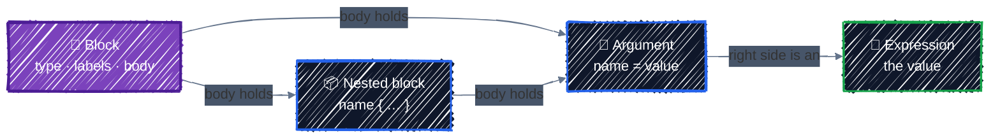

# Anatomy of HCL

> Blocks, arguments, and expressions, once and for all.

---

Terraform configurations are written in **HCL** (HashiCorp Configuration Language). It looks a bit like JSON, with less punctuation and with expressions built in. The good news: the whole language rests on **three building blocks**. Once you can name each part of a file, any Terraform code you open, from a one-file lab to a thousand-line production module, reads the same way.

## Before you start

Like [Core Workflow](core-workflow.md), this chapter uses only local resources: a generated name and a file that refers to it, split into the conventional files:

```bash
cd examples/getting-started/hcl-anatomy
terraform init
```

```
hcl-anatomy/
├── versions.tf    # terraform { } block: Terraform and provider versions
├── variables.tf   # inputs
├── main.tf        # locals and resources
└── outputs.tf     # outputs
```

## The three building blocks



Here they are in a real resource from `main.tf`:

```hcl
resource "random_pet" "server" {   # block: type "resource", two labels
  length = 2                       # argument: name = expression

  keepers = local.labels           # argument whose value is a map

  lifecycle {                      # nested block: no "="
    create_before_destroy = true   # argument inside the nested block
  }
}
```

`keepers` tells `random_pet` to generate a new name whenever one of these values changes. `lifecycle` is a block every resource accepts; [Meta-Arguments](../core-language/meta-arguments.md) covers it. For now, only their shape matters.

### 1. Blocks

A **block** is a container with a **type**, zero or more **labels**, and a **body** in braces:

| Part | In the example | Meaning |
|---|---|---|
| Type | `resource` | what kind of block this is |
| Label 1 | `"random_pet"` | for a resource: which kind of thing to create |
| Label 2 | `"server"` | for a resource: your local name for it |
| Body | `{ ... }` | the arguments and nested blocks |

The block type decides how many labels it takes. `resource` takes two, `variable` and `output` take one, and `terraform` and `locals` take none. You'll meet these block types in almost every configuration:

| Block | Labels | What it's for | Covered in |
|---|---|---|---|
| `terraform` | none | Terraform version, providers, backend | [Providers](../core-language/providers.md) |
| `provider` | provider name | Configure a provider, such as the GCP project and region. `local` and `random` need none | [Providers](../core-language/providers.md) |
| `resource` | type, name | Something Terraform **creates and manages** | [Resources & Data Sources](../core-language/resources-and-data-sources.md) |
| `data` | type, name | Something Terraform only **reads** | [Resources & Data Sources](../core-language/resources-and-data-sources.md) |
| `variable` | name | An input | [Variables, Locals & Outputs](../core-language/variables-and-outputs.md) |
| `locals` | none | Named values computed inside the configuration | [Variables, Locals & Outputs](../core-language/variables-and-outputs.md) |
| `output` | name | A value exposed to the caller | [Variables, Locals & Outputs](../core-language/variables-and-outputs.md) |
| `module` | name | Call another directory of Terraform code | [Writing Modules](../modules/writing-modules.md) |

Labels are always plain quoted strings. You can't compute them with expressions.

### 2. Arguments

An **argument** assigns a value to a name: `name = value`. Within one block, each argument name can appear only once, and the provider's documentation lists which ones exist. For example, the [`random_pet` docs](https://registry.terraform.io/providers/hashicorp/random/latest/docs/resources/pet) list `length`, `keepers`, `prefix`, and `separator`.

Lining up the `=` signs is just style. `terraform fmt` does it for you.

### 3. Nested blocks vs. map arguments: the `=` matters

This is the most common syntax mistake in Terraform. Things that look like "a name followed by braces" can be two different things. `versions.tf` has both, one inside the other:

```hcl
  required_providers {     # NESTED BLOCK: a structured part of the terraform block. No "=".
    local = {              # ARGUMENT: its value is a map. Uses "=".
      source  = "hashicorp/local"
      version = "~> 2.9"
    }
  }
```

You can't tell which is which by guessing. The docs say which names are arguments and which are blocks. Get it wrong and `terraform validate` tells you exactly what happened:

```
Error: Unsupported argument

  on versions.tf line 4, in terraform:
   4:   required_providers = {

An argument named "required_providers" is not expected here. Did you mean to
define a block of type "required_providers"?
```

```
Error: Unsupported block type

  on main.tf line 15, in resource "random_pet" "server":
  15:   keepers {

Blocks of type "keepers" are not expected here. Did you mean to define
argument "keepers"? If so, use the equals sign to assign it a value.
```

The fix is in the message both times: add or remove the `=`.

## Expressions: the right-hand side

Everything to the right of `=` is an **expression**. It can be a literal like `"dev"`, or something Terraform evaluates. You'll see these kinds constantly:

| Kind | Example | Result |
|---|---|---|
| Literal | `"dev"`, `24`, `true`, `null` | itself |
| Reference | `var.environment`, `local.name_prefix`, `random_pet.server.id` | another value in the configuration |
| String template | `"${var.team}-${var.environment}"` | `"ml-platform-dev"` |
| Function call | `upper(var.environment)` | `"DEV"` |
| Operator | `length(local.labels) > 1` | `true` |
| Conditional | `var.env == "prod" ? 3 : 1` | one of two values |
| Collection | `["a", "b"]`, `{ team = "ml" }` | a list, a map |

Part 1 goes deep on [functions, `for` expressions, and conditionals](../core-language/expressions.md). For now, two forms matter most: references and templates.

### References: how one thing points at another

Every value in a configuration has an address you can refer to:

| To refer to | Write | Example |
|---|---|---|
| An input variable | `var.<name>` | `var.environment` |
| A local value | `local.<name>` | `local.name_prefix` (block is `locals`, reference is `local`) |
| A resource attribute | `<type>.<name>.<attribute>` | `random_pet.server.id` |
| A data source attribute | `data.<type>.<name>.<attribute>` | `data.local_file.settings.content` |
| A module output | `module.<name>.<output>` | `module.network.subnet_id` |

### References create the dependency graph

In `main.tf`, the file refers to the name:

```hcl
resource "local_file" "readme" {
  ...
  content = <<-EOT
    This file is managed by Terraform.
    Server:      ${random_pet.server.id}   # ← reference
    ...
  EOT
}
```

That one reference does two jobs. It supplies the value, and it tells Terraform that **the file depends on the name**. Terraform builds a graph from every reference in the configuration:


- On `apply`, the name is generated first, because the file's content needs it.
- On `destroy`, the order reverses: the file goes first, then the name.
- Resources with no references between them are created **in parallel**.

You never write the order down. You can see the graph Terraform builds with `terraform graph`, which prints it in Graphviz format:

```
digraph G {
  rankdir = "RL";
  node [shape = rect, fontname = "sans-serif"];
  "local_file.readme" [label="local_file.readme"];
  "random_pet.server" [label="random_pet.server"];
  "local_file.readme" -> "random_pet.server";
}
```

This is why **order in the file doesn't matter**. You could put the file above the name and nothing would change. [Meta-Arguments](../core-language/meta-arguments.md) covers `depends_on`, for the rare dependency that a reference can't express.

### String templates and heredocs

`${ ... }` inside a quoted string inserts an expression's value:

```hcl
  name_prefix = "${var.team}-${var.environment}"
```

For multi-line text, use a **heredoc**. `<<-EOT` strips the common leading indentation, so the text can be indented with the rest of the code:

```hcl
  content = <<-EOT
    This file is managed by Terraform.
    Server:      ${random_pet.server.id}
    Environment: ${upper(var.environment)}
  EOT
```

`EOT` is only a convention; any word works as long as the closing line matches. You'll use heredocs for startup scripts, small config files, and policy documents.

## Types

Every value has a type. You'll declare these on variables in [Variables, Locals & Outputs](../core-language/variables-and-outputs.md):

| Type | Example |
|---|---|
| `string` | `"dev"` |
| `number` | `24`, `0.5` |
| `bool` | `true`, `false` |
| `list(...)` | `["us-central1-a", "us-central1-b"]` (ordered) |
| `set(...)` | like a list, but unordered and without duplicates |
| `map(...)` | `{ team = "ml", env = "dev" }` (keys are strings, values share one type) |
| `object({...})` | `{ name = "l4-pool", gpus = 1 }` (fixed keys, each with its own type) |

Two details trip people up:

- **`null` means "not set".** Assigning `null` to an argument is the same as leaving it out, so the provider's default applies. This is very handy in modules.
- **Terraform converts types automatically when it safely can.** `5 + "3"` is `8`, because `"3"` converts to a number. When conversion fails, you get a clear error instead of a surprise: `tonumber("abc")` fails with `cannot convert "abc" to number`.

## Comments

```hcl
# The idiomatic single-line comment. Use this one.
// Also a single-line comment. Works, but less common.
/* A multi-line comment,
   handy for temporarily disabling a block. */
```

## Files and directories

- Terraform reads **every `.tf` file in the current directory** and merges them into one configuration. It doesn't look in subdirectories.
- **File names mean nothing to Terraform.** `versions.tf`, `variables.tf`, `main.tf`, and `outputs.tf` are a team convention that makes code easy to navigate. Everything would work the same in one file.
- A directory of `.tf` files is a **module**. The one you run `terraform` in is the **root module**. That's why you `cd` into an example before running it.

The conventional layout:

| File | Holds |
|---|---|
| `versions.tf` | the `terraform { }` block: `required_version`, `required_providers`, `backend` |
| `providers.tf` | `provider` blocks. This example has none, because `local` and `random` need no configuration |
| `variables.tf` | `variable` blocks |
| `main.tf` | `locals`, `resource`, and `data` blocks. Split by topic (`network.tf`, `gke.tf`) as it grows |
| `outputs.tf` | `output` blocks |

## Try it: `terraform console`

`terraform console` is an interactive prompt where you can evaluate any expression against the current configuration. It's the fastest way to check a function or a reference before you use it. It doesn't change anything.

```bash
terraform console
```

```
> var.environment
"dev"
> local.name_prefix
"ml-platform-dev"
> upper(var.environment)
"DEV"
> merge(local.labels, { owner = "alice" })
{
  "environment" = "dev"
  "owner" = "alice"
  "team" = "ml-platform"
}
> random_pet.server.id
(known after apply)
> exit
```

`random_pet.server.id` shows `(known after apply)` until you've applied, because the console reads real values from state. Run `terraform apply` and ask again. You'll get the generated name.

## Apply it

```bash
terraform plan
```

```
  # local_file.readme will be created
  + resource "local_file" "readme" {
      + content              = (known after apply)
      ...
      + filename             = "./out/ml-platform-dev.txt"
      + id                   = (known after apply)
    }

  # random_pet.server will be created
  + resource "random_pet" "server" {
      + id        = (known after apply)
      + keepers   = {
          + "environment" = "dev"
          + "team"        = "ml-platform"
        }
      + length    = 2
      + separator = "-"
    }

Plan: 2 to add, 0 to change, 0 to destroy.

Changes to Outputs:
  + readme_path = "./out/ml-platform-dev.txt"
  + server_name = (known after apply)
```

Notice which values are known:

- `filename` and `keepers` are known at plan time, because they come from your variables and locals.
- `content` is `(known after apply)`, because it includes the pet name, which doesn't exist until `apply`. One unknown value inside a template makes the whole string unknown.

Apply it, and read the file back:

```bash
terraform apply
cat "$(terraform output -raw readme_path)"
```

```
This file is managed by Terraform.
Server:      national-alien
Environment: DEV
```

The heredoc's indentation was stripped, and both `${ }` templates were filled in.

## Checkpoint

1. In `server = random_pet.server.id`, identify the argument, the resource reference, and the attribute being read.
2. If resource B refers to an attribute of resource A, do you normally need `depends_on`? Predict the apply order.
3. Misspell `var.environment` as `var.enviroment`, run `terraform validate`, and use the error to locate the broken reference. Then restore it.

<details>
<summary>Answer</summary>

1. `server` is the argument being assigned; `random_pet.server` is the resource address; the final `.id` reads its exported attribute.
2. No. The reference creates an implicit dependency, so Terraform orders A before the part of B that needs A's value. Reserve `depends_on` for dependencies that aren't expressed by data flow.
3. Validation reports a reference to an undeclared input variable. Terraform names are exact; changing it back to `var.environment` restores the declared reference.

</details>

## Best practices

- **Run `terraform fmt` before every commit.** It ends all arguments about alignment and indentation.
- **Use the conventional file layout**, then split `main.tf` by topic once it grows past a screen or two.
- **Name resources for their role, not their type.** Write `local_file.readme`, not `local_file.file`; the type is already in the address.
- **Use snake_case for local names** (`model_weights`, not `modelWeights` or `model-weights`).
- **Let references express order.** Reach for `depends_on` only when there's no attribute to refer to.
- **Check the provider docs for argument vs. block.** When unsure, `terraform validate` tells you in a second.

## Clean up

```bash
terraform destroy
```

Watch the order in the output: the file is destroyed before the name, which is the dependency graph running in reverse.

---

[← Core Workflow](core-workflow.md) · [↑ Contents](../../README.md) · [Providers & Version Pinning →](../core-language/providers.md)
