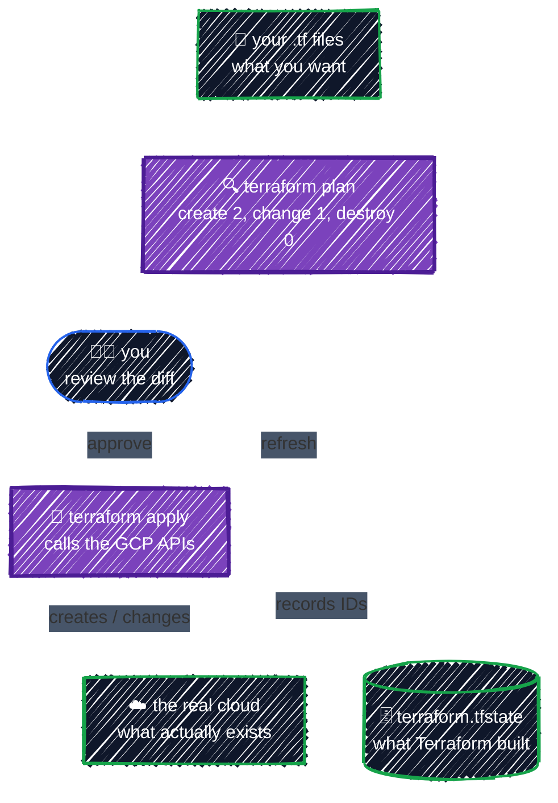

# What is Terraform?

> Infrastructure as Code, declarative vs. imperative, and where Terraform fits next to gcloud, Ansible, and Helm.

---

Terraform is an open-source tool for building cloud infrastructure from text files. You write down the infrastructure you want, such as _"a private network, a GKE cluster in it, and a bucket for model weights"_, in a language called **HCL**. Terraform then works out which API calls to make to get there, shows you the plan, and makes those calls only after you approve.

That practice is called **Infrastructure as Code (IaC)**. Your infrastructure lives in Git like any other code, so it gets the same benefits:

- **Reviewable.** A change to prod is a pull request with a diff, not a screenshot of the Console.
- **Repeatable.** dev, staging, and prod come from the same code, so they don't drift apart over time.
- **Disposable.** You can rebuild everything from scratch, and tear it down just as easily. That matters a lot when GPUs bill by the hour.

## Declarative vs. imperative

The mental shift from `gcloud` is **declarative vs. imperative**:

- **Imperative** (`gcloud`, scripts): you issue commands that each change something. _"Create this bucket"_, _"now turn on versioning"_. Running the script twice fails or creates duplicates, and you're the one who has to remember what already exists.
- **Declarative** (Terraform): you describe the end state, and Terraform works out the steps. Running it twice does nothing the second time, because the world already matches.

The same bucket both ways:

```bash
# Imperative: a sequence of commands. Running them again fails with "bucket already exists".
gcloud storage buckets create gs://my-models-bucket --location=us-central1
gcloud storage buckets update gs://my-models-bucket --versioning
```

```hcl
# Declarative: a description of the end state. Applying it again changes nothing.
resource "google_storage_bucket" "models" {
  name     = "my-models-bucket"
  location = "us-central1"

  versioning {
    enabled = true
  }
}
```

If someone later turns versioning off by hand, the `gcloud` script has no idea anything changed. Terraform notices the next time you run `plan` and offers to turn it back on.

## The one idea: config + state → plan

Terraform compares three things every time you run it:



- **Configuration** (`*.tf` files): the desired state, written by you.
- **State** (`terraform.tfstate`): Terraform's record of which real objects it manages, and their IDs. It's how Terraform knows that `google_storage_bucket.models` in your code *is* `gs://my-models-bucket` in GCP. [State & Drift](../state/state-basics.md) covers it in depth.
- **Providers**: plugins that translate HCL into API calls. The `google` provider talks to GCP, the `kubernetes` provider talks to a cluster, and so on. Terraform itself knows nothing about any cloud.

`plan` is the heart of the workflow. You always see the diff before anything changes, and a `-/+ destroy and then create replacement` in that diff is your warning that something will be deleted.

> **Analogy:** Terraform is like `git` for infrastructure. Your `.tf` files are the working tree, the state file is the last commit, and `plan` is `git diff` against what's really deployed. `apply` "commits" the change to the cloud.

## If you know Kubernetes: the one big difference

Both Kubernetes and Terraform are declarative, but **Terraform does not run continuously.**

- A Kubernetes controller is a loop that never stops. Delete a Pod and it's back within seconds.
- Terraform reconciles **only when you run it**. Delete a bucket by hand and it stays deleted until someone runs `terraform plan` and `apply` again.

That's why teams run `plan` on a schedule in CI to detect drift (see [CI/CD](../team-workflow/ci-cd.md)), and why "nobody touches prod by hand" is a team rule rather than something Terraform can enforce.

## Where Terraform fits

Terraform is great at creating and wiring up **cloud resources**. It's not the best tool for everything, and most real platforms combine several:

| Tool | Best at | Example in an AI platform |
|---|---|---|
| **Terraform** | Provisioning cloud resources and the dependencies between them | VPC, GKE cluster, GPU node pool, IAM, GCS buckets |
| **gcloud / Console** | One-off inspection and debugging | `gcloud container clusters list`, checking quotas |
| **Ansible** | Configuring software *inside* machines | Installing packages on a bare-metal GPU box |
| **Helm / kubectl** | Deploying apps *onto* Kubernetes | The vLLM Deployment, Prometheus |
| **Argo CD / Flux** | Continuously syncing Kubernetes apps from Git | Keeping model-serving releases in sync |

A common split, and the one this guide follows: **Terraform builds the platform** (network, cluster, node pools, IAM, storage), and Kubernetes tooling deploys the workloads that run on it. Terraform *can* deploy onto Kubernetes too, and you'll do that in [Kubernetes & Helm Providers](../ai-infra/kubernetes-and-helm.md), along with the trade-offs.

## Terraform vs. OpenTofu

In 2023 HashiCorp moved Terraform from an open-source license to the source-available **Business Source License (BSL)**. The community forked the last open-source version as **[OpenTofu](https://opentofu.org)**, now a Linux Foundation project.

- For learning, and for using Terraform to manage your own infrastructure, the BSL changes nothing. It restricts building a competing commercial product, not using the tool.
- The two are still largely compatible: same HCL, same providers, and nearly the same CLI (`tofu plan` instead of `terraform plan`). Newer features have started to diverge.

This guide uses **Terraform**, but almost everything here works unchanged on OpenTofu.

## Best practices

- **Change infrastructure through code only.** Every change made by hand in the Console becomes drift that someone has to discover later.
- **Always read the plan.** Look closely at anything marked `destroy` or `must be replaced` before you approve it.
- **Keep Terraform for the platform, and use Kubernetes tooling for the apps.** Mixing fast-changing app releases into infrastructure code slows both down.
- **Treat state as critical data.** It maps your code to real resources and can contain secrets. You'll move it to a locked, versioned GCS bucket in [Remote Backend on GCS](../state/remote-backend.md).

---

[↑ Contents](../../README.md) · [Setup →](setup.md)
