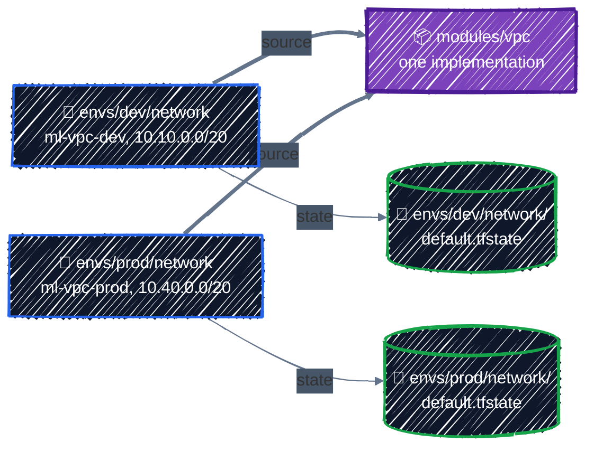
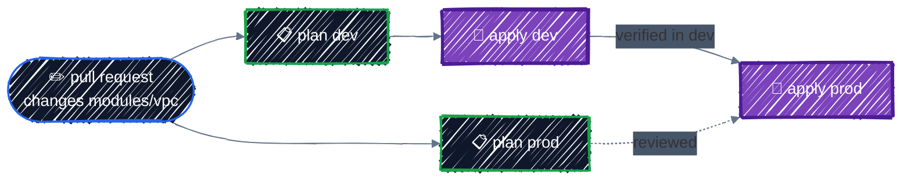

# Environments

> Directories vs. workspaces, and a state prefix per environment.

---

Every real platform has at least two copies: **dev**, where changes are tried, and **prod**, which serves users. They should be built from the same code, so that what you tested is what you ship, and kept apart, so that a mistake in dev can't touch prod. This chapter shows the layout most teams settle on: **one small root module per environment, all calling the same modules, each with its own state**.

## Before you start

```bash
cd examples/modules/environments
```

The example deploys the network module from [Writing Modules](writing-modules.md) twice, as `dev` and `prod`, from two directories.

## The layout

```
environments/
└── envs/
    ├── dev/
    │   └── network/
    │       ├── backend.hcl.example   # prefix = "envs/dev/network"
    │       ├── main.tf               # everything dev-specific
    │       ├── variables.tf
    │       └── versions.tf
    └── prod/
        └── network/
            ├── backend.hcl.example   # prefix = "envs/prod/network"
            ├── main.tf               # everything prod-specific
            ├── variables.tf
            └── versions.tf
```



Three rules make this work:

1. **The logic lives in modules.** Environment directories contain almost nothing but a provider, a backend, and module calls with environment-specific values.
2. **Each environment directory is its own root module with its own state.** `terraform apply` in `envs/dev/network` can't change anything in prod, because it has never seen prod's state.
3. **Each state has its own prefix**, mirroring the directory: `envs/dev/network`, `envs/prod/network` ([Remote Backend](../state/remote-backend.md#laying-out-the-bucket)).

## What differs between environments

The whole of [`envs/prod/network/main.tf`](../../examples/modules/environments/envs/prod/network/main.tf) is one module call plus its provider:

```hcl
# prod: everything that makes prod different from dev is in this file.
locals {
  environment = "prod"
  region      = "us-central1"
}

...

module "network" {
  source = "../../../../writing-modules/modules/vpc"

  project_id = google_project_service.compute.project
  name       = "ml-vpc-${local.environment}"
  region     = local.region

  # Different ranges from dev, so the two networks could be peered later.
  ip_ranges = {
    nodes    = "10.40.0.0/20"
    pods     = "10.48.0.0/14"
    services = "10.40.16.0/20"
  }

  enable_nat          = true
  iap_ssh_target_tags = [] # no SSH into prod nodes, even through IAP
}
```

Because the environment-specific values are all in one short file, comparing the environments is a `diff`:

```bash
diff envs/dev/network/main.tf envs/prod/network/main.tf
```

```
1c1
< # dev: everything that makes dev different from prod is in this file.
---
> # prod: everything that makes prod different from dev is in this file.
3c3
<   environment = "dev"
---
>   environment = "prod"
28a29
>   # Different ranges from dev, so the two networks could be peered later.
30,32c31,33
<     nodes    = "10.10.0.0/20"
<     pods     = "10.16.0.0/14"
<     services = "10.10.16.0/20"
---
>     nodes    = "10.40.0.0/20"
>     pods     = "10.48.0.0/14"
>     services = "10.40.16.0/20"
35c36,37
<   enable_nat          = true
---
>   enable_nat          = true
>   iap_ssh_target_tags = [] # no SSH into prod nodes, even through IAP
```

Every difference is visible and intentional: names, IP ranges, and prod's stricter SSH rule. Everything else is guaranteed identical, because it comes from the same module. That's the "copy-paste drift" problem solved: there's nothing to drift.

The plans confirm it. Dev gets seven resources; prod gets six, without the SSH firewall rule:

```
# dev
  # module.network.google_compute_firewall.allow_iap_ssh[0] will be created
  # module.network.google_compute_firewall.allow_internal will be created
  ...
Plan: 7 to add, 0 to change, 0 to destroy.

# prod
  # module.network.google_compute_firewall.allow_internal will be created
  ...
Plan: 6 to add, 0 to change, 0 to destroy.
```

Literal values in `main.tf`, rather than a `.tfvars` file, are a deliberate choice here: the values are short, non-secret, and reviewed like code. If you prefer `.tfvars` per environment, commit them (they're configuration, not personal settings) and add an exception for them to `.gitignore`.

## Running an environment

Each environment is initialized and applied on its own:

```bash
cd envs/dev/network
cp backend.hcl.example backend.hcl        # set your state bucket
terraform init -backend-config=backend.hcl
terraform plan
terraform apply
```

```
Successfully configured the backend "gcs"! Terraform will automatically
use this backend unless the backend configuration changes.
...
- network in ../../../../writing-modules/modules/vpc
```

Then `cd ../../prod/network` and repeat. After `init` in both, the state bucket holds one object per environment:

```
envs/dev/network/default.tfstate
envs/prod/network/default.tfstate
```

In a real organization, **each environment also gets its own GCP project** (`ml-dev`, `ml-prod`), and often its own state bucket. Then IAM separates them too: the CI job that deploys dev can't even read prod's state. This guide uses one sandbox project for both, with different names.

## Splitting by component, too

The `network` directory under each environment is a hint: a real environment has several root modules, one per **component**, each with its own state:

```
envs/prod/
├── network/     # VPC, NAT, firewall       changes: rarely
├── gke/         # cluster and node pools   changes: monthly
└── apps/        # Kubernetes workloads     changes: daily
```

Smaller states mean faster plans, a smaller blast radius for each apply, and permissions that can differ per component. The cost is passing values between them: the GKE configuration needs the network's subnet name. Three ways, in order of preference:

| Method | Example | Trade-off |
|---|---|---|
| **Known names** as inputs | `subnetwork = "ml-vpc-prod-gke-us-central1"` | simplest; the naming convention is the contract |
| **Data sources** | `data "google_compute_subnetwork" "gke" { name = ... }` | verifies the subnet exists at plan time |
| **`terraform_remote_state`** | reads the network state's outputs directly | couples the two states tightly, and needs read access to the whole network state |

Part 5 uses the first two: the GPU node pool chapter finds the cluster with a data source.

## Workspaces: the other approach

Terraform also has **CLI workspaces**: several states for **one** directory, switched with a command:

```bash
terraform workspace new dev
terraform workspace new prod
terraform workspace list
```

```
  default
  dev
* prod
```

The code reads the current workspace from `terraform.workspace`, and with the `gcs` backend each workspace's state is stored next to the others:

```
ws-demo/network/default.tfstate
ws-demo/network/dev.tfstate
ws-demo/network/prod.tfstate
```

| | Directories per environment | CLI workspaces |
|---|---|---|
| What you're working on | visible in your path and prompt | hidden in `terraform workspace show` |
| Differences between environments | explicit, in each directory | `terraform.workspace == "prod" ? ... : ...` scattered through the code |
| Different backend, project, or permissions per environment | yes | no: one backend configuration for all |
| Risk of applying to the wrong one | low | high: one forgotten `workspace select` |

Workspaces suit **identical, short-lived copies** of the same thing, such as a temporary environment per feature branch. For long-lived environments like dev and prod, use directories. (HCP Terraform's "workspaces" are a different, more complete concept with the same name.)

## Promoting a change

A module change reaches environments in order:



- **Plan every environment the change affects in the pull request.** A module change that's harmless in dev can force a replacement in prod, where the data lives.
- **Apply dev first**, check it works, then apply prod. [CI/CD](../team-workflow/ci-cd.md) automates this with an approval step before prod.
- **With local module paths, both environments get the change at once** in the code, so the order is enforced by when you apply. When modules live in another repository, prod can also pin an older module version (`?ref=v1.3.0`) while dev tries the new one.

## Best practices

- **One directory per environment, per component**, each a small root module with its own state.
- **Put the logic in modules**; keep environment directories to providers, backends, and module calls.
- **Make every difference explicit** in the environment's own files, so a `diff` shows it.
- **One state prefix per directory**, mirroring the path. Ideally, one project (and state bucket) per environment.
- **Pass values between components** by naming convention or data sources before reaching for `terraform_remote_state`.
- **Use CLI workspaces only for identical, temporary copies**, not for dev and prod.
- **Plan all affected environments in review; apply dev before prod.**

## Clean up

```bash
cd envs/dev/network && terraform destroy
cd ../../prod/network && terraform destroy
```

That completes Part 4. Part 5 puts it all to work: a GKE cluster with GPUs, starting with [GKE Cluster](../ai-infra/gke-cluster.md).

---

[← Using Registry Modules](registry-modules.md) · [↑ Contents](../../README.md) · [GKE Cluster →](../ai-infra/gke-cluster.md)
