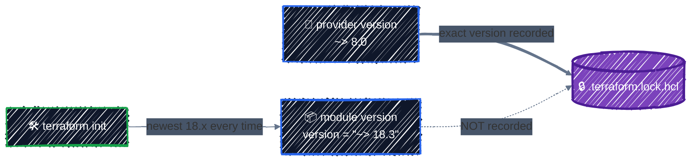

# Using Registry Modules

> Consume terraform-google-modules safely: pin, read, and wrap.

---

You don't have to write every module yourself. The [Terraform Registry](https://registry.terraform.io/browse/modules?provider=google) has thousands, and Google maintains a large, tested set under **[terraform-google-modules](https://github.com/terraform-google-modules)**: networks, GKE clusters, IAM, project factories. Used well, they save weeks. Used carelessly, they pull unreviewed changes into production on the next `init`. This chapter is about using them well.

## Before you start

```bash
cd examples/modules/registry-modules
terraform init
```

The example builds the same network as [Networking](../gcp-foundations/networking.md) and [Writing Modules](writing-modules.md), this time with Google's `network` and `cloud-router` modules.

## Calling a registry module

From [`main.tf`](../../examples/modules/registry-modules/main.tf):

```hcl
module "vpc" {
  source  = "terraform-google-modules/network/google"
  version = "~> 18.3" # >= 18.3.0, < 19.0.0: fixes and features, no breaking changes

  project_id   = google_project_service.compute.project
  network_name = "ml-vpc"
  routing_mode = "REGIONAL" # the module's default is GLOBAL

  subnets = [
    {
      subnet_name           = "ml-vpc-gke-${var.region}"
      subnet_ip             = "10.10.0.0/20"
      subnet_region         = var.region
      subnet_private_access = "true" # a string, not a bool, in this module
    },
  ]

  secondary_ranges = {
    "ml-vpc-gke-${var.region}" = [
      { range_name = "pods", ip_cidr_range = "10.16.0.0/14" },
      { range_name = "services", ip_cidr_range = "10.10.16.0/20" },
    ]
  }
  ...
}
```

- **`source = "<namespace>/<name>/<provider>"`** is a registry address: here, the `network` module for `google`, published by `terraform-google-modules`. It's short for `registry.terraform.io/terraform-google-modules/network/google`.
- **`version`** only works with registry sources. It takes the same constraints as providers ([Providers](../core-language/providers.md#version-constraints)). Registry modules follow semantic versioning, so a major version bump means breaking changes.
- **Every other argument is one of the module's inputs**, listed on its Registry page under **Inputs**.

`terraform init` downloads it, and every module it calls internally:

```
Initializing modules...
Downloading registry.terraform.io/terraform-google-modules/cloud-router/google 9.1.0 for cloud_router...
- cloud_router in .terraform/modules/cloud_router
Downloading registry.terraform.io/terraform-google-modules/network/google 18.3.1 for vpc...
- vpc in .terraform/modules/vpc
- vpc.private_service_access in .terraform/modules/vpc/modules/private-service-access
- vpc.subnets in .terraform/modules/vpc/modules/subnets
- vpc.routes in .terraform/modules/vpc/modules/routes
- vpc.vpc in .terraform/modules/vpc/modules/vpc
- vpc.firewall_rules in .terraform/modules/vpc/modules/firewall-rules
```

The plan shows the nesting in every address:

```
  # google_project_service.compute will be created
  # module.cloud_router.google_compute_router.router will be created
  # module.cloud_router.google_compute_router_nat.nats["ml-vpc-nat-us-central1"] will be created
  # module.vpc.module.firewall_rules.google_compute_firewall.rules_ingress_egress["ml-vpc-allow-iap-ssh"] will be created
  # module.vpc.module.firewall_rules.google_compute_firewall.rules_ingress_egress["ml-vpc-allow-internal"] will be created
  # module.vpc.module.subnets.google_compute_subnetwork.subnetwork["us-central1/ml-vpc-gke-us-central1"] will be created
  # module.vpc.module.vpc.google_compute_network.network will be created

Plan: 7 to add, 0 to change, 0 to destroy.
```

Seven resources, the same as the hand-written version. The extra layers are the module's internal structure.

## Pin the version, and know what pinning covers



The dependency lock file records **providers only**. Module versions aren't locked: every fresh `init` (every CI run, every new laptop) resolves `~> 18.3` again and downloads the newest matching release. So:

- **Never leave `version` out.** Without it, `init` takes the latest release, including new major versions. That's how a routine CI run picks up breaking changes:

  ```
  Downloading registry.terraform.io/terraform-google-modules/network/google 18.3.1 for vpc...
  ```

  Today that's 18.3.1. After the next major release, the same code silently gets 19.x.

- **`~> 18.3`** accepts minor and patch releases automatically. Fine for development.
- **`= 18.3.1`** (or just `"18.3.1"`) pins exactly. Use it for production root modules, and upgrade deliberately, in a pull request, with a tool like Renovate or Dependabot opening those pull requests for you.

## Read the module before you use it

A registry module is code you're running with your credentials. Before using one, read it. After `init`, the source is right there in `.terraform/modules/vpc/`. The Registry page links to the GitHub repository too.

Reading the network module turns up several things the README doesn't put front and center:

| Finding | Where | Why it matters |
|---|---|---|
| The VPC itself is created with **`google-beta`** | `modules/vpc/main.tf`: `provider = google-beta` | your root module must configure `google-beta` too, or that resource uses an unconfigured provider |
| **`routing_mode` defaults to `GLOBAL`** | `variables.tf` | different from the GCP default; set it explicitly |
| **`subnet_private_access` is a string** | `variables.tf`: `optional(string)` | `"true"`, not `true` |
| **`network_name` output is delayed until the VPC exists** | `outputs.tf` | deliberate, so anything using it waits for the network |
| It declares **`provider_meta`** with a module name | `versions.tf` | adds usage attribution to API requests; harmless, but good to know |

That first finding is why the example configures both providers identically, from [`providers.tf`](../../examples/modules/registry-modules/providers.tf):

```hcl
provider "google" {
  project        = var.project_id
  region         = var.region
  default_labels = local.default_labels
}

# Configured identically: some resources inside the registry modules use it.
provider "google-beta" {
  project        = var.project_id
  region         = var.region
  default_labels = local.default_labels
}
```

`google-beta` is a second provider, built from the same code as `google`, that adds GCP's preview features. Use `google` by default; a resource opts in with `provider = google-beta` only when it needs a preview feature. The two are released together with the same version numbers, so pin both to the same range and configure them the same way.

What to check in any module:

- **What resources does it create?** The Registry's **Resources** tab lists them. Make sure there's nothing you didn't expect (an extra service account, a broad IAM grant).
- **What are the defaults?** Defaults are where a module's opinions live, and they may not be yours.
- **Which providers and versions does it require?** That's next.
- **Is it maintained?** Recent releases, a changelog, upgrade guides for major versions. `terraform-google-modules` has all three, with `docs/upgrading_to_v*.md` guides in each repository.

## Provider versions: everyone has to agree

A configuration gets **one** version of each provider, shared by the root module and every module inside it. Terraform combines everyone's constraints. You can see it in the `init` output:

```
- Finding hashicorp/google-beta versions matching ">= 4.64.0, >= 6.18.0, >= 6.19.0, ~> 8.0, < 9.0.0"...
- Finding hashicorp/google versions matching ">= 3.33.0, >= 3.83.0, >= 4.51.0, >= 4.64.0, >= 6.18.0, >= 6.19.0, >= 6.28.0, ~> 8.0, < 9.0.0"...
- Installing hashicorp/google-beta v8.7.0...
- Installing hashicorp/google v8.7.0...
```

Your `~> 8.0` and the module's `< 9.0.0` overlap, so 8.7.0 satisfies everyone. Now try an older major version of the same module, `version = "~> 13.0"`, which was written before provider 8.x existed:

```
Error: Failed to query available provider packages

Could not retrieve the list of available versions for provider
hashicorp/google-beta: no available releases match the given constraints >=
4.64.0, >= 6.19.0, ~> 8.0, < 8.0.0
```

`~> 8.0` and `< 8.0.0` can't both be true. `terraform providers` shows who asked for what:

```
Providers required by configuration:
.
├── provider[registry.terraform.io/hashicorp/google] ~> 8.0
├── provider[registry.terraform.io/hashicorp/google-beta] ~> 8.0
└── module.vpc
    ├── provider[registry.terraform.io/hashicorp/google-beta] >= 4.64.0, < 8.0.0
    ├── provider[registry.terraform.io/hashicorp/google] >= 4.64.0, < 8.0.0
    ...
```

This is the most common problem with registry modules: **a module caps the provider version, and you can't upgrade the provider until the module releases a version that allows it.** It's also why your own reusable modules should state only a minimum ([Writing Modules](writing-modules.md#the-modules-files)). The fix is almost always to upgrade the module to a release that supports your provider version, not to downgrade the provider.

## Use it directly, wrap it, or write your own?

| Approach | When |
|---|---|
| **Call the registry module directly** from your root modules | the module fits, and each caller can set the inputs correctly |
| **Wrap it** in your own small module that calls it with your organization's defaults | many teams use it, and you want everyone to get the same settings (REGIONAL routing, Private Google Access, your naming) without repeating them |
| **Write your own** | you need a small part of what the module does, or its abstraction gets in your way |

Compare the two networks in this guide. The registry `network` module has 18 submodules and handles Shared VPC, IPv6, routes, peering, Private Service Connect, and more. The [`vpc` module](writing-modules.md) from the previous chapter is about 100 lines and does exactly one thing. For a platform team supporting many kinds of networks, the registry module is the better foundation. For one AI platform, a small module you fully understand is often easier to live with. Both are reasonable; what's not reasonable is using a large module without reading it.

## Upgrading a module

Treat a module upgrade like a provider upgrade:

1. Read the **CHANGELOG**, and for a major version the **upgrade guide** in the module's repository.
2. Change `version`, run `terraform init -upgrade` to download the new release.
3. Run `terraform plan`. For a minor version, expect **no changes**. For a major version, the guide tells you what to change; well-maintained modules ship `moved` blocks so that internal refactors don't destroy anything.
4. Look for `destroy` and `must be replaced` before you apply, as in [Refactoring](../state/refactoring.md). An upgrade that wants to replace your VPC or cluster is never "just an upgrade".
5. Upgrade one module per pull request.

## Apply it

```bash
terraform plan    # Plan: 7 to add, 0 to change, 0 to destroy.
terraform apply
terraform output
```

The result is the same network as the previous two chapters: `ml-vpc`, one subnet with `pods` and `services` ranges, Cloud NAT, and two firewall rules.

## Checkpoint

1. Why should a registry module use an exact version rather than tracking an unbounded latest release?
2. Before adopting a module, what three things should you inspect besides its README example?
3. A root module and child module specify incompatible provider constraints. Can each install its own provider version?

<details>
<summary>Answer</summary>

1. Module source code isn't covered by the provider lock file. An exact version keeps repeated initialization reproducible and makes upgrades explicit review events.
2. Its inputs/outputs, resources and IAM it creates, provider/version requirements, upgrade notes, maintenance history, and source code for security-sensitive behavior.
3. No. A configuration selects one version of each provider that must satisfy every module's constraints; incompatible constraints make initialization fail.

</details>

## Best practices

- **Always set `version`.** Use `~> X.Y` while developing, an exact version in production, and upgrade on purpose.
- **Remember that modules aren't in the lock file.** Only an exact `version` makes `init` reproducible.
- **Read the source** in `.terraform/modules/` before relying on a module: the resources it creates, its defaults, its providers.
- **Configure every provider the module uses**, including `google-beta`, identically.
- **Run `terraform providers`** when `init` can't find a provider version, and upgrade the module rather than downgrading the provider.
- **Prefer well-maintained publishers** such as `terraform-google-modules`, with changelogs and upgrade guides.
- **Wrap a registry module** when many teams need it with the same defaults; write your own when you need a small piece of it.
- **Check every upgrade's plan for destroys and replacements.**

## Clean up

```bash
terraform destroy
```

---

[← Writing Modules](writing-modules.md) · [↑ Contents](../../README.md) · [Environments →](environments.md)
