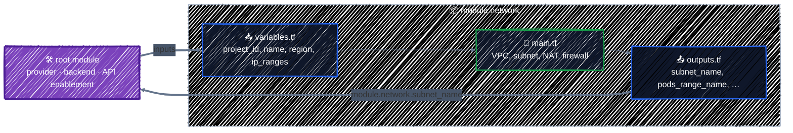

# Writing Modules

> Package a reusable unit with inputs, outputs, and validation.

---

You've written the network for the AI platform once, in [Networking](../gcp-services/networking.md). Now you need it in dev and prod, maybe in a second region, and the GKE configuration needs to know its subnet and range names. Copying 100 lines of HCL into each place means fixing every bug several times. A **module** packages those lines behind a small interface: a few inputs in, a few outputs out.

## Before you start

```bash
cd examples/modules/writing-modules
terraform init
```

The example turns the Networking chapter's VPC into a module in `modules/vpc/`, and calls it from a root configuration in eight lines.

## You've been writing modules all along

**Every directory of `.tf` files is a module.** The one you run `terraform` in is the **root module**. When it calls another directory with a `module` block, that directory is a **child module**:



- **Variables are the module's parameters.** The caller sets them in the `module` block.
- **Outputs are its return values.** The caller reads them as `module.<name>.<output>`.
- **Everything else is private.** The caller can't refer to `google_compute_subnetwork.gke` inside the module, only to what the module chooses to output.

That last point is what makes modules worth it: you can change the inside freely, as long as the inputs and outputs keep working.

## The module's files

```
writing-modules/
├── main.tf            # root: enables the API, calls the module
├── moved.tf           # root: only for adopting the Networking chapter's state
├── outputs.tf
├── providers.tf       # root: the ONLY provider configuration
├── variables.tf
├── versions.tf        # root: exact provider range, ~> 8.0
└── modules/
    └── vpc/
        ├── README.md     # how to use it
        ├── main.tf       # the resources
        ├── outputs.tf    # its return values
        ├── variables.tf  # its parameters
        ├── versions.tf   # minimum versions only
        └── tests/
            └── vpc.tftest.hcl  # unit tests (Testing & Code Quality)
```

The module's files are the same conventional layout as any configuration, plus a README. Two things are **deliberately missing** from it:

**No `provider` block.** A reusable module never configures providers. It uses whatever the caller configured, so the caller decides the project, region, credentials, and `default_labels`. A module with its own `provider "google" {}` can't be used with `for_each`, can't be pointed at another project, and can't be removed cleanly from a configuration.

**No exact versions.** From [`modules/vpc/versions.tf`](../../examples/modules/writing-modules/modules/vpc/versions.tf):

```hcl
terraform {
  required_version = ">= 1.10"

  # A reusable module states a MINIMUM provider version and nothing else.
  # The root module that calls it picks the exact version.
  required_providers {
    google = {
      source  = "hashicorp/google"
      version = ">= 8.0"
    }
  }
}
```

This is the rule from [Providers](../core-language/providers.md#version-constraints): root modules pin with `~>` and a lock file; reusable modules only state a minimum, so they combine with each other and with any root module.

## Designing the interface

The module's [`variables.tf`](../../examples/modules/writing-modules/modules/vpc/variables.tf) is its contract. Everything from [Variables, Locals & Outputs](../core-language/variables-and-outputs.md) applies, with more at stake, because other people will call it:

```hcl
variable "project_id" {
  description = "Project to create the network in."
  type        = string
}

variable "name" {
  description = "VPC name. Subnet, router, NAT, and firewall names are derived from it."
  type        = string

  validation {
    condition     = can(regex("^[a-z]([-a-z0-9]{0,40}[a-z0-9])?$", var.name))
    error_message = "name must be 1-42 characters: lowercase letters, digits, and hyphens, starting with a letter."
  }
}

variable "ip_ranges" {
  description = "Primary range for nodes, and secondary ranges for GKE Pods and Services."
  type = object({
    nodes    = string
    pods     = string
    services = string
  })

  validation {
    condition     = alltrue([for r in values(var.ip_ranges) : can(cidrnetmask(r))])
    error_message = "Every value in ip_ranges must be an IPv4 CIDR block, such as 10.10.0.0/20."
  }
}

variable "enable_nat" {
  description = "Create Cloud Router + NAT so nodes without public IPs can reach the internet."
  type        = bool
  default     = true
}
```

Choices worth copying:

- **`project_id` is an input**, even though the provider has a default project. A module that takes its project explicitly can be used for several projects from one configuration, and makes it obvious where things go.
- **Related settings form one `object`.** `ip_ranges` keeps the three ranges together, so a caller can't pass two and forget the third.
- **Validation lives in the module.** Errors point at the caller's code, but the message comes from the module:

  ```
  Error: Invalid value for variable

    on main.tf line 17, in module "network":
    17:   name       = "ML_VPC"
      ├────────────────
      │ var.name is "ML_VPC"

  name must be 1-42 characters: lowercase letters, digits, and hyphens,
  starting with a letter.

  This was checked by the validation rule at modules/vpc/variables.tf:10,3-13.
  ```

- **Features are switched with `count`**, as in [Meta-Arguments](../core-language/meta-arguments.md#count): `enable_nat = false` drops the router and NAT, and an empty `iap_ssh_target_tags` drops the SSH rule. Defaults are the safe, common choice.
- **Opinions are baked in.** There's no input for `auto_create_subnetworks` or `private_ip_google_access`: the module always does the right thing. A module that exposes every argument of every resource is just a slower way to write the resources.

Outputs follow the same thinking. [`outputs.tf`](../../examples/modules/writing-modules/modules/vpc/outputs.tf) exposes what callers need (IDs, names, the secondary range names for GKE) and nothing else:

```hcl
output "pods_range_name" {
  description = "Secondary range name for GKE Pods (ip_allocation_policy.cluster_secondary_range_name)."
  value       = google_compute_subnetwork.gke.secondary_ip_range[0].range_name
}
```

## Calling the module

From the root [`main.tf`](../../examples/modules/writing-modules/main.tf):

```hcl
# The same network as the Networking chapter, now in eight lines.
module "network" {
  source = "./modules/vpc"

  # Passing the project through the API's resource makes everything in the
  # module wait until the Compute API is enabled.
  project_id = google_project_service.compute.project
  name       = "ml-vpc"
  region     = var.region

  ip_ranges = {
    nodes    = cidrsubnet(local.base_cidr, 4, 0) # 10.10.0.0/20
    pods     = "10.16.0.0/14"
    services = cidrsubnet(local.base_cidr, 4, 1) # 10.10.16.0/20
  }
}
```

- **`source`** says where the module is. A path starting with `./` or `../` is a local directory in the same repository.
- Every other argument sets one of the module's variables. Leaving out a required one is caught immediately:

  ```
  Error: Missing required argument

    on main.tf line 11, in module "network":
    11: module "network" {

  The argument "region" is required, but no definition was found.
  ```

- **API enablement stays in the root.** The module doesn't enable APIs; the root does, and passes `project_id` through `google_project_service.compute.project` so the whole module waits for the API ([Projects & APIs](../gcp-foundations/projects-and-apis.md#wait-for-the-api-before-using-it)).

`terraform init` now also installs modules:

```
Initializing modules...
- network in modules/vpc
```

Every time you add a `module` block or change a `source`, run `init` again. Otherwise:

```
Error: Module not installed

  on extra.tf line 1:
   1: module "extra" {

This module is not yet installed. Run "terraform init" to install all modules
required by this configuration.
```

### Module addresses

Resources inside a module get the module's address as a prefix:

```
  # google_project_service.compute will be created
  # module.network.google_compute_firewall.allow_iap_ssh[0] will be created
  # module.network.google_compute_firewall.allow_internal will be created
  # module.network.google_compute_network.vpc will be created
  # module.network.google_compute_router.nat[0] will be created
  # module.network.google_compute_router_nat.nat[0] will be created
  # module.network.google_compute_subnetwork.gke will be created

Plan: 7 to add, 0 to change, 0 to destroy.
```

That's also how they appear in `terraform state list`, and how you'd target them in `moved` blocks.

### Using the outputs

```hcl
output "network" {
  description = "Everything the GKE chapter needs from the network."
  value = {
    network        = module.network.network_name
    subnet         = module.network.subnet_name
    pods_range     = module.network.pods_range_name
    services_range = module.network.services_range_name
  }
}
```

```
  + network = {
      + network        = "ml-vpc"
      + pods_range     = "pods"
      + services_range = "services"
      + subnet         = "ml-vpc-gke-us-central1"
    }
```

A GKE cluster in the same configuration would use `module.network.subnet_id` directly, which also makes the cluster wait for the subnet.

## Many instances with `for_each`

Modules support `count` and `for_each` just like resources. One network per region:

```hcl
module "regional" {
  source   = "./modules/vpc"
  for_each = {
    us = { region = "us-central1", nodes = "10.20.0.0/20", pods = "10.24.0.0/14", services = "10.20.16.0/20" }
    eu = { region = "europe-west4", nodes = "10.30.0.0/20", pods = "10.32.0.0/14", services = "10.30.16.0/20" }
  }

  project_id = var.project_id
  name       = "ml-vpc-${each.key}"
  region     = each.value.region
  enable_nat = false
  ip_ranges  = { nodes = each.value.nodes, pods = each.value.pods, services = each.value.services }
}
```

```
  # module.regional["eu"].google_compute_firewall.allow_iap_ssh[0] will be created
  # module.regional["eu"].google_compute_firewall.allow_internal will be created
  # module.regional["eu"].google_compute_network.vpc will be created
  # module.regional["eu"].google_compute_subnetwork.gke will be created
  # module.regional["us"].google_compute_firewall.allow_iap_ssh[0] will be created
  # module.regional["us"].google_compute_firewall.allow_internal will be created
  # module.regional["us"].google_compute_network.vpc will be created
  # module.regional["us"].google_compute_subnetwork.gke will be created
```

Each instance is addressed by key, `module.regional["eu"]`, with the same stability benefits as `for_each` on resources. This only works because the module has no `provider` block of its own.

To call a module with a **different provider configuration**, such as an aliased provider for another project, pass it explicitly:

```hcl
module "dr_network" {
  source    = "./modules/vpc"
  providers = { google = google.dr }
  ...
}
```

## Moving existing resources into a module

The Networking chapter created these same resources at the root, as `google_compute_network.vpc` and so on. If you'd applied that configuration and now switched it to use the module, every address would change, and Terraform would plan to destroy the whole network and recreate it:

```
Plan: 6 to add, 0 to change, 6 to destroy.
```

`moved` blocks from [Refactoring](../state/refactoring.md#moved-rename-without-destroying) fix that. [`moved.tf`](../../examples/modules/writing-modules/moved.tf) maps each old address to its new one inside the module, including the `[0]` that `count` added:

```hcl
moved {
  from = google_compute_network.vpc
  to   = module.network.google_compute_network.vpc
}
moved {
  from = google_compute_router.nat
  to   = module.network.google_compute_router.nat[0]
}
# ... one per resource
```

```
  # google_compute_firewall.allow_iap_ssh has moved to module.network.google_compute_firewall.allow_iap_ssh[0]
  # google_compute_firewall.allow_internal has moved to module.network.google_compute_firewall.allow_internal
  # google_compute_network.vpc has moved to module.network.google_compute_network.vpc
  # google_compute_router.nat has moved to module.network.google_compute_router.nat[0]
  # google_compute_router_nat.nat has moved to module.network.google_compute_router_nat.nat[0]
  # google_compute_subnetwork.gke has moved to module.network.google_compute_subnetwork.gke
Plan: 0 to add, 0 to change, 0 to destroy.
```

Six moves, **zero changes**: proof that the module builds exactly what the hand-written version did. That's the safe way to introduce a module into a live configuration. With fresh state, as in this example, the `moved` blocks have nothing to move and do nothing.

## Where modules live

| Source | Example | Use it for |
|---|---|---|
| Local path | `source = "./modules/vpc"` | modules used only within one repository |
| Git | `source = "git::https://github.com/acme/tf-modules.git//vpc?ref=v1.4.0"` | sharing across repositories; always pin `ref` to a tag |
| Terraform Registry | `source = "terraform-google-modules/network/google"` with `version = "~> 11.0"` | public, versioned modules ([next chapter](registry-modules.md)) |

Local modules change together with the code that calls them, which is simple and safe. Once several repositories share a module, put it in its own repository, tag releases, and pin callers to a tag: then a change to the module can't break everyone at once.

## When to write a module

Write one when:

- **The same group of resources is needed in several places**: an environment, a region, a team.
- **There's a right way to build something** that you want everyone to use: a secure bucket, a private GKE node pool.
- **A group of resources has a clear interface**: a network that outputs a subnet, a cluster that outputs an endpoint.

Don't write one when:

- **It wraps a single resource** and passes every argument through. It adds a layer and hides nothing.
- **It's used once**, and you're only guessing it'll be reused.
- **It would nest three levels deep.** Keep modules flat: root modules call modules, and modules rarely call other modules.

## Checkpoint

1. Which values belong in a module's inputs, and which implementation details should stay internal?
2. A caller needs the subnet ID created inside a module. Should it reach into the module's resources directly?
3. When is copying three straightforward resources clearer than creating a new module?

<details>
<summary>Answer</summary>

1. Expose choices callers genuinely need across uses; keep resource wiring, naming mechanics, and provider-specific details internal unless callers must control them.
2. No. Add a purposeful module output and consume `module.<name>.<output>`. The output is the module's supported interface.
3. When there is only one use, no stable reusable concept, and the abstraction would mostly forward every resource argument. Extract a module after a coherent interface emerges.

</details>

## Best practices

- **No `provider` blocks in reusable modules.** The caller configures providers and passes aliases with `providers = { ... }`.
- **Minimum versions in modules (`>= 8.0`), exact ranges and a lock file in roots.**
- **Small, opinionated interfaces**: required inputs for what must differ, defaults for the rest, `object` types for related settings.
- **Validate inputs inside the module**, with messages that tell the caller how to fix them.
- **Output what callers need**, with descriptions. Prefer IDs: referring to them creates dependencies.
- **Write a README** with an example call and the inputs and outputs. [terraform-docs](https://terraform-docs.io/) can generate the tables.
- **Introduce a module into existing code with `moved` blocks**, and check for a zero-change plan.
- **Test reusable modules.** The `vpc` module ships with unit tests in [`tests/vpc.tftest.hcl`](../../examples/modules/writing-modules/modules/vpc/tests/vpc.tftest.hcl), runnable without credentials; [Testing & Code Quality](../team-workflow/testing-and-quality.md#terraform-test-unit-tests-for-modules) explains how they work.
- **Pin shared modules to a version**, a Git tag or a registry version.

## Clean up

```bash
terraform destroy
```

---

[← BigQuery](../gcp-services/bigquery.md) · [↑ Contents](../../README.md) · [Using Registry Modules →](registry-modules.md)
