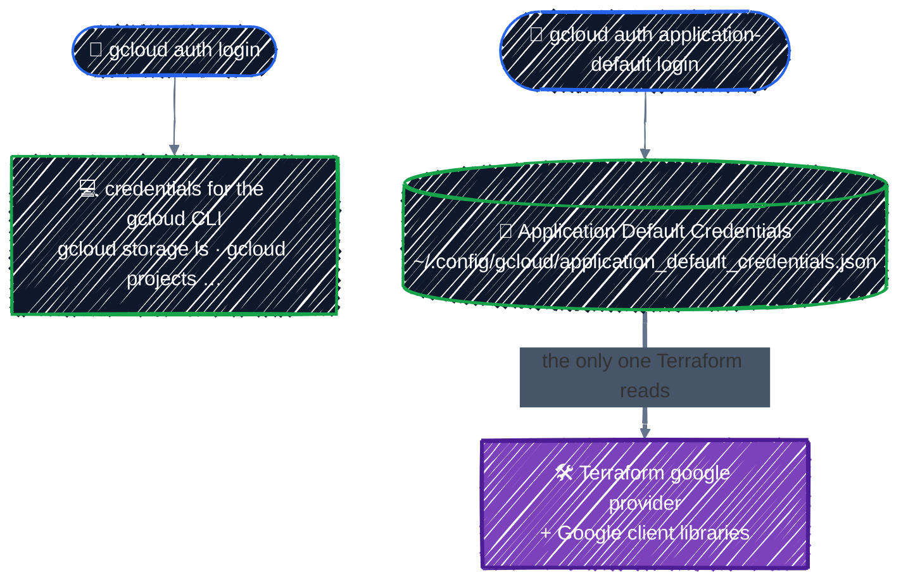

# Set up GCP

> Install gcloud, log in, and create a sandbox project with a budget alert. Do it once; every GCP chapter relies on it.

---

From here on, Terraform creates real resources in GCP. Before it can, it needs an account to act as and a project to work in. Do these steps once.

By the end of this chapter you'll have:

1. The **gcloud CLI** installed.
2. **Application Default Credentials (ADC)**, which is how Terraform logs in to GCP.
3. A dedicated **sandbox project**, linked to billing, used for nothing but this guide.
4. A **budget alert** on that project, created *before* any resources exist.
5. The base APIs enabled, and a few environment variables that every later chapter relies on.

## 1. Install the gcloud CLI

Terraform doesn't need gcloud to run, but you'll use gcloud to log in, create the project, and check what Terraform built. Commands assume Ubuntu, Debian, or WSL2, as in [Setup](../getting-started/setup.md).

```bash
# 1. Install the tools the next steps need
sudo apt-get update
sudo apt-get install -y apt-transport-https ca-certificates gnupg curl

# 2. Download Google Cloud's GPG key, used to verify the packages
curl -fsSL https://packages.cloud.google.com/apt/doc/apt-key.gpg \
  | sudo gpg --dearmor -o /usr/share/keyrings/cloud.google.gpg

# 3. Add Google Cloud's official apt repository
echo "deb [signed-by=/usr/share/keyrings/cloud.google.gpg] https://packages.cloud.google.com/apt cloud-sdk main" \
  | sudo tee /etc/apt/sources.list.d/google-cloud-sdk.list

# 4. Refresh the package list so apt sees the new repository
sudo apt-get update

# 5. Install the gcloud CLI
sudo apt-get install -y google-cloud-cli

# 6. Check the version
gcloud version
```

On macOS and other platforms: [Install the gcloud CLI](https://cloud.google.com/sdk/docs/install).

Part 5 also needs `kubectl` and the GKE auth plugin. You'll install those when you get there.

## 2. Log in, twice

This is the step that confuses everyone. gcloud keeps **two separate sets of credentials**, and Terraform uses only one of them:



Run both:

```bash
gcloud auth login                       # for the gcloud CLI
gcloud auth application-default login   # for Terraform (ADC)
```

Each opens a browser. On WSL2 or a remote machine where no browser opens, add `--no-launch-browser` and paste the URL it prints into a browser on your laptop.

If `gcloud` works but `terraform plan` says `could not find default credentials`, you skipped the second login. If both work but Terraform acts as the wrong account, run `gcloud auth application-default login` again. The two logins can point at different accounts without telling you.

> 🔑 **No service account keys.** Many older tutorials have you download a service account JSON key and set `GOOGLE_APPLICATION_CREDENTIALS`. Don't. A key is a long-lived password that ends up in Downloads folders, laptop backups, and Git history. In this guide you authenticate as yourself locally, and CI uses keyless Workload Identity Federation (see [CI/CD](../team-workflow/ci-cd.md)).

## 3. Create a sandbox project

Use a **brand-new project** for this guide. Then nothing you do can touch real workloads, IAM experiments stay contained, and if cleanup ever goes wrong you can delete the whole project as a last resort.

Project IDs are globally unique, 6–30 characters, lowercase letters, digits, and hyphens. Add a random suffix:

```bash
export PROJECT_ID="tf-tutorial-$(openssl rand -hex 3)"   # e.g. tf-tutorial-3fa9c1
gcloud projects create "$PROJECT_ID" --name="Terraform tutorial"
```

A project needs a **billing account** before it can create most resources. Find yours and link it:

```bash
gcloud billing accounts list
# ACCOUNT_ID            NAME                OPEN
# 0X0X0X-0X0X0X-0X0X0X  My Billing Account  True

export BILLING_ACCOUNT="0X0X0X-0X0X0X-0X0X0X"   # yours, from the list above
gcloud billing projects link "$PROJECT_ID" --billing-account="$BILLING_ACCOUNT"
```

Make it the default for gcloud, and tell ADC to bill API quota to it too:

```bash
gcloud config set project "$PROJECT_ID"
gcloud auth application-default set-quota-project "$PROJECT_ID"
```

> ⚠️ **Free trial accounts can't use GPUs.** The free trial credit covers Parts 2–4 easily, but GCP doesn't allow GPUs on free trial billing accounts. Before Part 5 you'll need to [upgrade to a paid account](https://cloud.google.com/free/docs/free-cloud-features#how-to-upgrade). Your remaining credit carries over. You'll also request GPU quota then. Both are covered in [GPU Node Pools](../ai-infra/gpu-node-pools.md).

## 4. Create a budget alert, now

Do this before creating any resource. A forgotten GKE cluster or GPU node is the classic way a learning project turns into a surprise bill.

```bash
gcloud services enable billingbudgets.googleapis.com

gcloud billing budgets create \
  --billing-account="$BILLING_ACCOUNT" \
  --display-name="tf-tutorial budget" \
  --budget-amount=20USD \
  --filter-projects="projects/$PROJECT_ID" \
  --threshold-rule=percent=0.5 \
  --threshold-rule=percent=0.9 \
  --threshold-rule=percent=1.0
```

That emails the billing account's admins at 50%, 90%, and 100% of $20 spent in a month on this project. Change the amount to suit you, but keep the alert.

> 💡 **A budget is an alarm, not a brake.** It sends email; it does **not** stop or delete anything. Spending keeps going past 100% until you destroy the resources. That's why every chapter ends with a cleanup step, and why [Cleanup](../capstone/cleanup.md) ends by checking the bill.

If the command fails with `PERMISSION_DENIED`, your account isn't a Billing Account Administrator or Costs Manager on that billing account. Create the budget in the Console under **Billing → Budgets & alerts** instead, or ask whoever owns the billing account.

## 5. Enable the base APIs

Every GCP service is behind an API that must be enabled in the project before anything (gcloud, Terraform, or the Console) can use it. A new project starts with only a few enabled. Turn on the ones the first chapters need:

```bash
gcloud services enable \
  serviceusage.googleapis.com \
  cloudresourcemanager.googleapis.com \
  storage.googleapis.com \
  iam.googleapis.com
```

From [Projects & APIs](../gcp-foundations/projects-and-apis.md) onward, Terraform enables the APIs it needs itself, so this is the only time you do it by hand. `serviceusage` and `cloudresourcemanager` have to be enabled first, because they're the APIs Terraform uses to enable all the others.

## 6. Set the variables every chapter uses

Every GCP example from here on takes the project and region as input variables named `project_id` and `region`. Terraform automatically reads any environment variable named `TF_VAR_<name>`, so set them once per shell:

```bash
export TF_VAR_project_id="$PROJECT_ID"
export TF_VAR_region="us-central1"
```

`us-central1` is used throughout because it has broad GPU availability, including the L4 GPUs in Part 5. If you pick another region, check later that it offers the GPU type you want.

New shells won't have these variables. Add the three `export` lines (`PROJECT_ID`, `TF_VAR_project_id`, `TF_VAR_region`) to your `~/.bashrc`, or keep them in a small `env.sh` you `source` before each session.

## Verify

```bash
terraform version                                   # v1.11+
gcloud config get-value project                     # your tf-tutorial-xxxxxx project
gcloud auth application-default print-access-token > /dev/null && echo "ADC OK"
gcloud billing projects describe "$PROJECT_ID" --format='value(billingEnabled)'   # True
echo "$TF_VAR_project_id $TF_VAR_region"            # both set
```

If all five check out, you're ready to [connect Terraform to GCP](google-provider.md).

## Checkpoint

1. `gcloud` works, but `terraform plan` fails with `could not find default credentials`. What's missing?
2. Your $20 budget reaches 100%. Does GCP stop the resources, and what actually stops the charges?

<details>
<summary>Answer</summary>

1. Application Default Credentials: run `gcloud auth application-default login`. The gcloud CLI's own login is a separate set of credentials, and Terraform reads only ADC.
2. No. A budget is an alert, not a spending cap. Destroying or stopping the billable resources, or deleting the dedicated sandbox project, stops new charges.

</details>

## Best practices

- **One sandbox project per learner or experiment.** Projects are free, and deleting one is the most complete cleanup there is.
- **Set a budget alert before creating anything.** Remember it only warns; destroying resources is what stops the cost.
- **Keep gcloud and ADC on the same account.** When Terraform does something unexpected, `gcloud auth list` and `gcloud auth application-default print-access-token` are the first things to check.

---

[← Meta-Arguments](../core-language/meta-arguments.md) · [↑ Contents](../../README.md) · [Connecting to GCP →](google-provider.md)
