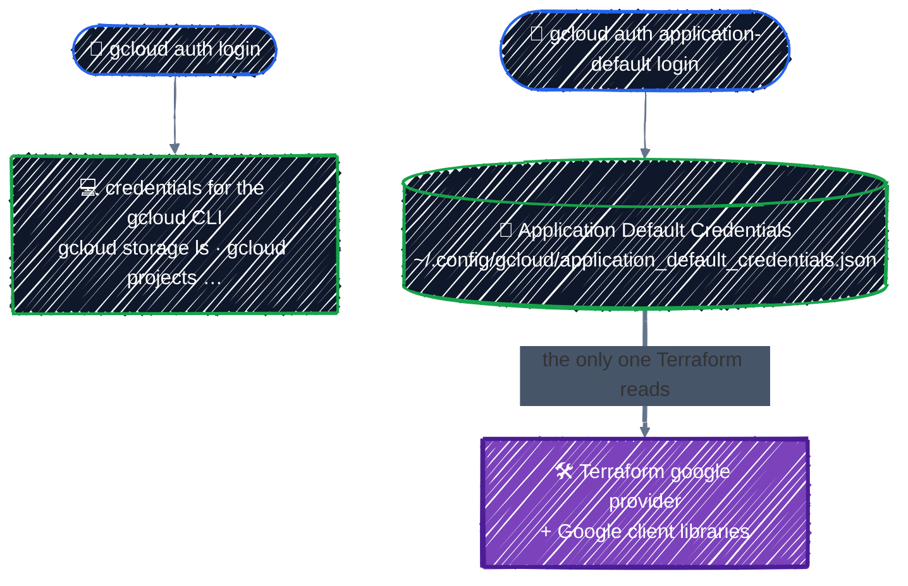

# Connecting to GCP

> Give Terraform an identity in GCP, check what that identity is allowed to do, and create your first cloud resource: a GCS bucket.

---

Everything so far ran on your own disk. From here on, Terraform creates real resources in GCP, through the **google provider**. Before it can, it needs two things:

1. A **credential**: whose identity Terraform acts as.
2. A **role**: what that identity is allowed to do in the project.

This chapter sets up both, then proves they work by creating a bucket. In between the two, you'll create a sandbox project and a budget alert. The role check needs a project to check against, and the budget has to exist before anything that costs money.

## 1. Install the gcloud CLI

Terraform doesn't need gcloud to run, but you'll use gcloud to log in, create the project, and check what Terraform built. Commands assume Ubuntu, Debian, or WSL2, as in [Setup](../getting-started/setup.md).

```bash
# 1. Install the tools the next steps need
sudo apt-get update
sudo apt-get install -y apt-transport-https ca-certificates gnupg curl

# 2. Download Google Cloud's GPG key, used to verify the packages
curl -fsSL https://packages.cloud.google.com/apt/doc/apt-key.gpg \
  | sudo gpg --dearmor -o /usr/share/keyrings/cloud.google.gpg

# 3. Add Google Cloud's official apt repository
echo "deb [signed-by=/usr/share/keyrings/cloud.google.gpg] https://packages.cloud.google.com/apt cloud-sdk main" \
  | sudo tee /etc/apt/sources.list.d/google-cloud-sdk.list

# 4. Refresh the package list so apt sees the new repository
sudo apt-get update

# 5. Install the gcloud CLI
sudo apt-get install -y google-cloud-cli

# 6. Check the version
gcloud version
```

On macOS and other platforms: [Install the gcloud CLI](https://cloud.google.com/sdk/docs/install).

Part 5 also needs `kubectl` and the GKE auth plugin. You'll install those when you get there.

## 2. Credential: who Terraform acts as

This is the step that confuses everyone. gcloud keeps **two separate sets of credentials**, and Terraform uses only one of them:



Run both:

```bash
gcloud auth login                       # for the gcloud CLI
gcloud auth application-default login   # for Terraform (ADC)
```

Each opens a browser. On WSL2 or a remote machine where no browser opens, add `--no-launch-browser` and paste the URL it prints into a browser on your laptop.

The second login may end with a warning such as `Cannot find a quota project to add to ADC`. That's expected: you don't have a project yet. Step 3 sets one.

If `gcloud` works but `terraform plan` says `could not find default credentials`, you skipped the second login.

The two logins can also point at different accounts without telling you. Check that they match:

```bash
gcloud config get-value account    # the gcloud CLI's account
curl -s "https://oauth2.googleapis.com/tokeninfo?access_token=$(gcloud auth application-default print-access-token)" \
  | grep '"email"'                 # the account Terraform acts as (ADC)
```

If the two emails differ, run `gcloud auth application-default login` again with the right account.

> 🔑 **No service account keys.** Many older tutorials have you download a service account JSON key and set `GOOGLE_APPLICATION_CREDENTIALS`. Don't. A key is a long-lived password that ends up in Downloads folders, laptop backups, and Git history. In this guide you authenticate as yourself locally, and CI uses keyless Workload Identity Federation (see [CI/CD](../team-workflow/ci-cd.md)).

## 3. Prep: create a sandbox project

Use a **brand-new project** for this guide. Then nothing you do can touch real workloads, IAM experiments stay contained, and if cleanup ever goes wrong you can delete the whole project as a last resort.

Project IDs are globally unique, 6–30 characters, lowercase letters, digits, and hyphens. Add a random suffix:

```bash
export PROJECT_ID="tf-tutorial-$(openssl rand -hex 3)"   # e.g. tf-tutorial-3fa9c1
gcloud projects create "$PROJECT_ID" --name="Terraform tutorial"
```

A project needs a **billing account** before it can create most resources. Find yours:

```bash
gcloud billing accounts list
# ACCOUNT_ID            NAME                OPEN
# 0X0X0X-0X0X0X-0X0X0X  My Billing Account  True
```

If the list is empty, you don't have a billing account yet. Open the [Google Cloud Console](https://console.cloud.google.com/), start the free trial (or go to **Billing → Create account**), add a payment method, then run the list command again.

Link it to the project:

```bash
export BILLING_ACCOUNT="0X0X0X-0X0X0X-0X0X0X"   # yours, from the list above
gcloud billing projects link "$PROJECT_ID" --billing-account="$BILLING_ACCOUNT"
```

Make the project the default for gcloud, and set it as ADC's **quota project**:

```bash
gcloud config set project "$PROJECT_ID"
gcloud auth application-default set-quota-project "$PROJECT_ID"
```

Some Google APIs need to know which project to count your requests against. That's the quota project. These two lines tell them to use your sandbox, for gcloud and for Terraform. This is the fix for the warning from step 2.

These `export` variables live only in the current shell. If you open a new terminal before the end of this chapter, set `PROJECT_ID` and `BILLING_ACCOUNT` again first, or the commands below run with empty values. Step 6 shows how to make them permanent.

> ⚠️ **Free trial accounts can't use GPUs.** The free trial credit covers Parts 2–4 easily, but GCP doesn't allow GPUs on free trial billing accounts. Before Part 5 you'll need to [upgrade to a paid account](https://cloud.google.com/free/docs/free-cloud-features#how-to-upgrade). Your remaining credit carries over. You'll also request GPU quota then. Both are covered in [GPU Node Pools](../ai-infra/gpu-node-pools.md).

## 4. Prep: create a budget alert, now

Do this before creating any resource. A forgotten GKE cluster or GPU node is the classic way a learning project turns into a surprise bill.

```bash
gcloud services enable billingbudgets.googleapis.com

gcloud billing budgets create \
  --billing-account="$BILLING_ACCOUNT" \
  --display-name="tf-tutorial budget" \
  --budget-amount=20USD \
  --filter-projects="projects/$PROJECT_ID" \
  --threshold-rule=percent=0.5 \
  --threshold-rule=percent=0.9 \
  --threshold-rule=percent=1.0
```

That emails the billing account's admins at 50%, 90%, and 100% of $20 spent in a month on this project. Change the amount to suit you, but keep the alert.

The currency in `--budget-amount` must match your billing account's currency. If your account bills in another currency, the command fails with `INVALID_ARGUMENT`; use your own currency code and a similar amount, such as `600TWD` or `3000JPY`. The currency is shown in the Console under **Billing → Account management**.

> 💡 **A budget is an alarm, not a brake.** It sends email; it does **not** stop or delete anything. Spending keeps going past 100% until you destroy the resources. That's why every chapter ends with a cleanup step, and why [Cleanup](../capstone/cleanup.md) ends by checking the bill.

If the command fails with `PERMISSION_DENIED`, your account isn't a Billing Account Administrator or Costs Manager on that billing account. Create the budget in the Console under **Billing → Budgets & alerts** instead, or ask whoever owns the billing account.

## 5. Role: what that identity may do

Back to the second half of the identity. A credential only says **who** you are. What you may do is decided by the **roles** that identity holds in the project. Check yours:

```bash
gcloud projects get-iam-policy "$PROJECT_ID" \
  --flatten="bindings[].members" \
  --filter="bindings.members:user:$(gcloud config get-value account)" \
  --format="value(bindings.role)"
```

```
roles/owner
```

You created the project, so you're its **Owner**, which allows everything, including creating buckets. That's fine for a personal sandbox. In a shared project you'd hold narrower roles, such as `roles/storage.admin` for buckets only. [IAM & Service Accounts](../gcp-foundations/iam.md) covers how to grant them with Terraform.

If an identity lacks the role it needs, `terraform apply` stops with a `403`:

```
Error: googleapi: Error 403: you@example.com does not have storage.buckets.create access to the Google Cloud project.
```

The fix is a role, not a different credential.

## 6. Your first resource: a GCS bucket

```bash
cd examples/state/google-provider
```

The example is one provider block and one bucket. From [`main.tf`](../../examples/state/google-provider/main.tf):

```hcl
provider "google" {
  project = var.project_id
  region  = var.region
}

resource "google_storage_bucket" "first" {
  name     = "${var.project_id}-first-bucket"
  location = var.region

  # Let `terraform destroy` delete the bucket even if it still holds objects.
  force_destroy = true
}
```

- **`project`, `region`**: the defaults for every resource this provider creates. Bucket names are global across all of GCP, so the project ID in the name keeps yours unique.
- **No credentials**: the provider finds the Application Default Credentials from [step 2](#2-credential-who-terraform-acts-as) by itself. The provider does have a `credentials` argument, and older tutorials use it with `credentials = file("key.json")`. Don't: it needs a key file, and the key ends up next to your code.

`project_id` and `region` are input variables with no hard-coded project. Terraform reads any environment variable named `TF_VAR_<name>` as the value of that variable.

Every GCP example from here on uses these same two variables. This example gives `region` a default of `us-central1`, but not every later example does, and later chapters also pass `$TF_VAR_region` to gcloud commands, so set it anyway. `us-central1` is used throughout because it has broad GPU availability, including the L4 GPUs in Part 5.

Set them, and save all four variables from this chapter so new shells have them too:

```bash
export TF_VAR_project_id="$PROJECT_ID"
export TF_VAR_region="us-central1"

# Append the current values to ~/.bashrc (use ~/.zshrc on zsh)
cat >> ~/.bashrc <<EOF
export PROJECT_ID="$PROJECT_ID"
export BILLING_ACCOUNT="$BILLING_ACCOUNT"
export TF_VAR_project_id="$PROJECT_ID"
export TF_VAR_region="us-central1"
EOF

tail -4 ~/.bashrc    # check: your own project ID and billing account, not empty strings
```

Now run the workflow:

```bash
terraform init
terraform plan    # Plan: 1 to add, 0 to change, 0 to destroy.
terraform apply
gcloud storage buckets list --format="value(name)"
```

`apply` ends by printing the example's one output, from [`outputs.tf`](../../examples/state/google-provider/outputs.tf):

```
Outputs:

bucket_url = "gs://tf-tutorial-3fa9c1-first-bucket"
```

The bucket shows up in the list, and in the Console under **Cloud Storage → Buckets**. Creating it proves both halves: the credential let Terraform in, and the role let it create a bucket.

## Clean up

```bash
terraform destroy
```

An empty bucket costs nothing, but destroying at the end of every chapter is the habit that keeps later parts cheap.

This destroys only the bucket. Keep the project and the budget alert: every later chapter uses the project, and the alert keeps watching until the end. [Cleanup](../capstone/cleanup.md) covers what to do with both when you finish the guide.

## Checkpoint

1. `gcloud` works, but `terraform plan` fails with `could not find default credentials`. What's missing, and why shouldn't you fix it with the `provider` block's `credentials` argument?
2. `terraform apply` fails with `does not have storage.buckets.create access`. Is the credential wrong?
3. Your $20 budget reaches 100%. Does GCP stop the resources?

<details>
<summary>Answer</summary>

1. Application Default Credentials: run `gcloud auth application-default login`. The gcloud CLI's own login is a separate credential set that Terraform never reads. The `credentials` argument would work, but only with a service account key file, the long-lived password this guide avoids. With ADC, the provider finds your login by itself.
2. No. Terraform got in, so the credential works. The identity lacks a role that allows creating buckets; grant one, such as `roles/storage.admin`.
3. No. A budget is an alert, not a spending cap. Destroying the billable resources, or deleting the sandbox project, stops new charges.

</details>

## Best practices

- **One sandbox project per learner or experiment.** Projects are free, and deleting one is the most complete cleanup there is.
- **Set a budget alert before creating anything.** Remember it only warns.
- **Keep gcloud and ADC on the same account.** When Terraform does something unexpected, compare the two emails with the commands in [step 2](#2-credential-who-terraform-acts-as) first.
- **Keep credentials out of `provider` blocks**, and set `project` from a variable, never hard-coded.

---

[← Meta-Arguments](../core-language/meta-arguments.md) · [↑ Contents](../../README.md) · [State & Drift →](state-basics.md)
