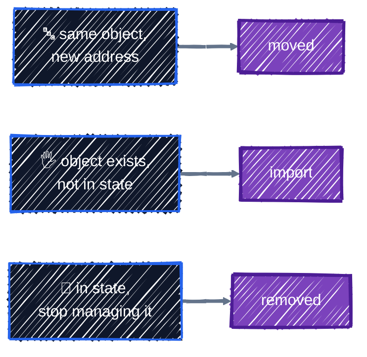

# Refactoring: moved, import, removed

> Rename, adopt, and forget resources without destroying them.

---

Code changes shape over time. You rename a resource to something clearer, turn one resource into a `for_each`, take over a bucket someone created by hand, or hand a resource to another team. In each case the **real object should stay exactly as it is**: only Terraform's bookkeeping needs to change.

That's harder than it sounds, because **the resource address is the identity in state** ([State & Drift](state-basics.md)). Rename `google_storage_bucket.bucket` to `google_storage_bucket.datasets` and Terraform sees one address that disappeared and one that's new:

```
  # google_storage_bucket.bucket will be destroyed
  # (because google_storage_bucket.bucket is not in configuration)
  # google_storage_bucket.datasets will be created
Plan: 1 to add, 0 to change, 1 to destroy.
```

That's a delete of the real bucket and everything in it, then an empty replacement, all for a rename. Terraform has three blocks that change state **through a normal plan**, so you review the bookkeeping change before it happens:



| Block | Situation | Real object | State |
|---|---|---|---|
| `moved` | you renamed or restructured code | untouched | the entry gets a new address |
| `import` | an object exists that Terraform doesn't manage yet | untouched (unless your code differs from it) | a new entry is added |
| `removed` | Terraform should stop managing an object | untouched with `destroy = false` | the entry is dropped |

## Before you start

```bash
cd examples/state/refactoring
terraform init
terraform apply
```

[`main.tf`](../../examples/state/refactoring/main.tf) is the starting point: a badly named bucket (`google_storage_bucket.bucket`) and a `handover` bucket that another team is about to take over. Now create a third bucket **by hand**, the way someone did before your team used Terraform:

```bash
gcloud storage buckets create "gs://$TF_VAR_project_id-rf-legacy-models" \
  --location="$TF_VAR_region" \
  --uniform-bucket-level-access \
  --public-access-prevention \
  --default-storage-class=STANDARD
gcloud storage buckets update "gs://$TF_VAR_project_id-rf-legacy-models" --update-labels=owner=research
```

You'll fix all three situations in one plan. The finished code is in [`refactored/main.tf`](../../examples/state/refactoring/refactored/main.tf). Copy it over when you've read the sections below:

```bash
cp refactored/main.tf main.tf
```

## `moved`: rename without destroying

Rename the resource, and add a `moved` block that records the old and new addresses:

```hcl
resource "google_storage_bucket" "datasets" {
  name     = "${var.project_id}-rf-datasets"
  location = var.region
  ...
}

moved {
  from = google_storage_bucket.bucket
  to   = google_storage_bucket.datasets
}
```

```
  # google_storage_bucket.bucket has moved to google_storage_bucket.datasets
    resource "google_storage_bucket" "datasets" {
        id                          = "tf-tutorial-3fa9c1-rf-datasets"
        name                        = "tf-tutorial-3fa9c1-rf-datasets"
        # (19 unchanged attributes hidden)

        # (2 unchanged blocks hidden)
    }

Plan: 0 to add, 0 to change, 0 to destroy.
```

`has moved to`, and nothing to add, change, or destroy. On `apply`, Terraform just renames the entry in state.

`moved` handles every kind of address change:

| Refactor | `from` | `to` |
|---|---|---|
| Rename a resource | `google_storage_bucket.bucket` | `google_storage_bucket.datasets` |
| Single resource into `for_each` | `google_storage_bucket.datasets` | `google_storage_bucket.dataset["datasets"]` |
| `count` to `for_each` | `google_storage_bucket.team[0]` | `google_storage_bucket.team["nlp"]` |
| Rename a `for_each` key | `google_storage_bucket.dataset["raw"]` | `google_storage_bucket.dataset["bronze"]` |
| Resource into a module | `google_storage_bucket.models` | `module.storage.google_storage_bucket.models` |
| Rename a module | `module.gke` | `module.cluster` |

The `count`-to-`for_each` row is how you escape the index-shifting trap from [Meta-Arguments](../core-language/meta-arguments.md#the-trouble-with-count-over-a-list): add one `moved` block per element, apply, and from then on every bucket is identified by name. For example, moving the single bucket into a `for_each`:

```
  # google_storage_bucket.datasets has moved to google_storage_bucket.dataset["datasets"]
Plan: 0 to add, 0 to change, 0 to destroy.
```

**When can you delete a `moved` block?** Once every copy of the state that might still use the old address has been applied: every environment, every teammate's branch. In a reusable module, keep `moved` blocks for a long time, because you don't know when callers will upgrade. Leaving one in place costs nothing.

## `import`: adopt an existing object

An `import` block says **which real object** a resource address should manage. The `id` is the object's import ID, whose format is listed at the bottom of every resource's page in the provider docs (for a bucket, it's just the name):

```hcl
import {
  to = google_storage_bucket.legacy_models
  id = "${var.project_id}-rf-legacy-models"
}
```

You also need a `resource` block describing the object. Writing it from scratch means guessing every setting, so let Terraform write a first draft:

```bash
terraform plan -generate-config-out=generated.tf
```

```
Warning: Config generation is experimental

Generating configuration during import is currently experimental, and the
generated configuration format may change in future versions.
```

```hcl
# __generated__ by Terraform
# Please review these resources and move them into your main configuration files.

# __generated__ by Terraform from "tf-tutorial-3fa9c1-rf-legacy-models"
resource "google_storage_bucket" "legacy_models" {
  default_event_based_hold    = false
  deletion_policy             = "DELETE"
  enable_object_retention     = false
  force_destroy               = false
  labels                      = {}
  location                    = "US-CENTRAL1"
  name                        = "tf-tutorial-3fa9c1-rf-legacy-models"
  project                     = "tf-tutorial-3fa9c1"
  public_access_prevention    = "enforced"
  requester_pays              = false
  rpo                         = "DEFAULT"
  storage_class               = "STANDARD"
  uniform_bucket_level_access = true
  hierarchical_namespace {
    enabled = false
  }
  soft_delete_policy {
    retention_duration_seconds = 604800
  }
}
```

The draft sets **every** argument to its current value, including defaults, and hard-codes the project ID. Treat it as a starting point, never as finished code:

- **Delete arguments that just restate defaults**, such as `requester_pays = false` and `rpo = "DEFAULT"`.
- **Replace hard-coded values** with variables and references: `var.project_id`, `var.region`.
- **Check labels.** The generated `labels = {}` doesn't include the `owner` label someone set by hand. The google provider only manages labels you list, so add it if you want Terraform to own it.
- **Move it into your normal files** and delete `generated.tf`.

The cleaned-up version in `refactored/main.tf`:

```hcl
resource "google_storage_bucket" "legacy_models" {
  name     = "${var.project_id}-rf-legacy-models"
  location = var.region

  uniform_bucket_level_access = true
  public_access_prevention    = "enforced"

  labels = {
    owner = "research"
  }
}
```

### Read the import plan

An import plan often isn't zero-change. It shows the import, **plus** whatever it takes to make the object match your code:

```
  # google_storage_bucket.legacy_models will be updated in-place
  # (imported from "tf-tutorial-3fa9c1-rf-legacy-models")
  ~ resource "google_storage_bucket" "legacy_models" {
      ~ effective_labels            = {
          + "managed-by" = "terraform"
            "owner"      = "research"
          + "tutorial"   = "refactoring"
        }
        id                          = "tf-tutorial-3fa9c1-rf-legacy-models"
      ~ labels                      = {
          + "owner" = "research"
        }
        location                    = "US-CENTRAL1"
        ...
    }

Plan: 1 to import, 0 to add, 1 to change, 0 to destroy.
```

Here the change is harmless: the provider's `default_labels` are added, and `owner` comes under Terraform's management. But if the plan says **`must be replaced`**, stop. Your code differs from the real object in an argument that forces replacement, and applying would delete the object you meant to adopt. Fix the code until the plan shows only changes you want.

If the ID is wrong, the plan fails before anything happens:

```
Error: Cannot import non-existent remote object

While attempting to import an existing object to
"google_storage_bucket.ghost", the provider detected that no object exists
with the given id. Only pre-existing objects can be imported; check that the
id is correct and that it is associated with the provider's configured region
or endpoint, or use "terraform apply" to create a new remote object for this
resource.
```

After the apply, the `import` block has done its job. Delete it, or leave it: once the address is in state, Terraform ignores it.

> 💡 **Importing many objects?** An `import` block can use `for_each`, just like a resource. And for whole projects of hand-built resources, `gcloud beta resource-config bulk-export --resource-format=terraform` can generate HCL for many resource types at once. Clean its output up the same way.

## `removed`: stop managing without destroying

Deleting a resource block means "destroy it". To mean "forget it", delete the block **and** add a `removed` block in its place:

```hcl
removed {
  from = google_storage_bucket.handover

  lifecycle {
    destroy = false
  }
}
```

```
 # google_storage_bucket.handover will no longer be managed by Terraform, but will not be destroyed
 # (destroy = false is set in the configuration)
 . resource "google_storage_bucket" "handover" {
        id                          = "tf-tutorial-3fa9c1-rf-handover"
        name                        = "tf-tutorial-3fa9c1-rf-handover"
        # (18 unchanged attributes hidden)

        # (2 unchanged blocks hidden)
    }
```

On apply, Terraform also warns you, because this is easy to do by accident:

```
Warning: Some objects will no longer be managed by Terraform

After applying this plan, Terraform will no longer manage these objects. You
will need to import them into Terraform to manage them again.
```

The bucket keeps running. It's just no longer in this configuration's state, so the other team can `import` it into theirs. Two Terraform configurations must never manage the same object: they'd fight over it on every apply.

## All three, in one plan

With `refactored/main.tf` in place, a single plan shows the rename, the adoption, and the hand-over together:

```bash
terraform plan
```

```
  # google_storage_bucket.bucket has moved to google_storage_bucket.datasets
  ...
 # google_storage_bucket.handover will no longer be managed by Terraform, but will not be destroyed
  ...
  # google_storage_bucket.legacy_models will be updated in-place
  # (imported from "tf-tutorial-3fa9c1-rf-legacy-models")
  ...

Plan: 1 to import, 0 to add, 1 to change, 0 to destroy.
```

**Nothing is destroyed.** That's the line to check on every refactoring plan.

```bash
terraform apply
terraform state list
```

```
google_storage_bucket.datasets
google_storage_bucket.legacy_models
```

The `handover` bucket is gone from state but still exists in GCP: `gcloud storage buckets list --filter="name~rf-"` shows all three.

## The old way: `terraform state` commands

Before these blocks existed, the same jobs were done with CLI commands that **change state immediately**, with no plan:

| Block (preferred) | CLI command | Output |
|---|---|---|
| `moved` | `terraform state mv <from> <to>` | `Successfully moved 1 object(s).` |
| `import` | `terraform import <address> <id>` | `Import successful!` |
| `removed` | `terraform state rm <address>` | `Successfully removed 1 resource instance(s).` |

The blocks are better in almost every way:

- **Reviewed.** They show up in `plan`, so they're checked like any other change, in a pull request and by CI.
- **Repeatable.** The same code applies the same refactor to dev, staging, and prod. A CLI command has to be run by hand against each state, and forgetting one means that environment destroys and recreates on its next apply.
- **Safe with remote state and CI.** Nobody needs write access to state from a laptop.

The CLI commands are still useful for one-off repairs on a single state, for example after a failed experiment. Take a backup with `terraform state pull > backup.json` first.

## Best practices

- **Read every refactoring plan for `destroy` and `must be replaced`.** A refactor should show moves, imports, and forgets, never a destroy.
- **Use blocks, not CLI commands**, so refactors go through review and apply consistently to every environment.
- **Refactor in its own pull request**, with no other changes, so the plan is easy to read.
- **Generate import config, then clean it up.** Remove defaults, use variables, check labels.
- **Keep `moved` blocks in reusable modules** until you're sure every caller has upgraded.
- **One object, one owner.** Use `removed` in the old configuration and `import` in the new one when handing a resource over.

## Clean up

```bash
terraform destroy
```

`handover` is no longer managed by Terraform, so `destroy` doesn't touch it. Delete it by hand:

```bash
gcloud storage buckets delete "gs://$TF_VAR_project_id-rf-handover"
```

That completes Part 2. Next, Part 3 builds the GCP foundations every AI platform needs, starting with [Projects & APIs](../gcp-foundations/projects-and-apis.md).

---

[← Remote Backend on GCS](remote-backend.md) · [↑ Contents](../../README.md) · [Projects & APIs →](../gcp-foundations/projects-and-apis.md)
