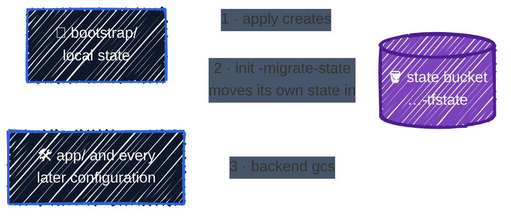
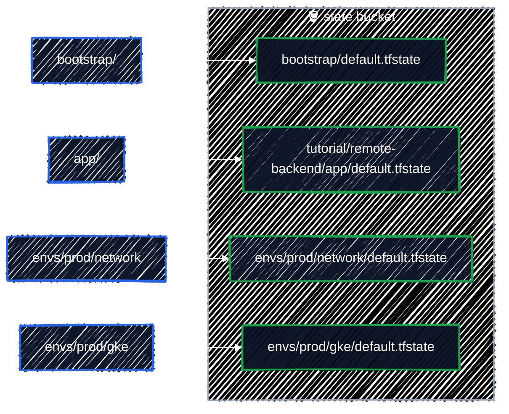
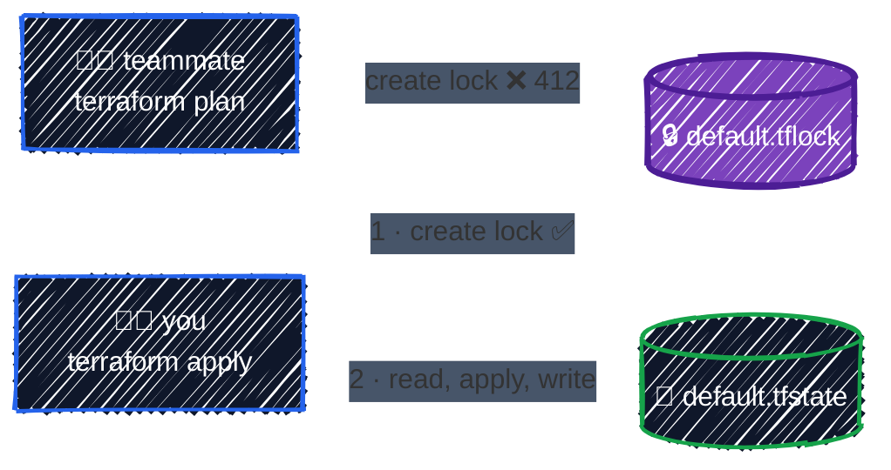

# Remote Backend on GCS

> Shared state with built-in locking, and the bootstrap chicken-and-egg.

---

[State & Drift](state-basics.md) ended with the problems of a local `terraform.tfstate`: it lives on one laptop, nobody else can use it, nothing stops two applies at once, and it holds secrets on a disk you don't control. A **backend** decides where state lives. The **`gcs` backend** stores it in a Cloud Storage bucket, which fixes all four problems:

| Problem with local state | With the `gcs` backend |
|---|---|
| on one laptop | in a bucket, with object versioning to roll back bad writes |
| nobody else can use it | anyone (or any CI job) with access to the bucket uses the same state |
| two applies can collide | every operation takes a **lock**; a second one waits or fails |
| secrets on a laptop disk | encrypted at rest, access controlled by IAM, and never written to your disk |

This chapter sets it up the way you'd run it for real: a dedicated, protected state bucket, created by Terraform itself.

## The chicken-and-egg problem

Terraform needs somewhere to store state before it can create anything. But the state bucket is something you want Terraform to create. The usual way out is a tiny **bootstrap** configuration:



1. `bootstrap/` creates the bucket, using **local** state for a few minutes.
2. It then moves its own state **into the bucket it just created**, so nothing is left on your laptop.
3. Every other configuration stores its state in that bucket from the start.

Some teams create the state bucket with `gcloud` instead and never manage it with Terraform. That works too, but you lose the review trail and the protections defined in code. Either way, it happens **once per project or organization**, not per configuration.

## 1. Create the state bucket

```bash
cd examples/state/remote-backend/bootstrap
terraform init
terraform apply
```

[`bootstrap/main.tf`](../../examples/state/remote-backend/bootstrap/main.tf) is a bucket with every protection turned on:

```hcl
resource "google_storage_bucket" "tfstate" {
  name     = "${var.project_id}-tfstate"
  location = var.region

  uniform_bucket_level_access = true
  public_access_prevention    = "enforced"

  # Every write of a state file keeps the previous version, so a bad apply
  # or a corrupted state can be rolled back.
  versioning {
    enabled = true
  }

  # Keep the 10 most recent old versions of each state file; delete older ones.
  lifecycle_rule {
    condition {
      num_newer_versions = 10
      with_state         = "ARCHIVED"
    }
    action {
      type = "Delete"
    }
  }

  # No force_destroy: GCS refuses to delete the bucket while it holds state.
  lifecycle {
    prevent_destroy = true
  }
}
```

- **Versioning** is the important one. Every state write keeps the previous version, which is your undo button (see [Recovering an old state](#recovering-an-old-state)).
- **`prevent_destroy`** and **no `force_destroy`** together make it very hard to delete by accident. Losing the state bucket means Terraform forgets everything it manages.
- **Uniform bucket-level access** and **public access prevention**: access is by IAM only, and the bucket can never be made public.

```
Outputs:

state_bucket = "tf-tutorial-3fa9c1-tfstate"
```

## 2. Move the bootstrap state into the bucket

Right now `bootstrap/terraform.tfstate` is a local file. Add a backend block, in a new file `bootstrap/backend.tf`, using your bucket name:

```hcl
terraform {
  backend "gcs" {
    bucket = "tf-tutorial-3fa9c1-tfstate"
    prefix = "bootstrap"
  }
}
```

Then re-initialize with **`-migrate-state`**:

```bash
terraform init -migrate-state
```

```
Initializing the backend...
Do you want to copy existing state to the new backend?
  Pre-existing state was found while migrating the previous "local" backend to the
  newly configured "gcs" backend. No existing state was found in the newly
  configured "gcs" backend. Do you want to copy this state to the new "gcs"
  backend? Enter "yes" to copy and "no" to start with an empty state.

  Enter a value: yes

Successfully configured the backend "gcs"! Terraform will automatically
use this backend unless the backend configuration changes.
```

The state is now the object `gs://tf-tutorial-3fa9c1-tfstate/bootstrap/default.tfstate`. The local `terraform.tfstate` is left behind **empty** (0 bytes), and `terraform.tfstate.backup` still holds the old copy. Confirm everything still lines up, then delete both local files:

```bash
terraform plan                                 # No changes.
rm terraform.tfstate terraform.tfstate.backup
```

Commit `backend.tf` for real projects. In this repo it's left for you to create, because the bucket name contains your project ID.

## 3. Use the backend from another configuration

[`app/versions.tf`](../../examples/state/remote-backend/app/versions.tf) declares the backend but leaves out the settings:

```hcl
terraform {
  required_version = ">= 1.10"

  required_providers {
    google = {
      source  = "hashicorp/google"
      version = "~> 8.0"
    }
  }

  # Partial configuration: the bucket and prefix come from backend.hcl,
  # passed with `terraform init -backend-config=backend.hcl`.
  backend "gcs" {}
}
```

### Why a partial configuration?

Because **backend blocks can't use variables**. The backend is set up during `init`, before variables are evaluated:

```
Error: Variables not allowed

  on main.tf line 4, in terraform:
   4:     bucket = var.b

Variables may not be used here.
```

So the settings that differ between projects or environments go in a separate file, passed at `init` time. [`app/backend.hcl.example`](../../examples/state/remote-backend/app/backend.hcl.example):

```hcl
# Copy to backend.hcl (git-ignored) and set your bucket:
#   cp backend.hcl.example backend.hcl
#   terraform init -backend-config=backend.hcl

bucket = "tf-tutorial-3fa9c1-tfstate" # the state_bucket output from ../bootstrap
prefix = "tutorial/remote-backend/app"
```

```bash
cd ../app
cp backend.hcl.example backend.hcl   # then edit the bucket name
terraform init -backend-config=backend.hcl
terraform apply
```

```
Initializing the backend...

Successfully configured the backend "gcs"! Terraform will automatically
use this backend unless the backend configuration changes.
```

After the apply, there's **no** `terraform.tfstate` in the directory. State only exists in the bucket. Every state command works the same as before, reading from GCS:

```bash
terraform state list
```

```
google_storage_bucket.app
```

> ⚠️ **The backend settings are saved at `init` time**, in `.terraform/terraform.tfstate` (despite the name, that file holds backend settings, not your state). If you edit `backend.hcl` later, nothing changes until you run `init` again. Then choose: `terraform init -migrate-state -backend-config=backend.hcl` to **copy** state to the new location, or `-reconfigure` to point at the new location **without** copying.

### Laying out the bucket

One bucket holds the state for many configurations. The **`prefix`** keeps them apart: each root module gets its own, and its state is stored at `<prefix>/default.tfstate`:



- **Mirror your directory layout in the prefix.** `envs/prod/gke` stored at prefix `envs/prod/gke` means you always know where a configuration's state is.
- **Never give two configurations the same prefix.** They'd overwrite each other's state.
- **`default`** is the workspace name. Terraform CLI workspaces store each workspace at `<prefix>/<workspace>.tfstate`; [Environments](../modules/environments.md) explains why this guide uses separate directories instead.

## Locking

Before any operation that could write state (`plan`, `apply`, `destroy`, `state` commands, `import`), Terraform takes a **lock**. With the `gcs` backend, the lock is an object next to the state, `<prefix>/default.tflock`. It's created with a GCS condition that only succeeds **if the object doesn't already exist**, so exactly one process can hold it:



The lock is held for the whole operation, including while `apply` waits for you to type `yes`. If a teammate runs `plan` meanwhile, it fails immediately and tells them who holds the lock:

```
Error: Error acquiring the state lock

Error message: writing
"gs://tf-tutorial-3fa9c1-tfstate/tutorial/remote-backend/app/default.tflock"
failed: googleapi: Error 412: At least one of the pre-conditions you
specified did not hold., conditionNotMet
Lock Info:
  ID:        1760844118949304
  Path:      gs://tf-tutorial-3fa9c1-tfstate/tutorial/remote-backend/app/default.tflock
  Operation: OperationTypeApply
  Who:       you@your-laptop
  Version:   1.16.6
  Created:   2026-10-19 06:21:58.949304364 +0000 UTC
  Info:


Terraform acquires a state lock to protect the state from being written
by multiple users at the same time. Please resolve the issue above and try
again. For most commands, you can disable locking with the "-lock=false"
flag, but this is not recommended.
```

`Who` and `Created` tell you whom to ask. When the other operation finishes, the lock object is deleted and you can go ahead.

**Waiting instead of failing.** In CI, where two pipelines can overlap, tell Terraform to retry for a while:

```bash
terraform plan -lock-timeout=5m
```

### Stale locks and `force-unlock`

If Terraform is killed mid-operation (laptop closed, CI job cancelled, process crashed), the lock object stays behind, and every later run fails with the error above, forever. Once you're **sure** the operation is no longer running, remove the lock with the ID from the error:

```bash
terraform force-unlock 1760844118949304
```

```
Do you really want to force-unlock?
  Terraform will remove the lock on the remote state.
  This will allow local Terraform commands to modify this state, even though it
  may still be in use. Only 'yes' will be accepted to confirm.

  Enter a value: yes

Terraform state has been successfully unlocked!

The state has been unlocked, and Terraform commands should now be able to
obtain a new lock on the remote state.
```

> 🛑 **Check before you unlock.** If the "stale" lock belongs to an apply that's still running, unlocking lets a second operation write state at the same time, which is exactly what locking prevents. Ask the person in `Who`, or check that the CI job is really gone. Never use `-lock=false` to get around someone else's lock.

## Recovering an old state

Bucket versioning keeps every previous state file. If a state gets corrupted, or a bad `state rm` loses track of resources, you can roll back:

```bash
# List all versions of a configuration's state, newest last
gcloud storage ls --all-versions "gs://$TF_VAR_project_id-tfstate/tutorial/remote-backend/app/default.tfstate"

# Inspect an old version (the #<number> suffix from the listing)
gcloud storage cat "gs://$TF_VAR_project_id-tfstate/tutorial/remote-backend/app/default.tfstate#<generation>"
```

To restore it, download that version and push it with `terraform state push <file>`. Terraform checks the `lineage` and `serial` from [State & Drift](state-basics.md#whats-in-the-file) and refuses a file from a different lineage or an older serial unless you add `-force`. Treat this as an emergency procedure: take a fresh copy with `terraform state pull > before-restore.json` first, and make sure nobody else is running Terraform.

## Who can access state

Whoever can read the state bucket can read every secret in every state in it. Plan access accordingly:

| Who | Needs | Role on the state bucket |
|---|---|---|
| People and CI that run `plan` and `apply` | read and write state, create and delete lock objects | `roles/storage.objectUser` |
| Read-only reviewers, drift-detection jobs | read state; `plan` still needs to create a lock, unless run with `-lock=false` | `roles/storage.objectUser`, or `roles/storage.objectViewer` with `-lock=false` |
| Everyone else | nothing | none |

- **Grant roles on the bucket, not the project.** Project-wide storage roles would cover every other bucket too.
- **Consider one state bucket per environment**, so that access to dev state doesn't mean access to prod state.
- **Keep project Owners to a minimum.** Owners can read every bucket.

[IAM & Service Accounts](../gcp-foundations/iam.md) shows how to grant these in Terraform, and [CI/CD](../team-workflow/ci-cd.md) gives the CI service account exactly this access.

## Best practices

- **Use a remote backend for anything more than a personal experiment.**
- **Create the state bucket with a bootstrap configuration**, then migrate the bootstrap state into it. Do it once per project or organization.
- **Turn on versioning, and protect the bucket** with `prevent_destroy` and no `force_destroy`.
- **One prefix per root module**, mirroring the directory layout. Never share a prefix.
- **Keep backend settings in `backend.hcl`** (git-ignored, with a committed `.example`) and pass them with `-backend-config`.
- **Re-run `init` after any backend change**, choosing `-migrate-state` or `-reconfigure` on purpose.
- **Never disable locking for anything that can write state.** Use `-lock-timeout` in CI, and `force-unlock` only after confirming the lock is stale.
- **Restrict the state bucket's IAM** to the people and service accounts that run Terraform.

## Clean up

Destroy the app's resources, but **keep the state bucket**: later chapters store their state in it.

```bash
cd examples/state/remote-backend/app
terraform destroy
```

`app/`'s state object stays in the bucket, now listing no resources. [Cleanup](../capstone/cleanup.md) removes the state bucket at the very end, after everything that uses it is gone.

---

[← State & Drift](state-basics.md) · [↑ Contents](../../README.md) · [Refactoring: moved, import, removed →](refactoring.md)
