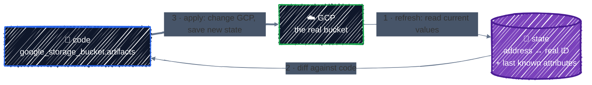
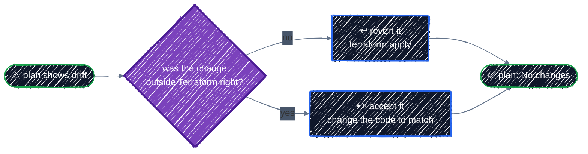

# State & Drift

> What the state file is, the state commands, and how to detect drift.

---

Every `apply` you've run left a `terraform.tfstate` file behind. [Core Workflow](../getting-started/core-workflow.md) told you not to edit it or commit it, and showed drift once. This chapter explains what's in the file, why Terraform can't work without it, how to inspect it safely, and how to detect and handle drift as a routine, not a surprise.

## Before you start

```bash
cd examples/state/state-basics
terraform init
terraform apply
```

The example is deliberately small: a bucket and one text file in it, so you can see every part of the state and break it on purpose.

## Why Terraform needs state

Your code says what **should** exist. GCP knows what **does** exist. State is Terraform's record of **which real object each resource address manages**:



State does several jobs that nothing else can:

- **Mapping.** Your code says `google_storage_bucket.artifacts`. GCP knows a bucket called `tf-tutorial-3fa9c1-state-basics`. Only state links the two. Without it, Terraform can't tell "this bucket is mine" from "someone else's bucket with a similar name".
- **Deletions.** When you remove a resource block, the code no longer mentions it. State is how Terraform knows it exists and must be destroyed.
- **Dependencies.** State records what each resource depended on, so Terraform can destroy things in the right order even after you've deleted the code that described them.
- **Attributes.** State keeps every attribute from the last read, including computed ones like `self_link`. That's what `terraform output` and `terraform state show` read, without calling GCP.

**Every `plan` starts by refreshing**: it reads each resource in state from GCP and updates the in-memory copy before comparing with your code. You've been seeing that all along:

```
google_storage_bucket.artifacts: Refreshing state... [id=tf-tutorial-3fa9c1-state-basics]
google_storage_bucket_object.notes: Refreshing state... [id=tf-tutorial-3fa9c1-state-basics-NOTES.txt]
```

## What's in the file

State is JSON. Look, but don't edit:

```bash
ls -a
# .  ..  .terraform  .terraform.lock.hcl  main.tf  terraform.tfstate  versions.tf
```

The top level identifies the file:

```json
{
  "version": 4,
  "terraform_version": "1.16.6",
  "serial": 3,
  "lineage": "5ce3aa8f-78e6-1f98-5612-0a9be1eccc1f",
  "outputs": { ... },
  "resources": [ ... ],
  "check_results": null
}
```

| Field | Meaning |
|---|---|
| `version` | the state file format (4 for every current Terraform) |
| `terraform_version` | the Terraform that last wrote it |
| `serial` | goes up by one every time the state changes |
| `lineage` | a random ID given when the state was first created. It never changes |

`serial` and `lineage` together stop accidents: Terraform refuses to overwrite a state with one from a **different lineage** (a different state entirely), or with an **older serial** (a stale copy). That matters once state is shared in [Remote Backend](remote-backend.md).

Each resource has an entry like this one (trimmed to a few attributes):

```json
{
  "mode": "managed",
  "type": "google_storage_bucket_object",
  "name": "notes",
  "provider": "provider[\"registry.terraform.io/hashicorp/google\"]",
  "instances": [
    {
      "schema_version": 0,
      "attributes": {
        "bucket": "tf-tutorial-3fa9c1-state-basics",
        "content": "Created by Terraform. Delete me by hand to see drift.\n",
        "id": "tf-tutorial-3fa9c1-state-basics-NOTES.txt",
        "md5hash": "F2KOSpQNzdnw/AUf+nKoIg==",
        "name": "NOTES.txt"
      },
      "sensitive_attributes": [
        [{ "type": "get_attr", "value": "content" }]
      ],
      "dependencies": [
        "google_storage_bucket.artifacts"
      ]
    }
  ]
}
```

- `mode` is `managed` for resources and `data` for data sources.
- `instances` holds one entry per copy. A `count` or `for_each` resource has several, each with an `index_key`.
- `attributes` is every argument and computed attribute, as last read.
- `dependencies` is how destroy order survives deleting the code.

Look at `content`, and at `sensitive_attributes`. The provider marks `content` sensitive, so plans hide it, but **the plain text is right there in state**. This is the point from [Sensitive values](../core-language/variables-and-outputs.md#sensitive-values) made concrete: **anyone who can read state can read every secret in it.** Treat the state file like a password file. That's the main reason it never goes in Git.

After the second apply you'll also find **`terraform.tfstate.backup`**, the previous version, written automatically before each change.

## Inspecting state

Use these commands instead of opening the file. They read state, not GCP, so they're instant and free.

| Command | Shows |
|---|---|
| `terraform state list` | every resource address in state |
| `terraform state show <address>` | one resource's attributes, in HCL style |
| `terraform show` | the whole state, human-readable |
| `terraform show -json` | the whole state as JSON, for `jq` and scripts |
| `terraform output` | output values ([Outputs](../core-language/variables-and-outputs.md#outputs)) |
| `terraform state pull` | the raw state JSON, even when it's stored remotely |

```bash
terraform state list
```

```
google_storage_bucket.artifacts
google_storage_bucket_object.notes
```

```bash
terraform state show google_storage_bucket.artifacts
```

```
# google_storage_bucket.artifacts:
resource "google_storage_bucket" "artifacts" {
    default_event_based_hold    = false
    deletion_policy             = "DELETE"
    effective_labels            = {
        "component"                  = "artifacts"
        "goog-terraform-provisioned" = "true"
        "managed-by"                 = "terraform"
        "tutorial"                   = "state-basics"
    }
    ...
    id                          = "tf-tutorial-3fa9c1-state-basics"
    location                    = "US-CENTRAL1"
    name                        = "tf-tutorial-3fa9c1-state-basics"
    project                     = "tf-tutorial-3fa9c1"
    project_number              = 123456789012
    self_link                   = "https://www.googleapis.com/storage/v1/b/tf-tutorial-3fa9c1-state-basics"
    ...
    url                         = "gs://tf-tutorial-3fa9c1-state-basics"

    soft_delete_policy {
        effective_time             = "2026-10-19T03:00:00.000Z"
        retention_duration_seconds = 604800
    }

    versioning {
        enabled = true
    }
}
```

`state show` is the quickest answer to "what's the actual ID/self_link/URL of that thing?". For scripts, use JSON:

```bash
terraform show -json | jq -r '.values.root_module.resources[] | "\(.address)  \(.values.id)"'
```

```
google_storage_bucket.artifacts  tf-tutorial-3fa9c1-state-basics
google_storage_bucket_object.notes  tf-tutorial-3fa9c1-state-basics-NOTES.txt
```

> 🛑 **Commands that change state**: `terraform state mv`, `state rm`, `import`, and `state push` rewrite state directly, without a plan to review. They're covered, along with safer plan-based replacements, in [Refactoring](refactoring.md). Never edit `terraform.tfstate` by hand.

## Drift

**Drift** is any difference between state and the real world that Terraform didn't cause: a label changed in the Console, an object deleted by a script, a setting changed by another tool. Terraform only finds it when it refreshes, and it falls into three kinds:

| Kind | Example | What `plan` does |
|---|---|---|
| **Changed** | someone edits a label | reports the change, then plans to change it back |
| **Deleted** | someone deletes the object | plans to create it again |
| **Created outside Terraform** | someone creates a new bucket by hand | nothing. It's not in state, so Terraform doesn't know it exists |

The third kind is invisible to `plan`. If you want Terraform to manage something created by hand, you have to **import** it ([Refactoring](refactoring.md)).

### Changed outside Terraform

Change a label by hand:

```bash
gcloud storage buckets update "gs://$(terraform output -raw bucket_name)" --update-labels=component=hotfix
terraform plan
```

You saw this in [Core Workflow](../getting-started/core-workflow.md#6-drift-someone-changes-it-by-hand): a `Note: Objects have changed outside of Terraform` section listing the drift, followed by a plan that reverts it.

### Deleted outside Terraform

Delete the file by hand:

```bash
gcloud storage rm "gs://$(terraform output -raw bucket_name)/NOTES.txt"
terraform plan
```

```
google_storage_bucket.artifacts: Refreshing state... [id=tf-tutorial-3fa9c1-state-basics]
google_storage_bucket_object.notes: Refreshing state... [id=tf-tutorial-3fa9c1-state-basics-NOTES.txt]

Terraform used the selected providers to generate the following execution
plan. Resource actions are indicated with the following symbols:
  + create

Terraform will perform the following actions:

  # google_storage_bucket_object.notes will be created
  + resource "google_storage_bucket_object" "notes" {
      + bucket          = "tf-tutorial-3fa9c1-state-basics"
      + content         = (sensitive value)
      ...
      + name            = "NOTES.txt"
      ...
    }

Plan: 1 to add, 0 to change, 0 to destroy.
```

During refresh, the provider asked GCP for the object, got a 404, and dropped it from the in-memory state. The resource is still in your code, so the plan is to create it.

**Refresh is what found this.** Skip it with `-refresh=false`, and Terraform compares code with the stale state only:

```bash
terraform plan -refresh=false
```

```
No changes. Your infrastructure matches the configuration.
```

That's false. `-refresh=false` makes plans faster on very large configurations, but it can hide drift. Don't use it unless you know why.

### Handling drift: revert or accept

For every piece of drift, decide which side is right:



- **Revert**: the hand change was a mistake, or a hotfix that should go through code. `terraform apply` puts things back.
- **Accept**: the change was right. Edit the code to match, until `plan` shows no changes. For the label above, set `component = "hotfix"` in `main.tf`:

  ```
  No changes. Your infrastructure matches the configuration.
  ```

Either way, the goal is the same: **code, state, and GCP agree again.** Leaving drift in place means the next person's `apply` silently undoes it.

### `-refresh-only`: update state without touching anything

`terraform plan -refresh-only` shows **only** the drift, with no plan to fix it:

```bash
terraform plan -refresh-only
```

```
Note: Objects have changed outside of Terraform

Terraform detected the following changes made outside of Terraform since the
last "terraform apply" which may have affected this plan:

  # google_storage_bucket.artifacts has changed
  ~ resource "google_storage_bucket" "artifacts" {
      ~ effective_labels            = {
          ~ "component"                  = "artifacts" -> "hotfix"
            # (3 unchanged elements hidden)
        }
        id                          = "tf-tutorial-3fa9c1-state-basics"
      ~ labels                      = {
          ~ "component" = "artifacts" -> "hotfix"
        }
        ...
    }

This is a refresh-only plan, so Terraform will not take any actions to undo
these. If you were expecting these changes then you can apply this plan to
record the updated values in the Terraform state without changing any remote
objects.
```

`terraform apply -refresh-only` then writes the new values into state, and changes **nothing** in GCP:

```
Apply complete! Resources: 0 added, 0 changed, 0 destroyed.
```

It's useful for two things:

- **Seeing drift clearly**, without it being mixed into a plan full of your own changes.
- **Updating outputs** after something changed outside Terraform, for example after an IP address was reassigned.

It does **not** accept the drift in your code. Run a normal `plan` afterwards and Terraform still wants to put the label back, because `main.tf` still says `artifacts`. Accepting drift always ends with a code change.

> 💡 The old `terraform refresh` command does the same as `terraform apply -refresh-only -auto-approve`, without showing you anything first. It's deprecated; use `-refresh-only`.

## Detecting drift automatically

Drift you find weeks later is much harder to reason about than drift you find the next morning. `-detailed-exitcode` makes `plan` usable in a scheduled job:

```bash
terraform plan -detailed-exitcode
echo $?
```

| Exit code | Meaning |
|---|---|
| `0` | no changes: code, state, and GCP agree |
| `1` | error |
| `2` | there are changes: drift, or code that hasn't been applied |

Run it nightly against every environment and alert on `2`. You'll build exactly this in [CI/CD](../team-workflow/ci-cd.md). Then make drift rare in the first place: give people **read-only** access in the Console for anything Terraform manages, and make changes through code. [IAM](../gcp-foundations/iam.md) covers how.

## Why local state doesn't scale

Everything so far used a `terraform.tfstate` file in your working directory. That's fine for learning, and wrong for a team:

- **It's on one laptop.** Lose the laptop, and Terraform no longer knows what it manages. You'd have to import every resource again.
- **Nobody else can use it.** A teammate running the same code has empty state and would try to create everything again.
- **Nothing stops two applies at once.** Two people applying simultaneously can corrupt state.
- **It holds secrets in plain text** on a disk you don't control.

The fix is a **remote backend**: state stored in a GCS bucket, shared, versioned, access-controlled, and locked during every operation. That's the next chapter.

## Best practices

- **Never edit state by hand, and never commit it.** Use `terraform state` commands and the plan-based tools in [Refactoring](refactoring.md).
- **Treat state as a secret.** It contains every sensitive value in plain text.
- **Use `state list`, `state show`, and `show -json`** to answer questions, instead of opening the file.
- **Don't use `-refresh=false`** unless you have a reason. Refresh is how drift is found.
- **Resolve drift, don't ignore it.** Revert with `apply`, or accept by changing the code. `-refresh-only` alone doesn't accept anything.
- **Check for drift on a schedule** with `plan -detailed-exitcode`.
- **Make the Console read-only** for resources Terraform manages.
- **Move to a remote backend** as soon as more than one person, or CI, runs the configuration.

## Clean up

```bash
terraform destroy
ls -a   # terraform.tfstate is still there, with an empty resources list
```

After `destroy`, state still exists: it just records that nothing is managed. Delete the directory's state files only once you're sure nothing in them is still running.

---

[← Meta-Arguments](../core-language/meta-arguments.md) · [↑ Contents](../../README.md) · [Remote Backend on GCS →](remote-backend.md)
