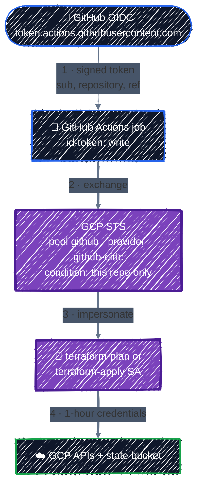

# CI/CD with GitHub Actions

> Workload Identity Federation (no JSON keys), plan on PR, apply on merge.

---

Running `terraform apply` from laptops doesn't scale: who applied what, from which branch, with which local changes? A pipeline fixes that. Every change goes through a pull request, where a preview plan is posted for review. After merge, CI creates a fresh deployment plan from the exact commit on `main`; a production reviewer inspects that plan and approves its apply. This chapter builds that pipeline with GitHub Actions, authenticated to GCP **without a single service account key**.

## Before you start

You need the state bucket from [Remote Backend](../state/remote-backend.md), and a GitHub repository for your Terraform code. The workflows expect the configuration in an `infra/` directory of that repository.

```bash
cd examples/team-workflow/ci-cd/wif
terraform init
```

The example has two parts:

| Path | What it is |
|---|---|
| [`wif/`](../../examples/team-workflow/ci-cd/wif/) | Terraform that lets one GitHub repository authenticate to GCP: a Workload Identity pool and provider, and two service accounts |
| [`workflows/`](../../examples/team-workflow/ci-cd/workflows/) | two workflow files to copy into that repository's `.github/workflows/` |

## Keyless authentication



GitHub issues every workflow job an **OIDC token**: a signed statement of which repository, branch, and environment the job is running for. GCP's **Workload Identity Federation** trusts GitHub's signature, checks the token against your rules, and lets the job impersonate a service account for an hour. It's the CI equivalent of [Workload Identity for GKE](../ai-infra/workload-identity.md): identity comes from where the code runs, not from a secret someone copied.

### The pool and provider

From [`wif/main.tf`](../../examples/team-workflow/ci-cd/wif/main.tf):

```hcl
resource "google_iam_workload_identity_pool" "github" {
  project                   = google_project_service.enabled["sts.googleapis.com"].project
  workload_identity_pool_id = "github"
  display_name              = "GitHub Actions"
}

resource "google_iam_workload_identity_pool_provider" "github" {
  workload_identity_pool_id          = google_iam_workload_identity_pool.github.workload_identity_pool_id
  workload_identity_pool_provider_id = "github-oidc"
  display_name                       = "GitHub OIDC"

  oidc {
    issuer_uri = "https://token.actions.githubusercontent.com"
  }

  # Claims from GitHub's token, copied into attributes IAM can match on.
  attribute_mapping = {
    "google.subject"         = "assertion.sub"
    "attribute.repository"   = "assertion.repository"
    "attribute.ref"          = "assertion.ref"
    "attribute.workflow_ref" = "assertion.job_workflow_ref"
  }

  # Without this, ANY repository on GitHub could exchange its token here.
  attribute_condition = "assertion.repository == '${var.github_repository}'"
}
```

```
      + attribute_condition                = "assertion.repository == 'acme/ml-platform'"
```

**`attribute_condition` is the most important line in this chapter.** Every GitHub repository in the world gets tokens from the same issuer. Without a condition, the pool accepts all of them, and the only thing standing between a stranger's workflow and your project is the IAM binding below. Restrict the provider to your repository (or your organization, with `assertion.repository_owner == 'acme'`).

### Two identities: plan and apply

```hcl
# Any workflow in the repository may act as the plan identity...
resource "google_service_account_iam_member" "plan_wif" {
  service_account_id = google_service_account.plan.name
  role               = "roles/iam.workloadIdentityUser"
  member             = "principalSet://iam.googleapis.com/${local.pool_path}/attribute.repository/${var.github_repository}"
}

# ...but only jobs running in the "production" GitHub environment, which
# requires a reviewer's approval, may act as the apply identity. GitHub sets
# the token's subject to repo:OWNER/REPO:environment:NAME for such jobs.
resource "google_service_account_iam_member" "apply_wif" {
  service_account_id = google_service_account.apply.name
  role               = "roles/iam.workloadIdentityUser"
  member             = "principal://iam.googleapis.com/${local.pool_path}/subject/repo:${var.github_repository}:environment:production"
}
```

```
  + member = "principalSet://iam.googleapis.com/projects/123456789012/locations/global/workloadIdentityPools/github/attribute.repository/acme/ml-platform"
  + member = "principal://iam.googleapis.com/projects/123456789012/locations/global/workloadIdentityPools/github/subject/repo:acme/ml-platform:environment:production"
```

| Service account | Who can use it | Project roles |
|---|---|---|
| `terraform-plan` | any job in the repository, including pull requests from branches | `roles/viewer`, plus `storage.objectUser` on the state bucket |
| `terraform-apply` | only jobs in the `production` environment | `roles/editor` and `projectIamAdmin`, plus `storage.objectUser` on the state bucket |

Splitting them means a pull request can never change infrastructure, even if someone edits the workflow in their branch: the plan identity has no write access, and the apply identity only accepts tokens from the protected environment. Both get `roles/storage.objectUser` on the state bucket only, as promised in [Remote Backend](../state/remote-backend.md#who-can-access-state), because both must read state and take the lock.

`roles/editor` is a pragmatic start for the apply identity; it's a [basic role](../gcp-foundations/iam.md#iam-in-one-picture). Once your configurations settle, replace it with the predefined roles they actually need (the [IAM recommender](https://cloud.google.com/policy-intelligence/docs/role-recommendations-overview) will tell you which ones are used).

### Apply it

```bash
terraform apply \
  -var github_repository=OWNER/REPO \
  -var state_bucket="$TF_VAR_project_id-tfstate"
terraform output
```

```
apply_service_account = "terraform-apply@tf-tutorial-3fa9c1.iam.gserviceaccount.com"
plan_service_account = "terraform-plan@tf-tutorial-3fa9c1.iam.gserviceaccount.com"
workload_identity_provider = "projects/123456789012/locations/global/workloadIdentityPools/github/providers/github-oidc"
```

Then, in the GitHub repository:

1. **Settings → Secrets and variables → Actions → Variables**: add `GCP_PROJECT_ID`, `WIF_PROVIDER`, `PLAN_SA`, `APPLY_SA` (the three outputs above), and `TF_STATE_BUCKET`. They're variables, not secrets: none of them grants anything by itself.
2. **Settings → Environments**: create `production`, add **required reviewers**, and limit it to the `main` branch.
3. Copy `workflows/terraform.yml` and `workflows/drift.yml` to `.github/workflows/`.

There's no JSON key anywhere: not in GitHub secrets, not on a laptop.

## The pipeline

```mermaid
---
config:
  look: handDrawn
  theme: default
  themeVariables:
    fontFamily: '"Comic Sans MS", "Comic Sans", "Segoe Print", "Bradley Hand", cursive'
    lineColor: '#64748B'
    edgeLabelBackground: '#475569'
  themeCSS: |
    .edgeLabel, .edgeLabel p, .edgeLabel span { color: #FFFFFF !important; }
---
flowchart LR
    pr(["✏️ pull request"])
    prchecks["🧪 PR checks"]
    preview["📋 preview plan"]
    comment["💬 preview posted<br/>on the PR"]
    merge(["🔀 merge to main"])
    deploychecks["🧪 deployment checks"]
    deployplan["📋 fresh plan<br/>from main"]
    approve{"👀 review plan +<br/>production approval"}
    apply["🚀 apply saved plan<br/>terraform-apply SA"]

    pr --> prchecks --> preview --> comment --> merge
    merge --> deploychecks --> deployplan --> approve
    approve -->|"approved"| apply

    classDef ctrl fill:#0F172A,stroke:#2563EB,stroke-width:2px,color:#FFFFFF
    classDef eng fill:#7B42BC,stroke:#4C1D95,stroke-width:3px,color:#FFFFFF
    classDef tgt fill:#0F172A,stroke:#16A34A,stroke-width:2px,color:#FFFFFF
    class pr,merge ctrl
    class prchecks,preview,deploychecks,deployplan,approve eng
    class comment,apply tgt
```



[`workflows/terraform.yml`](../../examples/team-workflow/ci-cd/workflows/terraform.yml) has three jobs.

### 1. Checks, without credentials

```yaml
  checks:
    runs-on: ubuntu-latest
    steps:
      - uses: actions/checkout@v7
      - uses: hashicorp/setup-terraform@v4
        with:
          terraform_version: "~1.16"
      - uses: terraform-linters/setup-tflint@v6
      - run: terraform fmt -check -recursive
      - run: terraform init -backend=false
      - run: terraform validate
      - run: tflint --init && tflint
      - uses: aquasecurity/trivy-action@v0.36.0
        with:
          scan-type: config
          scan-ref: ${{ env.TF_DIR }}
          severity: HIGH,CRITICAL
          exit-code: "1"
```

Everything from [Testing & Code Quality](testing-and-quality.md) and [Security Scanning](security-scanning.md), with `init -backend=false` so no credentials are needed. If you have module tests, add `terraform test` here.

### 2. Plan: preview on PR, deployment artifact on main

```yaml
  plan:
    needs: checks
    permissions:
      contents: read
      id-token: write       # lets the job request a GitHub OIDC token
      pull-requests: write  # lets the job comment the plan on the PR
    steps:
      - uses: actions/checkout@v7

      # Exchange GitHub's OIDC token for short-lived Google credentials. No keys.
      - uses: google-github-actions/auth@v3
        with:
          workload_identity_provider: ${{ vars.WIF_PROVIDER }}
          service_account: ${{ vars.PLAN_SA }}
      ...
      - run: >-
          terraform init
          -backend-config="bucket=${{ vars.TF_STATE_BUCKET }}"
          -backend-config="prefix=${{ env.TF_DIR }}"

      - run: terraform plan -lock-timeout=5m -out=tfplan
      - run: terraform show -no-color tfplan > plan.txt

      - name: Upload deployment plan
        if: github.event_name == 'push'
        uses: actions/upload-artifact@v7
        with:
          name: tfplan
          path: ${{ env.TF_DIR }}/tfplan
          retention-days: 1

      - name: Comment the plan on the pull request
        if: github.event_name == 'pull_request'
        uses: actions/github-script@v9
        ...

      - name: Add deployment plan to the run summary
        if: github.event_name == 'push'
        run: |
          # Append plan.txt to $GITHUB_STEP_SUMMARY for the approver.
          ...
```

- **`id-token: write`** is what allows the job to request the OIDC token. Without it, `google-github-actions/auth` fails.
- **`-lock-timeout=5m`** waits for another run's lock instead of failing ([Remote Backend](../state/remote-backend.md#locking)).
- On a **pull request**, the plan is posted as a comment so reviewers can catch replacements and unexpected changes next to the code. It is a preview, not the file that will eventually be applied.
- After merge, the `push` event starts a **new workflow run** against the exact commit on `main`. That run creates a fresh plan, puts its readable form in the run summary, and uploads the binary plan for its own apply job.
- The PR and post-merge plans should normally agree, but they can differ if state, provider data, or `main` changed between runs. The production reviewer must inspect the post-merge plan rather than relying only on the PR comment.
- Saved plans can contain sensitive values. The PR run does not upload one; the deployment artifact is retained for one day only. Keep repository and Actions access appropriately restricted.

### 3. Apply the post-merge plan, after approval

```yaml
  apply:
    if: github.event_name == 'push' && github.ref == 'refs/heads/main'
    needs: plan
    environment: production   # waits for a required reviewer
    concurrency:
      group: terraform-apply  # never two applies at once
      cancel-in-progress: false
    ...
    steps:
      ...
      - uses: google-github-actions/auth@v3
        with:
          workload_identity_provider: ${{ vars.WIF_PROVIDER }}
          service_account: ${{ vars.APPLY_SA }}
      ...
      - uses: actions/download-artifact@v8
        with:
          name: tfplan
          path: ${{ env.TF_DIR }}

      # Apply the post-merge plan from this same workflow run. If state changed
      # since it was created, Terraform refuses and the run must be repeated.
      - run: terraform apply -lock-timeout=5m tfplan
```

- **`environment: production`** pauses the job until a required reviewer approves it in the GitHub UI. Before approving, open the run summary and inspect the deployment plan generated from `main`. The environment is also what makes the OIDC token's subject `repo:OWNER/REPO:environment:production`, the only subject the apply identity accepts.
- **The apply uses the saved plan from the plan job of the same post-merge run.** That guarantees the approved deployment run applies its saved artifact rather than calculating an unreviewed plan during `apply` ([Core Workflow](../getting-started/core-workflow.md#7-saved-plans-apply-exactly-what-you-reviewed)). If state changes in between, Terraform refuses the stale plan.
- **`concurrency`** queues applies one after another; with the state lock as a second safety net.

The workflow files pass [actionlint](https://github.com/rhysd/actionlint), the linter for GitHub Actions; run it on your copies after editing them.

## Drift detection, every night

[State & Drift](../state/state-basics.md#detecting-drift-automatically) introduced `plan -detailed-exitcode`. [`workflows/drift.yml`](../../examples/team-workflow/ci-cd/workflows/drift.yml) runs it on a schedule, with the read-only plan identity, and opens an issue when reality no longer matches the code:

```yaml
on:
  schedule:
    - cron: "0 6 * * *"  # 06:00 UTC daily
  workflow_dispatch:
...
      # Exit code 0 = no changes, 1 = error, 2 = changes (drift).
      - id: plan
        run: |
          set +e
          terraform plan -detailed-exitcode -lock-timeout=5m -no-color > plan.txt
          code=$?
          echo "exitcode=$code" >> "$GITHUB_OUTPUT"
          if [ "$code" -eq 1 ]; then cat plan.txt; exit 1; fi

      - name: Open an issue on drift
        if: steps.plan.outputs.exitcode == '2'
        uses: actions/github-script@v9
        ...
```

Exit code 2 means either drift or merged code that was never applied. Both deserve a look the next morning.

## Several configurations

The workflow targets one directory, `infra/`. For several configurations (environments and components, as in [Environments](../modules/environments.md)), turn `TF_DIR` into a **matrix** of directories, each with its own state prefix, and give each environment its own GitHub environment, approvers, and apply identity. Production and development then have separate approvals and separate credentials.

## Checkpoint

1. Is the PR-commented plan the binary plan applied after merge in this workflow? Describe the two runs.
2. Why must the GitHub OIDC provider include an `attribute_condition`?
3. Why use separate plan and apply service accounts plus a protected production environment?

<details>
<summary>Answer</summary>

1. No. The PR run posts a preview. After merge, a new `push` run checks out the exact `main` commit, creates a fresh deployment plan, pauses for approval, and applies the saved artifact from that same run.
2. GitHub repositories share the same token issuer. The condition restricts which repository or organization tokens the GCP provider will accept.
3. Pull requests need read access to refresh and plan, not write access. The apply identity is available only after environment approval, reducing both credential exposure and the blast radius of untrusted changes.

</details>

## Best practices

- **No service account keys in CI.** Use Workload Identity Federation with `google-github-actions/auth`.
- **Always set `attribute_condition`** on the provider, to your repository or organization.
- **Separate plan and apply identities**: read-only for plans, write access only from a protected environment.
- **Post a preview plan on every pull request** and review it, not just the code.
- **Plan again from the merged commit**, show that deployment plan to the production approver, and apply its saved artifact from the same run.
- **Treat saved plans as sensitive**, restrict artifact access, and keep their retention short.
- **Serialize applies** with `concurrency`, and wait for locks with `-lock-timeout`.
- **Run fmt, validate, tflint, tests, and a security scan before every plan.**
- **Check for drift on a schedule**, with the read-only identity.
- **Pin action versions.** Major tags (`@v3`) are a minimum; pinning to a full commit SHA protects against a compromised tag.

## Clean up

```bash
cd examples/team-workflow/ci-cd/wif
terraform destroy -var github_repository=OWNER/REPO -var state_bucket="$TF_VAR_project_id-tfstate"
```

A deleted Workload Identity pool is kept for 30 days and its ID can't be reused during that time; pick a new `workload_identity_pool_id` if you recreate it sooner.

---

[← Security Scanning](security-scanning.md) · [↑ Contents](../../README.md) · [LLM Inference Platform on GKE →](../capstone/llm-platform.md)
