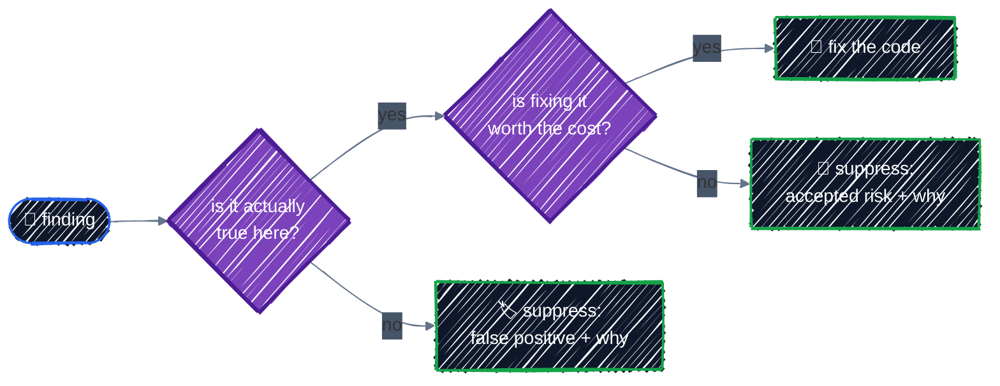

# Security Scanning

> Catch misconfigurations before apply with Trivy and Checkov.

---

`tflint` checks that your code is valid; security scanners check that it's **safe**: no public buckets, no SSH open to the internet, no Owner role granted to a person. They know hundreds of rules for GCP resources, run in seconds without credentials, and turn security review from "someone remembers to look" into a CI check. This chapter runs the two most common open-source scanners, **[Trivy](https://trivy.dev/)** and **[Checkov](https://www.checkov.io/)**, against a deliberately insecure configuration and against this guide's own GKE platform.

## Before you start

Install the scanners:

```bash
# Trivy: a single binary (see trivy.dev for brew, apt, and other options)
curl -sfL https://raw.githubusercontent.com/aquasecurity/trivy/main/contrib/install.sh | sh -s -- -b ~/.local/bin

# Checkov: a Python package
pipx install checkov        # or: pip install checkov
```

```bash
trivy --version      # Version: 0.76.0
checkov --version    # 3.3.29
cd examples/team-workflow/security-scanning
```

[`insecure.tf`](../../examples/team-workflow/security-scanning/insecure.tf) contains five resources, each with a mistake that turns up in real code. **Scan it; never apply it.**

## Scanning a configuration

```bash
trivy config .
```

Trivy groups findings by severity. With `--severity HIGH,CRITICAL`, the worst three:

```
insecure.tf (terraform)
=======================
Tests: 3 (SUCCESSES: 0, FAILURES: 3)
Failures: 3 (HIGH: 2, CRITICAL: 1)

GCP-0001 (HIGH): Bucket allows public access.
════════════════════════════════════════
Using 'allUsers' or 'allAuthenticatedUsers' as members in an IAM member/binding causes data to be exposed outside of the organisation.

────────────────────────────────────────
 insecure.tf:13
   via insecure.tf:10-14 (google_storage_bucket_iam_member.public)
────────────────────────────────────────
  10   resource "google_storage_bucket_iam_member" "public" {
  11     bucket = google_storage_bucket.shared_weights.name
  12     role   = "roles/storage.objectViewer"
  13 [   member = "allUsers"
  14   }
────────────────────────────────────────


GCP-0027 (CRITICAL): Firewall rule allows unrestricted ingress from any IP address.
...
 insecure.tf:20
  20 [   source_ranges = ["0.0.0.0/0"]
...

GCP-0061 (HIGH): Cluster does not have master authorized networks enabled.
...
```

Every finding by severity, from Trivy's JSON output:

| Severity | ID | Finding | Resource |
|---|---|---|---|
| CRITICAL | GCP-0027 | firewall allows unrestricted ingress | `ssh_anywhere` |
| HIGH | GCP-0001 | bucket publicly accessible | `public` |
| HIGH | GCP-0061 | no master authorized networks | `quick` (GKE) |
| MEDIUM | GCP-0002 | uniform bucket-level access off | `shared_weights` |
| MEDIUM | GCP-0003 | IAM granted directly to a user | `dev_owner` |
| MEDIUM | GCP-0059 | cluster not private | `quick` |
| MEDIUM | GCP-0071 | SSH access not restricted | `ssh_anywhere` |
| MEDIUM | GCP-0056, 0073, 0078 | no network policy, default firewall rules, no versioning | |
| LOW | GCP-0049, 0051, 0066 | IP aliasing, cluster labels, customer-managed encryption | |

Checkov finds largely the same problems under its own IDs, with some differences in coverage:

```bash
checkov -d . --framework terraform --compact
```

```
Passed checks: 16, Failed checks: 20, Skipped checks: 0

Check: CKV_GCP_29: "Ensure that Cloud Storage buckets have uniform bucket-level access enabled"
	FAILED for resource: google_storage_bucket.shared_weights
Check: CKV_GCP_114: "Ensure public access prevention is enforced on Cloud Storage bucket"
	FAILED for resource: google_storage_bucket.shared_weights
Check: CKV_GCP_28: "Ensure that Cloud Storage bucket is not anonymously or publicly accessible"
	FAILED for resource: google_storage_bucket_iam_member.public
Check: CKV_GCP_2: "Ensure Google compute firewall ingress does not allow unrestricted ssh access"
	FAILED for resource: google_compute_firewall.ssh_anywhere
Check: CKV_GCP_117: "Ensure basic roles are not used at project level."
	FAILED for resource: google_project_iam_member.dev_owner
Check: CKV_GCP_25: "Ensure Kubernetes Cluster is created with Private cluster enabled"
	FAILED for resource: google_container_cluster.quick
...
```

Every mistake in the file was caught, each one something an earlier chapter warned about: public buckets and uniform access in [Remote Backend](../state/remote-backend.md), basic roles in [IAM](../gcp-foundations/iam.md#iam-in-one-picture), SSH from anywhere in [Networking](../gcp-foundations/networking.md#firewall-rules), public nodes in [GKE Cluster](../ai-infra/gke-cluster.md#vpc-native-private-nodes). Scanners are how those lessons get enforced when nobody is reading carefully.

Both tools exit non-zero when they find something (`trivy config --exit-code 1` makes Trivy do so; Checkov does by default), so either one can fail a CI job.

## Scanning real code: triage

A scanner on a deliberately bad file is easy. On real code, you get a mix. Here's Trivy on the [GKE Cluster](../ai-infra/gke-cluster.md) example, which this guide considers well configured:

```bash
trivy config examples/ai-infra/gke-cluster
```

| Severity | ID | Finding |
|---|---|---|
| MEDIUM | GCP-0056 | Network Policy should be enabled on GKE clusters |
| MEDIUM | GCP-0076 | Subnetwork logging (flow logs) disabled |
| LOW | GCP-0029 | VPC flow logs should be enabled for all subnetworks |
| LOW | GCP-0051 | Clusters should be configured with labels |
| LOW | GCP-0054 | Container-Optimized OS should be used for node images |

And Checkov, with **37 passed, 9 failed**. Every finding needs one of three answers:



| Answer | Example finding | What to do |
|---|---|---|
| **Real: fix it** | Network Policy not enabled (`GCP-0056`, `CKV_GCP_12`) | for a multi-tenant cluster, enable it (for example with `datapath_provider = "ADVANCED_DATAPATH"`) |
| **False positive** | cluster has no labels (`GCP-0051`, `CKV_GCP_21`) | labels come from the provider's `default_labels`, which a static scanner can't see; suppress with a reason |
| **Accepted risk** | no flow logs, no customer-managed encryption keys | a real trade-off (cost, complexity); decide, then suppress with the reason, or set a severity threshold |

Triage is the actual work of security scanning. A scanner that reports 40 findings nobody acts on trains everyone to ignore it.

### Scanning the plan instead

Scanners read `.tf` files without evaluating them, so they miss values that come from variables, modules, and provider defaults. Scanning the **plan JSON** gives them the resolved values:

```bash
terraform plan -out=tfplan
terraform show -json tfplan > plan.json
trivy config plan.json
checkov -f plan.json --framework terraform_plan
```

On the GKE example, Checkov's plan scan drops a false positive (integrity monitoring on the node pool, which the plan shows is on by default), and Trivy's adds two findings it couldn't see in the source, inside the network module: the `allow_internal` firewall rule allows all ports. That one is intended (traffic between nodes and Pods) but worth a conscious decision. Scan the plan in CI, where a plan exists anyway.

## Suppressing findings, with reasons

Suppress in the code, next to the resource, with the reason:

```hcl
# Weights can be downloaded again, so versioning would only add cost.
#trivy:ignore:GCP-0078
resource "google_storage_bucket" "models" {
  #checkov:skip=CKV_GCP_78:Weights are reproducible; versioning would only add cost.
  #checkov:skip=CKV_GCP_62:Access logs not needed for public model weights.
  ...
}
```

- **Trivy** reads `#trivy:ignore:<ID>` on the line above the resource (or above a specific attribute).
- **Checkov** reads `#checkov:skip=<ID>:<reason>` inside the resource, and reports it:

  ```
  Passed checks: 2, Failed checks: 0, Skipped checks: 2
      SKIPPED for resource: google_storage_bucket.models
      Suppress comment: Weights are reproducible; versioning would only add cost.
  ```

The reason travels with the code, appears in review, and shows up in scan reports. Avoid disabling checks globally (`--skip-check` for everything, or a giant ignore file nobody reads): that hides the same mistake in the next resource too.

## Trivy or Checkov?

| | Trivy | Checkov |
|---|---|---|
| Scope | IaC **and** container images, filesystems, SBOMs, secrets | IaC across many frameworks (Terraform, Kubernetes, Helm, Dockerfiles, GitHub Actions) |
| GCP rules | a solid core set | more rules, more opinionated (flags more "best practices") |
| Plan scanning | yes (`trivy config plan.json`) | yes (`--framework terraform_plan`) |
| Custom policies | Rego | Python or YAML |

**Pick one** and use it consistently, rather than running both and triaging everything twice. Trivy is a good default if you'll also scan container images (such as the vLLM image) with the same tool; Checkov if you want broad, opinionated IaC coverage.

## Checkpoint

1. Why can scanning a rendered plan find issues that scanning configuration alone misses?
2. A scanner finding is not applicable. What must accompany a suppression?
3. Do Trivy or Checkov replace plan review, IAM review, and runtime controls?

<details>
<summary>Answer</summary>

1. Modules, expressions, defaults, and conditions are resolved in the plan, exposing effective resource values that aren't obvious in source files.
2. A narrow suppression beside the resource, with a reason a reviewer can evaluate. Avoid repository-wide disables for one justified exception.
3. No. They automate known policy checks; they don't understand every architecture, identity path, provider behavior, or runtime threat.

</details>

## Best practices

- **Scan every pull request**, and fail the build on HIGH and CRITICAL findings.
- **Scan the plan JSON in CI** for resolved values; scan source locally for speed.
- **Triage every finding**: fix it, or suppress it next to the code with a reason.
- **Never suppress globally** what could be suppressed per resource.
- **Start strict on new code**, and introduce scanners to old code with a severity threshold you lower over time.
- **Scanners complement, not replace, reviews** of IAM and network changes. They know common mistakes, not your architecture.

## Clean up

Nothing to clean up: nothing in this chapter touches GCP, and `insecure.tf` should never be applied.

---

[← Testing & Code Quality](testing-and-quality.md) · [↑ Contents](../../README.md) · [CI/CD with GitHub Actions →](ci-cd.md)
